# 55 - Topology optimization

`feagent.topology` removes material where it is not needed. It starts from an
existing model (a mesh of solids or shells, supports, loads) and finds the
stiffest material layout for a given volume fraction, i.e. **minimum
compliance** `c = Fᵀu`. The result yields the **reduced model**, without the
removed elements, which is analysed like any other feagent model.

The module is written entirely in Python (numpy and scipy), like the rest of
the engine.

## Methods

**SIMP** (penalised continuous density). Each element has a density
`0 ≤ ρ ≤ 1` and a modulus

*E(ρ) = E_min + ρ^p (E₀ − E_min)*, with *p = 3* and *E_min = 10⁻⁹ E₀*.

The compliance sensitivity is *∂c/∂ρₑ = −p ρₑ^(p−1) (E₀ − E_min) uₑᵀ kₑ uₑ*.
It is smoothed with a cone density filter of radius `r` (Bruns and Tortorelli
2001). Densities are updated with the optimality criterion, with bisection on
the volume multiplier and a move limit of 0.2 per iteration. This is the
formulation of the 88-line code of Andreassen et al. (SMO 43, 2011).

**BESO** (bi-directional ESO, *soft-kill*). Elements are either solid (`x = 1`)
or nearly void (`x = x_min = 10⁻³`, modulus `x_min^p E₀ = 10⁻⁹ E₀`). The design
starts full and at each iteration the volume shrinks by the evolutionary ratio
down to the target; elements are removed and added back according to their
sensitivity number (Huang and Xie, *Evolutionary Topology Optimization of
Continuum Structures*, 2010). The layout is crisp and needs no threshold.

### BESO step by step

At each iteration *k*:

1. **Analysis.** The structure is solved with moduli `x^p E₀` and the compliance
   *c = Fᵀu* is computed (weighted sum over the load cases, if several).
2. **Sensitivity number** of each element, per unit volume:

   *αₑ = ½ xₑ^(p−1) uₑᵀ kₑ uₑ / vₑ*

   where *kₑ* is the stiffness of the solid element and *vₑ* its volume (area
   times thickness for shells). For a solid element it is its strain energy;
   for a void one the same quantity scaled by *x_min^(p−1) = 10⁻⁶*.
3. **Filter**, a cone of radius *r*: *α̃ₑ = Σⱼ wₑⱼ αⱼ / Σⱼ wₑⱼ*, with
   *wₑⱼ = r − dₑⱼ* for the elements at distance *dₑⱼ < r*. The filter spreads
   the sensitivity over the neighbours: a void next to highly stressed elements
   gets a high value and can come back, and checkerboards are avoided.
4. **History average**: *α̃ₑ⁽ᵏ⁾ ← (α̃ₑ⁽ᵏ⁾ + α̃ₑ⁽ᵏ⁻¹⁾) / 2*. It damps the
   oscillations between iterations (Huang and Xie, 2007).
5. **Volume of the step**: *V₍ₖ₊₁₎ = max(V\*, Vₖ (1 − er))*, with *V\** the
   target volume and *er* the evolutionary ratio (default 2 %).
6. **Threshold**: elements with *α̃ₑ > α_th* stay solid, with *α_th* found by
   bisection so that the solid volume is *V₍ₖ₊₁₎*; the others become void.
   Passive and loaded elements stay solid, imposed voids stay void.
   Sensitivities are rounded to 8 digits relative to the median, so that two
   symmetric elements fall on the same side of the threshold and the layout
   stays symmetric.
7. **Connection check** (on top of the original method, see below).
8. **Stop**: once *V\** is reached, when the mean compliance of the last five
   iterations differs from that of the five before by less than *τ*:

   *|Σᵢ₌₀..₄ c₍ₖ₋ᵢ₎ − Σᵢ₌₅..₉ c₍ₖ₋ᵢ₎| / Σᵢ₌₀..₄ c₍ₖ₋ᵢ₎ ≤ τ*, with *τ = 10⁻³*.

**The connection check.** With a point load and a low volume fraction, the BESO
of Huang and Xie can remove in a single step the element that keeps the load
attached. The compliance then jumps by eight or nine orders of magnitude (the
load is carried by void elements only) and the layout never recovers: the
sensitivities near the break become huge and the threshold puts material back
at random. A faithful transcription of their code does the same, and it is the
case of figure 3. After each step the module therefore checks that every loaded
node reaches the supports through solid elements sharing **an edge** (shells) or
**a face** (solids). A single shared vertex or edge is a hinge and does not
count. Anchors are the nodes with a restrained translation, except a direction
restrained at every node (like `uz` in a plane problem), and the nodes of
non-design parts (beams, springs, kinematic constraints). If the step detaches
the load, the smallest set of removed elements that reattaches it is put back,
preferring the most sensitive ones and keeping together those with the same
sensitivity. The volume of the step stays slightly above its target and the
following steps remove material elsewhere. On coarse meshes the volume may stop
above the requested fraction: a warning says so. It is switched off with
`connessione=False`.

## Which method to use

| | SIMP | BESO |
|---|---|---|
| Densities | continuous between 0 and 1, with grey zones | solid or void only |
| Start | uniform density equal to the fraction | full structure, the volume drops by 2 % per step |
| Iterations in the examples of this page | from 40 (plate) to 263 (fine MBB beam) | 81-86; with *er* = 2 % about 60 steps are needed just to reach 30 % |
| Reduced model | needs a threshold: the volume-preserving one, lowered if the cut leaves hinges | the layout itself (threshold 0.5) |
| Coarse meshes | very grey layout, reduced model often a mechanism | crisp layout, but the volume may stop above the target |
| When to use it | first exploration, any mesh, several load cases | a layout to turn into geometry straight away, direct comparison of alternatives |

In practice: SIMP to see where the material goes, BESO when a crisp layout is
needed for re-analysis, checks or drawings. On the plate of the worked example
both methods give the same scheme, with chords converging on the load and a
central diagonal.

## Usage

```python
from feagent.topology import ottimizza, figura, centro

r = ottimizza(model, frazione=0.3, metodo="simp")      # or "beso"
print(r.tabella())                                    # summary
figura(r, "layout.png")                               # grey-scale densities
m2 = r.modello_ridotto()                              # without the removed elements
res = m2.solve(sparse=True)                           # check the layout
```

Parameters of `ottimizza` (all by keyword after `frazione` and `metodo`):

| Parameter | Default | Meaning |
|---|---|---|
| `frazione` | 0.3 | fraction of the design volume to keep (0 < fraction < 1); the design volume excludes passive elements and includes imposed voids |
| `metodo` | `"simp"` | `"simp"` or `"beso"` |
| `tipi` | all | elements that may lose material: `"solid"`, `"shell"`, `"shell_tri"` |
| `passivi`, `vuoti` | none | always-solid or always-void elements: list of ids (solids), of `(type, id)` or a function `f(type, id, element)`; `centro(element)` gives the centroid |
| `casi`, `pesi` | default case, weights 1 | a case or combination as in `Model.solve` (`{"Q": 1.0}`), or a list of combinations: the objective is the weighted sum of compliances |
| `carichi_pieni` | yes | loaded elements (pressures, surface loads, loaded nodes) stay solid |
| `raggio` | 1.5 *h* | filter radius, *h* being the median element size; a larger radius gives fewer, thicker members |
| `penal` | 3 | penalty exponent *p* (SIMP and BESO) |
| `iterazioni` | 200 | iteration limit |
| `tol` | SIMP 0.01; BESO 10⁻³ | stop: SIMP maximum density change, BESO relative change of compliance over the last ten iterations |
| `mossa` | 0.2 | SIMP: move limit of the density per iteration |
| `er` | 0.02 | BESO: evolutionary ratio, how much volume is removed per step |
| `connessione` | yes | BESO: no step detaches the loaded nodes from the supports |
| `xmin` | 10⁻³ | BESO: density of void elements |
| `Emin` | 10⁻⁹ | SIMP: relative modulus of void |
| `verbose` | none | function `f(iteration, compliance, volume, change)` called at each iteration |

The result (`RisultatoTopologia`) exposes `rho` (density per element, in the
order of `elementi`), `densita()` (dict `(type, id) → ρ`), `deformabilita` and
`volume` (history per iteration), `iterazioni`, `convergenza`,
`frazione_ottenuta(threshold)`, `grigio()` (volume with 0.1 < ρ < 0.9),
`soglia_per_volume(fraction)`, `pieni(threshold)`, `tabella()`,
`modello_ridotto(threshold)` and, after the latter, `soglia_ridotto` (the
threshold actually used).

Beams, springs, trusses, elastic supports and kinematic constraints (rigid
links, equalDOF, diaphragms) stay in the model with their own stiffness and do
not lose material. Cables are not allowed, because they require the nonlinear
analysis.

**Assumptions.** Linear elastic material. Design-independent loads: the self
weight of design elements is kept as a fixed load, and the module issues a
warning. Zero displacement supports, no imposed settlements.

## Worked example: cantilever plate

Steel plate 3 m × 1 m, 10 mm thick, 48 × 16 Q4 shells in the XY plane, clamped
along x = 0 and loaded by 10 kN downwards at mid-height of the free edge. 30 %
of the volume is kept. The full script, which also draws the figures, is
`examples/ex21_topologia_lastra.py`.

```python
from feagent import Material, Model, ShellSection
from feagent.topology import figura, ottimizza

m = Model()
steel, sec = Material(E=210e9, nu=0.3, name="S355"), ShellSection(t=0.01)
nx, ny = 48, 16
nid = lambda i, j: i * (ny + 1) + j + 1
for i in range(nx + 1):
    for j in range(ny + 1):
        m.add_node(nid(i, j), 3.0 * i / nx, 1.0 * j / ny, 0.0)
e = 1
for i in range(nx):
    for j in range(ny):
        m.add_shell(e, [nid(i, j), nid(i + 1, j), nid(i + 1, j + 1), nid(i, j + 1)], steel, sec)
        e += 1
for j in range(ny + 1):
    m.fix(nid(0, j))                                   # clamped edge
m.add_nodal_load(nid(nx, ny // 2), case="Q", Fy=-1e4)

r = ottimizza(m, frazione=0.3, metodo="beso", tipi=("shell", "shell_tri"),
              casi={"Q": 1.0}, iterazioni=100)
print(r.tabella())
figura(r, "lastra_beso.png")
m2 = r.modello_ridotto()                               # 230 shells
res = m2.solve(cases={"Q": 1.0}, sparse=True)
print(m2.assemble_loads({"Q": 1.0}) @ res.U)           # compliance of the reduced model
```

Three remarks on the model: the shells lie in the XY plane and the load is in
the plane, so they work as membranes; the out-of-plane DOFs stay free and the
bending modes of the thin plate do no harm (the reduced model tells them from
true mechanisms); the loaded node belongs to two shells, which stay solid.

| | SIMP | BESO | BESO without connection check |
|---|---|---|---|
| Iterations | 40 | 86 | 100 (no convergence) |
| Initial compliance [J] | 205.6 | 5.60 | 5.60 |
| Final compliance [J] | 23.23 (with grey) | 16.88 | 3.9 · 10⁸ |
| Fraction with threshold 0.5 | 0.298 | 0.298 | 0.299 |
| Grey volume | 0.495 | 0 | 0 |
| Reduced model | 263 shells, threshold lowered to 0.419 (fraction 0.34) | 230 shells, threshold 0.5 | not available: load detached |
| Compliance of the reduced model [J] | 12.31 | 16.62 | |

How to read the numbers:

* SIMP starts from the uniform density 0.3, a very flexible structure (205.6);
  BESO starts from the full plate (5.60) and softens as it removes material.
* The final SIMP compliance includes the penalised intermediate densities and
  cannot be compared directly with BESO. The fair comparison is between the
  reduced models, where every shell is either solid or removed.
* The SIMP reduced model cut at the volume-preserving threshold left chains of
  shells joined by a vertex (out-of-plane mechanisms); the threshold is lowered
  until they disappear, and the model keeps 34 % of the volume: that is why it
  is stiffer than the BESO one at 30 %.
* Without the connection check BESO detaches the load at iteration 52 and never
  recovers (figures 3 and 4).

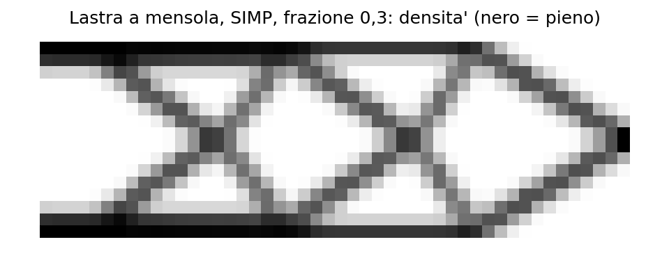
*Figure 1 — Cantilever plate, SIMP, fraction 0.3: density (black = solid, grey = intermediate density).*

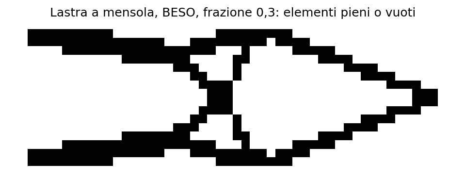
*Figure 2 — Cantilever plate, BESO, fraction 0.3: chords converging on the load and a central diagonal.*

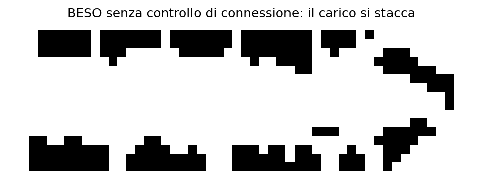
*Figure 3 — BESO without connection check: the load hangs on void elements only.*

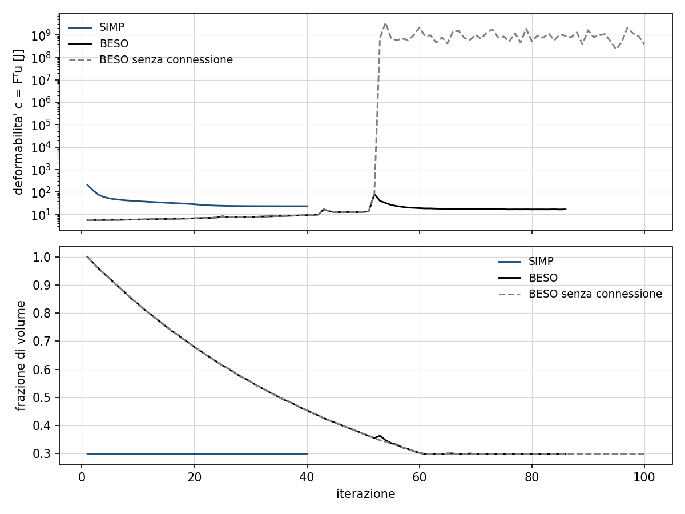
*Figure 4 — Compliance (log scale) and volume fraction per iteration. The BESO peak at iteration 52 is a detachment repaired by the connection check; without it, the compliance jumps to 10⁹ and stays there.*

## From the desktop GUI

The optimisation works on the shells of the open model (shells or plates are
needed). To repeat the worked example:

1. **Model.** Build the plate with **Modello > Genera piastra a maglia…** (or open
   a model with shells), clamp the left edge and put the force in case `Q`.
2. **Analisi > Ottimizzazione topologica (SIMP/BESO)…** opens the dialog
   (figure 5): method, volume fraction, maximum iterations, filter radius (empty =
   automatic, 1.5 times the shell size) and load cases with factors (`Q=1`, or
   `G=1 Q=1.5`).
3. **Esegui.** The result is the density map (figure 6): each shell has the
   colour of its own density, with no averaging at the nodes, so BESO shows only
   solid and void and SIMP its true intermediate densities. The log reports the
   summary table and the notes: iterations, fraction obtained with the
   threshold, shells of the reduced model and any warning (lowered threshold,
   volume left above the target).
4. **Risultati > Storia dell'ottimizzazione** plots compliance and volume
   fraction per iteration (figure 7).
5. **Risultati > Apri il modello ridotto** opens the model without the removed
   shells (figure 8), with the same vertical axis as the starting model and
   without the nodes left with no shells. It is analysed, checked and saved
   like any other model.

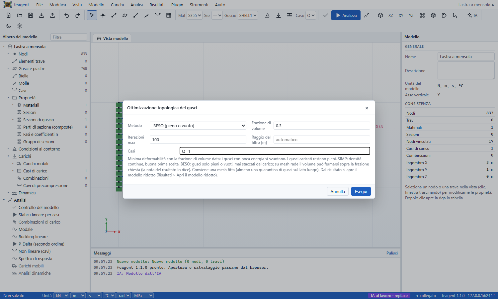
*Figure 5 — The topology optimisation dialog, with BESO and fraction 0.3.*

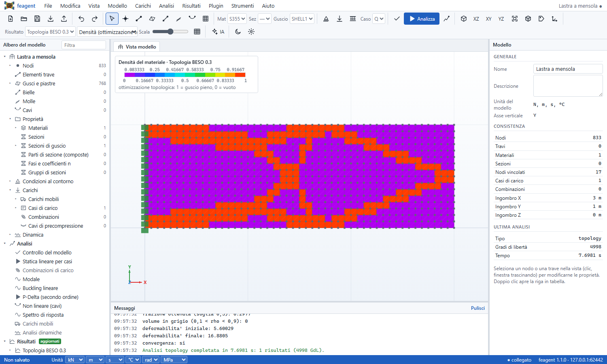
*Figure 6 — BESO density of the plate: solid (orange) or void (purple) shells.*

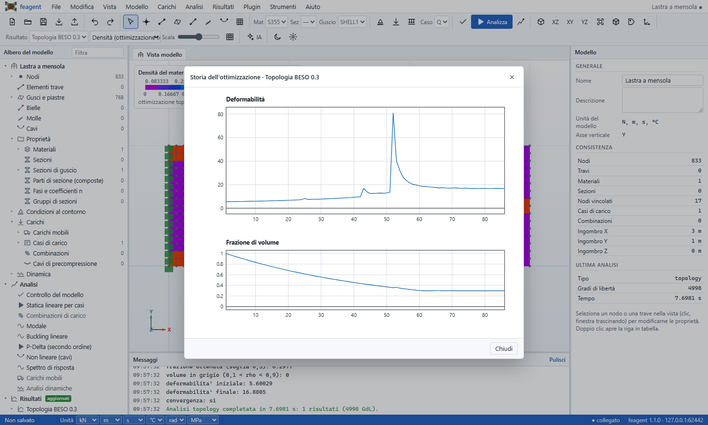
*Figure 7 — Optimisation history in the GUI.*

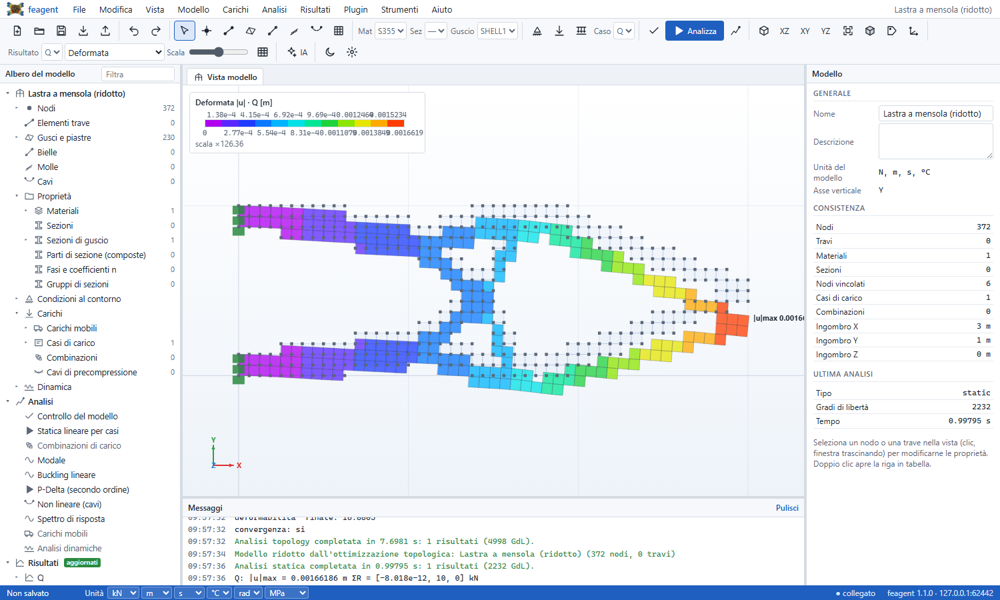
*Figure 8 — The reduced model reopened and re-analysed: 230 shells, deformed shape under load Q.*

## Messages and what to do

| Message | What it means | What to do |
|---|---|---|
| `BESO: frazione di volume ferma a … (chiesta …) per non staccare il carico dai vincoli` | on this mesh BESO finds no connected layout at the requested fraction | refine the mesh (about forty elements along the long side), raise the fraction or use SIMP |
| `modello ridotto SIMP: soglia abbassata da … a …` | cutting the grey left hinges on the load path | nothing: the reduced model is valid, with the volume shown; to get back to the requested volume refine the mesh or use BESO |
| `il modello ridotto è labile anche togliendo le parti appese` | even with a lower threshold, mechanisms remain that involve elements to keep solid | finer mesh; `modello_ridotto(threshold)` with a lower threshold; BESO |
| `con la soglia … elementi da tenere pieni restano staccati dai vincoli` | the threshold cuts the load path | lower threshold or finer mesh |
| `nodi caricati restano senza elementi` | with `carichi_pieni=False` the elements around the load were removed | keep `carichi_pieni=True` or lower the threshold |
| final compliance much larger than the initial one (GUI note) | the structure is detached from the load or from the supports | check supports and loads; higher fraction or finer mesh |
| `forze di volume … trattate come carico fisso` | the self-weight of the design elements does not decrease with the removed material | acceptable if the weight is small compared with the loads; otherwise optimise without self-weight and check the reduced model with it |

## The reduced model

`modello_ridotto(soglia)` is a copy of the model in which:

* elements below the threshold are removed. The default for SIMP is the
  threshold that keeps the requested volume; for BESO it is 0.5;
* **islands** are removed, i.e. parts that no path of shared nodes, beams or
  constraints connects to the supports;
* **parts hanging by an edge or a vertex** are removed. Between hexahedra
  these are hinges that would make the model a mechanism. Between shells a
  single shared vertex is one too (the drilling stiffness is not tied to the
  translations). They are found as the zero-energy modes of the reduced model
  stiffness, scaled by its diagonal. Without the scaling, the out-of-plane
  bending modes of a thin plate passed for mechanisms and the eigenvalue search
  did not converge; the number of modes sought now grows until all zero-energy
  motions are captured;
* with SIMP and the default threshold, cutting the grey may leave chains of
  elements joined by a vertex right on the load path. Removing them leaves a
  much more flexible model (48 × 16 cantilever plate, fraction 0.3: 305 instead
  of 12). The threshold is then lowered, up to +0.10 of volume, and the model
  with the lowest compliance per volume is kept. A warning reports the
  threshold used, which is stored in `soglia_ridotto`;
* body forces and thermal loads of the removed elements go with them, and
  nodes left without elements are fixed (the GUI removes them altogether, with
  their supports, so the reduced model does not show hundreds of useless
  supports).

If an element that must stay solid (loaded or passive) ends up detached from
the supports, the threshold cuts the load path: the module stops with an
explicit error rather than returning a model that sends the load straight to
the supports.

## Solver

Each iteration solves the linear system. With solids the sparse factorisation
is the expensive part, but densities change little between iterations. The
module therefore uses conjugate gradients preconditioned with the
factorisation of an earlier iteration (approximate reanalysis, Amir, Bendsøe
and Sigmund, IJNME 79, 2009), with relative tolerance 10⁻¹⁰. It refactorises
when more than 20 iterations are needed.

## Validation

**MBB beam against the 88-line code.** Half simply supported beam, 30 × 10 Q4
shells in plane (feagent's membrane is the bilinear quadrilateral of top88),
volume fraction 0.5, *p = 3*, *r = 1.5*. The comparison is with an independent
transcription of top88 inside the test: compliance history within 10⁻⁸
relative, densities within 10⁻⁶, same number of iterations. At 60 × 20 the
agreement is the same: 126 iterations, compliance 1007.02 → 218.80.

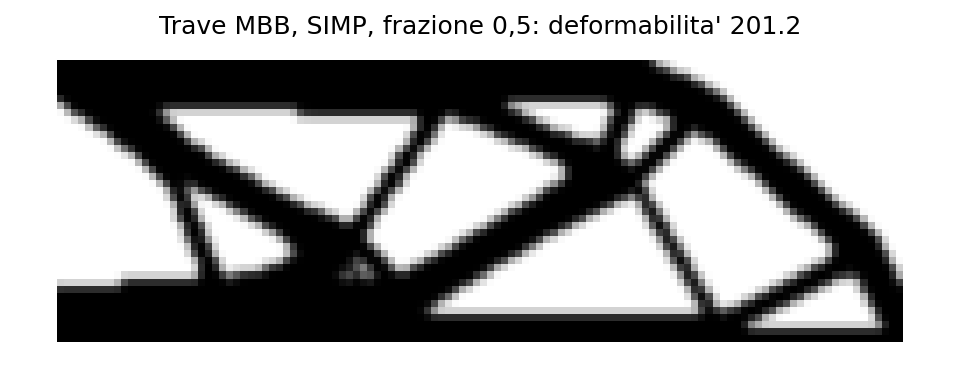
*Figure 9 — MBB beam 120 × 40, SIMP, volume fraction 0.5: 263 iterations, compliance 1026.8 → 201.2.*

**3D cantilever of hexahedra.** 24 × 6 × 12 hexahedra, fixed on one face,
tip load, volume fraction 0.25. The layout is symmetric about both mid planes
and the reduced model is in equilibrium.

| Method | Iterations | Optimisation compliance | Reduced model hexahedra | Reduced model compliance |
|---|---|---|---|---|
| SIMP | 77 | 137.19 | 451 of 1728 | 80.63 |
| BESO | 81 | 79.76 | 448 of 1728 | 79.84 |

With BESO the reduced model is the same layout: the compliances agree within
0.1 %. With SIMP the optimisation compliance includes the penalised
intermediate densities. In the reduced model the elements above the threshold
become solid, so the reduced model is stiffer than the grey layout. Both
methods reach the same chord-and-diagonal layout.

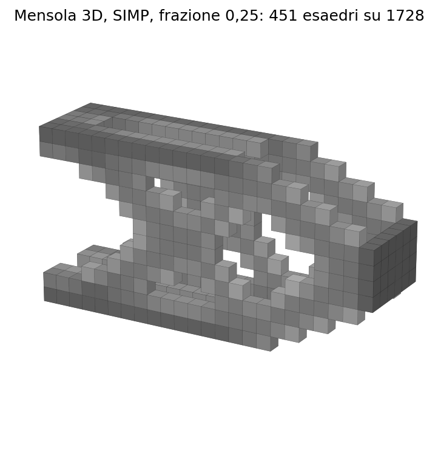
*Figure 10 — 3D cantilever, SIMP, elements above the volume-preserving threshold (grey = intermediate density).*

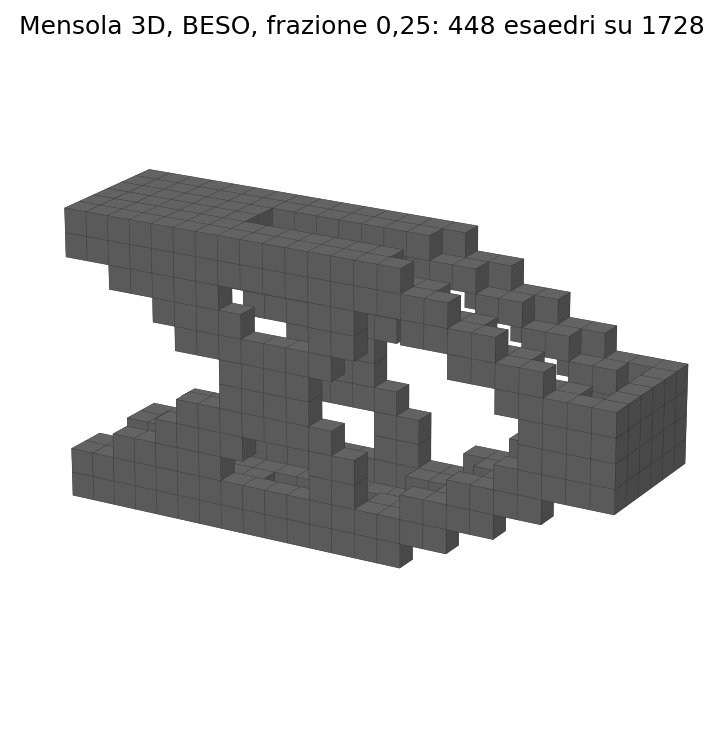
*Figure 11 — 3D cantilever, BESO: solid or void elements.*

**Deep beam.** Supports at the ends, distributed load on the top edge. The top
edge and the support zones stay solid. The result is the tied arch, the
strut-and-tie model of the deep beam.

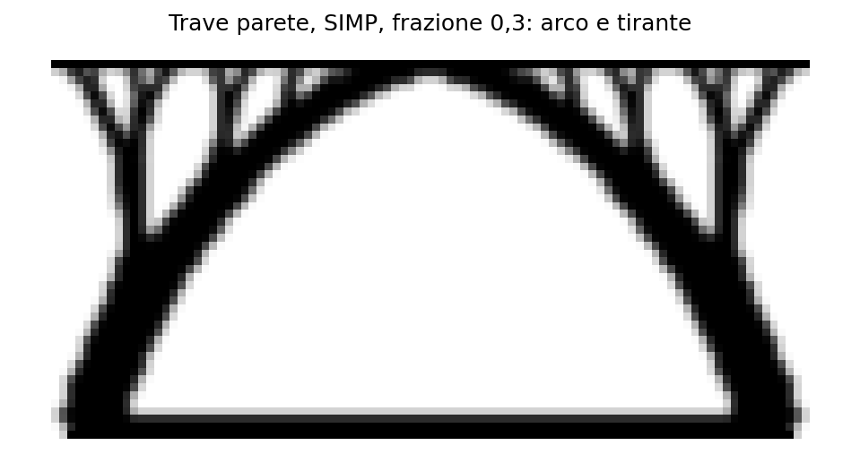
*Figure 12 — Deep beam 4 × 2 m, 96 × 48 shells, SIMP, volume fraction 0.3: tied arch.*

The other tests (`tests/test_topology.py`) check:

* that passive and void elements are respected;
* that two symmetric load cases give a symmetric layout, while case A alone
  does not;
* that a load carried through an equalDOF gives the same layout as a direct
  load;
* that a part hanging by an edge is removed from the reduced model;
* that BESO on a 48 × 16 shell cantilever plate with a point load, fraction 0.3,
  stays attached to the load: symmetric layout, compliance 16.9 against 23.2 for
  SIMP, reduced model in equilibrium (before: 3.9·10⁸ after 100 iterations); on
  the 24 × 8 mesh the layout is symmetric and a warning reports the volume left
  above the target;
* that SIMP on the same plate gives a solvable reduced model in equilibrium
  within a few seconds: at 0.3 with the lowered threshold (before: 137 s and a
  singular matrix), at 0.4 without (before: a spurious out-of-plane mechanism
  made it unavailable); and that a whole 5 mm plate is not flagged as a mechanism;
* the parameter errors.

Figure scripts: `examples/ex20_topologia.py` (validation), `examples/ex21_topologia_lastra.py` (worked example) and `scripts/_gen_gui_topology_screenshots.py` (GUI screenshots).
