# 62 - Examples from Cook, Malkus, Plesha

This page collects **all the worked examples** of the book *Concepts and Applications of Finite Element Analysis* (R.D. Cook, D.S. Malkus, M.E. Plesha, 3rd ed., Wiley, 1989) redone with feagent. For each example: reference in the book, feagent model, numerical comparison between the book value and feagent, notes (missing data, book misprints corrected, modelling differences). Texts are summarised in our own words; numerical data are given to redo the computation. The code of every example is in `validation/books/cook/`; to run them again:

```bash
python -m validation.books.run_books cook
python scripts/_gen_book_docs.py
```

**Outcome**: ✅ reproduced and compared; 🟡 partly reproduced (book data or results incomplete); 📐 derivation of formulas checked numerically; ⛔ not reproducible (reason in the notes). The *error* column is the largest relative error of the comparisons; *ref.* tells what the comparison is made against: book, exact solution or corrected value of a misprint.

**135 examples**: 36 reproduced, 19 partly, 77 derivations checked, 3 not reproducible; 785 numerical checks, 785 within tolerance.

## Summary

| Example | Title | Outcome | Checks | Max error |
|---|---|---|---|---|
| [Sez. 1.1, Fig. 1.1-1; Problema 1.1](#cook-1-1-tapered-bar-stepped-model) | Tapered bar modelled by uniform stepped elements | ✅ | 6/6 | 0.00 % |
| [Sez. 1.2, Eq. 1.2-1..1.2-4](#cook-1-2-bar-stiffness-direct) | Bar stiffness matrix by the direct method | 📐 | 6/6 | 0.00 % |
| [Sez. 1.2, Eq. 1.2-5..1.2-7](#cook-1-2-heat-current-bar) | Bar element for heat conduction and electric resistor | 📐 | 4/4 | 0.00 % |
| [Sez. 1.2, Eq. 1.2-8..1.2-14](#cook-1-2-beam-stiffness-direct) | Plane beam stiffness matrix by the direct method | 📐 | 10/10 | 0.00 % |
| [Sez. 1.3, Eq. 1.3-1..1.3-6](#cook-1-3-two-bar-series-assembly) | Assembly and solution of two bars in series | ✅ | 6/6 | 0.00 % |
| [Sez. 2.2-2.5, 3.3; Eq. 2.2-6, 2.3-8, 2.3-9](#cook-2-2-three-bar-truss) | Three-bar plane truss: structure stiffness and solution | ✅ | 13/13 | 0.00 % |
| [Sez. 2.4, Eq. 2.4-1..2.4-5](#cook-2-4-plane-truss-element) | Stiffness matrix of an inclined plane truss bar | 📐 | 10/10 | 0.00 % |
| [Sez. 2.6, Eq. 2.6-1..2.6-3](#cook-2-6-truss-weight-thermal-loads) | Equivalent nodal loads of bar self-weight and heating | 📐 | 8/8 | 0.00 % |
| [Sez. 2.7, Fig. 2.7-1..2.7-4](#cook-2-7-assembly-hypothetical-triangles) | Assembly driven by node numbers (hypothetical two-triangle structure) | 📐 | 10/10 | 0.00 % |
| [Sez. 2.8-2.10, Fig. 2.8-2, 2.8-3](#cook-2-8-bandwidth-numbering) | Node numbering and semibandwidth of a truss | ✅ | 2/2 | 0.00 % |
| [Sez. 2.10, Eq. 2.10-1](#cook-2-10-penalty-prescribed-displacement) | Prescribed displacement by penalty spring and by the zero-one method | 📐 | 5/5 | 0.00 % |
| [Sez. 2.11, Fig. 2.11-1; Problema 8.1](#cook-2-11-gauss-elimination-bars-in-series) | Three bars in series: Gauss elimination and its physical meaning | ✅ | 8/8 | 0.00 % |
| [Sez. 2.11, Fig. 2.11-2](#cook-2-11-singular-stiffness-cases) | Structures with singular K (beam with only rotations fixed, two collinear bars) | ✅ | 3/3 | 0.00 % |
| [Sez. 2.13 (Example), Fig. 2.13-1](#cook-2-13-three-bar-thermal-axial) | Three-element bar fixed at both ends with a force and partial heating | ✅ | 7/7 | 0.00 % |
| [Sez. 3.2, Eq. 3.2-1..3.2-6](#cook-3-2-spring-potential-energy) | Linear spring: stationary potential energy | 📐 | 3/3 | 0.00 % |
| [Sez. 3.3 (Example: Springs in Series), Eq. 3.3-3..3.3-5](#cook-3-3-springs-in-series) | Three springs in series with three loads | ✅ | 8/8 | 0.00 % |
| [Sez. 3.4 (Example: Bar Under Axial Load)](#cook-3-4-bar-end-load-and-heating) | Uniform bar with end load and uniform heating | ✅ | 2/2 | 0.00 % |
| [Sez. 3.5, Fig. 3.5-1, Eq. 3.5-3..3.5-9](#cook-3-5-bar-linear-load-rayleigh-ritz) | Bar with linear axial load q = cx: classical Rayleigh-Ritz with 1, 2, 3 terms | 📐 | 6/6 | 0.00 % |
| [Sez. 3.7, Eq. 3.7-8..3.7-15](#cook-3-7-bar-variational-derivation) | Bar with distributed load and end traction: Euler equation and natural boundary condition | 📐 | 4/4 | 0.00 % |
| [Sez. 3.9, Fig. 3.9-1, Eq. 3.9-6..3.9-12](#cook-3-9-bar-linear-load-three-elements) | Bar with linear load q = cx modelled by three linear elements | ✅ | 12/12 | 0.00 % |
| [Sez. 3.10, Eq. 3.10-1..3.10-9](#cook-3-10-heat-conduction-functional) | FE formulation of plane heat conduction from a functional | 📐 | 7/7 | 0.00 % |
| [Sez. 3.12, Eq. 3.12-2, 3.12-3, 3.12-6, 3.12-10](#cook-3-12-lagrange-shape-functions) | C0 shape functions: linear, quadratic (Lagrange) and bilinear | 📐 | 14/14 | 0.00 % |
| [Sez. 3.13, Eq. 3.13-1..3.13-4](#cook-3-13-hermite-cubic-shape-functions) | Cubic Hermite interpolation (beam shape functions) | 📐 | 8/8 | 0.00 % |
| [Sez. 4.2, Eq. 4.2-1..4.2-19](#cook-4-2-element-stiffness-overview) | Stiffness matrices of bar, beam, plane frame, CST, bilinear rectangle, trilinear brick | 📐 | 5/5 | 0.00 % |
| [Sez. 4.3, Fig. 4.3-1, Eq. 4.3-1, 4.3-2](#cook-4-3-bar-initial-strain-thermal) | Nodal loads of a bar too long by DeltaL and heated by T | 📐 | 3/3 | 0.00 % |
| [Sez. 4.3 (Example: Bar Element), Eq. 4.3-6..4.3-9](#cook-4-3-bar-consistent-loads) | Consistent loads of a bar with linear load and a point force at 2L/3 | 📐 | 4/4 | 0.00 % |
| [Sez. 4.3, Fig. 4.3-3..4.3-5, Eq. 4.3-10, 4.3-11](#cook-4-3-plane-solid-consistent-loads) | Consistent loads on linear and quadratic edges, force at a Q8 centre, loaded face | 📐 | 8/8 | 0.00 % |
| [Sez. 4.3, Fig. 4.3-6, Eq. 4.3-12](#cook-4-3-beam-consistent-loads) | Consistent beam loads for uniform q, midspan P and M | 📐 | 12/12 | 0.00 % |
| [Sez. 4.3 (Error Produced by Lumping), Fig. 4.3-7, Eq. 4.3-13, 4.3-14](#cook-4-3-cantilever-udl-lumped-vs-consistent) | Cantilever under uniform load: consistent versus lumped loads | ✅ | 12/12 | 0.81 % |
| [Sez. 4.4, 4.5, Fig. 4.4-1, 4.4-2, 4.5-1..4.5-3](#cook-4-4-equilibrium-compatibility) | Equilibrium and compatibility in the FE solution; convergence requirements | 📐 | 3/3 | 0.00 % |
| [Sez. 4.6, Fig. 4.6-1](#cook-4-6-patch-test-q4) | Patch test of four 4-node quadrilaterals under uniform sigma_x | ✅ | 4/4 | 0.00 % |
| [Sez. 4.7, Fig. 4.7-1, Eq. 4.7-3](#cook-4-7-bar-self-weight-fixed-ends) | Vertical bar under self-weight fixed at both ends: 1, 2, 4 elements | ✅ | 8/8 | 0.00 % |
| [Sez. 4.7 (Thermal Stress), Fig. 4.7-2, Eq. 4.7-4, 4.7-5](#cook-4-7-cst-linear-temperature) | Spurious stresses in a CST with a linear temperature field | 📐 | 5/5 | 0.00 % |
| [Sez. 4.7 (controesempio), Fig. 4.2-4](#cook-4-7-q4-beam-linear-temperature) | Beam between rigid walls with temperature linear through the depth (one bilinear element) | 📐 | 4/4 | 0.00 % |
| [Sez. 4.7, Fig. 4.7-3, Tabella 4.7-1, Eq. 4.7-8](#cook-4-7-plate-hole-stress-improvement) | Plate with a central hole: stress at the hole edge, standard and iterative methods | 🟡 | 5/5 | 0.80 % |
| [Sez. 5.1, Eq. 5.1-1..5.1-12](#cook-5-1-natural-coordinates-bar) | Linear natural coordinates and 2- and 3-node bar | 📐 | 6/6 | 0.00 % |
| [Sez. 5.2, Eq. 5.2-1..5.2-13](#cook-5-2-area-volume-coordinates) | Area and volume coordinates, derivatives and integration formulas | 📐 | 7/7 | 0.00 % |
| [Sez. 5.4, Eq. 5.4-1..5.4-7](#cook-5-4-cst-formulation) | Linear triangle: scalar field and constant-strain triangle (CST) | 📐 | 2/2 | 0.00 % |
| [Sez. 5.4, Fig. 5.4-1, Eq. 5.4-8, 5.4-9](#cook-5-4-cst-pure-bending) | CST in pure bending: wrong strains | 📐 | 4/4 | 0.00 % |
| [Sez. 5.4-5.5, Fig. 5.4-2](#cook-5-4-cantilever-cst-vs-lst) | Cantilever with parabolic end load: CST versus LST | ✅ | 6/6 | 0.74 % |
| [Sez. 5.5, Eq. 5.5-1..5.5-10](#cook-5-5-lst-formulation) | Straight-sided quadratic triangle (LST) | 📐 | 3/3 | 0.00 % |
| [Sez. 5.6, Fig. 5.6-1, Eq. 5.6-1](#cook-5-6-quadratic-tetrahedron) | Shape functions of the 10-node quadratic tetrahedron | 📐 | 12/12 | 0.00 % |
| [Sez. 6.2, Fig. 6.2-1, Eq. 6.2-1..6.2-7](#cook-6-2-isoparametric-bar-3-node) | Isoparametric 3-node bar and Jacobian | 📐 | 9/9 | 0.00 % |
| [Sez. 6.3-6.5, Eq. 6.3-1..6.3-21, Fig. 6.5-1, 6.5-2](#cook-6-3-q4-isoparametric) | Isoparametric bilinear quadrilateral: Jacobian, [B], [k], subroutines SHAPE and QUAD4 | 📐 | 3/3 | 0.00 % |
| [Sez. 6.4 (Example), Tabella 6.4-1, Eq. 6.4-3..6.4-8](#cook-6-4-gauss-quadrature) | Gauss quadrature: cubic polynomial example, 2D and 3D rules | 📐 | 5/5 | 0.00 % |
| [Sez. 6.6, Eq. 6.6-1..6.6-8, Tabella 6.6-1](#cook-6-6-quadratic-quadrilaterals) | Shape functions of 4- to 9-node quadrilaterals (serendipity and Lagrange) | 📐 | 9/9 | 0.00 % |
| [Sez. 6.7, Fig. 6.7-1, Eq. 6.7-1..6.7-6](#cook-6-7-hexahedral-elements) | Isoparametric hexahedral solid elements | 📐 | 2/2 | 0.00 % |
| [Sez. 6.8, Tabella 6.8-1, Eq. 6.8-1..6.8-8](#cook-6-8-triangle-isoparametric-quadrature) | Isoparametric triangles and integration rules on the triangle | 📐 | 6/6 | 0.00 % |
| [Sez. 6.9, Eq. 6.9-1](#cook-6-9-lst-body-force) | Uniform body force on a quadratic triangle: load only at mid-side nodes | 📐 | 2/2 | 0.00 % |
| [Sez. 6.10, 6.11, Fig. 6.10-1, 6.10-2](#cook-6-10-isoparametric-validity) | Validity of isoparametric elements; superparametric element failing the patch test; quadrature order | 📐 | 5/5 | 0.00 % |
| [Sez. 6.12, Fig. 6.12-1..6.12-3, Eq. 6.12-2..6.12-8](#cook-6-12-zero-energy-modes) | Zero-energy (hourglass) modes of Q4 with 1 point and of Q8/Q9 with 2x2 | 📐 | 9/9 | 0.00 % |
| [Sez. 6.12, Fig. 6.12-4](#cook-6-12-near-mechanism-beam) | Near mechanisms with reduced integration (cantilever with point load, rigid inclusion) | 🟡 | 4/4 | 1.57 % |
| [Sez. 6.13, Fig. 6.13-1..6.13-3, Eq. 6.13-2..6.13-5](#cook-6-13-gauss-point-stress-extrapolation) | Superconvergent points and stress extrapolation from Gauss points | 📐 | 6/6 | 0.02 % |
| [Sez. 6.14, Tabella 6.14-1](#cook-6-14-cantilever-q4-aspect-distortion) | Cantilever with bilinear elements: effect of aspect ratio and distortion | ✅ | 6/6 | 0.54 % |
| [Sez. 6.14, Tabella 6.14-2](#cook-6-14-cantilever-q8-q9-distortion) | Two-element quadratic cantilever (8 and 9 nodes): Gauss rule and distortion | 🟡 | 25/25 | 1.42 % |
| [Sez. 6.14, Fig. 6.14-1](#cook-6-14-badly-shaped-elements) | Badly shaped elements and negative Jacobian at Gauss points | 📐 | 4/4 | 0.00 % |
| [Sez. 7.2-7.3, Eq. 7.2-1..7.3-11](#cook-7-3-stress-strain-material-transformation) | Transformation of vectors, strains, stresses and material matrix | 📐 | 5/5 | 0.00 % |
| [Sez. 7.4-7.5, Fig. 7.5-1, 7.5-2, Eq. 7.5-1..7.5-7](#cook-7-5-truss-frame-transformation) | Transformation of plane truss, space truss and plane frame stiffness matrices | 📐 | 2/2 | 0.00 % |
| [Sez. 7.6, Fig. 7.6-1, Eq. 7.6-1..7.6-8](#cook-7-6-inclined-support) | Inclined support by transforming the nodal dofs | 📐 | 5/5 | 0.00 % |
| [Sez. 7.7, Fig. 7.7-1, Eq. 7.7-1..7.7-5](#cook-7-7-dissimilar-elements) | Connecting a frame or bar element to the side of a quadrilateral | 📐 | 3/3 | 0.00 % |
| [Sez. 7.8, Fig. 7.8-1, Eq. 7.8-1..7.8-4](#cook-7-8-rigid-link-stiffened-plate) | Eccentric beam connected to the plate by rigid links; coupling error | 🟡 | 3/3 | 1.47 % |
| [Sez. 7.8, Fig. 7.8-2, Eq. 7.8-5](#cook-7-8-rigid-triangle) | Plane triangle made rigid by a 3-dof transformation | 📐 | 2/2 | 0.00 % |
| [Sez. 8.1-8.2, Eq. 8.1-1..8.1-5, Fig. 8.1-1, 8.2-1, 8.2-2](#cook-8-1-static-condensation) | Static condensation, internal and nodeless dofs, recovery | 📐 | 5/5 | 0.00 % |
| [Sez. 8.3, Fig. 8.3-1, Eq. 8.3-1..8.3-5](#cook-8-3-bilinear-parasitic-shear) | Parasitic shear of the bilinear rectangle in pure bending | 📐 | 6/6 | 0.00 % |
| [Sez. 8.3, Fig. 8.3-3](#cook-8-3-cooks-membrane-qm6-q4) | Cook's membrane: QM6 versus bilinear | 🟡 | 17/17 | 0.63 % |
| [Sez. 8.4, Fig. 8.4-1, Eq. 8.4-1..8.4-9](#cook-8-4-drilling-dof-triangle) | Plane triangle with 'drilling' rotations obtained from the LST | 📐 | 4/4 | 0.00 % |
| [Sez. 8.5 (Example), Fig. 8.5-1, Eq. 8.5-1..8.5-16](#cook-8-5-hybrid-stress-rectangle) | Assumed-stress hybrid element (5-beta rectangle) | 📐 | 1/1 | 0.00 % |
| [Sez. 8.6, Fig. 8.6-1, 8.6-2](#cook-8-6-hybrid-drilling-triangle-membrane) | Cook's membrane with drilling-rotation triangles (Eq. 8.4-5 and hybrid macroelement) | 🟡 | 5/5 | 0.29 % |
| [Sez. 8.7 (Example), Eq. 8.7-1..8.7-9](#cook-8-7-elastic-kernel-beam) | Elastic kernel: rebuilding the full beam [k] | 📐 | 1/1 | 0.00 % |
| [Sez. 8.9, Fig. 8.9-1..8.9-4, Eq. 8.9-1..8.9-8](#cook-8-9-quarter-point-crack) | Quarter-point elements for the crack-tip singularity | 🟡 | 5/5 | 0.86 % |
| [Sez. 8.10, Fig. 8.10-1, Eq. 8.10-1, 8.10-2](#cook-8-10-winkler-foundation) | Stiffness matrix of a Winkler foundation | 📐 | 3/3 | 0.03 % |
| [Sez. 8.11, Fig. 8.11-1..8.11-3, Eq. 8.11-1..8.11-8](#cook-8-11-infinite-elements) | Mapped infinite elements in 1D and 2D | ⛔ | 0/0 | - |
| [Sez. 8.12-8.16, Fig. 8.14-1, 8.15-1, 8.16-1](#cook-8-14-substructuring-symmetry) | Finite differences, reanalysis, substructuring, symmetry and cyclic symmetry | 📐 | 2/2 | 0.00 % |
| [Sez. 9.1 (Example), Fig. 9.1-2, Eq. 9.1-7..9.1-9](#cook-9-1-bars-constraint-transformation) | Three bars with constraint u2 = u3 imposed by transformation | ✅ | 3/3 | 0.00 % |
| [Sez. 9.1, Fig. 9.1-3, Eq. 9.1-10](#cook-9-1-rigid-bar-two-springs) | Rigid bar on two springs with constraint v1 = v2 | ✅ | 3/3 | 0.00 % |
| [Sez. 9.2 (Example), Eq. 9.2-1..9.2-4](#cook-9-2-bars-lagrange-multiplier) | Three bars with constraint u2 = u3 imposed by a Lagrange multiplier | ✅ | 4/4 | 0.00 % |
| [Sez. 9.3 (Example), Fig. 9.3-1, Eq. 9.3-4..9.3-6](#cook-9-3-penalty-two-bars) | Two bars with constraint u1 = u2 imposed by a penalty function | ✅ | 5/5 | 0.00 % |
| [Sez. 9.4-9.5, Fig. 9.4-1, Eq. 9.4-1..9.4-5](#cook-9-4-mindlin-beam-locking) | Shear locking of a linear Mindlin beam element | 🟡 | 15/15 | 0.00 % |
| [Sez. 9.4-9.6, Fig. 9.5-1, 9.5-2, 9.6-1](#cook-9-4-incompressibility-constraint-counting) | Nearly incompressible materials, constraint counting and consistent penalty | 🟡 | 12/12 | 3.36 % |
| [Sez. 10.4, Fig. 10.4-1, Eq. 10.4-4](#cook-10-4-square-wave-fourier) | Fourier series of a square wave (uniform load on a span) | 📐 | 4/4 | 0.00 % |
| [Sez. 10.4, Eq. 10.4-5](#cook-10-4-point-load-fourier) | Fourier series of a midspan point load and beam deflection | 📐 | 2/2 | 0.00 % |
| [Sez. 10.4, Eq. 10.4-6..10.4-12, Fig. 10.4-2](#cook-10-4-ss-beam-sine-load) | Simply supported beam under sinusoidal load: uncoupled harmonic solution | ✅ | 3/3 | 0.32 % |
| [Sez. 11.3, Fig. 11.3-2, Tabella 11.3-1](#cook-11-3-mindlin-clamped-square-plate) | Clamped square plate with Mindlin elements: locking as L/t varies | 🟡 | 4/4 | 1.14 % |
| [Sez. 11.4, Tabella 11.4-1, Fig. 11.4-2](#cook-11-4-dkt-square-plates) | DKT element: centre deflection of square plates | ✅ | 16/16 | 0.04 % |
| [Sez. 11.4, Fig. 11.4-3](#cook-11-4-dkt-stiffness-code) | 9x9 stiffness matrix of the DKT element | 📐 | 4/4 | 0.00 % |
| [Sez. 11.5, Fig. 11.5-2](#cook-11-5-rhombic-plate) | Simply supported rhombic plate (Morley): classical and 'finite element' support conditions | ✅ | 4/4 | 2.93 % |
| [Sez. 11.5, Fig. 11.5-3](#cook-11-5-patch-test-curvature) | Constant-curvature patch test for plate elements | ✅ | 8/8 | 0.00 % |
| [Sez. 11.5, Fig. 11.5-4](#cook-11-5-twisted-ribbon) | Twisted ribbon: thin cantilever loaded by corner forces for varying length | 🟡 | 4/4 | 3.05 % |
| [Sez. 12.2, Fig. 12.2-1a](#cook-12-2-semicircular-arch) | Clamped semicircular arch with crown load: straight elements | 🟡 | 3/3 | 36.69 % |
| [Sez. 12.2, Eq. 12.2-12](#cook-12-2-curved-element-rigid-body) | Curved arch element with an internal mode: spurious rigid-body energy | ⛔ | 0/0 | - |
| [Sez. 12.3, Eq. 12.3-4](#cook-12-3-drilling-stiffness) | Fictitious stiffness for the normal (drilling) rotation in flat shells | 📐 | 6/6 | 0.00 % |
| [Sez. 12.4, Fig. 12.4-4](#cook-12-4-cylinder-internal-pressure) | Open-ended cylinder under internal pressure: meridional moment near the edge | 🟡 | 3/3 | 0.73 % |
| [Sez. 13.3, Eq. 13.3-1..13.3-3, Fig. 13.3-1](#cook-13-3-bar-beam-mass-matrices) | Consistent and lumped mass matrices of bar and beam | 📐 | 4/4 | 0.00 % |
| [Sez. 13.3, Fig. 13.3-2](#cook-13-3-cst-q4-consistent-mass) | Consistent mass matrices of CST and bilinear rectangle | 📐 | 2/2 | 0.00 % |
| [Sez. 13.3, Eq. 13.3-4, 13.3-5, Fig. 13.3-3](#cook-13-3-hrz-lumping) | HRZ diagonal masses of bar, beam, Q8 and Q9 | 📐 | 13/13 | 0.00 % |
| [Sez. 13.3, Tabella 13.3-1](#cook-13-3-thick-plate-frequencies-mass) | Frequencies of a thick simply supported plate: consistent and lumped mass | 🟡 | 7/7 | 6.34 % |
| [Sez. 13.3, Eq. 13.3-6..13.3-9, Fig. 13.3-4](#cook-13-3-optimal-lumping-quadratic-bar) | Optimal mass lumping: quadratic bar, T6, Q8, Q9 | 📐 | 9/9 | 0.00 % |
| [Sez. 13.4, Eq. 13.4-1..13.4-3, Fig. 13.4-1](#cook-13-4-rayleigh-damping) | Rayleigh damping: coefficients from two damping ratios | 📐 | 4/4 | 0.00 % |
| [Sez. 13.5, Eq. 13.5-8..13.5-10, Fig. 13.5-1](#cook-13-5-free-bar-eigen) | Free bar with one element: eigenvalues with consistent and lumped mass | ✅ | 3/3 | 0.00 % |
| [Sez. 13.7, Fig. 13.7-1](#cook-13-7-cantilever-plate-guyan) | Square cantilever plate: first 4 frequencies, full system and Guyan reduction | 🟡 | 8/8 | 4.40 % |
| [Sez. 13.7, Eq. 13.7-8..13.7-13, Fig. 13.7-2](#cook-13-7-beam-guyan) | One-element beam: eigenvalues, Guyan reduction and lumped mass | ✅ | 8/8 | 0.00 % |
| [Sez. 13.8, Eq. 13.8-6..13.8-14, Tabella 13.8-1, Fig. 13.8-1](#cook-13-8-cms-bar) | Component mode synthesis (CMS1 and Craig-Bampton) of a stepped bar | ✅ | 16/16 | 0.08 % |
| [Sez. 13.10, Fig. 13.10-2..13.10-5](#cook-13-10-bar-wave-propagation) | Wave propagation in a bar with central differences | ✅ | 6/6 | 0.22 % |
| [Sez. 13.12, Eq. 13.12-5..13.12-7, Tabella 13.12-1](#cook-13-12-newmark-stability-table) | Newmark family: stability limits | 📐 | 5/5 | 0.00 % |
| [Sez. 13.13, Eq. 13.13-1..13.13-26, Fig. 13.13-2](#cook-13-13-period-error) | Period error of central differences and the trapezoidal rule | 📐 | 8/8 | 0.00 % |
| [Sez. 14.1, Eq. 14.1-1..14.1-9, Fig. 14.1-1](#cook-14-1-beam-column-energy) | Simply supported beam-column: stress stiffening and Euler load | 📐 | 4/4 | 0.05 % |
| [Sez. 14.2, Eq. 14.2-9, 14.2-11; Sez. 14.4, Eq. 14.4-9](#cook-14-2-stress-stiffness-beam-bar) | Stress-stiffness matrices of beam and bar | 📐 | 2/2 | 0.00 % |
| [Sez. 14.4, Eq. 14.4-10..14.4-16, Fig. 14.4-1](#cook-14-4-one-bar-large-rotation) | One-element bar with Green-Lagrange strain: rigid rotation and linearization | 📐 | 4/4 | 0.00 % |
| [Sez. 14.5, Fig. 14.5-1](#cook-14-5-shallow-two-bar-snap) | Inclined hinged elastic bar: linearized critical load and nonlinear collapse | 🟡 | 4/4 | 0.12 % |
| [Sez. 14.5, Eq. 14.5-8..14.5-10, Fig. 14.5-2](#cook-14-5-cantilever-column-buckling) | Cantilever column: critical load with one beam element | ✅ | 3/3 | 0.01 % |
| [Sez. 14.5, Eq. 14.5-11, 14.5-12](#cook-14-5-buckling-condensation) | Condensation of the rotation in cantilever buckling | ✅ | 2/2 | 0.00 % |
| [Sez. 15.3, Eq. 15.3-1..15.3-14, Tabella 15.3-1, Fig. 15.3-1](#cook-15-3-weighted-residual-bar) | Weighted-residual methods on a bar with linear axial load | 📐 | 13/13 | 0.04 % |
| [Sez. 15.4, Eq. 15.4-1..15.4-20](#cook-15-4-galerkin-bar-beam) | Galerkin for the bar and for beam dynamics: the standard matrices | 📐 | 4/4 | 0.00 % |
| [Sez. 15.4, Eq. 15.4-21..15.4-24, Fig. 15.4-3](#cook-15-4-heat-bar-galerkin) | Steady conduction in a bar: 2-node Galerkin element | 📐 | 3/3 | 0.00 % |
| [Sez. 15.6, Eq. 15.6-1..15.6-7](#cook-15-6-quasiharmonic-galerkin) | 2D quasi-harmonic equation: Galerkin conductivity matrix and vectors | 📐 | 2/2 | 0.00 % |
| [Sez. 16.2, Eq. 16.2-1..16.2-8, Fig. 16.2-1](#cook-16-2-heat-bar-convection) | Bar with conduction, lateral convection and source: matrices and solution | 📐 | 3/3 | 0.01 % |
| [Sez. 16.5, Eq. 16.5-5..16.5-10, Fig. 16.5-1](#cook-16-5-q4-heat-matrices) | Q4 element for conduction: edge convection and point source | 📐 | 4/4 | 0.00 % |
| [Sez. 16.6, Eq. 16.6-6..16.6-9](#cook-16-6-thermal-transient-trapezoid) | Thermal transients: generalized trapezoidal rule and critical step | 📐 | 7/7 | 0.00 % |
| [Sez. 16.7, Fig. 16.7-1](#cook-16-7-potential-flow-cylinder) | Potential flow around a cylinder in a channel: potential and stream function | 🟡 | 2/2 | 1.12 % |
| [Sez. 16.9, Eq. 16.9-7, 16.9-8, Fig. 16.9-2b](#cook-16-9-slosh-one-element) | Liquid sloshing in a tank with one 'mock-fluid' element | ✅ | 3/3 | 0.00 % |
| [Sez. 16.9, Eq. 16.9-9, 16.9-10, Fig. 16.9-2c](#cook-16-9-acoustic-pipe-spring) | Acoustic modes of air in a pipe with two elements | ✅ | 3/3 | 0.03 % |
| [Sez. 17.2, Eq. 17.2-1..17.2-16, Fig. 17.2-1..17.2-9](#cook-17-2-nonlinear-spring-methods) | Nonlinear spring: direct substitution, Newton-Raphson, modified Newton | 📐 | 4/4 | 0.00 % |
| [Sez. 17.3, Eq. 17.3-1..17.3-7, Fig. 17.3-1..17.3-3](#cook-17-3-tapered-bar-plasticity) | Elastic-plastic tapered bar: incremental tangent-stiffness method | 📐 | 3/3 | 0.00 % |
| [Sez. 17.4, Eq. 17.4-16..17.4-19](#cook-17-4-uniaxial-plasticity) | Uniaxial von Mises plasticity with kinematic hardening | 📐 | 4/4 | 0.00 % |
| [Sez. 17.6, Fig. 17.6-1, 17.6-2](#cook-17-6-bar-dynamic-plasticity) | Elastic and plastic waves in an elastic-plastic bar (central differences) | ✅ | 4/4 | 4.08 % |
| [Sez. 17.7, Eq. 17.7-2..17.7-7, Fig. 17.7-1a](#cook-17-7-cantilever-tip-moment) | Cantilever under a tip moment in large rotations (planar corotational) | ✅ | 5/5 | 0.10 % |
| [Sez. 18.2, Eq. 18.2-1..18.2-3, Fig. 18.2-1](#cook-18-2-ill-conditioning-springs) | Ill-conditioning: nearly singular system and stiff spring on a soft spring | 📐 | 5/5 | 0.00 % |
| [Sez. 18.3, Fig. 18.3-1, Eq. 18.3-1..18.3-10](#cook-18-3-condition-bar) | Condition number: two-element bar and growth estimates | 📐 | 4/4 | 1.54 % |
| [Sez. 18.4, Tabella 18.4-1](#cook-18-4-diagonal-decay-cantilever) | Diagonal decay ratios and node numbering in a long cantilever | 🟡 | 19/19 | 0.83 % |
| [Sez. 18.6, Eq. 18.6-1..18.6-9, Fig. 18.6-1](#cook-18-6-bar-discretization-error) | Discretization error in a bar under distributed load | 📐 | 4/4 | 0.00 % |
| [Sez. 18.7, Eq. 18.7-3, Fig. 18.7-1](#cook-18-7-laplacian-mesh-estimate) | A priori estimate of relative error on a graded mesh | ⛔ | 0/0 | - |
| [Sez. 18.7, Fig. 18.7-4, Tabella 18.7-1](#cook-18-7-cantilever-regular-refinement) | Cantilever with bilinear elements: regular refinement and Richardson extrapolation | ✅ | 17/17 | 0.37 % |
| [Sez. 18.7, Fig. 18.7-6](#cook-18-7-beam-with-hole-irregular) | Cantilever with a large central hole: maximum stress under mesh refinement | 🟡 | 2/2 | 3.27 % |
| [Sez. 18.8, Fig. 18.8-1, Eq. 18.8-1, 18.8-2](#cook-18-8-q4-eigenvalue-test) | Eigenvalues of the stiffness matrix of a square plane-strain Q4 | ✅ | 8/8 | 0.00 % |
| [Sez. 18.8, Fig. 18.8-2](#cook-18-8-single-element-cantilever-test) | Single-element test: cantilever in pure bending for varying L/H | ✅ | 8/8 | 0.00 % |

## Chapter 1

<a id="cook-1-1-tapered-bar-stepped-model"></a>

### Sez. 1.1, Fig. 1.1-1; Problema 1.1 - Tapered bar modelled by uniform stepped elements

✅ · PDF page 22 · bar

Bar of length L fixed at one end and pulled by P at the other, with area varying linearly from 3A0 at the support to A0 at the free end. The book asks for the error of stepped models with 1-4 elements and prints the exact displacement u = P L ln3 / (2 E A0) = 0.5493 P L/(E A0).

**Model**: feagent L2 bars (add_bar) in series, 1, 2, 3, 4 and 64 elements; element area = true area at mid-element, or nodal areas (tapered bar): for the L2 the two choices coincide.

| Quantity | Ref. | Reference | feagent | Error | |
|---|---|---|---|---|---|
| Exact u P L ln3/(2 E A0) [PL/EA0] | book | 0.5493 | 0.54931 | 0.00 % | ✅ |
| u, 1 stepped elements (sum over steps) [PL/EA0] | exact | 0.5 | 0.5 | 0.00 % | ✅ |
| u, 2 stepped elements (sum over steps) [PL/EA0] | exact | 0.53333 | 0.53333 | 0.00 % | ✅ |
| u, 3 stepped elements (sum over steps) [PL/EA0] | exact | 0.54167 | 0.54167 | 0.00 % | ✅ |
| u, 4 stepped elements (sum over steps) [PL/EA0] | exact | 0.54488 | 0.54488 | 0.00 % | ✅ |
| u, 64 bars with nodal areas [PL/EA0] | exact | 0.54931 | 0.54929 | 0.00 % | ✅ |

**Notes**: Non-dimensional data P = L = E = A0 = 1. The book does not print the stepped-model values: they are compared with the closed-form sum over the steps (exact for the stepped model) and with the exact tapered-bar displacement. One element gives -9.0 % error, four elements -0.7 %.

*Code*: `validation/books/cook/ch01.py`

<a id="cook-1-2-bar-stiffness-direct"></a>

### Sez. 1.2, Eq. 1.2-1..1.2-4 - Bar stiffness matrix by the direct method

📐 · PDF page 28 · bar

The stiffness of a bar follows from unit displacements at its two ends: [k] = AE/L [[1, -1], [-1, 1]].

**Model**: feagent truss (add_truss) and isoparametric L2 bar (add_bar) with A = 2, E = 3, L = 4 along an inclined direction.

| Quantity | Ref. | Reference | feagent | Error | |
|---|---|---|---|---|---|
| truss: k11 [F/L] | exact | 1.5 | 1.5 | 0.00 % | ✅ |
| truss: k12 [F/L] | exact | -1.5 | -1.5 | 0.00 % | ✅ |
| truss: k22 [F/L] | exact | 1.5 | 1.5 | 0.00 % | ✅ |
| L2 bar: k11 [F/L] | exact | 1.5 | 1.5 | 0.00 % | ✅ |
| L2 bar: k12 [F/L] | exact | -1.5 | -1.5 | 0.00 % | ✅ |
| L2 bar: k22 [F/L] | exact | 1.5 | 1.5 | 0.00 % | ✅ |

**Notes**: The 6x6 feagent matrix is projected on the bar axis and compared term by term with AE/L.

*Code*: `validation/books/cook/ch01.py`

<a id="cook-1-2-heat-current-bar"></a>

### Sez. 1.2, Eq. 1.2-5..1.2-7 - Bar element for heat conduction and electric resistor

📐 · PDF page 29 · heat_steady

The bar matrix also governs 1D conduction (Ak/L [[1,-1],[-1,1]] on temperatures) and an electric resistor (1/r [[1,-1],[-1,1]] on voltages).

**Model**: FieldModel('heat') with L2 elements (area A, conductivity k); for the resistor k = 1/r with A = L = 1. Two elements in series solved with prescribed end temperatures (voltages).

| Quantity | Ref. | Reference | feagent | Error | |
|---|---|---|---|---|---|
| Thermal k11 = A k / L [W/K] | exact | 10 | 10 | 0.00 % | ✅ |
| Thermal k12 = -A k / L [W/K] | exact | -10 | -10 | 0.00 % | ✅ |
| Voltage at the middle node [V] | exact | 6 | 6 | 0.00 % | ✅ |
| Current entering node 1 [A] | exact | 2 | 2 | 0.00 % | ✅ |

**Notes**: Trial values A = 0.5, k = 40, L = 2; resistors r1 = 2, r2 = 3 with V = 10 and 0 at the ends: current I = 2 and middle voltage 6.

*Code*: `validation/books/cook/ch01.py`

<a id="cook-1-2-beam-stiffness-direct"></a>

### Sez. 1.2, Eq. 1.2-8..1.2-14 - Plane beam stiffness matrix by the direct method

📐 · PDF page 30 · beam

The beam stiffness columns follow from activating one dof at a time: unit tip deflection (12EI/L^3, 6EI/L^2) and unit rotation (4EI/L, 2EI/L).

**Model**: One feagent Euler-Bernoulli beam (EI = 6, L = 2); columns of [k] obtained as reactions with a single prescribed dof (add_settlement) and the others fixed, as in the book.

| Quantity | Ref. | Reference | feagent | Error | |
|---|---|---|---|---|---|
| k11 (reaction) | exact | 9 | 9 | 0.00 % | ✅ |
| k21 (reaction) | exact | 9 | 9 | 0.00 % | ✅ |
| k31 (reaction) | exact | -9 | -9 | 0.00 % | ✅ |
| k41 (reaction) | exact | 9 | 9 | 0.00 % | ✅ |
| k22 (reaction) | exact | 12 | 12 | 0.00 % | ✅ |
| k32 (reaction) | exact | -9 | -9 | 0.00 % | ✅ |
| k42 (reaction) | exact | 6 | 6 | 0.00 % | ✅ |
| k33 (reaction) | exact | 9 | 9 | 0.00 % | ✅ |
| k43 (reaction) | exact | -9 | -9 | 0.00 % | ✅ |
| k44 (reaction) | exact | 12 | 12 | 0.00 % | ✅ |

**Notes**: Compared with Eq. 4.2-5 of the book, dofs (v1, theta1, v2, theta2).

*Code*: `validation/books/cook/ch01.py`

<a id="cook-1-3-two-bar-series-assembly"></a>

### Sez. 1.3, Eq. 1.3-1..1.3-6 - Assembly and solution of two bars in series

✅ · PDF page 32 · bar

Assembly of two bars in series and solution: u1 = -P/k1 - P/k2, u2 = -P/k2, sigma_i = -P/A_i.

**Model**: Two trusses in series (node 3 fixed on the left, node 1 at the right end) with A1 = 2, E1 = 100, L1 = 1 and A2 = 1, E2 = 200, L2 = 4; P = 10 along -x at node 1 (compression).

| Quantity | Ref. | Reference | feagent | Error | |
|---|---|---|---|---|---|
| Assembled K22 = k1 + k2 [F/L] | exact | 250 | 250 | 0.00 % | ✅ |
| Assembled K12 = -k1 [F/L] | exact | -200 | -200 | 0.00 % | ✅ |
| u1 [L] | exact | -0.25 | -0.25 | 0.00 % | ✅ |
| u2 [L] | exact | -0.2 | -0.2 | 0.00 % | ✅ |
| sigma1 [F/L2] | exact | -5 | -5 | 0.00 % | ✅ |
| sigma2 [F/L2] | exact | -10 | -10 | 0.00 % | ✅ |

**Notes**: Symbolic example: trial numbers. The assembled feagent matrix is also compared with [[k1,-k1,0],[-k1,k1+k2,-k2],[0,-k2,k2]].

*Code*: `validation/books/cook/ch01.py`

## Chapter 2

<a id="cook-2-2-three-bar-truss"></a>

### Sez. 2.2-2.5, 3.3; Eq. 2.2-6, 2.3-8, 2.3-9 - Three-bar plane truss: structure stiffness and solution

✅ · PDF page 52 · truss

The book builds the 6x6 stiffness of the three-bar truss by activating one dof at a time (Eq. 2.2-6), reduces it to the active dofs u1, v1, v3 (Eq. 2.3-8) and writes the reactions (Eq. 2.3-9); the unsupported [K] has rank 3.

**Model**: Three feagent trusses (nodes 2 = (0,0), 3 = (0,4), 1 = (3,0)); areas chosen to give k1 = 2, k2 = 3, k3 = 5 with E = 1; pin at 2, vertical roller at 3, P = 1 downwards at node 1.

| Quantity | Ref. | Reference | feagent | Error | |
|---|---|---|---|---|---|
| Reduced K (u1, u1), Eq. 2.3-8 [F/L] | exact | 6.08 | 6.08 | 0.00 % | ✅ |
| Reduced K (u1, v1), Eq. 2.3-8 [F/L] | exact | -1.44 | -1.44 | 0.00 % | ✅ |
| Reduced K (u1, v3), Eq. 2.3-8 [F/L] | exact | 1.44 | 1.44 | 0.00 % | ✅ |
| Reduced K (v1, v1), Eq. 2.3-8 [F/L] | exact | 1.92 | 1.92 | 0.00 % | ✅ |
| Reduced K (v1, v3), Eq. 2.3-8 [F/L] | exact | -1.92 | -1.92 | 0.00 % | ✅ |
| Reduced K (v3, v3), Eq. 2.3-8 [F/L] | exact | 3.92 | 3.92 | 0.00 % | ✅ |
| rank of unsupported 6x6 [K] | exact | 3 | 3 | 0.00 % | ✅ |
| u1 (solution of Eq. 2.3-8) [L] | exact | -0.15 | -0.15 | 0.00 % | ✅ |
| v1 (solution of Eq. 2.3-8) [L] | exact | -1.1333 | -1.1333 | 0.00 % | ✅ |
| v3 (solution of Eq. 2.3-8) [L] | exact | -0.5 | -0.5 | 0.00 % | ✅ |
| reaction p2, Eq. 2.3-9 [F] | exact | 0.75 | 0.75 | 0.00 % | ✅ |
| reaction q2, Eq. 2.3-9 [F] | exact | 1 | 1 | 0.00 % | ✅ |
| reaction p3, Eq. 2.3-9 [F] | exact | -0.75 | -0.75 | 0.00 % | ✅ |

**Notes**: The book is symbolic (no numbers): the feagent [K] is compared term by term with Eq. 2.3-8 evaluated with the trial k, the solution with that of system 2.3-8 and the reactions with Eq. 2.3-9.

*Code*: `validation/books/cook/ch02.py`

<a id="cook-2-4-plane-truss-element"></a>

### Sez. 2.4, Eq. 2.4-1..2.4-5 - Stiffness matrix of an inclined plane truss bar

📐 · PDF page 56 · truss

The stiffness of a bar inclined at beta is AE/L [[c², cs, -c², -cs], ...] with c = cos beta, s = sin beta (Eq. 2.4-5).

**Model**: feagent truss from (1, 2) to (1 + 4 cos 30°, 2 + 4 sin 30°), A = 1.5, E = 2.

| Quantity | Ref. | Reference | feagent | Error | |
|---|---|---|---|---|---|
| k11 [F/L] | exact | 0.5625 | 0.5625 | 0.00 % | ✅ |
| k12 [F/L] | exact | 0.32476 | 0.32476 | 0.00 % | ✅ |
| k13 [F/L] | exact | -0.5625 | -0.5625 | 0.00 % | ✅ |
| k14 [F/L] | exact | -0.32476 | -0.32476 | 0.00 % | ✅ |
| k22 [F/L] | exact | 0.1875 | 0.1875 | 0.00 % | ✅ |
| k23 [F/L] | exact | -0.32476 | -0.32476 | 0.00 % | ✅ |
| k24 [F/L] | exact | -0.1875 | -0.1875 | 0.00 % | ✅ |
| k33 [F/L] | exact | 0.5625 | 0.5625 | 0.00 % | ✅ |
| k34 [F/L] | exact | 0.32476 | 0.32476 | 0.00 % | ✅ |
| k44 [F/L] | exact | 0.1875 | 0.1875 | 0.00 % | ✅ |

**Notes**: All 16 terms compared on the dofs (u1, v1, u2, v2).

*Code*: `validation/books/cook/ch02.py`

<a id="cook-2-6-truss-weight-thermal-loads"></a>

### Sez. 2.6, Eq. 2.6-1..2.6-3 - Equivalent nodal loads of bar self-weight and heating

📐 · PDF page 60 · truss, thermal

The bar weight W goes to the nodes as W/2 downwards (Eq. 2.6-1); uniform heating T gives {r} = alpha E A T [-c, -s, c, s] (Eq. 2.6-3).

**Model**: feagent L2 bar inclined at 30° (A = 2, E = 3, L = 5, alpha = 1e-3, T = 40, weight density 0.7 along -y): nodal forces from equivalent_body_force and equivalent_thermal_load; truss weight with add_truss_self_weight.

| Quantity | Ref. | Reference | feagent | Error | |
|---|---|---|---|---|---|
| peso: v1 = -W/2 [F] | exact | -3.5 | -3.5 | 0.00 % | ✅ |
| peso: v2 = -W/2 [F] | exact | -3.5 | -3.5 | 0.00 % | ✅ |
| peso: u1 = 0 [F] | exact | 0 | 0 | 0.00 % | ✅ |
| thermal: u1 [F] | exact | -0.20785 | -0.20785 | 0.00 % | ✅ |
| thermal: v1 [F] | exact | -0.12 | -0.12 | 0.00 % | ✅ |
| thermal: u2 [F] | exact | 0.20785 | 0.20785 | 0.00 % | ✅ |
| thermal: v2 [F] | exact | 0.12 | 0.12 | 0.00 % | ✅ |
| truss weight at node 2 [F] | exact | -3.5 | -3.5 | 0.00 % | ✅ |

**Notes**: Trial values; the feagent forces are those applied to the nodes.

*Code*: `validation/books/cook/ch02.py`

<a id="cook-2-7-assembly-hypothetical-triangles"></a>

### Sez. 2.7, Fig. 2.7-1..2.7-4 - Assembly driven by node numbers (hypothetical two-triangle structure)

📐 · PDF page 61 · assembly

The book shows how the element-matrix coefficients land in the global [K] following the node numbers (array NOD, Eq. 2.7-4).

**Model**: FieldModel with two T3 triangles with one dof per node (element 1: nodes 1, 4, 2; element 2: nodes 4, 3, 2), as in the hypothetical structure of the book.

| Quantity | Ref. | Reference | feagent | Error | |
|---|---|---|---|---|---|
| Assembled K11 vs hand scatter | exact | 1.3951 | 1.3951 | 0.00 % | ✅ |
| Assembled K12 vs hand scatter | exact | -0.34568 | -0.34568 | 0.00 % | ✅ |
| Assembled K13 vs hand scatter | exact | 0 | 0 | 0.00 % | ✅ |
| Assembled K14 vs hand scatter | exact | -1.0494 | -1.0494 | 0.00 % | ✅ |
| Assembled K22 vs hand scatter | exact | 2.3506 | 2.3506 | 0.00 % | ✅ |
| Assembled K23 vs hand scatter | exact | -0.74599 | -0.74599 | 0.00 % | ✅ |
| Assembled K24 vs hand scatter | exact | -1.2589 | -1.2589 | 0.00 % | ✅ |
| Assembled K33 vs hand scatter | exact | 1.8128 | 1.8128 | 0.00 % | ✅ |
| Assembled K34 vs hand scatter | exact | -1.0668 | -1.0668 | 0.00 % | ✅ |
| Assembled K44 vs hand scatter | exact | 3.3752 | 3.3752 | 0.00 % | ✅ |

**Notes**: The feagent assembled [K] is compared with the element matrices scattered by hand according to the connectivity; K13 = 0 is checked (nodes 1 and 3 share no element).

*Code*: `validation/books/cook/ch02.py`

<a id="cook-2-8-bandwidth-numbering"></a>

### Sez. 2.8-2.10, Fig. 2.8-2, 2.8-3 - Node numbering and semibandwidth of a truss

✅ · PDF page 65 · truss, assembly

The semibandwidth b depends on the largest node-number difference within an element: b = 6 with the good numbering, b = 12 with the poor one.

**Model**: Six-node, nine-bar plane truss of Fig. 2.8-2 (indicative coordinates, only connectivity matters) with the good and the poor numbering; semibandwidth of the feagent [K] ordered by node number.

| Quantity | Ref. | Reference | feagent | Error | |
|---|---|---|---|---|---|
| semibandwidth, good numbering | book | 6 | 6 | 0.00 % | ✅ |
| semibandwidth, poor numbering | book | 12 | 12 | 0.00 % | ✅ |

**Notes**: The book gives no coordinates: plausible positions from the figure are used.

*Code*: `validation/books/cook/ch02.py`

<a id="cook-2-10-penalty-prescribed-displacement"></a>

### Sez. 2.10, Eq. 2.10-1 - Prescribed displacement by penalty spring and by the zero-one method

📐 · PDF page 71 · truss

A prescribed displacement is imposed by removing its row and column (Eq. 2.10-1, reduced system with corrected right-hand side) or by a very stiff spring and a force equal to stiffness times the desired displacement.

**Model**: Three-bar truss of Fig. 2.2-1 (k1 = 2, k2 = 3, k3 = 5) with prescribed v1 = -0.1: exact settlement (add_settlement) and ground penalty spring kb = 1e6 K22 with force kb v1 (add_elastic_support).

| Quantity | Ref. | Reference | feagent | Error | |
|---|---|---|---|---|---|
| u1, prescribed dof (Eq. 2.10-1) [L] | exact | -0.013235 | -0.013235 | 0.00 % | ✅ |
| v3, prescribed dof (Eq. 2.10-1) [L] | exact | -0.044118 | -0.044118 | 0.00 % | ✅ |
| v1 with penalty spring [L] | exact | -0.1 | -0.1 | 0.00 % | ✅ |
| u1 with penalty spring [L] | exact | -0.013235 | -0.013235 | 0.00 % | ✅ |
| v3 with penalty spring [L] | exact | -0.044118 | -0.044118 | 0.00 % | ✅ |

**Notes**: Expected relative penalty error about 1e-6.

*Code*: `validation/books/cook/ch02.py`

<a id="cook-2-11-gauss-elimination-bars-in-series"></a>

### Sez. 2.11, Fig. 2.11-1; Problema 8.1 - Three bars in series: Gauss elimination and its physical meaning

✅ · PDF page 74 · bar

System [[12,-6,0],[-6,12,-6],[0,-6,6]]{u2,u3,u4} = {24,0,0}: eliminating u2 leaves K33' = 9 with R' = 12, eliminating u3 leaves 2 u4 = 8; u2 = u3 = u4 = 4 and bars 2 and 3 carry no force.

**Model**: Three trusses in series with AE/L = 6, node 1 fixed, P = 24 at node 2; Gauss elimination performed on the reduced [K] assembled by feagent.

| Quantity | Ref. | Reference | feagent | Error | |
|---|---|---|---|---|---|
| K33' dopo l'eliminazione di u2 [F/L] | book | 9 | 9 | 0.00 % | ✅ |
| R' dopo l'eliminazione di u2 [F] | book | 12 | 12 | 0.00 % | ✅ |
| K44'' dopo l'eliminazione di u3 [F/L] | book | 2 | 2 | 0.00 % | ✅ |
| R'' dopo l'eliminazione di u3 [F] | book | 8 | 8 | 0.00 % | ✅ |
| u2 [L] | book | 4 | 4 | 0.00 % | ✅ |
| u3 [L] | book | 4 | 4 | 0.00 % | ✅ |
| u4 [L] | book | 4 | 4 | 0.00 % | ✅ |
| force in bar 2 [F] | book | 0 | 0 | 0.00 % | ✅ |

**Notes**: Each elimination step is a static condensation (Problem 8.1).

*Code*: `validation/books/cook/ch02.py`

<a id="cook-2-11-singular-stiffness-cases"></a>

### Sez. 2.11, Fig. 2.11-2 - Structures with singular K (beam with only rotations fixed, two collinear bars)

✅ · PDF page 75 · beam, truss

The book shows two structures for which Gauss elimination fails because [K] is singular: the beam can translate rigidly, the node between two aligned bars has no transverse stiffness.

**Model**: (a) one feagent plane beam with only the rotations fixed; (b) two aligned trusses with the middle node loaded transversely. Mechanisms found by Model.find_mechanisms.

| Quantity | Ref. | Reference | feagent | Error | |
|---|---|---|---|---|---|
| mechanisms of the beam with only rotations fixed | exact | 2 | 2 | 0.00 % | ✅ |
| mechanisms of the two aligned bars | exact | 1 | 1 | 0.00 % | ✅ |
| the mechanism is v2 (transverse at node 2) | exact | 1 | 1 | 0.00 % | ✅ |

**Notes**: No numbers in the book: the expected number of mechanisms is compared (2 rigid translations for the plane beam, 1 transverse motion of the middle node).

*Code*: `validation/books/cook/ch02.py`

<a id="cook-2-13-three-bar-thermal-axial"></a>

### Sez. 2.13 (Example), Fig. 2.13-1 - Three-element bar fixed at both ends with a force and partial heating

✅ · PDF page 77 · bar, thermal

Bar divided into three equal elements, fixed at both ends, with force F at node 2 and the two left elements heated by T. The book derives u2, u3, the three stresses and the reactions (Fig. 2.13-1b).

**Model**: Three identical feagent L2 bars (L = 2, A = 3, E = 200, alpha = 1e-3), nodes 1 and 4 fixed, F = 30 along -x at node 2, elements 1 and 2 heated by T = 50 (add_solid_thermal).

| Quantity | Ref. | Reference | feagent | Error | |
|---|---|---|---|---|---|
| u2 | exact | -0.033333 | -0.033333 | 0.00 % | ✅ |
| u3 | exact | 0.033333 | 0.033333 | 0.00 % | ✅ |
| sigma1 | exact | -13.333 | -13.333 | 0.00 % | ✅ |
| sigma2 | exact | -3.3333 | -3.3333 | 0.00 % | ✅ |
| sigma3 | exact | -3.3333 | -3.3333 | 0.00 % | ✅ |
| R1 | exact | 40 | 40 | 0.00 % | ✅ |
| R4 | exact | -10 | -10 | 0.00 % | ✅ |

**Notes**: Symbolic formulas of the book evaluated with the trial data; displacements rebuilt from the equations (garbled OCR) and consistent with the printed stresses.

*Code*: `validation/books/cook/ch02.py`

## Chapter 3

<a id="cook-3-2-spring-potential-energy"></a>

### Sez. 3.2, Eq. 3.2-1..3.2-6 - Linear spring: stationary potential energy

📐 · PDF page 91 · spring

The spring potential energy is Pi = k D^2/2 - P D; stationarity dPi/dD = 0 gives D = P/k and the minimum is Pi = -P^2/(2k).

**Model**: One feagent spring (k = 50) with force P = 20 at the free end.

| Quantity | Ref. | Reference | feagent | Error | |
|---|---|---|---|---|---|
| D = P/k [L] | exact | 0.4 | 0.4 | 0.00 % | ✅ |
| minimum Pi = -P²/(2k) [F L] | exact | -4 | -4 | 0.00 % | ✅ |
| increase of Pi for D + 10 % [F L] | exact | 0.04 | 0.04 | 0.00 % | ✅ |

**Notes**: Pi computed with the feagent [K] and solution; Pi is also checked to grow away from D.

*Code*: `validation/books/cook/ch03.py`

<a id="cook-3-3-springs-in-series"></a>

### Sez. 3.3 (Example: Springs in Series), Eq. 3.3-3..3.3-5 - Three springs in series with three loads

✅ · PDF page 93 · spring

Stationary potential energy gives [[k1+k2,-k2,0],[-k2,k2+k3,-k3],[0,-k3,k3]]{D} = {P}; a spring k4 from the support to node 3 adds k4 to K33.

**Model**: Three feagent springs in series (k1 = 10, k2 = 20, k3 = 30), loads P1 = 1, P2 = 2, P3 = 3; variant with a fourth spring k4 = 15 between support and node 3.

| Quantity | Ref. | Reference | feagent | Error | |
|---|---|---|---|---|---|
| K33 [F/L] | exact | 30 | 30 | 0.00 % | ✅ |
| D1 [L] | exact | 0.6 | 0.6 | 0.00 % | ✅ |
| D2 [L] | exact | 0.85 | 0.85 | 0.00 % | ✅ |
| D3 [L] | exact | 0.95 | 0.95 | 0.00 % | ✅ |
| K33 with k4 [F/L] | exact | 45 | 45 | 0.00 % | ✅ |
| D1 with k4 [L] | exact | 0.22 | 0.22 | 0.00 % | ✅ |
| D2 with k4 [L] | exact | 0.28 | 0.28 | 0.00 % | ✅ |
| D3 with k4 [L] | exact | 0.25333 | 0.25333 | 0.00 % | ✅ |

**Notes**: Symbolic example, trial values.

*Code*: `validation/books/cook/ch03.py`

<a id="cook-3-4-bar-end-load-and-heating"></a>

### Sez. 3.4 (Example: Bar Under Axial Load) - Uniform bar with end load and uniform heating

✅ · PDF page 98 · bar, thermal

With a single dof the functional gives D = P L/(A E) + alpha L T and sigma = P/A (free heating causes no stress).

**Model**: One feagent L2 bar (L = 3, A = 2, E = 100, alpha = 2e-4, T = 25), fixed on the left, P = 8 at the free end.

| Quantity | Ref. | Reference | feagent | Error | |
|---|---|---|---|---|---|
| D [L] | exact | 0.135 | 0.135 | 0.00 % | ✅ |
| sigma [F/L2] | exact | 4 | 4 | 0.00 % | ✅ |

**Notes**: Trial values.

*Code*: `validation/books/cook/ch03.py`

<a id="cook-3-5-bar-linear-load-rayleigh-ritz"></a>

### Sez. 3.5, Fig. 3.5-1, Eq. 3.5-3..3.5-9 - Bar with linear axial load q = cx: classical Rayleigh-Ritz with 1, 2, 3 terms

📐 · PDF page 100 · bar

Uniform bar fixed at x = 0 with distributed load q = c x. One-term Ritz: u = c L^2 x/(3AE); two terms: u = c L (7 L x - 3 x^2)/(12 AE); three terms give the exact u = c (3 L^2 x - x^3)/(6 AE).

**Model**: 1-term Ritz (u = a1 x) = one L2 bar; 2-term Ritz (u = a1 x + a2 x^2) = one L3 bar with consistent linear load (add_bar_line_load with nodal values); 3 terms (exact solution) compared with 32 L3 bars.

| Quantity | Ref. | Reference | feagent | Error | |
|---|---|---|---|---|---|
| u(L), 1-term Ritz [L] | exact | 1.2 | 1.2 | 0.00 % | ✅ |
| sigma, 1-term Ritz [F/L2] | exact | 4 | 4 | 0.00 % | ✅ |
| u(L/2), 2-term Ritz [L] | exact | 0.825 | 0.825 | 0.00 % | ✅ |
| u(L), 2-term Ritz [L] | exact | 1.2 | 1.2 | 0.00 % | ✅ |
| sigma(0), 2-term Ritz [F/L2] | exact | 7 | 7 | 0.00 % | ✅ |
| u(L) = c L^3/(3AE), 3 terms (exact) [L] | exact | 1.2 | 1.2 | 0.00 % | ✅ |

**Notes**: A finite element with the same polynomial basis as the classical Ritz (which satisfies u(0) = 0) reproduces the Ritz solution exactly: displacements and stresses at x = L/2 and x = L are compared. Formulas rebuilt (partial OCR).

*Code*: `validation/books/cook/ch03.py`

<a id="cook-3-7-bar-variational-derivation"></a>

### Sez. 3.7, Eq. 3.7-8..3.7-15 - Bar with distributed load and end traction: Euler equation and natural boundary condition

📐 · PDF page 105 · bar

Stationarity of the bar functional gives the Euler equation AE u'' + q = 0 and the natural condition E u'(L) = sigma_L. With uniform q the solution is quadratic.

**Model**: 4 feagent L3 bars (A = 2, E = 50, L = 4) with uniform q = 3 and end traction sigma_L = 5 at the free end (force sigma_L A).

| Quantity | Ref. | Reference | feagent | Error | |
|---|---|---|---|---|---|
| u(L) [L] | exact | 0.64 | 0.64 | 0.00 % | ✅ |
| u(L/2) [L] | exact | 0.38 | 0.38 | 0.00 % | ✅ |
| E u'(L) = sigma_L (natural condition) [F/L2] | exact | 5 | 5 | 0.00 % | ✅ |
| AE u'' = -q (Euler equation) [F/L] | exact | -3 | -3 | 0.00 % | ✅ |

**Notes**: The quadratic bar contains the exact solution: nodal displacements, end stress (natural condition satisfied only weakly, exact here) and curvature u'' = -q/(AE) from the displacements.

*Code*: `validation/books/cook/ch03.py`

<a id="cook-3-9-bar-linear-load-three-elements"></a>

### Sez. 3.9, Fig. 3.9-1, Eq. 3.9-6..3.9-12 - Bar with linear load q = cx modelled by three linear elements

✅ · PDF page 111 · bar

The Ritz-example bar modelled by three linear elements: consistent loads c L^2/6 {1, 6, 12, 8}, nodal displacements c L^3/(3AE) {0, 13, 23, 27} equal to the exact ones, piecewise-constant stresses (13, 10, 4) c L^2/(3A), and at mid-element 2 the FE displacement is 6.0 against 6.1875 c L^3/(AE).

**Model**: Three feagent L2 bars of length L, fixed at x = 0, linear load q = c x with add_bar_line_load (nodal values); c = L = A = E = 1.

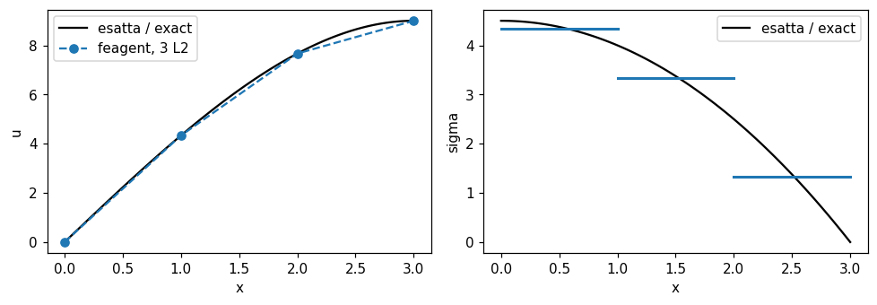

| Quantity | Ref. | Reference | feagent | Error | |
|---|---|---|---|---|---|
| consistent load at node 1 [F] | book | 0.16667 | 0.16667 | 0.00 % | ✅ |
| consistent load at node 2 [F] | book | 1 | 1 | 0.00 % | ✅ |
| consistent load at node 3 [F] | book | 2 | 2 | 0.00 % | ✅ |
| consistent load at node 4 [F] | book | 1.3333 | 1.3333 | 0.00 % | ✅ |
| u2 [L] | book | 4.3333 | 4.3333 | 0.00 % | ✅ |
| u3 [L] | book | 7.6667 | 7.6667 | 0.00 % | ✅ |
| u4 [L] | book | 9 | 9 | 0.00 % | ✅ |
| FE u at mid-element 2 [cL3/AE] | book | 6 | 6 | 0.00 % | ✅ |
| exact u at mid-element 2 [cL3/AE] | book | 6.1875 | 6.1875 | 0.00 % | ✅ |
| sigma1 [F/L2] | book | 4.3333 | 4.3333 | 0.00 % | ✅ |
| sigma2 [F/L2] | book | 3.3333 | 3.3333 | 0.00 % | ✅ |
| sigma3 [F/L2] | book | 1.3333 | 1.3333 | 0.00 % | ✅ |

**Notes**: The load vector is rebuilt from Eq. 3.9-6/3.9-9 (partial OCR) and checked: resultant c (3L)^2/2.

*Code*: `validation/books/cook/ch03.py`

<a id="cook-3-10-heat-conduction-functional"></a>

### Sez. 3.10, Eq. 3.10-1..3.10-9 - FE formulation of plane heat conduction from a functional

📐 · PDF page 113 · heat_steady

The conduction functional gives [k] = int B^T k B dV, [c] = int N^T N rho c dV and {r_Q} = int N^T Q dV; for the linear triangle: [k] = k t A B^T B, [c] = rho c t A/12 [[2,1,1],[1,2,1],[1,1,2]], r_Q = Q t A/3.

**Model**: FieldModel('heat') T3 element (k = 2.5, thickness 0.4, rho c = 3, Q = 7) on a generic triangle.

| Quantity | Ref. | Reference | feagent | Error | |
|---|---|---|---|---|---|
| conduction k11 | exact | 0.54545 | 0.54545 | 0.00 % | ✅ |
| conduction k12 | exact | -0.22727 | -0.22727 | 0.00 % | ✅ |
| conduction k23 | exact | -0.32576 | -0.32576 | 0.00 % | ✅ |
| conduction k33 | exact | 0.64394 | 0.64394 | 0.00 % | ✅ |
| capacity c11 | exact | 0.264 | 0.264 | 0.00 % | ✅ |
| capacity c12 | exact | 0.132 | 0.132 | 0.00 % | ✅ |
| source Q t A/3 per node | exact | 1.232 | 1.232 | 0.00 % | ✅ |

**Notes**: The book writes the matrices in general form; the closed forms of the linear triangle are the classical ones of the same book (Sec. 5.4).

*Code*: `validation/books/cook/ch03.py`

<a id="cook-3-12-lagrange-shape-functions"></a>

### Sez. 3.12, Eq. 3.12-2, 3.12-3, 3.12-6, 3.12-10 - C0 shape functions: linear, quadratic (Lagrange) and bilinear

📐 · PDF page 116 · shape_functions

Linear and quadratic 1D Lagrange functions and bilinear rectangle functions N1 = (a - x)(b - y)/(4ab), ...

**Model**: feagent L2 and L3 bars (central middle node) and a rectangular 2a x 2b PlaneQ4 (a = 1.5, b = 0.8) centred at the origin.

| Quantity | Ref. | Reference | feagent | Error | |
|---|---|---|---|---|---|
| L2 N1(1.7) | exact | 0.76667 | 0.76667 | 0.00 % | ✅ |
| L2 N2(1.7) | exact | 0.23333 | 0.23333 | 0.00 % | ✅ |
| L3 N1(1.7) | exact | 0.40889 | 0.40889 | 0.00 % | ✅ |
| L3 N2(1.7) | exact | -0.12444 | -0.12444 | 0.00 % | ✅ |
| L3 N3(1.7) | exact | 0.71556 | 0.71556 | 0.00 % | ✅ |
| L2 N1(3.2) | exact | 0.26667 | 0.26667 | 0.00 % | ✅ |
| L2 N2(3.2) | exact | 0.73333 | 0.73333 | 0.00 % | ✅ |
| L3 N1(3.2) | exact | -0.12444 | -0.12444 | 0.00 % | ✅ |
| L3 N2(3.2) | exact | 0.34222 | 0.34222 | 0.00 % | ✅ |
| L3 N3(3.2) | exact | 0.78222 | 0.78222 | 0.00 % | ✅ |
| bilinear N1(0.4, -0.3) | exact | 0.25208 | 0.25208 | 0.00 % | ✅ |
| bilinear N2(0.4, -0.3) | exact | 0.43542 | 0.43542 | 0.00 % | ✅ |
| bilinear N3(0.4, -0.3) | exact | 0.19792 | 0.19792 | 0.00 % | ✅ |
| bilinear N4(0.4, -0.3) | exact | 0.11458 | 0.11458 | 0.00 % | ✅ |

**Notes**: Functions evaluated at trial points; in the Q4 x = a xi, y = b eta.

*Code*: `validation/books/cook/ch03.py`

<a id="cook-3-13-hermite-cubic-shape-functions"></a>

### Sez. 3.13, Eq. 3.13-1..3.13-4 - Cubic Hermite interpolation (beam shape functions)

📐 · PDF page 120 · beam, shape_functions

Hermite functions: N1 = 1 - 3x^2/L^2 + 2x^3/L^3, N2 = x - 2x^2/L + x^3/L^2, N3 = 3x^2/L^2 - 2x^3/L^3, N4 = -x^2/L + x^3/L^2.

**Model**: feagent BeamElement3D.shape_functions on a beam of length L = 2.5.

| Quantity | Ref. | Reference | feagent | Error | |
|---|---|---|---|---|---|
| N1(0.6) | exact | 0.85485 | 0.85485 | 0.00 % | ✅ |
| N2(0.6) | exact | 0.34656 | 0.34656 | 0.00 % | ✅ |
| N3(0.6) | exact | 0.14515 | 0.14515 | 0.00 % | ✅ |
| N4(0.6) | exact | -0.10944 | -0.10944 | 0.00 % | ✅ |
| N1(1.9) | exact | 0.14515 | 0.14515 | 0.00 % | ✅ |
| N2(1.9) | exact | 0.10944 | 0.10944 | 0.00 % | ✅ |
| N3(1.9) | exact | 0.85485 | 0.85485 | 0.00 % | ✅ |
| N4(1.9) | exact | -0.34656 | -0.34656 | 0.00 % | ✅ |

**Notes**: Rows of the feagent N(x) for (v1, theta1, v2, theta2) in the x-y plane.

*Code*: `validation/books/cook/ch03.py`

## Chapter 4

<a id="cook-4-2-element-stiffness-overview"></a>

### Sez. 4.2, Eq. 4.2-1..4.2-19 - Stiffness matrices of bar, beam, plane frame, CST, bilinear rectangle, trilinear brick

📐 · PDF page 133 · beam, plane, solid

General formulas [k] = int B^T E B dV for the main elements: Hermite beam (Eq. 4.2-5), 6x6 plane frame (Eq. 4.2-8), CST [k] = t A B^T E B, bilinear rectangle and trilinear brick.

**Model**: feagent BeamElement3D (EA = 5, EI = 3, L = 2), PlaneT3, rectangular 2a x 2b PlaneQ4 and box-shaped Hex8 (E = 7, nu = 0.3, t = 0.5).

| Quantity | Ref. | Reference | feagent | Error | |
|---|---|---|---|---|---|
| 6x6 plane frame, max deviation from Eq. 4.2-8 | exact | 0 | 0 | 0.00 % | ✅ |
| beam 4EI/L | exact | 6 | 6 | 0.00 % | ✅ |
| CST, max deviation from t A B^T E B | exact | 0 | 4.4409e-16 | 0.00 % | ✅ |
| bilinear rectangle, max deviation | exact | 0 | 1.7764e-15 | 0.00 % | ✅ |
| trilinear brick, max relative deviation | exact | 0 | 7.5527e-16 | 0.00 % | ✅ |

**Notes**: For rectangle and brick the reference is an independent numerical integration (4x4 and 4x4x4 Gauss with numpy) of the shape functions written as in the book.

*Code*: `validation/books/cook/ch04.py`

<a id="cook-4-3-bar-initial-strain-thermal"></a>

### Sez. 4.3, Fig. 4.3-1, Eq. 4.3-1, 4.3-2 - Nodal loads of a bar too long by DeltaL and heated by T

📐 · PDF page 138 · bar, thermal

A bar too long by DeltaL and heated by T has initial strain eps0 = DeltaL/L + alpha T and nodal loads {-F, F} with F = E A eps0; fitted between two fixed supports its stress is -E eps0.

**Model**: feagent L2 bar (A = 2, E = 100, L = 4, alpha = 1e-4, T = 30, DeltaL = 0.002) fixed at both ends; the initial strain DeltaL/L is given as an equivalent temperature.

| Quantity | Ref. | Reference | feagent | Error | |
|---|---|---|---|---|---|
| carico nodale r1 = -F [F] | exact | -0.7 | -0.7 | 0.00 % | ✅ |
| carico nodale r2 = F [F] | exact | 0.7 | 0.7 | 0.00 % | ✅ |
| stress between two fixed ends [F/L2] | exact | -0.35 | -0.35 | 0.00 % | ✅ |

**Notes**: Trial values.

*Code*: `validation/books/cook/ch04.py`

<a id="cook-4-3-bar-consistent-loads"></a>

### Sez. 4.3 (Example: Bar Element), Eq. 4.3-6..4.3-9 - Consistent loads of a bar with linear load and a point force at 2L/3

📐 · PDF page 140 · bar

Linear load from q1 to q2: {r} = L/6 {2q1 + q2, q1 + 2q2}; force F at x = 2L/3: {r} = {F/3, 2F/3}.

**Model**: feagent L2 bar (L = 3): equivalent_line_load with q1 = 2, q2 = 5 and shape functions at x = 2L/3 for F = 9.

| Quantity | Ref. | Reference | feagent | Error | |
|---|---|---|---|---|---|
| r1 q [F] | exact | 4.5 | 4.5 | 0.00 % | ✅ |
| r2 q [F] | exact | 6 | 6 | 0.00 % | ✅ |
| r1 F [F] | exact | 3 | 3 | 0.00 % | ✅ |
| r2 F [F] | exact | 6 | 6 | 0.00 % | ✅ |

**Notes**: Trial values.

*Code*: `validation/books/cook/ch04.py`

<a id="cook-4-3-plane-solid-consistent-loads"></a>

### Sez. 4.3, Fig. 4.3-3..4.3-5, Eq. 4.3-10, 4.3-11 - Consistent loads on linear and quadratic edges, force at a Q8 centre, loaded face

📐 · PDF page 141 · plane

Consistent loads: linear edge with linear pressure L/6 (2p1 + p2, p1 + 2p2); quadratic edge with uniform q qL/6, 2qL/3, qL/6; force F at a Q8 centre: -F/4 at corners and F/2 at mid-side nodes; 8-node face with uniform sigma: -sigma A/12 at corners and sigma A/3 at sides; Q4 1/4 per node.

**Model**: Rectangular feagent PlaneQ8 and PlaneQ4 (3 x 2, t = 1): quadratic edge with uniform traction, shape functions at the Q8 centre, uniform body force on Q4 and Q8; L2 bar for the linear edge with linear load.

| Quantity | Ref. | Reference | feagent | Error | |
|---|---|---|---|---|---|
| quadratic edge: qL/6 at corner [F] | exact | 1.3333 | 1.3333 | 0.00 % | ✅ |
| quadratic edge: 2qL/3 at mid node [F] | exact | 5.3333 | 5.3333 | 0.00 % | ✅ |
| F at Q8 centre: -F/4 at corners [F/F] | exact | -0.25 | -0.25 | 0.00 % | ✅ |
| F at Q8 centre: F/2 at mid nodes [F/F] | exact | 0.5 | 0.5 | 0.00 % | ✅ |
| 8-node face: -sigma A/12 at corner [F] | exact | -3 | -3 | 0.00 % | ✅ |
| 8-node face: sigma A/3 at side [F] | exact | 12 | 12 | 0.00 % | ✅ |
| Q4: 1/4 per node [F] | exact | 9 | 9 | 0.00 % | ✅ |
| linear edge, linear pressure: L/6 (2p1 + p2) [F] | exact | 2.55 | 2.55 | 0.00 % | ✅ |

**Notes**: The values P and Q of the 8-node face (Fig. 4.3-5) are missing from the OCR text: -sigma A/12 and sigma A/3 are the integral of the serendipity functions, the same as a uniform body force on the Q8.

*Code*: `validation/books/cook/ch04.py`

<a id="cook-4-3-beam-consistent-loads"></a>

### Sez. 4.3, Fig. 4.3-6, Eq. 4.3-12 - Consistent beam loads for uniform q, midspan P and M

📐 · PDF page 143 · beam

Uniform q: forces qL/2 and moments qL^2/12; midspan P: P/2 and PL/8; midspan couple M: forces -3M/(2L), +3M/(2L) and moments -M/4, -M/4 (Eq. 4.3-12 with dN/dx at L/2).

**Model**: feagent BeamElement3D (L = 2): equivalent vectors of DistributedLoad and ConcentratedElementLoad (force and couple at xi = 0.5).

| Quantity | Ref. | Reference | feagent | Error | |
|---|---|---|---|---|---|
| load q: F1 | exact | 3 | 3 | 0.00 % | ✅ |
| load q: M1 | exact | 1 | 1 | 0.00 % | ✅ |
| load q: F2 | exact | 3 | 3 | 0.00 % | ✅ |
| load q: M2 | exact | -1 | -1 | 0.00 % | ✅ |
| load P: F1 | exact | 2.5 | 2.5 | 0.00 % | ✅ |
| load P: M1 | exact | 1.25 | 1.25 | 0.00 % | ✅ |
| load P: F2 | exact | 2.5 | 2.5 | 0.00 % | ✅ |
| load P: M2 | exact | -1.25 | -1.25 | 0.00 % | ✅ |
| load M: F1 | exact | -5.25 | -5.25 | 0.00 % | ✅ |
| load M: M1 | exact | -1.75 | -1.75 | 0.00 % | ✅ |
| load M: F2 | exact | 5.25 | 5.25 | 0.00 % | ✅ |
| load M: M2 | exact | -1.75 | -1.75 | 0.00 % | ✅ |

**Notes**: Dofs (v1, theta1, v2, theta2) of the local x-y plane; the couple moment signs follow dN/dx at L/2 (Fig. 4.3-6c).

*Code*: `validation/books/cook/ch04.py`

<a id="cook-4-3-cantilever-udl-lumped-vs-consistent"></a>

### Sez. 4.3 (Error Produced by Lumping), Fig. 4.3-7, Eq. 4.3-13, 4.3-14 - Cantilever under uniform load: consistent versus lumped loads

✅ · PDF page 143 · beam

With consistent loads tip deflection and rotation are exact for every n (qL^4/8EI, qL^3/6EI); dropping the nodal moments the deflection error is 33.3, 8.3, 3.7, 2.1 % and the rotation error 50, 12.5, 5.6, 3.1 %.

**Model**: Cantilever with n = 1, 2, 3, 4 feagent Hermite beams (EI = L = q = 1): distributed (consistent) load or only nodal forces qL/2 per element.

| Quantity | Ref. | Reference | feagent | Error | |
|---|---|---|---|---|---|
| deflection, consistent loads, n = 1 [qL4/EI] | exact | 0.125 | 0.125 | 0.00 % | ✅ |
| rotation, consistent loads, n = 1 [qL3/EI] | exact | 0.16667 | 0.16667 | 0.00 % | ✅ |
| deflection error with lumped loads, n = 1 [%] | book | 33.3 | 33.333 | 0.10 % | ✅ |
| rotation error with lumped loads, n = 1 [%] | book | 50 | 50 | 0.00 % | ✅ |
| deflection error with lumped loads, n = 2 [%] | book | 8.3 | 8.3333 | 0.40 % | ✅ |
| rotation error with lumped loads, n = 2 [%] | book | 12.5 | 12.5 | 0.00 % | ✅ |
| deflection error with lumped loads, n = 3 [%] | book | 3.7 | 3.7037 | 0.10 % | ✅ |
| rotation error with lumped loads, n = 3 [%] | book | 5.6 | 5.5556 | 0.79 % | ✅ |
| deflection, consistent loads, n = 4 [qL4/EI] | exact | 0.125 | 0.125 | 0.00 % | ✅ |
| rotation, consistent loads, n = 4 [qL3/EI] | exact | 0.16667 | 0.16667 | 0.00 % | ✅ |
| deflection error with lumped loads, n = 4 [%] | book | 2.1 | 2.0833 | 0.79 % | ✅ |
| rotation error with lumped loads, n = 4 [%] | book | 3.1 | 3.125 | 0.81 % | ✅ |

**Notes**: Percentage errors compared with the printed values (one decimal).

*Code*: `validation/books/cook/ch04.py`

<a id="cook-4-4-equilibrium-compatibility"></a>

### Sez. 4.4, 4.5, Fig. 4.4-1, 4.4-2, 4.5-1..4.5-3 - Equilibrium and compatibility in the FE solution; convergence requirements

📐 · PDF page 144 · plane

The FE solution satisfies equilibrium at the nodes but not between elements (stresses jump across shared edges); an element must represent rigid motions without strain (convergence requirement).

**Model**: 4 x 1 cantilever of 16 CSTs (PlaneT3) loaded at the tip; one isolated CST under a small rigid rotation.

| Quantity | Ref. | Reference | feagent | Error | |
|---|---|---|---|---|---|
| equilibrium at an internal node: sum of element forces [F] | exact | 0 | 4.6407e-14 | 0.00 % | ✅ |
| sigma_x jump between two adjacent CSTs (non-zero) [F/L2] | book | - | 7.9282 | - | ✅ |
| CST strains under rigid rotation | exact | 0 | 1.0842e-19 | 0.00 % | ✅ |

**Notes**: The book is qualitative: the nodal residual (sum of element forces = applied load), the zero strain of a CST in rigid rotation are checked, and the normal traction jump across an internal edge is reported.

*Code*: `validation/books/cook/ch04.py`

<a id="cook-4-6-patch-test-q4"></a>

### Sez. 4.6, Fig. 4.6-1 - Patch test of four 4-node quadrilaterals under uniform sigma_x

✅ · PDF page 150 · plane

Patch of four irregular quadrilaterals loaded by the consistent forces of a uniform stress state sigma_x = sigma_c: the element passes the patch test if the computed stresses are exactly sigma_x = sigma_c, sigma_y = tau_xy = 0 everywhere.

**Model**: Four feagent PlaneQ4 (thickness 1, E = 1000, nu = 0.3) with the nodes of Fig. 4.6-1; node 1 fixed in x and y, node 2 in x; forces F at nodes 7 and 9, 2F at node 8, 1.5F along -x at node 3, F = sigma_c = 10. Variant: u3 = 0 instead of the 1.5F force; repeated with QM6 (incompatible=True).

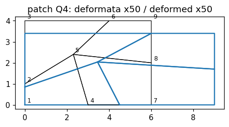

| Quantity | Ref. | Reference | feagent | Error | |
|---|---|---|---|---|---|
| Q4: max deviation from sigma_x = sigma_c, sigma_y = tau = 0 | exact | 0 | 1.0658e-14 | 0.00 % | ✅ |
| reaction at node 2 [F] | exact | -20 | -20 | 0.00 % | ✅ |
| Q4 u3=0: max deviation from sigma_x = sigma_c, sigma_y = tau = 0 | exact | 0 | 1.0658e-15 | 0.00 % | ✅ |
| QM6: max deviation from sigma_x = sigma_c, sigma_y = tau = 0 | exact | 0 | 3.5527e-15 | 0.00 % | ✅ |

**Notes**: Coordinates from the figure; the interior node 5 is not dimensioned and is placed at (2.3, 2.4) (irrelevant for the patch test). Reactions are 0.5F at node 1 and 2F at node 2.

*Code*: `validation/books/cook/ch04.py`

<a id="cook-4-7-bar-self-weight-fixed-ends"></a>

### Sez. 4.7, Fig. 4.7-1, Eq. 4.7-3 - Vertical bar under self-weight fixed at both ends: 1, 2, 4 elements

✅ · PDF page 153 · bar

The exact stress varies linearly from +sigma_c at the top to -sigma_c at the bottom (sigma_c = W/2A). One element gives sigma = 0, two elements +-sigma_c/2, four elements 3/4, 1/4, -1/4, -3/4 sigma_c. Adding the correction of Eq. 4.7-3 in each element recovers the exact solution.

**Model**: Vertical bar (Y axis) of 1, 2 and 4 feagent L2 elements, fixed at top and bottom, body force -gamma along Y (add_solid_body_force); W = gamma A L = 2, A = 1.

| Quantity | Ref. | Reference | feagent | Error | |
|---|---|---|---|---|---|
| 1 elements: stress of element 1 (from the top) [sigma_c] | book | 0 | 0 | 0.00 % | ✅ |
| 2 elements: stress of element 1 (from the top) [sigma_c] | book | 0.5 | 0.5 | 0.00 % | ✅ |
| 2 elements: stress of element 2 (from the top) [sigma_c] | book | -0.5 | -0.5 | 0.00 % | ✅ |
| 2 elements + Eq. 4.7-3 correction: sigma at the top [sigma_c] | exact | 1 | 1 | 0.00 % | ✅ |
| 4 elements: stress of element 1 (from the top) [sigma_c] | book | 0.75 | 0.75 | 0.00 % | ✅ |
| 4 elements: stress of element 2 (from the top) [sigma_c] | book | 0.25 | 0.25 | 0.00 % | ✅ |
| 4 elements: stress of element 3 (from the top) [sigma_c] | book | -0.25 | -0.25 | 0.00 % | ✅ |
| 4 elements: stress of element 4 (from the top) [sigma_c] | book | -0.75 | -0.75 | 0.00 % | ✅ |

**Notes**: Values of the 2- and 4-element models read from the figure.

*Code*: `validation/books/cook/ch04.py`

<a id="cook-4-7-cst-linear-temperature"></a>

### Sez. 4.7 (Thermal Stress), Fig. 4.7-2, Eq. 4.7-4, 4.7-5 - Spurious stresses in a CST with a linear temperature field

📐 · PDF page 154 · plane, thermal

The CST has constant strain: a linear temperature field with zero mean gives zero nodal loads, hence zero displacements and stresses sigma_x = sigma_y = -E alpha T/(1 - nu), spurious everywhere except at the centroid (the exact solution of a free plate with linear T is stress-free).

**Model**: One feagent PlaneT3 with centroid at the origin (E = 200, nu = 0.25, alpha = 1e-2) and nodal temperatures T = c1 x + c2 y (c1 = 3, c2 = -2), add_solid_thermal with nodal values; statically determinate support.

| Quantity | Ref. | Reference | feagent | Error | |
|---|---|---|---|---|---|
| zero thermal nodal loads [F] | exact | 0 | 2.2204e-16 | 0.00 % | ✅ |
| sigma_x at vertex 2 = -E alpha T/(1-nu) [F/L2] | exact | -12.267 | -12.267 | 0.00 % | ✅ |
| sigma_y vertice 2 [F/L2] | exact | -12.267 | -12.267 | 0.00 % | ✅ |
| tau vertice 2 [F/L2] | exact | 0 | 4.6259e-17 | 0.00 % | ✅ |
| sigma_x at the centroid (correct) [F/L2] | exact | 0 | 4.5334e-16 | 0.00 % | ✅ |

**Notes**: Stresses evaluated at vertex 2 and at the centroid.

*Code*: `validation/books/cook/ch04.py`

<a id="cook-4-7-q4-beam-linear-temperature"></a>

### Sez. 4.7 (controesempio), Fig. 4.2-4 - Beam between rigid walls with temperature linear through the depth (one bilinear element)

📐 · PDF page 154 · plane, thermal

With the nodes fixed the bilinear element has zero strain: using the actual temperature gives sigma_x = sigma_y = -E alpha T, right for sigma_x (beam between rigid walls) but wrong for sigma_y, which should be zero.

**Model**: One rectangular 4 x 1 PlaneQ4 (E = 100, nu = 0, alpha = 1e-3) with all nodes fixed and nodal temperatures T = T0 y (T0 = 20, y from the mid-plane).

| Quantity | Ref. | Reference | feagent | Error | |
|---|---|---|---|---|---|
| sigma_x at Gauss point 1 = -E alpha T [F/L2] | exact | 0.57735 | 0.57735 | 0.00 % | ✅ |
| sigma_y at Gauss point 1 (wrong, exact = 0) [F/L2] | book | 0.57735 | 0.57735 | 0.00 % | ✅ |
| sigma_x at Gauss point 4 = -E alpha T [F/L2] | exact | -0.57735 | -0.57735 | 0.00 % | ✅ |
| sigma_y at Gauss point 4 (wrong, exact = 0) [F/L2] | book | -0.57735 | -0.57735 | 0.00 % | ✅ |

**Notes**: The book also discusses a 'reduced' temperature consistent with the element strain field (sigma_x = sigma_y = 0), a proposal not adopted by feagent: the case with the actual temperature is compared.

*Code*: `validation/books/cook/ch04.py`

<a id="cook-4-7-plate-hole-stress-improvement"></a>

### Sez. 4.7, Fig. 4.7-3, Tabella 4.7-1, Eq. 4.7-8 - Plate with a central hole: stress at the hole edge, standard and iterative methods

🟡 · PDF page 155 · plane

Strip in tension with a hole of diameter equal to half the width: stress sigma_x at point A on the hole edge. The book compares the standard method (2x2: 30.9; 4x4: 36.6) with an iterative stress-improvement method and with the exact 43.2 (Kt = 2.16 on the net section), and corrects the case of a plate loaded by point forces with the ratio of the secondary case (Eq. 4.7-8: 103 and 112).

**Model**: Quarter of a strip with a hole (width 2, hole diameter 1, half-length 3, E = 1, nu = 0.3, sigma = 10 far from the hole): mapped block around the hole plus a rectangular block; Q4 with 2x2 and 4x4 meshes in the hole quadrant (stress at A extrapolated from the 4 Gauss points) and Q9 16x16 as converged solution.

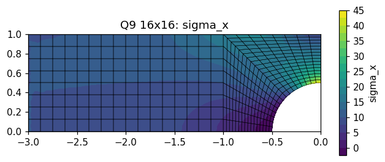

| Quantity | Ref. | Reference | feagent | Error | |
|---|---|---|---|---|---|
| sigma_x at A, Q4 2x2 standard (book 30.9, different mesh) [F/L2] | book | - | 28.805 | - | ✅ |
| sigma_x at A, Q4 4x4 standard (book 36.6, different mesh) [F/L2] | book | - | 37.646 | - | ✅ |
| sigma_x at A, Q9 16x16 (book exact 43.2) [F/L2] | book | 43.2 | 43.546 | 0.80 % | ✅ |
| secondary-case correction, 2x2 [F/L2] | book | 103 | 102.9 | 0.10 % | ✅ |
| secondary-case correction, 4x4 [F/L2] | book | 112 | 112.49 | 0.43 % | ✅ |

**Notes**: The book gives no dimensions, model length nor mesh coordinates: the geometry is rebuilt (gross sigma 10 to obtain 43.2). The feagent Q4 2x2 and 4x4 values (about 28.9 and 37.8) are only reported because the book mesh differs. The iterative method (Eq. 4.7-7) is not in feagent; case b (point forces, P not given, reference from 8x8 Q9) is not reproducible. The converged solution is checked against 43.2, together with the arithmetic of Eq. 4.7-8. A model limited to the square around the hole, with the traction applied at distance b from the centre, would converge to about 64: the book model must include a longer portion of strip.

*Code*: `validation/books/cook/ch04.py`

## Chapter 5

<a id="cook-5-1-natural-coordinates-bar"></a>

### Sez. 5.1, Eq. 5.1-1..5.1-12 - Linear natural coordinates and 2- and 3-node bar

📐 · PDF page 167 · bar

With the linear natural coordinates xi1, xi2 the bar has [k] = AE/L [[1,-1],[-1,1]] and int xi1^k xi2^l dL = k! l! L/(k + l + 1)! holds.

**Model**: feagent L2 and L3 bars (L = 2.5, A = 1.2, E = 30); shape functions used as natural coordinates xi1 = N1, xi2 = N2 and integrated by Gauss quadrature.

| Quantity | Ref. | Reference | feagent | Error | |
|---|---|---|---|---|---|
| k11 [F/L] | exact | 14.4 | 14.4 | 0.00 % | ✅ |
| k12 [F/L] | exact | -14.4 | -14.4 | 0.00 % | ✅ |
| int xi1^1 xi2^1 [L] | exact | 0.41667 | 0.41667 | 0.00 % | ✅ |
| int xi1^2 xi2^1 [L] | exact | 0.20833 | 0.20833 | 0.00 % | ✅ |
| int xi1^3 xi2^2 [L] | exact | 0.041667 | 0.041667 | 0.00 % | ✅ |
| 3-node bar: k11 = 7AE/(3L) [F/L] | exact | 33.6 | 33.6 | 0.00 % | ✅ |

**Notes**: Integration formula checked for (k, l) = (1, 1), (2, 1), (3, 2).

*Code*: `validation/books/cook/ch05.py`

<a id="cook-5-2-area-volume-coordinates"></a>

### Sez. 5.2, Eq. 5.2-1..5.2-13 - Area and volume coordinates, derivatives and integration formulas

📐 · PDF page 169 · shape_functions

Area coordinates: 2A = x21 y31 - x31 y21, int xi1^k xi2^l xi3^m dA = 2A k! l! m!/(2 + k + l + m)!; analogous volume formula with 6V and (3 + ...)!.

**Model**: feagent PlaneT3 and Tet10; quadratures feagent.solid.gauss_tri and gauss_tet.

| Quantity | Ref. | Reference | feagent | Error | |
|---|---|---|---|---|---|
| 2A = x21 y31 - x31 y21 [L2] | exact | 3.17 | 3.17 | 0.00 % | ✅ |
| int L^(1,1,0) dA [L2] | exact | 0.13208 | 0.13208 | 0.00 % | ✅ |
| int L^(2,1,1) dA [L2] | exact | 0.0088056 | 0.0088056 | 0.00 % | ✅ |
| int L^(2,2,1) dA [L2] | exact | 0.0025159 | 0.0025159 | 0.00 % | ✅ |
| int L^(1,1,1,0) dV [L3] | exact | 0.0036111 | 0.0036111 | 0.00 % | ✅ |
| int L^(2,1,0,1) dV [L3] | exact | 0.0010317 | 0.0010317 | 0.00 % | ✅ |
| volume Tet10 [L3] | exact | 0.43333 | 0.43333 | 0.00 % | ✅ |

**Notes**: Area coordinates are the T3 shape functions; integration on the actual triangle with the feagent rules.

*Code*: `validation/books/cook/ch05.py`

<a id="cook-5-4-cst-formulation"></a>

### Sez. 5.4, Eq. 5.4-1..5.4-7 - Linear triangle: scalar field and constant-strain triangle (CST)

📐 · PDF page 174 · plane

[B] = 1/(2A) [[y23, 0, y31, 0, y12, 0], [0, x32, 0, x13, 0, x21], [x32, y23, x13, y31, x21, y12]] and [k] = t A [B]^T [E] [B].

**Model**: feagent PlaneT3 on a generic triangle (E = 5, nu = 0.2, t = 0.3).

| Quantity | Ref. | Reference | feagent | Error | |
|---|---|---|---|---|---|
| max deviation of [B] [1/L] | exact | 0 | 1.1102e-16 | 0.00 % | ✅ |
| max deviation of [k] [F/L] | exact | 0 | 2.2204e-16 | 0.00 % | ✅ |

**Notes**: All terms of [B] (rows exx, eyy, gxy) and [k] compared.

*Code*: `validation/books/cook/ch05.py`

<a id="cook-5-4-cst-pure-bending"></a>

### Sez. 5.4, Fig. 5.4-1, Eq. 5.4-8, 5.4-9 - CST in pure bending: wrong strains

📐 · PDF page 176 · plane

Exact field u = u_bar x y/(c l), v = u_bar (-x^2 - nu y^2)/(2 c l): eps_x = u_bar y/(c l), gamma = 0. The CST with the same nodal displacements gives eps_x = eps_y = 0 and a spurious shear strain gamma = (1/c - nu c/(4 l^2)) u_bar (Eq. 5.4-9): it represents bending by shear instead of axial strains.

**Model**: feagent PlaneT3 with nodes (l, -c), (l, c), (-l, 0) (l = 2, c = 0.5, nu = 0.3) and nodal displacements taken from the pure-bending field (u_bar = 0.01).

| Quantity | Ref. | Reference | feagent | Error | |
|---|---|---|---|---|---|
| CST eps_x (exact: u_bar y/(c l)) | exact | 0 | 0 | 0.00 % | ✅ |
| eps_y CST | exact | 0 | 0 | 0.00 % | ✅ |
| spurious CST gamma_xy (Eq. 5.4-5 on the nodal displacements) | exact | 0.019906 | 0.019906 | 0.00 % | ✅ |
| gamma_xy = (1/c - nu c/(4 l^2)) u_bar (Eq. 5.4-9, exact 0) | book | 0.019906 | 0.019906 | 0.00 % | ✅ |

**Notes**: Eq. 5.4-9 read from the page image: gamma_xy = (1/c - nu c/(4 l^2)) u_bar; it is also compared with the CST [B] of Eq. 5.4-5 written by hand.

*Code*: `validation/books/cook/ch05.py`

<a id="cook-5-4-cantilever-cst-vs-lst"></a>

### Sez. 5.4-5.5, Fig. 5.4-2 - Cantilever with parabolic end load: CST versus LST

✅ · PDF page 176 · plane

Deflection v_A at mid free end and bending stress sigma_xB at the top fibre at distance h from the support, as ratios to elasticity theory: 128 CST 0.859 and 0.854; 512 CST 0.961 and 0.956; 32 LST 0.998 and 0.986. For equal dof the quadratic triangle is far more accurate.

**Model**: 4h x h cantilever (h = 1, t = 1, E = 1, nu = 0.25) with all left-end nodes fixed and parabolic load P = 1 on the right: 128 CST (16 x 4 rectangles with alternating diagonals, 160 dof), 512 CST (32 x 8, 576 dof), 32 LST (8 x 2 rectangles, 160 dof) and, as reference, 2048 LST (64 x 16).

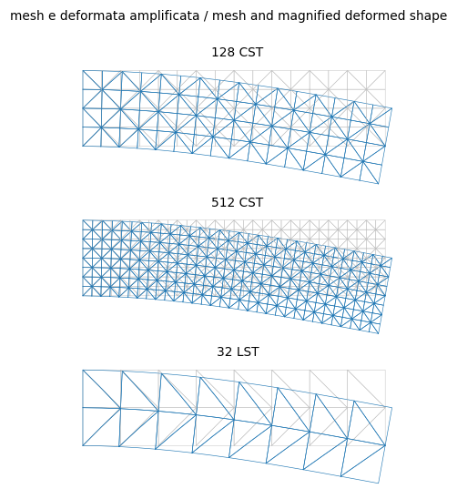

| Quantity | Ref. | Reference | feagent | Error | |
|---|---|---|---|---|---|
| v_A / v_ref, 128 CST | book | 0.859 | 0.86535 | 0.74 % | ✅ |
| sigma_xB / (Mc/I), 128 CST | book | 0.854 | 0.85271 | 0.15 % | ✅ |
| v_A / v_ref, 512 CST | book | 0.961 | 0.96184 | 0.09 % | ✅ |
| sigma_xB / (Mc/I), 512 CST | book | 0.956 | 0.95574 | 0.03 % | ✅ |
| v_A / v_ref, 32 LST | book | 0.998 | 0.9971 | 0.09 % | ✅ |
| sigma_xB / (Mc/I), 32 LST | book | 0.986 | 0.98549 | 0.05 % | ✅ |

**Notes**: Ratios: v_A with respect to the converged solution with the same support (2048 LST, v = 267.0 against 256 of bending only and 268 of the Timoshenko beam), sigma_xB with respect to M c/I = 18. For the CSTs sigma_xB is the mean of the two triangles with an edge on the top fibre meeting at B (this gives 0.854 and 0.956), for the LSTs the nodal average. Diagonal layout read from the figure. Largest deviation 0.7 % (v_A of the 128 CSTs).

*Code*: `validation/books/cook/ch05.py`

<a id="cook-5-5-lst-formulation"></a>

### Sez. 5.5, Eq. 5.5-1..5.5-10 - Straight-sided quadratic triangle (LST)

📐 · PDF page 177 · plane

The book writes the complete quadratic field u = a1 + a2 x + ... + a6 y^2, obtains [B] = [Q][H] and [k] = int [B]^T [E] [B] t dA; a uniform edge load is shared by the three edge nodes as 1-4-1.

**Model**: feagent PlaneT6 on a generic straight-sided triangle (E = 3, nu = 0.25, t = 0.5).

| Quantity | Ref. | Reference | feagent | Error | |
|---|---|---|---|---|---|
| max relative deviation of [k] | exact | 0 | 2.0353e-15 | 0.00 % | ✅ |
| edge load: 1/6 at corner [F] | exact | 0.31136 | 0.31136 | 0.00 % | ✅ |
| edge load: 4/6 at mid node [F] | exact | 1.2454 | 1.2454 | 0.00 % | ✅ |

**Notes**: Reference built with numpy by the book method (inversion of the nodal monomial matrix, degree-4 Gauss quadrature on the triangle).

*Code*: `validation/books/cook/ch05.py`

<a id="cook-5-6-quadratic-tetrahedron"></a>

### Sez. 5.6, Fig. 5.6-1, Eq. 5.6-1 - Shape functions of the 10-node quadratic tetrahedron

📐 · PDF page 179 · solid

Shape functions N_i = xi_i (2 xi_i - 1) at the vertices and 4 xi_i xi_j at the edge nodes; the stiffness is 30 x 30 with 6 rigid-body modes (rank 24).

**Model**: feagent Tet10 on a generic tetrahedron (E = 1, nu = 0.3).

| Quantity | Ref. | Reference | feagent | Error | |
|---|---|---|---|---|---|
| N1 | exact | -0.1218 | -0.1218 | 0.00 % | ✅ |
| N2 | exact | -0.1218 | -0.1218 | 0.00 % | ✅ |
| N3 | exact | -0.1122 | -0.1122 | 0.00 % | ✅ |
| N4 | exact | -0.1122 | -0.1122 | 0.00 % | ✅ |
| N5 | exact | 0.2436 | 0.2436 | 0.00 % | ✅ |
| N6 | exact | 0.1428 | 0.1428 | 0.00 % | ✅ |
| N7 | exact | 0.1972 | 0.1972 | 0.00 % | ✅ |
| N8 | exact | 0.3828 | 0.3828 | 0.00 % | ✅ |
| N9 | exact | 0.2772 | 0.2772 | 0.00 % | ✅ |
| N10 | exact | 0.2244 | 0.2244 | 0.00 % | ✅ |
| dimensione [k] | exact | 30 | 30 | 0.00 % | ✅ |
| rank of [k] (30 - 6 rigid modes) | exact | 24 | 24 | 0.00 % | ✅ |

**Notes**: Functions evaluated at an interior trial point; edges in the feagent order (1-2), (2-3), (3-1), (1-4), (2-4), (3-4).

*Code*: `validation/books/cook/ch05.py`

## Chapter 6

<a id="cook-6-2-isoparametric-bar-3-node"></a>

### Sez. 6.2, Fig. 6.2-1, Eq. 6.2-1..6.2-7 - Isoparametric 3-node bar and Jacobian

📐 · PDF page 184 · bar

Shape functions [-xi(1 - xi)/2, xi(1 + xi)/2, 1 - xi^2], geometry x = N x_i and Jacobian J = dx/dxi = (x2 - x1)/2 + xi (x1 + x2 - 2 x3): constant and equal to L/2 only with node 3 at the centre.

**Model**: feagent L3 bar (add_bar with 3 nodes: ends, then middle node), x1 = 1, x2 = 4, node 3 central (x3 = 2.5) or shifted (x3 = 2), A = 2, E = 10.

| Quantity | Ref. | Reference | feagent | Error | |
|---|---|---|---|---|---|
| N1 x3=2.5 xi=-0.6 | exact | 0.48 | 0.48 | 0.00 % | ✅ |
| Jacobian, x3 = 2.5, xi = -0.6 [L] | exact | 1.5 | 1.5 | 0.00 % | ✅ |
| N1 x3=2.5 xi=0.3 | exact | -0.105 | -0.105 | 0.00 % | ✅ |
| Jacobian, x3 = 2.5, xi = 0.3 [L] | exact | 1.5 | 1.5 | 0.00 % | ✅ |
| 3-node bar stiffness [F/L] | exact | 0 | 1.4211e-14 | 0.00 % | ✅ |
| N1 x3=2.0 xi=-0.6 | exact | 0.48 | 0.48 | 0.00 % | ✅ |
| Jacobian, x3 = 2.0, xi = -0.6 [L] | exact | 0.9 | 0.9 | 0.00 % | ✅ |
| N1 x3=2.0 xi=0.3 | exact | -0.105 | -0.105 | 0.00 % | ✅ |
| Jacobian, x3 = 2.0, xi = 0.3 [L] | exact | 1.8 | 1.8 | 0.00 % | ✅ |

**Notes**: With a central node the stiffness AE/(3L) [[7, 1, -8], [1, 7, -8], [-8, -8, 16]] is also checked.

*Code*: `validation/books/cook/ch06.py`

<a id="cook-6-3-q4-isoparametric"></a>

### Sez. 6.3-6.5, Eq. 6.3-1..6.3-21, Fig. 6.5-1, 6.5-2 - Isoparametric bilinear quadrilateral: Jacobian, [B], [k], subroutines SHAPE and QUAD4

📐 · PDF page 186 · plane

Shape functions N_i = (1 +- xi)(1 +- eta)/4, Jacobian [J] = [dN/dxi] [x y], [B] from the Cartesian derivatives [J]^-1 {dN/dxi, dN/deta}, stiffness [k] = sum W_i W_j [B]^T [E] [B] t J and body loads int [N]^T {F} t J.

**Model**: feagent PlaneQ4 on a generic quadrilateral (E = 2, nu = 0.3, t = 0.7) with a body force; reference: the book's SHAPE and QUAD4 subroutines rewritten in numpy (2x2 Gauss).

| Quantity | Ref. | Reference | feagent | Error | |
|---|---|---|---|---|---|
| det J at (0.3, -0.4) [L2] | exact | 0.82775 | 0.82775 | 0.00 % | ✅ |
| [k] vs QUAD4 [F/L] | exact | 0 | 2.2204e-16 | 0.00 % | ✅ |
| body forces vs QUAD4 [F] | exact | 0 | 2.2204e-16 | 0.00 % | ✅ |

**Notes**: J at a trial point, [k] and the body-force vector compared.

*Code*: `validation/books/cook/ch06.py`

<a id="cook-6-4-gauss-quadrature"></a>

### Sez. 6.4 (Example), Tabella 6.4-1, Eq. 6.4-3..6.4-8 - Gauss quadrature: cubic polynomial example, 2D and 3D rules

📐 · PDF page 190 · quadrature

For phi = a1 + a2 xi + a3 xi^2 + a4 xi^3 the exact integral over [-1, 1] is 2a1 + 2a3/3: one point gives 2a1, two points the exact value. In the 3x3 rule the weights are 25/81, 40/81 and 64/81.

**Model**: feagent Gauss rules (feagent.solid._gl, 3x3 plane rule feagent.plane._quad_rule).

| Quantity | Ref. | Reference | feagent | Error | |
|---|---|---|---|---|---|
| regola a 1 punto = 2 a1 | exact | 2.6 | 2.6 | 0.00 % | ✅ |
| 2-point rule = exact | exact | 4 | 4 | 0.00 % | ✅ |
| peso 3x3 angolo | exact | 0.30864 | 0.30864 | 0.00 % | ✅ |
| peso 3x3 lato | exact | 0.49383 | 0.49383 | 0.00 % | ✅ |
| peso 3x3 centro | exact | 0.79012 | 0.79012 | 0.00 % | ✅ |

**Notes**: Trial coefficients a = (1.3, -0.7, 2.1, 0.9).

*Code*: `validation/books/cook/ch06.py`

<a id="cook-6-6-quadratic-quadrilaterals"></a>

### Sez. 6.6, Eq. 6.6-1..6.6-8, Tabella 6.6-1 - Shape functions of 4- to 9-node quadrilaterals (serendipity and Lagrange)

📐 · PDF page 196 · shape_functions

Serendipity functions: side nodes N5 = (1 - xi^2)(1 - eta)/2 ...; corners N1 = (1 - xi)(1 - eta)/4 - (N5 + N8)/2 ...; the ninth node has N9 = (1 - xi^2)(1 - eta^2) and the Q9 functions are products of quadratic Lagrange functions.

**Model**: feagent PlaneQ8 and PlaneQ9; for the transition elements (5-7 nodes), not in feagent, the functions of Table 6.6-1 are checked with numpy.

| Quantity | Ref. | Reference | feagent | Error | |
|---|---|---|---|---|---|
| Q8 serendipity vs Eq. 6.6-1 | exact | 0 | 6.9389e-17 | 0.00 % | ✅ |
| Q9: N9 = (1 - xi^2)(1 - eta^2) | exact | 0.62972 | 0.62972 | 0.00 % | ✅ |
| Q9: N1 Lagrange product | exact | -0.046061 | -0.046061 | 0.00 % | ✅ |
| 5 nodes: N_i(x_j) = delta_ij | exact | 0 | 0 | 0.00 % | ✅ |
| 5 nodes: sum N_i = 1 | exact | 1 | 1 | 0.00 % | ✅ |
| 6 nodes: N_i(x_j) = delta_ij | exact | 0 | 0 | 0.00 % | ✅ |
| 6 nodes: sum N_i = 1 | exact | 1 | 1 | 0.00 % | ✅ |
| 7 nodes: N_i(x_j) = delta_ij | exact | 0 | 0 | 0.00 % | ✅ |
| 7 nodes: sum N_i = 1 | exact | 1 | 1 | 0.00 % | ✅ |

**Notes**: Transition elements: Kronecker delta at the nodes and partition of unity.

*Code*: `validation/books/cook/ch06.py`

<a id="cook-6-7-hexahedral-elements"></a>

### Sez. 6.7, Fig. 6.7-1, Eq. 6.7-1..6.7-6 - Isoparametric hexahedral solid elements

📐 · PDF page 200 · solid, shape_functions

Trilinear shape functions N_i = (1 +- xi)(1 +- eta)(1 +- zeta)/8 and 3x3 Jacobian; Hex20 and Hex27 are only mentioned.

**Model**: feagent Hex8 on a distorted hexahedron.

| Quantity | Ref. | Reference | feagent | Error | |
|---|---|---|---|---|---|
| trilinear functions | exact | 0 | 0 | 0.00 % | ✅ |
| det J [L3] | exact | 0.36107 | 0.36107 | 0.00 % | ✅ |

**Notes**: Hex20 and Hex27 are not in feagent.

*Code*: `validation/books/cook/ch06.py`

<a id="cook-6-8-triangle-isoparametric-quadrature"></a>

### Sez. 6.8, Tabella 6.8-1, Eq. 6.8-1..6.8-8 - Isoparametric triangles and integration rules on the triangle

📐 · PDF page 202 · quadrature, plane

The 3-point rule has points (2/3, 1/6, 1/6) and permutations with weight 1/3 of the area and is exact for quadratics; for a curved-sided T6 the Jacobian varies within the element and the area follows by integrating det J.

**Model**: feagent.solid.gauss_tri (1- and 3-point rules and higher-order conical rules) and curved-sided PlaneT6.

| Quantity | Ref. | Reference | feagent | Error | |
|---|---|---|---|---|---|
| 3-point rule: weight 1/3 of area | exact | 0.33333 | 0.33333 | 0.00 % | ✅ |
| 3-point rule: coordinate 2/3 | exact | 0.66667 | 0.66667 | 0.00 % | ✅ |
| int r^1 s^1 with gauss_tri(2) | exact | 0.041667 | 0.041667 | 0.00 % | ✅ |
| int r^2 s^1 with gauss_tri(3) | exact | 0.016667 | 0.016667 | 0.00 % | ✅ |
| int r^3 s^2 with gauss_tri(4) | exact | 0.002381 | 0.002381 | 0.00 % | ✅ |
| area of a T6 with a parabolic side [L2] | exact | 2.4 | 2.4 | 0.00 % | ✅ |

**Notes**: The 4-, 6-, 7-, 12-, 13-point rules of Table 6.8-1 are not in feagent, which uses conical rules: polynomial exactness is checked. Area of a T6 with one parabolic side compared with Simpson's formula.

*Code*: `validation/books/cook/ch06.py`

<a id="cook-6-9-lst-body-force"></a>

### Sez. 6.9, Eq. 6.9-1 - Uniform body force on a quadratic triangle: load only at mid-side nodes

📐 · PDF page 205 · plane

For the straight-sided quadratic triangle a uniform body force gives zero loads at the vertices and F_x A t/3 at each mid-side node.

**Model**: feagent straight-sided PlaneT6 (t = 0.4), equivalent_body_force with F_x = 5.

| Quantity | Ref. | Reference | feagent | Error | |
|---|---|---|---|---|---|
| vertice: 0 [F] | exact | 0 | -2.4286e-16 | 0.00 % | ✅ |
| mid-side node: F A t/3 [F] | exact | 0.71333 | 0.71333 | 0.00 % | ✅ |

**Notes**: Generic triangle.

*Code*: `validation/books/cook/ch06.py`

<a id="cook-6-10-isoparametric-validity"></a>

### Sez. 6.10, 6.11, Fig. 6.10-1, 6.10-2 - Validity of isoparametric elements; superparametric element failing the patch test; quadrature order

📐 · PDF page 206 · plane, shape_functions

An isoparametric element represents constant-strain states exactly because sum N_i = 1 and sum N_i x_i = x; a superparametric element (geometry of higher order than displacements) cannot reproduce the linear field and fails the patch test.

**Model**: Distorted feagent PlaneQ4, PlaneQ8, PlaneQ9 and PlaneT6; superparametric element (Q8 geometry with a curved side, Q4 displacements) built with numpy from the feagent shape functions.

| Quantity | Ref. | Reference | feagent | Error | |
|---|---|---|---|---|---|
| Q4: eps_x = 1 for u = x | exact | 1 | 1 | 0.00 % | ✅ |
| Q8: eps_x = 1 for u = x | exact | 1 | 1 | 0.00 % | ✅ |
| Q9: eps_x = 1 for u = x | exact | 1 | 1 | 0.00 % | ✅ |
| superparametric: eps_x for u = x (should be 1) | book | - | 1.0303 | - | ✅ |
| the superparametric element does not reproduce eps_x = 1 | exact | 1 | 1 | 0.00 % | ✅ |

**Notes**: u = x (strain eps_x = 1) is imposed and the computed strain at a trial point is measured.

*Code*: `validation/books/cook/ch06.py`

<a id="cook-6-12-zero-energy-modes"></a>

### Sez. 6.12, Fig. 6.12-1..6.12-3, Eq. 6.12-2..6.12-8 - Zero-energy (hourglass) modes of Q4 with 1 point and of Q8/Q9 with 2x2

📐 · PDF page 210 · plane

Reduced integration introduces zero-energy modes besides the 3 rigid-body modes: 1-point Q4 2 modes (u = v = xi eta), 2x2 Q9 3 modes (including u = 3 xi^2 eta^2 - xi^2 - eta^2 and u = xi(3 eta^2 - 1), v = eta(1 - 3 xi^2)), 2x2 Q8 1 mode: rank 12 for both. Stabilisation adds stiffness along the hourglass vector {1, -1, 1, -1}.

**Model**: Square feagent elements with integration='reduced': 1-point Q4 (also with hourglass=True), 2x2 Q8 and Q9; stiffness eigenvalues.

| Quantity | Ref. | Reference | feagent | Error | |
|---|---|---|---|---|---|
| zero eigenvalues, Q4 1 punto | exact | 5 | 5 | 0.00 % | ✅ |
| zero eigenvalues, Q4 1 punto + hourglass | exact | 3 | 3 | 0.00 % | ✅ |
| zero eigenvalues, Q8 2x2 | exact | 4 | 4 | 0.00 % | ✅ |
| rank, Q8 2x2 | exact | 12 | 12 | 0.00 % | ✅ |
| zero eigenvalues, Q9 2x2 | exact | 6 | 6 | 0.00 % | ✅ |
| rank, Q9 2x2 | exact | 12 | 12 | 0.00 % | ✅ |
| energy of mode Q4: u = v = xi eta | exact | 0 | 0 | 0.00 % | ✅ |
| energy of mode Q9: u = 3xi2eta2 - xi2 - eta2 | exact | 0 | 5.8287e-16 | 0.00 % | ✅ |
| energy of mode Q8: u = xi(3eta2-1), v = eta(1-3xi2) | exact | 0 | 3.9690e-15 | 0.00 % | ✅ |

**Notes**: Zero eigenvalues are counted and the book fields, imposed at the nodes, are checked to have zero energy.

*Code*: `validation/books/cook/ch06.py`

<a id="cook-6-12-near-mechanism-beam"></a>

### Sez. 6.12, Fig. 6.12-4 - Near mechanisms with reduced integration (cantilever with point load, rigid inclusion)

🟡 · PDF page 212 · plane

With reduced integration a mesh without mechanisms may still behave badly because the restraints on the hourglass modes are weak: for the strip with a 2 x 24 mesh and a concentrated load the displacement under the load can exceed P L/(AE) by more than 500 times.

**Model**: 24 x 2 strip with a 2 x 24 mesh of square feagent Q4 (E = 1, nu = 0.3, t = 1), left nodes fixed, axial force P = 1 concentrated at the middle node of the right end: full integration, 1 point and 1 point with hourglass control.

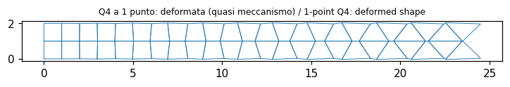

| Quantity | Ref. | Reference | feagent | Error | |
|---|---|---|---|---|---|
| u/(PL/AE), full integration [PL/AE] | book | - | 1.0552 | - | ✅ |
| u/(PL/AE), 1-point Q4 [PL/AE] | book | - | 771.87 | - | ✅ |
| 1-point Q4: u > 500 PL/AE | book | 1 | 1 | 0.00 % | ✅ |
| u/(PL/AE), 1-point Q4 with hourglass (ref. full) [PL/AE] | other | 1.0552 | 1.0717 | 1.57 % | ✅ |

**Notes**: The book gives neither dimensions nor material: a strip of square elements is used. The ratios u/(PL/AE) are reported; with the unstabilised 1-point Q4 the ratio is several orders of magnitude larger (the mesh is nearly singular), with hourglass control it returns close to full integration. The rigid-inclusion case (Fig. 6.12-4b) has no data.

*Code*: `validation/books/cook/ch06.py`

<a id="cook-6-13-gauss-point-stress-extrapolation"></a>

### Sez. 6.13, Fig. 6.13-1..6.13-3, Eq. 6.13-2..6.13-5 - Superconvergent points and stress extrapolation from Gauss points

📐 · PDF page 214 · plane

Stresses at the 2x2 Gauss points are extrapolated to the corners with the bilinear functions in r = xi sqrt(3): sigma_A = 1.866 s1 - 0.500 s2 + 0.134 s3 - 0.500 s4. In the Q4 under pure bending the parasitic shear is saw-toothed and vanishes at the centre, while sigma_x at the Gauss points is exact.

**Model**: feagent PlaneQ4: shape functions evaluated at r = xi sqrt(3), s = eta sqrt(3); a rectangular Q4 in pure bending with imposed displacements.

| Quantity | Ref. | Reference | feagent | Error | |
|---|---|---|---|---|---|
| c1 | book | 1.866 | 1.866 | 0.00 % | ✅ |
| c2 | book | -0.5 | -0.5 | 0.00 % | ✅ |
| c3 | book | 0.134 | 0.13397 | 0.02 % | ✅ |
| c4 | book | -0.5 | -0.5 | 0.00 % | ✅ |
| zero parasitic shear at the centre | exact | 0 | 0 | 0.00 % | ✅ |
| sigma_x at the Gauss point = E k y | exact | 0.0057735 | 0.0057735 | 0.00 % | ✅ |

**Notes**: Coefficients compared with the printed ones (3 decimals).

*Code*: `validation/books/cook/ch06.py`

<a id="cook-6-14-cantilever-q4-aspect-distortion"></a>

### Sez. 6.14, Tabella 6.14-1 - Cantilever with bilinear elements: effect of aspect ratio and distortion

✅ · PDF page 216 · plane

Ratios to beam theory: one elongated element sigma_xB = 0.096, v_A = 0.091; five squares sigma_xC = 0.727, v_A = 0.682; five distorted elements sigma_xC = 0.301, v_A = 0.494. Square elements beat elongated ones and distortion stiffens.

**Model**: feagent PlaneQ4 (2x2 Gauss), 10 x 2 cantilever, nu = 0.25, E = 1, t = 1; left nodes fixed, P = 1 split equally between the two right nodes: (1) one 10 x 2 element; (2) 5 squares; (3) 5 distorted elements with bottom nodes at x = 0, 1, 2, 4, 7, 10 and top nodes at x = 0, 2, 4, 5, 6, 10.

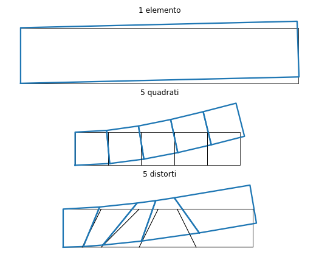

| Quantity | Ref. | Reference | feagent | Error | |
|---|---|---|---|---|---|
| sigma_x / (Mc/I), 1 elemento | book | 0.096 | 0.096386 | 0.40 % | ✅ |
| v_A / v_beam, 1 elemento | book | 0.091 | 0.090508 | 0.54 % | ✅ |
| sigma_x / (Mc/I), 5 quadrati | book | 0.727 | 0.72727 | 0.04 % | ✅ |
| v_A / v_beam, 5 quadrati | book | 0.682 | 0.68293 | 0.14 % | ✅ |
| sigma_x / (Mc/I), 5 distorti | book | 0.301 | 0.30069 | 0.10 % | ✅ |
| v_A / v_beam, 5 distorti | book | 0.494 | 0.49269 | 0.27 % | ✅ |

**Notes**: Distorted-mesh coordinates and positions of B and C read from the figure: B at mid bottom side of the single element (x = 5), C at mid bottom side of the element from x = 2 to x = 4 (x = 3). Deflection reference P L^3/(3EI) + P L/(G A) (shear 2.4 %; the book says 3 %, with shear factor 1.2 deviations rise to 0.4-1 %), stress M c/I at the point.

*Code*: `validation/books/cook/ch06.py`

<a id="cook-6-14-cantilever-q8-q9-distortion"></a>

### Sez. 6.14, Tabella 6.14-2 - Two-element quadratic cantilever (8 and 9 nodes): Gauss rule and distortion

🟡 · PDF page 217 · plane

Ratios sigma_xB (2x2 Gauss point of the left element) and v_A to beam theory without shear, for 8 and 9 nodes, 2x2 and 3x3 rules, rectangular, trapezoidal and curved-side meshes. The 8-node element collapses with distortion (sigma_xB 0.05, v_A 0.16-0.43), the 9-node one stays acceptable; the 2x2 rule is preferable. Four T6 on the trapezoids give v_A = 0.796.

**Model**: Two feagent PlaneQ8 or PlaneQ9 (integration='reduced' = 2x2, 'full' = 3x3), 100 x 10 cantilever, nu = 0.3, E = 1, left nodes fixed, P = 1 split 1-8-1 on the right nodes. Meshes: 50 x 10 rectangles; trapezoids with C at x = 25 and D at x = 75; curved interface with mid node E moved left by 5. Q9 centre node at the Q8-map position. Variant with 4 T6 on the trapezoidal mesh.

| Quantity | Ref. | Reference | feagent | Error | |
|---|---|---|---|---|---|
| sigma_xB, rectangles, 8 nodes, 2x2 | book | 1 | 1 | 0.00 % | ✅ |
| v_A, rectangles, 8 nodes, 2x2 | book | 0.968 | 0.96784 | 0.02 % | ✅ |
| sigma_xB, rectangles, 8 nodes, 3x3 | book | 1.129 | 1.1293 | 0.02 % | ✅ |
| v_A, rectangles, 8 nodes, 3x3 | book | 0.93 | 0.93013 | 0.01 % | ✅ |
| sigma_xB, rectangles, 9 nodes, 2x2 | book | 1 | 1 | 0.00 % | ✅ |
| v_A, rectangles, 9 nodes, 2x2 | book | 1.006 | 1.0059 | 0.01 % | ✅ |
| sigma_xB, rectangles, 9 nodes, 3x3 | book | 1.141 | 1.1407 | 0.03 % | ✅ |
| v_A, rectangles, 9 nodes, 3x3 | book | 0.954 | 0.9541 | 0.01 % | ✅ |
| sigma_xB, trapezoids, 8 nodes, 2x2 | book | 0.051 | 0.050826 | 0.34 % | ✅ |
| v_A, trapezoids, 8 nodes, 2x2 | book | 0.362 | 0.36235 | 0.10 % | ✅ |
| sigma_xB, trapezoids, 8 nodes, 3x3 | book | 0.048 | 0.047552 | 0.93 % | ✅ |
| v_A, trapezoids, 8 nodes, 3x3 | book | 0.161 | 0.16115 | 0.09 % | ✅ |
| sigma_xB, trapezoids, 9 nodes, 2x2 (book 1.125) | book | - | 1.0601 | - | ✅ |
| v_A, trapezoids, 9 nodes, 2x2 (book 1.109) | book | - | 1.0745 | - | ✅ |
| sigma_xB, trapezoids, 9 nodes, 3x3 | book | 0.687 | 0.68674 | 0.04 % | ✅ |
| v_A, trapezoids, 9 nodes, 3x3 | book | 0.791 | 0.79126 | 0.03 % | ✅ |
| sigma_xB, curved side, 8 nodes, 2x2 | book | -0.048 | -0.047318 | 1.42 % | ✅ |
| v_A, curved side, 8 nodes, 2x2 | book | 0.43 | 0.42969 | 0.07 % | ✅ |
| sigma_xB, curved side, 8 nodes, 3x3 | book | 0.05 | 0.049875 | 0.25 % | ✅ |
| v_A, curved side, 8 nodes, 3x3 | book | 0.221 | 0.22107 | 0.03 % | ✅ |
| sigma_xB, curved side, 9 nodes, 2x2 (book 0.958) | book | - | 0.96307 | - | ✅ |
| v_A, curved side, 9 nodes, 2x2 (book 0.955) | book | - | 0.95513 | - | ✅ |
| sigma_xB, curved side, 9 nodes, 3x3 | book | 0.705 | 0.70519 | 0.03 % | ✅ |
| v_A, curved side, 9 nodes, 3x3 | book | 0.737 | 0.73699 | 0.00 % | ✅ |
| v_A, 4 T6 on the trapezoidal mesh | book | 0.796 | 0.79608 | 0.01 % | ✅ |

**Notes**: 22 of 24 values agree with the table to the third digit. The 2x2 Q9 on the distorted meshes depends on the centre-node position, not given by the book: with the node at the Q8 map feagent gives 1.060/1.074 (trapezoids, book 1.125/1.109) and 0.963/0.955 (curved side, book 0.958/0.955); moving the centre node by a few units reproduces the book values (the 2x2 Q9 has three spurious modes and is sensitive to it). These values are only reported.

*Code*: `validation/books/cook/ch06.py`

<a id="cook-6-14-badly-shaped-elements"></a>

### Sez. 6.14, Fig. 6.14-1 - Badly shaped elements and negative Jacobian at Gauss points

📐 · PDF page 218 · plane

With a 180° angle the Jacobian vanishes at node 3 (positive elsewhere); moving a corner to the centre or a side node onto a corner makes det J change sign in the element, even at the Gauss points: the element is unusable and must be rejected by geometric checks.

**Model**: feagent PlaneQ4 and PlaneQ8 with the shapes of Fig. 6.14-1: 180° angle at node 3, node 1 at the centre, node 7 on vertex 3 (misplaced side nodes).

| Quantity | Ref. | Reference | feagent | Error | |
|---|---|---|---|---|---|
| 180° angle: det J at node 3 | exact | 0 | 0 | 0.00 % | ✅ |
| 180° angle: det J > 0 at centre | exact | 1 | 1 | 0.00 % | ✅ |
| Q8 with node 1 at centre: rejected | exact | 1 | 1 | 0.00 % | ✅ |
| Q8 with node 7 on vertex 3: rejected | exact | 1 | 1 | 0.00 % | ✅ |

**Notes**: feagent rejects the element when det J changes sign at the Gauss points (ValueError): rejection is counted as 1.

*Code*: `validation/books/cook/ch06.py`

## Chapter 7

<a id="cook-7-3-stress-strain-material-transformation"></a>

### Sez. 7.2-7.3, Eq. 7.2-1..7.3-11 - Transformation of vectors, strains, stresses and material matrix

📐 · PDF page 229 · plane

Stress and strain components rotate with the matrices [T_sigma], [T_eps] (in the plane Mohr's circle, Eq. 7.3-11) and the material matrix with [E] = [T_eps]^T [E'] [T_eps].

**Model**: feagent functions: principal stresses (feagent.solid.principal_stresses), plane constitutive matrix (plane_D) and rotated orthotropic conductivity tensor (FieldMaterial with angle); the book's transformation matrices written with numpy.

| Quantity | Ref. | Reference | feagent | Error | |
|---|---|---|---|---|---|
| sigma1 dal cerchio di Mohr [F/L2] | exact | 13.434 | 13.434 | 0.00 % | ✅ |
| sigma2 dal cerchio di Mohr [F/L2] | exact | -5.434 | -5.434 | 0.00 % | ✅ |
| isotropic [E] invariant under rotation | exact | 0 | 4.4409e-16 | 0.00 % | ✅ |
| invariant sigma^T eps | exact | 3.5984e-06 | 3.5984e-06 | 0.00 % | ✅ |
| rotated orthotropic tensor | exact | 0 | 0 | 0.00 % | ✅ |

**Notes**: Checks: feagent principal stresses vs Mohr's circle; invariance of the isotropic [E] under rotation; rotated orthotropic conductivity vs R k' R^T; invariant energy sigma^T eps.

*Code*: `validation/books/cook/ch07.py`

<a id="cook-7-5-truss-frame-transformation"></a>

### Sez. 7.4-7.5, Fig. 7.5-1, 7.5-2, Eq. 7.5-1..7.5-7 - Transformation of plane truss, space truss and plane frame stiffness matrices

📐 · PDF page 234 · truss, beam

Plane frame in global coordinates (Fig. 7.5-2b): F = Z c^2 + K s^2, G = (Z - K) c s, H = -M s, P = Z s^2 + K c^2, Q = M c with Z = AE/L, K = 12EI/L^3, M = 6EI/L^2, A = 4EI/L, B = 2EI/L; space truss AE/L [l m n]^T [l m n].

**Model**: feagent beam inclined at beta = 35° in the X-Y plane (A = 2, I = 0.5, E = 3, L = 4) and space truss with direction cosines (l, m, n).

| Quantity | Ref. | Reference | feagent | Error | |
|---|---|---|---|---|---|
| plane frame: max deviation from Fig. 7.5-2b | exact | 0 | 6.6613e-16 | 0.00 % | ✅ |
| space truss | exact | 0 | 0 | 0.00 % | ✅ |

**Notes**: Whole 6x6 global frame matrix compared on the (u, v, theta) dofs of both nodes.

*Code*: `validation/books/cook/ch07.py`

<a id="cook-7-6-inclined-support"></a>

### Sez. 7.6, Fig. 7.6-1, Eq. 7.6-1..7.6-8 - Inclined support by transforming the nodal dofs

📐 · PDF page 236 · truss

Node 3 slides only along direction r inclined at beta: its dofs are transformed by [T] = [[c, s], [-s, c]], [K'] = [T]^T [K] [T] (Eq. 7.6-6), and the normal displacement is set to zero.

**Model**: feagent three-bar truss (1-2, 2-3, 1-3; nodes 1 = (0,0), 2 = (4,3), 3 = (8,0), E A = 1000) with node 3 on a roller inclined at beta = 30° (set_support_axes) and load (5, -10) at node 2.

| Quantity | Ref. | Reference | feagent | Error | |
|---|---|---|---|---|---|
| u2 [L] | exact | 0.031319 | 0.031319 | 0.00 % | ✅ |
| v2 [L] | exact | -0.085161 | -0.085161 | 0.00 % | ✅ |
| u3 = r3 cos beta [L] | exact | 0.041579 | 0.041579 | 0.00 % | ✅ |
| v3 = r3 sin beta [L] | exact | 0.024006 | 0.024006 | 0.00 % | ✅ |
| reaction component along the plane [F] | exact | 0 | 0 | 0.00 % | ✅ |

**Notes**: Reference built with numpy by applying the book transformation to the [K] assembled by feagent; it is also checked that the reaction is normal to the sliding plane.

*Code*: `validation/books/cook/ch07.py`

<a id="cook-7-7-dissimilar-elements"></a>

### Sez. 7.7, Fig. 7.7-1, Eq. 7.7-1..7.7-5 - Connecting a frame or bar element to the side of a quadrilateral

📐 · PDF page 238 · plane, beam

Beam node 5 is not a quadrilateral node: its displacements are interpolated linearly from those of nodes 2 and 3 and its rotation is that of the side, (u2 - u3)/L23 for a vertical side; the 6x7 matrix [T] ties the beam dofs to the independent dofs.

**Model**: One feagent PlaneQ4 and a plane beam whose node 5 lies on side 2-3 of the quadrilateral; the transformed beam stiffness [T]^T [k] [T] (Eq. 7.7-4) is inserted with add_superelement on the (u, v) dofs of nodes 2 and 3 and on the dofs of the free beam node.

| Quantity | Ref. | Reference | feagent | Error | |
|---|---|---|---|---|---|
| zero energy for rigid translation | exact | 0 | 0 | 0.00 % | ✅ |
| zero energy for rigid rotation | exact | 0 | -5.5511e-16 | 0.00 % | ✅ |
| sum of vertical reactions = load [F] | exact | 1 | 1 | 0.00 % | ✅ |

**Notes**: feagent has no general linear constraints: the transformation is applied to the feagent beam matrix and the result enters as a superelement. Checked: zero energy for rigid motions of the side, global equilibrium.

*Code*: `validation/books/cook/ch07.py`

<a id="cook-7-8-rigid-link-stiffened-plate"></a>

### Sez. 7.8, Fig. 7.8-1, Eq. 7.8-1..7.8-4 - Eccentric beam connected to the plate by rigid links; coupling error

🟡 · PDF page 240 · beam

With rigid links the linear axial field of the stiffener is not compatible with the cubic rotation of the plate: between nodes the two beams do not act together and the deflection is overestimated by 69 %, 17 % and 4.3 % with 1, 2, 4 elements with respect to the composite beam.

**Model**: Cantilever modelled as two feagent Hermite beams (plate and stiffener, A = 1, I = 1e-3, L = 1) at distance e, connected at the nodes by add_rigid_link; tip load P; n = 1, 2, 4 elements.

| Quantity | Ref. | Reference | feagent | Error | |
|---|---|---|---|---|---|
| deflection error, n = 1 (calibrates e) [%] | book | 69 | 69 | 0.00 % | ✅ |
| deflection error, n = 2 [%] | book | 17 | 17.25 | 1.47 % | ✅ |
| deflection error, n = 4 [%] | book | 4.3 | 4.3125 | 0.29 % | ✅ |

**Notes**: The case of ref. [7.1] is not described: the eccentricity e is calibrated so that one element gives 69 % (e = 0.1051); with n = 2 and 4 feagent then gives 17.25 % and 4.31 % (book 17 and 4.3): the error scales as 1/n^2 regardless of the proportions. Miller's correction (mid-element axial dof) is not in feagent.

*Code*: `validation/books/cook/ch07.py`

<a id="cook-7-8-rigid-triangle"></a>

### Sez. 7.8, Fig. 7.8-2, Eq. 7.8-5 - Plane triangle made rigid by a 3-dof transformation

📐 · PDF page 241 · plane

A rigid triangle has 3 dofs: with theta = (u1 - u2)/b, v2 = v1 and the third node displacement given by the rigid rotation (Eq. 7.8-5). Any combination of the 3 dofs is a rigid motion: [k][T] = 0.

**Model**: feagent PlaneT3 with nodes 1 = (0, 0), 2 = (0, b), 3 = (a, b/2) (a = 1.5, b = 2); book transformation from the independent dofs u1, v1, u2.

| Quantity | Ref. | Reference | feagent | Error | |
|---|---|---|---|---|---|
| zero nodal forces for the rigid-triangle motions | exact | 0 | 5.5511e-17 | 0.00 % | ✅ |
| 3 independent dofs | exact | 3 | 3 | 0.00 % | ✅ |

**Notes**: Geometry chosen with side 1-2 vertical as in the figure.

*Code*: `validation/books/cook/ch07.py`

## Chapter 8

<a id="cook-8-1-static-condensation"></a>

### Sez. 8.1-8.2, Eq. 8.1-1..8.1-5, Fig. 8.1-1, 8.2-1, 8.2-2 - Static condensation, internal and nodeless dofs, recovery

📐 · PDF page 248 · bar, beam

[k]_c = k_rr - k_rc k_cc^-1 k_cr and {r}_c = r_r - k_rc k_cc^-1 r_c: for the three bars 2 u4 = 8; a hinge release in a frame is a condensation of the end rotation: k = 3EI/L^3 [[1, L, -1], ...].

**Model**: (a) Problem 8.1: the three trusses in series of Fig. 2.11-1 (AE/L = 6, P = 24 at node 2) condensed to dof u4 with feagent.reduction.guyan; (b) feagent beam with an rz release at end j (Fig. 8.1-2, EI = 2, L = 3), stiffness read as reactions.

| Quantity | Ref. | Reference | feagent | Error | |
|---|---|---|---|---|---|
| rigidezza condensata su u4 [F/L] | book | 2 | 2 | 0.00 % | ✅ |
| carico condensato su u4 [F] | book | 8 | 8 | 0.00 % | ✅ |
| u2 recuperato [L] | book | 4 | 4 | 0.00 % | ✅ |
| beam hinged at j: k11 = 3EI/L^3 [F/L] | exact | 0.22222 | 0.22222 | 0.00 % | ✅ |
| beam hinged at j: k21 = 3EI/L^2 [F] | exact | 0.66667 | 0.66667 | 0.00 % | ✅ |

**Notes**: Recovery: internal displacements rebuilt from the reduction equal those of the full solution.

*Code*: `validation/books/cook/ch08.py`

<a id="cook-8-3-bilinear-parasitic-shear"></a>

### Sez. 8.3, Fig. 8.3-1, Eq. 8.3-1..8.3-5 - Parasitic shear of the bilinear rectangle in pure bending

📐 · PDF page 252 · plane

For the same side rotations the moment M1 required by the bilinear element exceeds the exact M2 because of parasitic shear: M1/M2 = [1/(1 - nu) + (a/b)^2/2]/(1 + nu). The QM6 element removes the error (M1/M2 = 1).

**Model**: Rectangular 2a x 2b feagent PlaneQ4 (E = 1, t = 1) with nodal displacements u = u_bar xi eta, v = 0; QM6 (incompatible=True) for comparison; a/b = 0.5, 1, 4 and nu = 0.3.

| Quantity | Ref. | Reference | feagent | Error | |
|---|---|---|---|---|---|
| M1/M2, Q4, a/b = 0.5 | book | 1.1951 | 1.1951 | 0.00 % | ✅ |
| M1/M2, QM6, a/b = 0.5 | exact | 1 | 1 | 0.00 % | ✅ |
| M1/M2, Q4, a/b = 1.0 | book | 1.4835 | 1.4835 | 0.00 % | ✅ |
| M1/M2, QM6, a/b = 1.0 | exact | 1 | 1 | 0.00 % | ✅ |
| M1/M2, Q4, a/b = 4.0 | book | 7.2527 | 7.2527 | 0.00 % | ✅ |
| M1/M2, QM6, a/b = 4.0 | exact | 1 | 1 | 0.00 % | ✅ |

**Notes**: M1/M2 = U_Q4/U_exact for equal rotation; exact pure-bending energy (2/3) E u_bar^2 b t / a.

*Code*: `validation/books/cook/ch08.py`

<a id="cook-8-3-cooks-membrane-qm6-q4"></a>

### Sez. 8.3, Fig. 8.3-3 - Cook's membrane: QM6 versus bilinear

🟡 · PDF page 256 · plane

Deflection v_C at the middle of the loaded side, maximum stress at A (middle of the lower side) and minimum at B (middle of the upper side) as ratios to the best known solution: QM6 0.884/0.967 for v_C, bilinear 0.498/0.769. QM6 is far more accurate than the bilinear element.

**Model**: Trapezoidal membrane (0,0), (48,44), (48,60), (0,44), E = 1, nu = 1/3, t = 1, left side clamped, uniform shear of resultant 1 on the right side; N x N meshes (N = 2, 4) of bilinear PlaneQ4 and QM6; reference Q9 32 x 32.

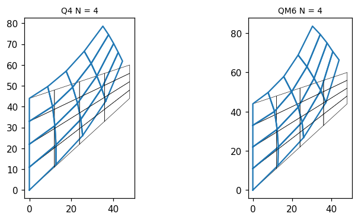

| Quantity | Ref. | Reference | feagent | Error | |
|---|---|---|---|---|---|
| converged v_C, Q9 32x32 (Bergan-Felippa 23.96) | other | 23.96 | 23.961 | 0.00 % | ✅ |
| v_C, Q4 2x2 (published benchmark 11.85) | other | 11.85 | 11.845 | 0.04 % | ✅ |
| v_C, QM6 2x2 (published benchmark 21.05) | other | 21.05 | 21.05 | 0.00 % | ✅ |
| v_C reference implied by the book (from QM6 N = 2) | book | - | 23.813 | - | ✅ |
| sigma_A / 0.2362, QM6, N = 2 (book 0.84) | book | - | 0.72468 | - | ✅ |
| sigma_B / -0.2023, QM6, N = 2 (book 0.788) | book | - | 0.92765 | - | ✅ |
| v_C / v_ref, QM6, N = 4 | book | 0.967 | 0.96657 | 0.04 % | ✅ |
| sigma_A / 0.2362, QM6, N = 4 (book 0.978) | book | - | 0.92792 | - | ✅ |
| sigma_B / -0.2023, QM6, N = 4 (book 0.926) | book | - | 0.9267 | - | ✅ |
| v_C / v_ref, Q4, N = 2 | book | 0.498 | 0.49743 | 0.11 % | ✅ |
| sigma_A / 0.2362, Q4, N = 2 (book 0.558) | book | - | 0.48716 | - | ✅ |
| sigma_B / -0.2023, Q4, N = 2 (book 0.457) | book | - | 0.39233 | - | ✅ |
| v_C / v_ref, Q4, N = 4 | book | 0.769 | 0.76847 | 0.07 % | ✅ |
| sigma_A / 0.2362, Q4, N = 4 (book 0.83) | book | - | 0.77699 | - | ✅ |
| sigma_B / -0.2023, Q4, N = 4 (book 0.753) | book | - | 0.7086 | - | ✅ |
| sigma_max at A, Q9 32x32 | other | 0.2362 | 0.237 | 0.34 % | ✅ |
| sigma_min at B, Q9 32x32 | other | -0.2023 | -0.20358 | 0.63 % | ✅ |

**Notes**: Point C is the middle of the right side (48, 52): with it 2x2 Q4 and 2x2 QM6 give 11.85 and 21.05 as in published benchmarks and Q9 32x32 converges to 23.96 (Bergan and Felippa). The book's four v_C ratios however imply a reference of 23.81 (the best known value of the time, ref. [8.3]): it is derived from QM6 N = 2 and the other three ratios are checked. The book stresses at A and B depend on an undescribed recovery (extrapolation, averaging, use of the incompatible modes): feagent values (nodal average, principal stresses) are only reported.

*Code*: `validation/books/cook/ch08.py`

<a id="cook-8-4-drilling-dof-triangle"></a>

### Sez. 8.4, Fig. 8.4-1, Eq. 8.4-1..8.4-9 - Plane triangle with 'drilling' rotations obtained from the LST

📐 · PDF page 256 · plane

The vertices keep u, v and the rotation omega; the normal displacement of the mid-side nodes is delta = L (omega_j - omega_i)/8 (parabolic side). The 9-dof triangle has one spurious mode (equal omegas, u = v = 0) to be stabilised by a small stiffness (gamma = 1e-6), and represents rigid motions and constant-strain states exactly.

**Model**: feagent PlaneT6 (E = 1, nu = 0.25, t = 1) on a generic triangle; the book's 12x9 transformation written with numpy, [k] = [T]^T [k_LST] [T].

| Quantity | Ref. | Reference | feagent | Error | |
|---|---|---|---|---|---|
| zero eigenvalues of 9x9 [k] (3 rigid + 1 spurious) | exact | 4 | 4 | 0.00 % | ✅ |
| rigid rotation with omega = theta | exact | 0 | 7.2506e-22 | 0.00 % | ✅ |
| spurious mode (equal omegas) | exact | 0 | 0 | 0.00 % | ✅ |
| constant-strain state | exact | 0.001 | 1.0000e-03 | 0.00 % | ✅ |

**Notes**: Checks: 4 zero eigenvalues (3 rigid modes + spurious mode), rigid rotation with omega = theta at zero energy, constant strain reproduced.

*Code*: `validation/books/cook/ch08.py`

<a id="cook-8-5-hybrid-stress-rectangle"></a>

### Sez. 8.5 (Example), Fig. 8.5-1, Eq. 8.5-1..8.5-16 - Assumed-stress hybrid element (5-beta rectangle)

📐 · PDF page 259 · plane

Stress field sigma_x = b1 + b4 y, sigma_y = b2 + b5 x, tau = b3, bilinear boundary displacements: [k] = [G]^T [H]^-1 [G] with [H] = int P^T E^-1 P dV, [G] = int P^T B dV. For the rectangle it equals the QM6.

**Model**: 2a x 2b rectangle (a = 1.5, b = 0.6, E = 1, nu = 0.3, t = 1): [H] and [G] built with numpy from the 5-parameter field and the feagent PlaneQ4 [B]; comparison with the feagent QM6.

| Quantity | Ref. | Reference | feagent | Error | |
|---|---|---|---|---|---|
| 5-beta hybrid vs QM6 (rectangle) | exact | 0 | 5.9459e-16 | 0.00 % | ✅ |

**Notes**: Coordinates x, y from the rectangle centre; 2x2 Gauss is exact.

*Code*: `validation/books/cook/ch08.py`

<a id="cook-8-6-hybrid-drilling-triangle-membrane"></a>

### Sez. 8.6, Fig. 8.6-1, 8.6-2 - Cook's membrane with drilling-rotation triangles (Eq. 8.4-5 and hybrid macroelement)

🟡 · PDF page 264 · plane, shell

The book solves Cook's membrane with the drilling triangle of Eq. 8.4-5 (v_C 0.840/0.950 for N = 2/4) and with a hybrid macroelement of three sub-triangles (0.900/0.969): drilling rotations greatly improve the constant-strain triangle.

**Model**: Cook's membrane (as cook-8.3) with feagent shell triangles in the X-Y plane (add_shell_tri): formulation='thin' (GT9 membrane with drilling, Long and Xu) and 'membrane' (triangle without drilling); each N x N quadrilateral split along one diagonal; out-of-plane dofs fixed.

| Quantity | Ref. | Reference | feagent | Error | |
|---|---|---|---|---|---|
| v_C/23.96, thin, N = 2 (book 0.840 / 0.900) | book | - | 0.70889 | - | ✅ |
| v_C/23.96, thin, N = 4 (book 0.950 / 0.969) | book | - | 0.89368 | - | ✅ |
| v_C/23.96, membrane, N = 2 (book 0.840 / 0.900) | book | - | 0.28141 | - | ✅ |
| v_C/23.96, membrane, N = 4 (book 0.950 / 0.969) | book | - | 0.46962 | - | ✅ |
| v_C, GT9 with drilling, N = 32 | other | 23.96 | 23.891 | 0.29 % | ✅ |

**Notes**: The book elements are not in feagent: the feagent drilling triangle is the GT9, a different one. The ratios v_C/23.96 with N = 2, 4 for GT9 and for the triangle without drilling are reported, and GT9 is checked to converge to the reference (N = 32); the book's subdivision pattern is unknown.

*Code*: `validation/books/cook/ch08.py`

<a id="cook-8-7-elastic-kernel-beam"></a>

### Sez. 8.7 (Example), Eq. 8.7-1..8.7-9 - Elastic kernel: rebuilding the full beam [k]

📐 · PDF page 264 · beam

From the stiffness k_EE of the 'elastic' dofs of a statically supported element and the rigid-motion matrix the full 4x4 [k] is rebuilt (Eq. 4.2-5).

**Model**: feagent cantilever (EI = 5, L = 2) fixed on the left: tip flexibility from two solutions with unit loads, k_EE = flexibility^-1 and kinematic matrix [T] = [[1, -L], [0, 1]] of rigid motions.

| Quantity | Ref. | Reference | feagent | Error | |
|---|---|---|---|---|---|
| [k] rebuilt from the elastic kernel | exact | 0 | 1.7764e-15 | 0.00 % | ✅ |

**Notes**: [k] = [[T^T k_EE T, -T^T k_EE], [-k_EE T, k_EE]] on dofs (v1, th1, v2, th2).

*Code*: `validation/books/cook/ch08.py`

<a id="cook-8-9-quarter-point-crack"></a>

### Sez. 8.9, Fig. 8.9-1..8.9-4, Eq. 8.9-1..8.9-8 - Quarter-point elements for the crack-tip singularity

🟡 · PDF page 267 · bar, plane, fracture

Moving the mid-side node to the quarter point makes the isoparametric map produce strains proportional to r^-1/2, the crack-tip singularity. For the centre-cracked plate the book gives K_I = sigma sqrt(pi a) [1 - 0.5 (a/c) + 0.326 (a/c)^2]/sqrt(1 - a/c) and the formula for K_I from the crack-face node displacements.

**Model**: (a) feagent L3 bar with the middle node at L/4 from end 1; (b) quarter of a centre-cracked plate (a/c = 0.5, height 2H = 6c, sigma = 1, E = 1, nu = 0.3, plane stress) of Q8 with a graded mesh and quarter-point nodes on the sides leaving the tip; K_I from the crack-face displacements (Eq. 8.9-8) and from the change of strain energy with crack length.

| Quantity | Ref. | Reference | feagent | Error | |
|---|---|---|---|---|---|
| eps * sqrt(x) = 1/2 (u = sqrt(x)), xi = -0.5 | exact | 0.5 | 0.5 | 0.00 % | ✅ |
| eps * sqrt(x) = 1/2 (u = sqrt(x)), xi = 0.4 | exact | 0.5 | 0.5 | 0.00 % | ✅ |
| K_I/K_tab, quarter-point nodes, crack-face displacements | book | - | 0.95635 | - | ✅ |
| K_I/K_tab, mid-side nodes, crack-face displacements | book | - | 1.4905 | - | ✅ |
| K_I = sqrt(E dU/dA) against the tabulated formula | book | 1.4738 | 1.4865 | 0.86 % | ✅ |

**Notes**: feagent has no K_I post-processing: it is computed from the displacements (Eq. 8.9-8, K_I = E/4 sqrt(2 pi/l) (4 v_B - v_C)) and, as a check, from G = dU/dA (K_I = sqrt(E G)). With non-collapsed quadrilaterals the displacement method stays about 4-5 % below the tabulated formula (reported), while the energy method recovers it within 1 %. Without quarter-point nodes the same displacement calculation is about 50 % off.

*Code*: `validation/books/cook/ch08.py`

<a id="cook-8-10-winkler-foundation"></a>

### Sez. 8.10, Fig. 8.10-1, Eq. 8.10-1, 8.10-2 - Stiffness matrix of a Winkler foundation

📐 · PDF page 270 · beam, foundation

The foundation adds [k_f] = int beta [N]^T [N] dA (consistent); with Hermite functions it is beta L/420 [[156, 22L, 54, -13L], ...]; the lumped version gives beta A/n to each node.

**Model**: feagent.foundation: beam_foundation_stiffness on a beam (L = 2, beta = 3) and add_beam_foundation on a long beam (EI = 1, k = 4, L = 40, 80 elements) with a midspan point load.

| Quantity | Ref. | Reference | feagent | Error | |
|---|---|---|---|---|---|
| Hermite consistent foundation | exact | 0 | 4.4409e-16 | 0.00 % | ✅ |
| rigid translation: resultant beta L (lumped beta L/2 per node) [F/L] | exact | 6 | 6 | 0.00 % | ✅ |
| long beam on Winkler: w = P lambda/(2k) [L] | exact | 0.125 | 0.12497 | 0.03 % | ✅ |

**Notes**: Additional check: deflection under the load of a long beam on elastic foundation, P lambda/(2k) with lambda = (k/4EI)^(1/4) (Hetenyi).

*Code*: `validation/books/cook/ch08.py`

<a id="cook-8-11-infinite-elements"></a>

### Sez. 8.11, Fig. 8.11-1..8.11-3, Eq. 8.11-1..8.11-8 - Mapped infinite elements in 1D and 2D

⛔ · PDF page 272 · infinite_elements

Infinite elements with mapping M1 = -2 xi/(1 - xi), M2 = (1 + xi)/(1 - xi) and pole at distance a from node 1: the field decays as a/r and (a/r)^2.

**Model**: None.

**Notes**: feagent has no infinite elements.

*Code*: `validation/books/cook/ch08.py`

<a id="cook-8-14-substructuring-symmetry"></a>

### Sez. 8.12-8.16, Fig. 8.14-1, 8.15-1, 8.16-1 - Finite differences, reanalysis, substructuring, symmetry and cyclic symmetry

📐 · PDF page 276 · plane

The book discusses substructuring (condensation of the internal dofs of a part), symmetry and antisymmetry (conditions on the axis), cyclic symmetry and reanalysis; it is qualitative.

**Model**: 4 x 2 plate of feagent Q8 supported at the bottom corners and loaded at midspan: whole model, half model with symmetry conditions (u = 0 on the axis) and model with the right half condensed as a Guyan superelement (feagent.reduction.guyan + add_superelement).

| Quantity | Ref. | Reference | feagent | Error | |
|---|---|---|---|---|---|
| midspan deflection, half symmetric model [L] | exact | -0.605 | -0.605 | 0.00 % | ✅ |
| midspan deflection, right half condensed (Guyan) [L] | exact | -0.605 | -0.605 | 0.00 % | ✅ |

**Notes**: Half symmetric model and condensed substructure are checked to give the same midspan deflection as the whole model.

*Code*: `validation/books/cook/ch08.py`

## Chapter 9

<a id="cook-9-1-bars-constraint-transformation"></a>

### Sez. 9.1 (Example), Fig. 9.1-2, Eq. 9.1-7..9.1-9 - Three bars with constraint u2 = u3 imposed by transformation

✅ · PDF page 293 · bar, constraints

With the transformation {u1, u2, u3} = [T]{u1, u2} the system becomes [[2k, -k], [-k, k]]{u1, u2} = {P, 2P}: u1 = 3P/k, u2 = u3 = 5P/k.

**Model**: Three feagent trusses in series (k = AE/L = 10), node 0 fixed, P = 1 at nodes 1, 2, 3; constraint u2 = u3 with add_equal_dof (master-slave elimination).

| Quantity | Ref. | Reference | feagent | Error | |
|---|---|---|---|---|---|
| u1 [L] | book | 0.3 | 0.3 | 0.00 % | ✅ |
| u2 [L] | book | 0.5 | 0.5 | 0.00 % | ✅ |
| u3 [L] | book | 0.5 | 0.5 | 0.00 % | ✅ |

**Notes**: Trial values k = 10, P = 1.

*Code*: `validation/books/cook/ch09.py`

<a id="cook-9-1-rigid-bar-two-springs"></a>

### Sez. 9.1, Fig. 9.1-3, Eq. 9.1-10 - Rigid bar on two springs with constraint v1 = v2

✅ · PDF page 294 · spring, constraints

The constraint v1 = v2 makes the bar rigid in translation: v1 = v2 = P/(2k) and each spring carries P/2; the elastic forces alone do not balance moments: the constraint carries the difference.

**Model**: Two nodes 2 apart on ground springs k = 50 (add_elastic_support), force P = 4 at node 1, constraint v1 = v2 (add_equal_dof).

| Quantity | Ref. | Reference | feagent | Error | |
|---|---|---|---|---|---|
| v1 [L] | exact | -0.04 | -0.04 | 0.00 % | ✅ |
| v2 [L] | exact | -0.04 | -0.04 | 0.00 % | ✅ |
| force in spring 2 = P/2 [F] | exact | -2 | -2 | 0.00 % | ✅ |

**Notes**: Trial values.

*Code*: `validation/books/cook/ch09.py`

<a id="cook-9-2-bars-lagrange-multiplier"></a>

### Sez. 9.2 (Example), Eq. 9.2-1..9.2-4 - Three bars with constraint u2 = u3 imposed by a Lagrange multiplier

✅ · PDF page 295 · bar, constraints

Augmented system [[K, C^T], [C, 0]]{u, lambda} = {P, 0} with [C] = [0, 1, -1]: u1 = 3P/k, u2 = u3 = 5P/k and lambda = -P (force in the rigid link 2-3).

**Model**: As cook-9.1 (three trusses, k = 10, P = 1): feagent eliminates the constraint by transformation; the multiplier lambda = constraint force at node 3 follows from the node equilibrium with the force of truss 2-3. Also compared with the book's augmented system solved with numpy on the feagent [K].

| Quantity | Ref. | Reference | feagent | Error | |
|---|---|---|---|---|---|
| u1 from augmented system vs feagent [L] | exact | 0.3 | 0.3 | 0.00 % | ✅ |
| u3 [L] | book | 0.5 | 0.5 | 0.00 % | ✅ |
| lambda dal sistema aumentato [F] | book | -1 | -1 | 0.00 % | ✅ |
| constraint force at node 3 (feagent) [F] | book | -1 | -1 | 0.00 % | ✅ |

**Notes**: The sign of lambda depends on the [C] convention: with [C] = [0, 1, -1], lambda = -P.

*Code*: `validation/books/cook/ch09.py`

<a id="cook-9-3-penalty-two-bars"></a>

### Sez. 9.3 (Example), Fig. 9.3-1, Eq. 9.3-4..9.3-6 - Two bars with constraint u1 = u2 imposed by a penalty function

✅ · PDF page 297 · bar, constraints

u1 = 2P/k for any alpha and u2 = (3 + 2 alpha) P/(k (1 + alpha)): with alpha = 0 u2 = 3P/k (no constraint), with alpha -> infinity u2 -> 2P/k (constraint satisfied).

**Model**: Two feagent axial springs in series (k = 10), P = 1 at nodes 1 and 2; the penalty [C] = [sqrt(k), -sqrt(k)] with number alpha equals a spring of stiffness alpha k between nodes 1 and 2 (alpha = 0, 1, 1e3, 1e6).

| Quantity | Ref. | Reference | feagent | Error | |
|---|---|---|---|---|---|
| u2, alpha = 0 [L] | book | 0.3 | 0.3 | 0.00 % | ✅ |
| u2, alpha = 1 [L] | book | 0.25 | 0.25 | 0.00 % | ✅ |
| u1 [L] | book | 0.2 | 0.2 | 0.00 % | ✅ |
| u2, alpha = 1000 [L] | book | 0.2001 | 0.2001 | 0.00 % | ✅ |
| u2, alpha = 1e+06 [L] | book | 0.2 | 0.2 | 0.00 % | ✅ |

**Notes**: Trial values.

*Code*: `validation/books/cook/ch09.py`

<a id="cook-9-4-mindlin-beam-locking"></a>

### Sez. 9.4-9.5, Fig. 9.4-1, Eq. 9.4-1..9.4-5 - Shear locking of a linear Mindlin beam element

🟡 · PDF page 299 · beam, locking

With exactly integrated shear w2 = [12 (t/L)^2 + 20]/[12 (t/L)^2 + 5] 1.2 PL/(GA): for a slender beam it tends to 4.8 PL/(GA), tiny compared with bending (locking); with one Gauss point (constraint ratio r = 2) the result improves greatly.

**Model**: Linear Mindlin element (linear w and theta) written with numpy, shear integrated with 2 points (exact) or 1 point; reference the exact feagent Timoshenko beam (shear=True, Asy = A/1.2). Cantilever b = 1, nu = 0 (E = 2G), form factor 1.2, tip load P, t/L = 1, 0.1, 0.01.

| Quantity | Ref. | Reference | feagent | Error | |
|---|---|---|---|---|---|
| w2 full integration, t/L = 1.0 (Eq. 9.4-5) [L] | book | 2.2588 | 2.2588 | 0.00 % | ✅ |
| feagent Timoshenko beam, t/L = 1.0 [L] | exact | 3.2 | 3.2 | 0.00 % | ✅ |
| full w2 / exact, t/L = 1.0 | book | - | 0.70588 | - | ✅ |
| one-point w2 = PL^3/(4EI) + 1.2 PL/(GA), t/L = 1.0 [L] | exact | 2.7 | 2.7 | 0.00 % | ✅ |
| one-point w2 / exact, t/L = 1.0 | book | - | 0.84375 | - | ✅ |
| w2 full integration, t/L = 0.1 (Eq. 9.4-5) [L] | book | 47.156 | 47.156 | 0.00 % | ✅ |
| feagent Timoshenko beam, t/L = 0.1 [L] | exact | 2012 | 2012 | 0.00 % | ✅ |
| full w2 / exact, t/L = 0.1 | book | - | 0.023438 | - | ✅ |
| one-point w2 = PL^3/(4EI) + 1.2 PL/(GA), t/L = 0.1 [L] | exact | 1512 | 1512 | 0.00 % | ✅ |
| one-point w2 / exact, t/L = 0.1 | book | - | 0.75149 | - | ✅ |
| w2 full integration, t/L = 0.01 (Eq. 9.4-5) [L] | book | 479.91 | 479.91 | 0.00 % | ✅ |
| feagent Timoshenko beam, t/L = 0.01 [L] | exact | 2.0001e+06 | 2.0001e+06 | 0.00 % | ✅ |
| full w2 / exact, t/L = 0.01 | book | - | 2.3994e-04 | - | ✅ |
| one-point w2 = PL^3/(4EI) + 1.2 PL/(GA), t/L = 0.01 [L] | exact | 1.5001e+06 | 1.5001e+06 | 0.00 % | ✅ |
| one-point w2 / exact, t/L = 0.01 | book | - | 0.75001 | - | ✅ |

**Notes**: feagent has no linear Mindlin element (its Timoshenko beam is exact and does not lock): the book element is written with numpy and compared with the formula of Eq. 9.4-5 and with the feagent beam. The book does not print the one-point formula: with one point w2 = PL^3/(4EI) + 1.2 PL/(GA), i.e. 3/4 of the exact bending deflection for a slender beam, without locking.

*Code*: `validation/books/cook/ch09.py`

<a id="cook-9-4-incompressibility-constraint-counting"></a>

### Sez. 9.4-9.6, Fig. 9.5-1, 9.5-2, 9.6-1 - Nearly incompressible materials, constraint counting and consistent penalty

🟡 · PDF page 300 · plane, locking

With nu -> 0.5 the incompressibility condition constrains the displacement field: if the constraints (integration points of the volumetric term) are too many compared with the dofs (r <= 1) the mesh locks. Book values of r: 1-point Q4 2, 3x3 Q8 6/9, 2x2 Q8 6/4, 2x2 Q9 8/4, pairs of 3-point T6 8/6.

**Model**: 10 x 2 plane-strain cantilever (E = 1, nu = 0.3 and 0.4999, parabolic tip load P = 1) with 20 x 4 meshes of PlaneQ4 (full and 'volumetric' integration), PlaneQ8 (3x3 and 'reduced') and PlaneQ9 ('volumetric'); constraint ratio r counted on a 60 x 60 mesh.

| Quantity | Ref. | Reference | feagent | Error | |
|---|---|---|---|---|---|
| constraint ratio r, Q4 1 punto | book | 2 | 2.0672 | 3.36 % | ✅ |
| constraint ratio r, Q8 3x3 | book | 0.66667 | 0.68154 | 2.23 % | ✅ |
| constraint ratio r, Q8 2x2 | book | 1.5 | 1.5335 | 2.23 % | ✅ |
| constraint ratio r, Q9 2x2 | book | 2 | 2.0335 | 1.67 % | ✅ |
| constraint ratio r, T6 3 punti | book | 1.3333 | 1.3556 | 1.67 % | ✅ |
| deflection / reference, Q4 pieno, nu = 0.4999 | book | - | 0.047158 | - | ✅ |
| deflection / reference, Q4 volumetrico, nu = 0.4999 | book | - | 0.9514 | - | ✅ |
| deflection / reference, Q8 3x3, nu = 0.4999 | book | - | 0.96222 | - | ✅ |
| deflection / reference, Q8 2x2, nu = 0.4999 | book | - | 0.96682 | - | ✅ |
| deflection / reference, Q9 volumetrico, nu = 0.4999 | book | - | 0.98561 | - | ✅ |
| fully integrated Q4 locks (ratio < 0.5) | book | 1 | 1 | 0.00 % | ✅ |
| Q4 with reduced volumetric term free of locking (ratio > 0.9) | book | 1 | 1 | 0.00 % | ✅ |

**Notes**: The book is qualitative: r (dofs per constraint point, large mesh) is counted and deflection locking is shown: ratio to the nu = 0.4999 deflection computed with Q9 'volumetric' 40 x 8. The consistent penalty (Sec. 9.6) is not reproduced.

*Code*: `validation/books/cook/ch09.py`

## Chapter 10

<a id="cook-10-4-square-wave-fourier"></a>

### Sez. 10.4, Fig. 10.4-1, Eq. 10.4-4 - Fourier series of a square wave (uniform load on a span)

📐 · PDF page 318 · other

Function -phi0 for -L < x < 0 and +phi0 for 0 < x < L, period 2L: the coefficients vanish for even n and q_n = 4 phi0/(n pi) for odd n.

**Model**: Coefficients computed by numerical integration (numpy) and compared with the book's formula; no finite element.

| Quantity | Ref. | Reference | feagent | Error | |
|---|---|---|---|---|---|
| coefficient q_1 | exact | 2.5465 | 2.5465 | 0.00 % | ✅ |
| coefficient q_2 | exact | 0 | 0 | 0.00 % | ✅ |
| coefficient q_3 | exact | 0.84883 | 0.84883 | 0.00 % | ✅ |
| coefficient q_5 | exact | 0.5093 | 0.5093 | 0.00 % | ✅ |

**Notes**: It is the uniform load expanded in series for the simply supported beam example. Test data phi0 = 2, L = 3.

*Code*: `validation/books/cook/ch10.py`

<a id="cook-10-4-point-load-fourier"></a>

### Sez. 10.4, Eq. 10.4-5 - Fourier series of a midspan point load and beam deflection

📐 · PDF page 319 · other, beam

The load P at midspan of a span L has q_n = (2P/L) sin(n pi/2): the load series does not converge, but the displacement series does, and the midspan deflection tends to P L^3/(48 EI).

**Model**: Sum of the book's series for the deflection and a simply supported beam of 40 feagent beams with a midspan point load.

| Quantity | Ref. | Reference | feagent | Error | |
|---|---|---|---|---|---|
| deflection from the series (3999 terms) | exact | 0.020833 | 0.020833 | 0.00 % | ✅ |
| feagent beam vs series | other | 0.020833 | 0.020833 | 0.00 % | ✅ |

**Notes**: With 4000 terms the deflection series matches the feagent beam (exact at nodes). Data: P = L = EI = 1.

*Code*: `validation/books/cook/ch10.py`

<a id="cook-10-4-ss-beam-sine-load"></a>

### Sez. 10.4, Eq. 10.4-6..10.4-12, Fig. 10.4-2 - Simply supported beam under sinusoidal load: uncoupled harmonic solution

✅ · PDF page 319 · beam

Each load harmonic produces only the same displacement harmonic: w_n = (q_n/EI)(L/(n pi))^4 and M = -q_n L^2/(n pi)^2 sin(n pi x/L).

**Model**: 80 feagent beams with a trapezoidal load per element approximating q_n sin(n pi x/L), for n = 1, 3, 5.

| Quantity | Ref. | Reference | feagent | Error | |
|---|---|---|---|---|---|
| deflection at 0.500 L, harmonic n = 1 | exact | 0.010266 | 0.010265 | 0.01 % | ✅ |
| deflection at 0.500 L, harmonic n = 3 | exact | -1.2674e-04 | -1.2659e-04 | 0.12 % | ✅ |
| deflection at 0.100 L, harmonic n = 5 | exact | 1.6426e-05 | 1.6373e-05 | 0.32 % | ✅ |

**Notes**: The piecewise linear load introduces an O(h^2) error that grows with n (0.3 % for n = 5 with 80 elements). Data: L = EI = q_n = 1.

*Code*: `validation/books/cook/ch10.py`

## Chapter 11

<a id="cook-11-3-mindlin-clamped-square-plate"></a>

### Sez. 11.3, Fig. 11.3-2, Tabella 11.3-1 - Clamped square plate with Mindlin elements: locking as L/t varies

🟡 · PDF page 346 · plate

With an 8x8 mesh the book compares the computed centre deflection with the thin-plate value as L/t varies, for bilinear, quadratic, serendipity and heterosis elements with reduced, selective and full integration: the fully integrated bilinear locks, the selective bilinear and the reduced Lagrangian stay close to 1 up to L/t = 1e6.

**Model**: 8x8 mesh of feagent Mindlin Q4 shells (add_shell) on the whole plate, uniform load, L/t from 30 to 1e6.

| Quantity | Ref. | Reference | feagent | Error | |
|---|---|---|---|---|---|
| computed w / thin-plate w, L/t = 100 | exact | 1 | 0.99064 | 0.94 % | ✅ |
| computed w / thin-plate w, L/t = 1000 | exact | 1 | 0.98871 | 1.13 % | ✅ |
| computed w / thin-plate w, L/t = 10000 | exact | 1 | 0.98869 | 1.13 % | ✅ |
| computed w / thin-plate w, L/t = 1e+06 | exact | 1 | 0.98863 | 1.14 % | ✅ |

**Notes**: feagent has no 8- and 9-node Mindlin plates nor heterosis: only the Q4 curve is redone, and it does not lock (ratio 0.989 to the thin plate from L/t = 100 to 1e6, like the book's selective bilinear; feagent's one has the MITC4 assumed shear). The book values are only plotted. Reference w = 0.001265 q L^4/D (Timoshenko).

*Code*: `validation/books/cook/ch11.py`

<a id="cook-11-4-dkt-square-plates"></a>

### Sez. 11.4, Tabella 11.4-1, Fig. 11.4-2 - DKT element: centre deflection of square plates

✅ · PDF page 351 · plate

The book tabulates the ratio of the DKT centre deflection to the exact thin-plate value (nu = 0.3) for simply supported or clamped plates under uniform or concentrated load: for example 1.025, 0.999, 1.001, 1.001 (simply supported, uniform) and 1.500, 1.228, 1.069, 1.021 (clamped, uniform).

**Model**: feagent thin triangles (add_shell_tri, formulation='thin': DKT bending) on a quarter plate with symmetry, diagonals towards the centre as in Fig. 11.4-2, N_es = 1, 2, 4, 8; classical simple support (w = 0 and zero tangential rotation) or clamping; distributed load lumped one third to the vertices of each element.

| Quantity | Ref. | Reference | feagent | Error | |
|---|---|---|---|---|---|
| simply supported, uniform load, N_es = 1 | book | 1.025 | 1.025 | 0.00 % | ✅ |
| simply supported, uniform load, N_es = 2 | book | 0.999 | 0.99898 | 0.00 % | ✅ |
| simply supported, uniform load, N_es = 4 | book | 1.001 | 1.0012 | 0.02 % | ✅ |
| simply supported, uniform load, N_es = 8 | book | 1.001 | 1.0009 | 0.01 % | ✅ |
| clamped, uniform load, N_es = 1 | book | 1.5 | 1.4997 | 0.02 % | ✅ |
| clamped, uniform load, N_es = 2 | book | 1.228 | 1.2281 | 0.01 % | ✅ |
| clamped, uniform load, N_es = 4 | book | 1.069 | 1.0694 | 0.03 % | ✅ |
| clamped, uniform load, N_es = 8 | book | 1.021 | 1.0211 | 0.01 % | ✅ |
| simply supported, concentrated load, N_es = 1 | book | 1.076 | 1.0762 | 0.02 % | ✅ |
| simply supported, concentrated load, N_es = 2 | book | 1.008 | 1.0076 | 0.04 % | ✅ |
| simply supported, concentrated load, N_es = 4 | book | 1.003 | 1.003 | 0.00 % | ✅ |
| simply supported, concentrated load, N_es = 8 | book | 1.001 | 1.0012 | 0.02 % | ✅ |
| clamped, concentrated load, N_es = 1 | book | 1.012 | 1.0123 | 0.03 % | ✅ |
| clamped, concentrated load, N_es = 2 | book | 1.046 | 1.0456 | 0.04 % | ✅ |
| clamped, concentrated load, N_es = 4 | book | 1.019 | 1.0192 | 0.02 % | ✅ |
| clamped, concentrated load, N_es = 8 | book | 1.007 | 1.0073 | 0.03 % | ✅ |

**Notes**: Exact references as in the book: 0.00406, 0.00126 q a^4/D and 0.01160, 0.00560 P a^2/D (Timoshenko). The 16 cells agree within three-decimal rounding.

*Code*: `validation/books/cook/ch11.py`

<a id="cook-11-4-dkt-stiffness-code"></a>

### Sez. 11.4, Fig. 11.4-3 - 9x9 stiffness matrix of the DKT element

📐 · PDF page 352 · plate

The book lists the Fortran subroutine of the DKT stiffness, integrated exactly with three points; it prints no numerical values.

**Model**: feagent thin triangle (ShellT3Thin, DKT bending): bending part on the w, rx, ry DOFs of the three vertices.

| Quantity | Ref. | Reference | feagent | Error | |
|---|---|---|---|---|---|
| three zero eigenvalues (rigid motions) | exact | 0 | 2.4408e-16 | 0.00 % | ✅ |
| no other zero-energy mode | book | 1 | 1 | 0.00 % | ✅ |
| energy of constant curvature w,xx = 1 | exact | 0.024038 | 0.024038 | 0.00 % | ✅ |
| energy of constant twist w,xy = 1 | exact | 0.033654 | 0.033654 | 0.00 % | ✅ |

**Notes**: Without the executable listing, the properties the matrix must have are checked: three zero eigenvalues (rigid motions w, rx, ry) and the exact energy of constant curvatures (w = x^2/2: U = D A/2; w = x y: U = D (1 - nu) A). Test triangle (0,0), (1.2,0.1), (0.3,0.9).

*Code*: `validation/books/cook/ch11.py`

<a id="cook-11-5-rhombic-plate"></a>

### Sez. 11.5, Fig. 11.5-2 - Simply supported rhombic plate (Morley): classical and 'finite element' support conditions

✅ · PDF page 354 · plate

Rhombus of side a, acute angle 30 degrees, nu = 0.3, uniform load. The book notes that with a 14 x 14 mesh and classical support the centre deflection is underestimated by more than 20 %, while with 'finite element' support the error drops below 3 %; Fig. 11.5-2b gives the centre moments (Morley: 0.0191 and 0.0108 q a^2).

**Model**: Rhombus with a 30 degree angle split into N x N parallelograms divided into two feagent thin DKT triangles; 'finite element' support (w = 0 only) or classical (also zero tangential rotation, with rotated support axes on the skew edges).

| Quantity | Ref. | Reference | feagent | Error | |
|---|---|---|---|---|---|
| classical support, 14 x 14: w / w Morley (book: more than 20 % low) | book | 0.8 | 0.79606 | 0.49 % | ✅ |
| 'finite element' support, 14 x 14: w / w Morley (book: error < 3 %) | book | 1 | 1.0293 | 2.93 % | ✅ |
| larger principal moment at the centre [q a^2] | book | 0.0191 | 0.019127 | 0.14 % | ✅ |
| smaller principal moment at the centre [q a^2] | book | 0.0108 | 0.010974 | 1.61 % | ✅ |

**Notes**: The book speaks of 'most elements' without naming one. With the feagent DKT and the parallelograms split along the short diagonal, on 14 x 14 the classical support gives w = 0.796 times Morley's value (-20.4 %) and the 'finite element' one 1.029 (+2.9 %), as the book states. With the long diagonal the 'finite element' support overestimates by 9 % on 14 x 14 (2.7 % on 32 x 32). Morley's exact deflection 0.408e-3 q a^4/D; centre principal moments are the average of the triangles touching the centre node (reference read from Fig. 11.5-2b).

*Code*: `validation/books/cook/ch11.py`

<a id="cook-11-5-patch-test-curvature"></a>

### Sez. 11.5, Fig. 11.5-3 - Constant-curvature patch test for plate elements

✅ · PDF page 354 · plate

The patch is loaded by Mx = 2 M_n/H; with w,y = 0 imposed on the boundary to avoid edge curling due to nu, every element must show the same curvature w,xx and hence Mx = 2 M_n/H and My = nu Mx.

**Model**: Four feagent DKT triangles around a generic interior node 5; left side clamped, nodal couples M_n at nodes 2 and 3 of the right side, w,y = 0 (rx) imposed at nodes 1-4.

| Quantity | Ref. | Reference | feagent | Error | |
|---|---|---|---|---|---|
| Mx (principal) in element 1 | exact | 2 | 2 | 0.00 % | ✅ |
| My = nu Mx in element 1 | exact | 0.6 | 0.6 | 0.00 % | ✅ |
| Mx (principal) in element 2 | exact | 2 | 2 | 0.00 % | ✅ |
| My = nu Mx in element 2 | exact | 0.6 | 0.6 | 0.00 % | ✅ |
| Mx (principal) in element 3 | exact | 2 | 2 | 0.00 % | ✅ |
| My = nu Mx in element 3 | exact | 0.6 | 0.6 | 0.00 % | ✅ |
| Mx (principal) in element 4 | exact | 2 | 2 | 0.00 % | ✅ |
| My = nu Mx in element 4 | exact | 0.6 | 0.6 | 0.00 % | ✅ |

**Notes**: Free dimensions: W = 2, H = 1, interior node (0.7, 0.6), nu = 0.3, M_n = 1.

*Code*: `validation/books/cook/ch11.py`

<a id="cook-11-5-twisted-ribbon"></a>

### Sez. 11.5, Fig. 11.5-4 - Twisted ribbon: thin cantilever loaded by corner forces for varying length

🟡 · PDF page 355 · plate

Ribbon 1 wide, 0.05 thick, E = 1e7, nu = 0.25, length up to 12: the book plots the deflection of corner 3 against L for the two-triangle DKT (about 40e-3 for L = 12), for a benchmark of 16 Kirchhoff elements (about 33e-3) and for an element that is too stiff.

**Model**: Two feagent DKT triangles (diagonal 1-3) and a fine DKT mesh (24 x 4 split rectangles); clamped side 1-4, force +1 at node 3 and -1 at node 2.

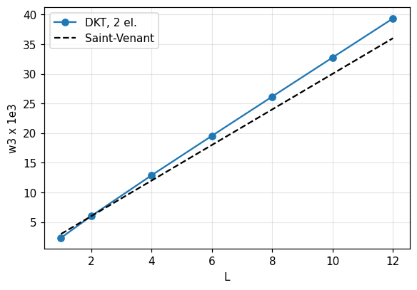

| Quantity | Ref. | Reference | feagent | Error | |
|---|---|---|---|---|---|
| two-triangle DKT, L = 4 (read from the figure) | book | 0.0128 | 0.012889 | 0.70 % | ✅ |
| two-triangle DKT, L = 8 (read from the figure) | book | 0.0262 | 0.026162 | 0.15 % | ✅ |
| two-triangle DKT, L = 12 (read from the figure) | book | 0.0397 | 0.039337 | 0.91 % | ✅ |
| fine mesh against Saint-Venant torsion, L = 12 | exact | 0.036 | 0.034902 | 3.05 % | ✅ |

**Notes**: Values read from the figure (about 1 % precision): the two-triangle feagent DKT follows the book's DKT curve. The fine mesh (34.9e-3 at L = 12) is compared with Saint-Venant torsion of the thin strip, w3 = T L/(2 G J) with J = b t^3/3 (36.0e-3; the 3 % gap is the restrained warping at the root); the book's 16-element benchmark reads about 33e-3.

*Code*: `validation/books/cook/ch11.py`

## Chapter 12

<a id="cook-12-2-semicircular-arch"></a>

### Sez. 12.2, Fig. 12.2-1a - Clamped semicircular arch with crown load: straight elements

🟡 · PDF page 366 · frame, shell

Semicircular arch with R/t = 40, clamped ends, load P at the crown: with 4 straight elements whose length equals the arc the error on the load displacement is about 2 %, with the chord length about 10 %; simple curved elements lock.

**Model**: 4 straight feagent beams with nodes on the arch: with the chord length (normal beams) or with the arc length pi R/4 (stiffness of a beam of that length rotated onto the chord, as a superelement); reference with 400 elements.

| Quantity | Ref. | Reference | feagent | Error | |
|---|---|---|---|---|---|
| 400-element reference vs bending only | exact | 1 | 1.0053 | 0.53 % | ✅ |
| error with 4 elements of arc length (about 2 %) | book | 0.02 | 0.027337 | 36.69 % | ✅ |
| error with 4 elements of chord length (about 10 %) | book | 0.1 | 0.099609 | 0.39 % | ✅ |

**Notes**: The book gives neither E, section, P nor the exact value: R = 40, rectangular section t = 1, E = P = 1 are used, with 400 elements as reference, which differs by 0.5 % from bending only (Castigliano) because of axial deformability. With 4 elements feagent errs by 2.7 % (arc) and 10.0 % (chord). Curved arch elements do not exist in feagent.

*Code*: `validation/books/cook/ch12.py`

<a id="cook-12-2-curved-element-rigid-body"></a>

### Sez. 12.2, Eq. 12.2-12 - Curved arch element with an internal mode: spurious rigid-body energy

⛔ · PDF page 368 · shell

The book reports that the fields of Eq. 12.2-12 (with a condensed internal mode) reduce the spurious rigid-body energy relative to Eq. 12.2-7 by 122,000 times for a 12 degree element and 18,000 times for 20 degrees (ref. 12.4).

**Notes**: feagent has no curved arch elements. A numpy reconstruction of the book's fields does not reproduce the printed factors without the data of ref. 12.4 (rigid motion considered, membrane to bending stiffness ratio, exact form of the internal mode, only partly legible in the text): with membrane energy only and tangential translation one gets 4.4e6 and 5.7e5, so the case remains not reproducible.

*Code*: `validation/books/cook/ch12.py`

<a id="cook-12-3-drilling-stiffness"></a>

### Sez. 12.3, Eq. 12.3-4 - Fictitious stiffness for the normal (drilling) rotation in flat shells

📐 · PDF page 372 · shell

For the flat triangle the book adds on the vertex normal rotations the matrix alpha E V [[1,-1/2,-1/2],[-1/2,1,-1/2],[-1/2,-1/2,1]] (alpha about 0.3), which does not resist the rigid rotation theta_z1 = theta_z2 = theta_z3.

**Model**: Book matrix evaluated with numpy; feagent thin triangle (GT9 membrane with drilling) and 'cst' triangle (penalty drilling) for the in-plane rigid rotation.

| Quantity | Ref. | Reference | feagent | Error | |
|---|---|---|---|---|---|
| zero eigenvalue (rigid rotation) | exact | 0 | -5.5511e-17 | 0.00 % | ✅ |
| other two eigenvalues 1.5 | exact | 3 | 3 | 0.00 % | ✅ |
| thin triangle: rigid-rotation forces at the stabilization level (1e-8) | book | 1 | 1 | 0.00 % | ✅ |
| thin triangle: rz coupled to the membrane (true drilling rotation) | book | 1 | 1 | 0.00 % | ✅ |
| 'cst' triangle: rigid-rotation forces at the stabilization level (1e-8) | book | 1 | 1 | 0.00 % | ✅ |
| 'cst' triangle: rz coupled to the membrane (true drilling rotation) | book | 0 | 0 | 0.00 % | ✅ |

**Notes**: The book matrix has eigenvalues 0, 1.5, 1.5 (for alpha E V = 1) with null vector (1, 1, 1). In feagent the thin triangle (GT9 membrane) has a true drilling rotation coupled to u and v, so the in-plane rigid rotation produces no forces beyond the small numerical stabilization (1e-8 of the diagonal); the 'cst' triangle has the stabilization only, with no coupling.

*Code*: `validation/books/cook/ch12.py`

<a id="cook-12-4-cylinder-internal-pressure"></a>

### Sez. 12.4, Fig. 12.4-4 - Open-ended cylinder under internal pressure: meridional moment near the edge

🟡 · PDF page 377 · shell, axisym

Cylinder R = 10 in, length 10 in, thickness 0.1 in, p = 200 psi, E = 200,000 psi, nu = 0.3, open ends with radial support. The book plots M_s along s: zero up to about 7.5 in, maximum about 20 in-lb/in near s = 9.4 and zero at the end; 8 conical Mindlin elements follow thin-shell theory.

**Model**: Half cylinder (s = 5..10) with 80 x 2 feagent axisymmetric Q8 elements through the thickness (shells of revolution are absent in feagent); symmetry at s = 5, radial support of the mid node at s = 10; meridional moment by integrating the axial stresses through the thickness.

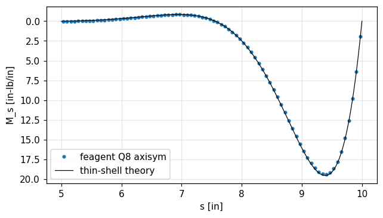

| Quantity | Ref. | Reference | feagent | Error | |
|---|---|---|---|---|---|
| maximum meridional moment (theory 19.51) [in-lb/in] | exact | 19.512 | 19.37 | 0.73 % | ✅ |
| location of the maximum (s = 9.39) [in] | exact | 9.389 | 9.4062 | 0.18 % | ✅ |
| moment at s = 9.0 in [in-lb/in] | exact | 16.06 | 15.947 | 0.70 % | ✅ |

**Notes**: The plot is compared with thin-shell theory (simply supported edge): M = 2 beta^2 D w_p exp(-beta x) sin(beta x), maximum 19.51 in-lb/in at x = pi/(4 beta) = 0.611 in from the edge (s = 9.39). The catalogue had read about 22: the enlarged plot shows a maximum just below 20.

*Code*: `validation/books/cook/ch12.py`

## Chapter 13

<a id="cook-13-3-bar-beam-mass-matrices"></a>

### Sez. 13.3, Eq. 13.3-1..13.3-3, Fig. 13.3-1 - Consistent and lumped mass matrices of bar and beam

📐 · PDF page 391 · bar, beam, dynamics_modal

The book derives the consistent mass of a bar moving in the plane, m/6 [[2,0,1,0],[0,2,0,1],[1,0,2,0],[0,1,0,2]], and that of the Hermite beam m/420 [[156,22L,54,-13L],...]; lumped masses are m/2 per node (with optional rotary inertia a L^2/210, a = 17.5).

**Model**: feagent truss (TrussElement.consistent_mass_global), feagent beam (BeamElement3D.consistent_mass_local, uy and rz DOFs in the X-Y plane), lumped mass from Model.assemble_mass.

| Quantity | Ref. | Reference | feagent | Error | |
|---|---|---|---|---|---|
| bar: max |M feagent - M book| | exact | 0 | 0 | 0.00 % | ✅ |
| beam: max |M feagent - M book| | exact | 0 | 2.7756e-16 | 0.00 % | ✅ |
| beam: translational lumped mass m/2 | book | 1.5 | 1.5 | 0.00 % | ✅ |
| coefficient a of the lumped rotary inertia | exact | 17.5 | 17.5 | 0.00 % | ✅ |

**Notes**: Test data: L = 2, rho A = 1.5 (m = 3). feagent lumped mass is translational only (a = 0 case); a = 17.5 is the inertia of half the beam about its end, (m/2)(L/2)^2/3, checked in closed form.

*Code*: `validation/books/cook/ch13.py`

<a id="cook-13-3-cst-q4-consistent-mass"></a>

### Sez. 13.3, Fig. 13.3-2 - Consistent mass matrices of CST and bilinear rectangle

📐 · PDF page 392 · plane_stress, dynamics_modal

For plane elements moving in three directions the book gives equal blocks for u, v, w: CST rho A t/12 [[2,1,1],[1,2,1],[1,1,2]], bilinear rectangle rho A t/36 [[4,2,1,2],[2,4,2,1],[1,2,4,2],[2,1,2,4]].

**Model**: feagent PlaneT3 and PlaneQ4 (consistent_mass), ux, uy, uz DOFs per node.

| Quantity | Ref. | Reference | feagent | Error | |
|---|---|---|---|---|---|
| CST: largest error of u, v, w blocks | exact | 0 | 2.7756e-17 | 0.00 % | ✅ |
| bilinear rectangle: largest block error | exact | 0 | 8.3267e-17 | 0.00 % | ✅ |

**Notes**: Test data: 2 x 1.5 rectangle, arbitrary triangle, rho = 2, t = 0.3.

*Code*: `validation/books/cook/ch13.py`

<a id="cook-13-3-hrz-lumping"></a>

### Sez. 13.3, Eq. 13.3-4, 13.3-5, Fig. 13.3-3 - HRZ diagonal masses of bar, beam, Q8 and Q9

📐 · PDF page 392 · bar, beam, plane_stress, dynamics_modal

The HRZ scheme keeps the diagonal of the consistent mass and scales it to the total mass: bar m/2, m/2; beam m/78 diag[39, L^2, 39, L^2]; Q8 corners 1/36 and sides 8/36 with 2x2 quadrature, 3/76 and 16/76 with 3x3; Q9 1/36, 4/36, 16/36 with both.

**Model**: feagent consistent masses (bar, beam, PlaneQ8, PlaneQ9) and lumped_masses (HRZ) of the plane elements; the 2x2 quadrature variant is integrated with numpy on the feagent shape functions.

| Quantity | Ref. | Reference | feagent | Error | |
|---|---|---|---|---|---|
| beam HRZ: mass on w (m 39/78) | book | 1 | 1 | 0.00 % | ✅ |
| beam HRZ: inertia on theta (m L^2/78) | book | 0.10256 | 0.10256 | 0.00 % | ✅ |
| bar HRZ: m/2 | book | 1 | 1 | 0.00 % | ✅ |
| Q8 HRZ 3x3: corner 3/76 | book | 0.039474 | 0.039474 | 0.00 % | ✅ |
| Q8 HRZ 3x3: side 16/76 | book | 0.21053 | 0.21053 | 0.00 % | ✅ |
| Q8 HRZ 2x2: corner 1/36 | book | 0.027778 | 0.027778 | 0.00 % | ✅ |
| Q8 HRZ 2x2: side 8/36 | book | 0.22222 | 0.22222 | 0.00 % | ✅ |
| Q9 HRZ: corner | book | 0.027778 | 0.027778 | 0.00 % | ✅ |
| Q9 HRZ 2x2: corner | book | 0.027778 | 0.027778 | 0.00 % | ✅ |
| Q9 HRZ: side | book | 0.11111 | 0.11111 | 0.00 % | ✅ |
| Q9 HRZ 2x2: side | book | 0.11111 | 0.11111 | 0.00 % | ✅ |
| Q9 HRZ: centre | book | 0.44444 | 0.44444 | 0.00 % | ✅ |
| Q9 HRZ 2x2: centre | book | 0.44444 | 0.44444 | 0.00 % | ✅ |

**Notes**: feagent integrates the Q8 mass with an exact rule, so lumped_masses returns the book's 3x3 values (3/76, 16/76).

*Code*: `validation/books/cook/ch13.py`

<a id="cook-13-3-thick-plate-frequencies-mass"></a>

### Sez. 13.3, Tabella 13.3-1 - Frequencies of a thick simply supported plate: consistent and lumped mass

🟡 · PDF page 393 · plate, dynamics_modal

The book compares the percentage frequency errors of a thick simply supported plate (half plate, 4x2 mesh of reduced-integration 8-node Mindlin elements) with consistent, HRZ and ad hoc lumped mass: for example mode (1,1) -0.11 %, +0.32 %, +0.32 % and mode (3,3) +13.78 %, -5.18 %, -19.42 %.

**Model**: Whole plate with an 8x8 mesh of feagent Mindlin Q4 shells (add_shell), w = 0 on the edges with zero tangential rotation (Navier support); translational consistent mass (assemble_mass_matrix) and lumped mass with equal particles (row sum, which for the rectangular Q4 coincides with HRZ).

| Quantity | Ref. | Reference | feagent | Error | |
|---|---|---|---|---|---|
| mode (1,1), consistent mass | exact | 0.58117 | 0.59095 | 1.68 % | ✅ |
| mode (1,1), lumped mass | exact | 0.58117 | 0.58304 | 0.32 % | ✅ |
| mode (1,2), consistent mass | exact | 1.398 | 1.4822 | 6.02 % | ✅ |
| mode (1,2), lumped mass | exact | 1.398 | 1.4281 | 2.15 % | ✅ |
| mode (2,2), consistent mass | exact | 2.1583 | 2.2952 | 6.34 % | ✅ |
| mode (2,2), lumped mass | exact | 2.1583 | 2.1587 | 0.02 % | ✅ |
| mode (1,1): lumped mass lowers the frequency | book | 1 | 1 | 0.00 % | ✅ |

**Notes**: feagent has no 8-node Mindlin plate: the table cannot be reproduced cell by cell, and the book does not give the thickness (it refers to ref. 13.5). t/a = 0.1, nu = 0.3 are used and the low modes are compared with the exact Mindlin solution without rotary inertia (feagent shell mass is translational only): the lumped mass gives lower frequencies than the consistent one, as in the book for the low modes.

*Code*: `validation/books/cook/ch13.py`

<a id="cook-13-3-optimal-lumping-quadratic-bar"></a>

### Sez. 13.3, Eq. 13.3-6..13.3-9, Fig. 13.3-4 - Optimal mass lumping: quadratic bar, T6, Q8, Q9

📐 · PDF page 394 · bar, dynamics_modal

The 'optimal' lumped mass uses a quadrature with points at the nodes: for the quadratic bar Simpson gives rho A L/6 diag[1, 1, 4]; for T6 vertices 0 and sides A/3, for Q8 corners -A/12 and sides A/3, for Q9 corners A/36, sides A/9 and centre 4A/9.

**Model**: feagent L3 bar (3-node add_bar), PlaneT6, PlaneQ8, PlaneQ9: nodal weights int N_i dA computed with the feagent shape functions and exact numpy quadrature.

| Quantity | Ref. | Reference | feagent | Error | |
|---|---|---|---|---|---|
| L3 bar: end node | book | 0.16667 | 0.16667 | 0.00 % | ✅ |
| L3 bar: middle node | book | 0.66667 | 0.66667 | 0.00 % | ✅ |
| T6: vertex 0 | book | 0 | -1.4537e-16 | 0.00 % | ✅ |
| T6: side A/3 | book | 0.33333 | 0.33333 | 0.00 % | ✅ |
| Q8: corner -A/12 | book | -0.083333 | -0.083333 | 0.00 % | ✅ |
| Q8: side A/3 | book | 0.33333 | 0.33333 | 0.00 % | ✅ |
| Q9: corner | book | 0.027778 | 0.027778 | 0.00 % | ✅ |
| Q9: side | book | 0.11111 | 0.11111 | 0.00 % | ✅ |
| Q9: centre | book | 0.44444 | 0.44444 | 0.00 % | ✅ |

**Notes**: With nodes at the quadrature points the weights equal the integrals of the shape functions, which are checked directly. Unit element (A = 1, L = 1).

*Code*: `validation/books/cook/ch13.py`

<a id="cook-13-4-rayleigh-damping"></a>

### Sez. 13.4, Eq. 13.4-1..13.4-3, Fig. 13.4-1 - Rayleigh damping: coefficients from two damping ratios

📐 · PDF page 396 · dynamics_transient

With [C] = a[K] + b[M] the damping ratio is xi = (a omega + b/omega)/2; imposing xi1 and xi2 at omega1 and omega2 the book derives a and b in closed form.

**Model**: feagent.moving_dynamics.RayleighDamping.from_frequencies (C = a M + b K, with the coefficient names swapped with respect to the book).

| Quantity | Ref. | Reference | feagent | Error | |
|---|---|---|---|---|---|
| coefficient of [K] (book's a) [s] | book | 5.2403e-04 | 5.2403e-04 | 0.00 % | ✅ |
| coefficient of [M] (book's b) [1/s] | book | 0.23064 | 0.23064 | 0.00 % | ✅ |
| xi at omega1 | book | 0.02 | 0.02 | 0.00 % | ✅ |
| xi at omega2 | book | 0.05 | 0.05 | 0.00 % | ✅ |

**Notes**: Test data: xi1 = 0.02 at 1 Hz, xi2 = 0.05 at 30 Hz.

*Code*: `validation/books/cook/ch13.py`

<a id="cook-13-5-free-bar-eigen"></a>

### Sez. 13.5, Eq. 13.5-8..13.5-10, Fig. 13.5-1 - Free bar with one element: eigenvalues with consistent and lumped mass

✅ · PDF page 400 · bar, dynamics_modal

Uniform free bar with one element: with consistent mass omega1 = 0 (rigid motion) and omega2 = (2/L) sqrt(3E/rho), 10 % above the exact pi/L sqrt(E/rho); with lumped mass omega2 = (2/L) sqrt(E/rho), below the exact value.

**Model**: One free-free feagent L2 bar (add_bar, rho), K and M from the model (assemble_stiffness, assemble_mass_matrix) and HRZ mass (lumped_masses).

| Quantity | Ref. | Reference | feagent | Error | |
|---|---|---|---|---|---|
| omega1, consistent mass (rigid) [rad/s] | book | 0 | 0 | 0.00 % | ✅ |
| omega2, consistent mass [rad/s] | book | 3.4641 | 3.4641 | 0.00 % | ✅ |
| omega2, lumped mass [rad/s] | book | 2 | 2 | 0.00 % | ✅ |

**Notes**: Data: L = E = rho = A = 1.

*Code*: `validation/books/cook/ch13.py`

<a id="cook-13-7-cantilever-plate-guyan"></a>

### Sez. 13.7, Fig. 13.7-1 - Square cantilever plate: first 4 frequencies, full system and Guyan reduction

🟡 · PDF page 409 · plate, dynamics_modal

Thin square plate clamped on one edge, 90 DOFs. The book gives omega = 3.469, 8.535, 21.450, 27.059 for the full system and 3.473, 8.604, 22.690, 29.490 with 6 master DOFs (dimensionless frequencies omega a^2 sqrt(rho t/D)).

**Model**: 5x5 mesh of squares split into two triangles (diagonal as in the figure), feagent thin DKT triangles (add_shell_tri, formulation='thin') with translational consistent mass; massless rotations condensed; Guyan reduction on the lateral displacements of the 6 circled nodes.

| Quantity | Ref. | Reference | feagent | Error | |
|---|---|---|---|---|---|
| omega1, full system | book | 3.469 | 3.4612 | 0.22 % | ✅ |
| omega2, full system | book | 8.535 | 8.5888 | 0.63 % | ✅ |
| omega3, full system | book | 21.45 | 22.068 | 2.88 % | ✅ |
| omega4, full system | book | 27.059 | 28.251 | 4.40 % | ✅ |
| omega1: Guyan / full ratio | book | 1.0012 | 1.001 | 0.01 % | ✅ |
| omega2: Guyan / full ratio | book | 1.0081 | 1.0085 | 0.04 % | ✅ |
| omega3: Guyan / full ratio | book | 1.0578 | 1.0561 | 0.16 % | ✅ |
| omega4: Guyan / full ratio | book | 1.0898 | 1.0926 | 0.25 % | ✅ |

**Notes**: The book's triangle (ref. 13.37) has a full consistent mass, the feagent one is the DKT with translational mass only: the first two frequencies agree within 1 %, the third and fourth are 3-5 % higher. The effect of the Guyan reduction (reduced/full ratio, which depends on the master choice) agrees within 0.3 %. nu = 0.3 assumed.

*Code*: `validation/books/cook/ch13.py`

<a id="cook-13-7-beam-guyan"></a>

### Sez. 13.7, Eq. 13.7-8..13.7-13, Fig. 13.7-2 - One-element beam: eigenvalues, Guyan reduction and lumped mass

✅ · PDF page 410 · beam, dynamics_modal

With two DOFs the book finds omega^2 = 6.1362 and 758.17 EI/(m L^3) (continuum 6.0881 and 493.13) and the mode theta2 = -1.5704/L; Guyan reduction on w1 gives 6.1765 with recovery theta2 = -1.5000/L (static) or -1.5709/L (with mass), and the Rayleigh quotient of the recovered vector returns 6.1362; with m/2 lumped at w1 the result is 6.

**Model**: One feagent beam (EI = 1, rho A = 1, L = 1) with w1 and theta2 free (theta1 = 0, w2 = 0); consistent mass; feagent.reduction.guyan with master w1.

| Quantity | Ref. | Reference | feagent | Error | |
|---|---|---|---|---|---|
| omega^2 mode 1 [EI/mL^3] | book | 6.1362 | 6.1362 | 0.00 % | ✅ |
| omega^2 mode 2 [EI/mL^3] | book | 758.17 | 758.17 | 0.00 % | ✅ |
| mode 1: theta2 with w1 = 1 [1/L] | book | -1.5704 | -1.5704 | 0.00 % | ✅ |
| Guyan reduced omega^2 [EI/mL^3] | book | 6.1765 | 6.1765 | 0.00 % | ✅ |
| recovered theta2 (Eq. 13.7-2) [1/L] | book | -1.5 | -1.5 | 0.00 % | ✅ |
| recovered theta2 (Eq. 13.7-7) [1/L] | book | -1.5709 | -1.5709 | 0.00 % | ✅ |
| Rayleigh quotient of the recovered vector [EI/mL^3] | book | 6.1362 | 6.1362 | 0.00 % | ✅ |
| omega^2 with m/2 lumped at w1 [EI/mL^3] | book | 6 | 6 | 0.00 % | ✅ |

**Notes**: The OCR text says omega but the values are omega^2 (6.0881 = (pi/2)^4).

*Code*: `validation/books/cook/ch13.py`

<a id="cook-13-8-cms-bar"></a>

### Sez. 13.8, Eq. 13.8-6..13.8-14, Tabella 13.8-1, Fig. 13.8-1 - Component mode synthesis (CMS1 and Craig-Bampton) of a stepped bar

✅ · PDF page 413 · bar, dynamics_modal

The book splits the bar into two substructures (nodes 1-2 and 4-5, interface 3), computes their modes and compares the first three frequencies 0.2651, 0.6156, 1.000 with those of CMS1 (0.2656, 0.8794, 1.182) and Craig-Bampton (0.2719, 0.9927, 1.268).

**Model**: 5 feagent bars (areas A, A, 2A, 2A, 2A; AE/L = 1) with nodal masses 1, 2, 3, 4, 4 (rho A L/2 = 1), node 6 clamped; Craig-Bampton with feagent.reduction.craig_bampton (interface node 3, 2 internal modes); CMS1 with the Ritz vectors K^-1 R.

| Quantity | Ref. | Reference | feagent | Error | |
|---|---|---|---|---|---|
| omega1, full system | book | 0.2651 | 0.26513 | 0.01 % | ✅ |
| omega2, full system | book | 0.6156 | 0.61563 | 0.00 % | ✅ |
| omega3, full system | book | 1 | 1 | 0.00 % | ✅ |
| substructure 1: lambda1 | book | 0.29289 | 0.29289 | 0.00 % | ✅ |
| substructure 2: lambda1 | book | 0.5 | 0.5 | 0.00 % | ✅ |
| CMS1: W(1,1) | book | 6.768 | 6.7678 | 0.00 % | ✅ |
| CMS1: Kr(1,1) | book | 15.91 | 15.907 | 0.02 % | ✅ |
| CMS1: Mr(1,1) | book | 216.7 | 216.69 | 0.01 % | ✅ |
| omega1, CMS1 | book | 0.2656 | 0.26567 | 0.03 % | ✅ |
| omega2, CMS1 | book | 0.8794 | 0.8794 | 0.00 % | ✅ |
| omega3, CMS1 | book | 1.182 | 1.1815 | 0.04 % | ✅ |
| omega1, book's CMS2 | book | 0.2719 | 0.2719 | 0.00 % | ✅ |
| omega2, book's CMS2 | book | 0.9927 | 0.99268 | 0.00 % | ✅ |
| omega3, book's CMS2 | book | 1.268 | 1.2679 | 0.01 % | ✅ |
| omega1, feagent Craig-Bampton (one mode per substructure) vs original | other | 0.2651 | 0.2653 | 0.08 % | ✅ |
| Craig-Bampton: constraint mode at node 4 | book | 0.66667 | 0.66667 | 0.00 % | ✅ |

**Notes**: The book's CMS2 adds the same-order modes of the two substructures in a single column (amplitudes tied together): it is not the standard feagent Craig-Bampton, which keeps one mode per substructure in separate columns and gives 0.2653, 0.6161, 1.051, much closer to the original. The book's CMS2 is rebuilt with feagent matrices and constraint mode. The CMS1 Ritz vectors are the static responses to the substructure mode shapes used as loads (modes of the same order added together) and to a unit interface load: they reproduce the printed [W], [Kr] and [Mr].

*Code*: `validation/books/cook/ch13.py`

<a id="cook-13-10-bar-wave-propagation"></a>

### Sez. 13.10, Fig. 13.10-2..13.10-5 - Wave propagation in a bar with central differences

✅ · PDF page 422 · bar, dynamics_transient

Steel bar L = 20 in, A = 1 in^2, E = 30e6 psi, rho = 7.4e-4 lb s^2/in^4, step force P0 = 100 lb at the free end. The book derives omega_max = 8.0523e5 rad/s and dt_crit = 2.483e-6 s, integrates 83 steps with dt = 2.4e-6 s and shows the stress of element 20 (x = 9.75 in): about -100 psi with spurious oscillations, then -200 psi after the reflection; with dt = 2.5e-6 s the scheme is unstable.

**Model**: 40 feagent L2 bars with lumped mass, right end clamped; Model.solve_time_history(method='central_difference').

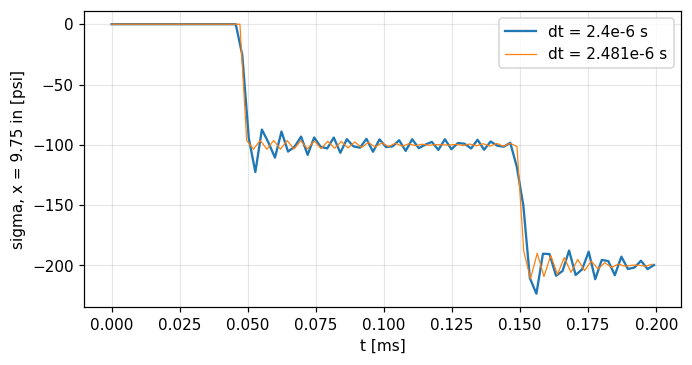

| Quantity | Ref. | Reference | feagent | Error | |
|---|---|---|---|---|---|
| element omega_max 2c/L [rad/s] | book | 8.0539e+05 | 8.0539e+05 | 0.00 % | ✅ |
| mesh omega_max [rad/s] | book | 8.0523e+05 | 8.0523e+05 | 0.00 % | ✅ |
| critical step 2/omega_max [s] | book | 2.4830e-06 | 2.4838e-06 | 0.03 % | ✅ |
| mean stress at element 20 after the wave arrives [psi] | exact | -100 | -99.778 | 0.22 % | ✅ |
| mean stress after the reflection [psi] | exact | -200 | -199.96 | 0.02 % | ✅ |
| dt = 2.5e-6 s detected as unstable | book | 1 | 1 | 0.00 % | ✅ |

**Notes**: dt_crit = 2.4838e-6 s: the book truncates it to 2.483e-6. The stress history is only plotted: the time averages over the two plateaus (60-140 us and after 165 us) are compared with the exact -100 and -200 psi. Instability with dt = 2.5e-6 s is flagged by the feagent integrator (error dt > 2/omega_max).

*Code*: `validation/books/cook/ch13.py`

<a id="cook-13-12-newmark-stability-table"></a>

### Sez. 13.12, Eq. 13.12-5..13.12-7, Tabella 13.12-1 - Newmark family: stability limits

📐 · PDF page 429 · dynamics_transient

The book tabulates the limits of the Newmark methods: average acceleration (1/4, 1/2) unconditionally stable, linear acceleration (1/6, 1/2) Omega_crit = 2 sqrt3, Fox-Goodwin (1/12, 1/2) sqrt6, central differences (0, 1/2) 2; for 2 beta >= gamma >= 1/2 stability is unconditional.

**Model**: Amplification matrix of an oscillator built from one step of feagent.dynamics.newmark_integrate and central_difference_integrate; spectral radius and bisection search of Omega_crit = omega dt.

| Quantity | Ref. | Reference | feagent | Error | |
|---|---|---|---|---|---|
| Omega_crit, linear acceleration | book | 3.4641 | 3.4641 | 0.00 % | ✅ |
| Omega_crit, Fox-Goodwin | book | 2.4495 | 2.4495 | 0.00 % | ✅ |
| Omega_crit, central differences | book | 2 | 2 | 0.00 % | ✅ |
| average acceleration: largest spectral radius (Omega up to 500) | book | 1 | 1 | 0.00 % | ✅ |
| gamma = 0.6, beta = (gamma + 1/2)^2/4: radius < 1 (dissipative) | book | 1 | 1 | 0.00 % | ✅ |

**Notes**: Central differences are Newmark with beta = 0, which the implicit integrator does not accept: the feagent explicit integrator is used. The HHT variant is not in feagent.

*Code*: `validation/books/cook/ch13.py`

<a id="cook-13-13-period-error"></a>

### Sez. 13.13, Eq. 13.13-1..13.13-26, Fig. 13.13-2 - Period error of central differences and the trapezoidal rule

📐 · PDF page 431 · dynamics_transient

The book shows that central differences shorten the period (cos Omega_bar = 1 - Omega^2/2) and the trapezoidal rule lengthens it (tan(Omega_bar/2) = Omega/2), both without amplitude error.

**Model**: Oscillator Z'' + omega^2 Z = 0 integrated with feagent central_difference_integrate and newmark_integrate (1/4, 1/2); numerical period from the argument of the amplification-matrix eigenvalues.

| Quantity | Ref. | Reference | feagent | Error | |
|---|---|---|---|---|---|
| central differences: numerical/exact period, Omega = 0.5 | exact | 0.98939 | 0.98939 | 0.00 % | ✅ |
| central differences: amplitude, Omega = 0.5 | exact | 1 | 1 | 0.00 % | ✅ |
| trapezoidal rule: numerical/exact period, Omega = 0.5 | exact | 1.0205 | 1.0205 | 0.00 % | ✅ |
| trapezoidal rule: amplitude, Omega = 0.5 | exact | 1 | 1 | 0.00 % | ✅ |
| central differences: numerical/exact period, Omega = 1.5 | exact | 0.88437 | 0.88437 | 0.00 % | ✅ |
| central differences: amplitude, Omega = 1.5 | exact | 1 | 1 | 0.00 % | ✅ |
| trapezoidal rule: numerical/exact period, Omega = 1.5 | exact | 1.1655 | 1.1655 | 0.00 % | ✅ |
| trapezoidal rule: amplitude, Omega = 1.5 | exact | 1 | 1 | 0.00 % | ✅ |

**Notes**: Checked at Omega = omega dt = 0.5 and 1.5.

*Code*: `validation/books/cook/ch13.py`

## Chapter 14

<a id="cook-14-1-beam-column-energy"></a>

### Sez. 14.1, Eq. 14.1-1..14.1-9, Fig. 14.1-1 - Simply supported beam-column: stress stiffening and Euler load

📐 · PDF page 449 · beam, buckling

With w = wc sin(pi x/L) the book obtains (k + k_sigma) wc = 2 qc L/pi with k = pi^4 EI/(2L^3) and k_sigma = pi^2 P/(2L): wc = qc L^4/(pi^4 EI + pi^2 P L^2) and P_cr = -pi^2 EI/L^2.

**Model**: Simply supported beam of 20 feagent beams with sinusoidal lateral load (trapezoidal loads per element) and tensile or compressive axial force; second-order analysis (solve_pdelta) and linear buckling.

| Quantity | Ref. | Reference | feagent | Error | |
|---|---|---|---|---|---|
| midspan deflection, P = +0.5 pi^2 EI/L^2 | exact | 0.006844 | 0.0068405 | 0.05 % | ✅ |
| midspan deflection, P = -0.5 pi^2 EI/L^2 | exact | 0.020532 | 0.020521 | 0.05 % | ✅ |
| midspan deflection, P = +0.0 pi^2 EI/L^2 | exact | 0.010266 | 0.010261 | 0.05 % | ✅ |
| Euler load [EI/L^2] | exact | 9.8696 | 9.8696 | 0.00 % | ✅ |

**Notes**: For the sinusoidal load the one-parameter function is the exact solution: the book's formula is exact and feagent reaches it under refinement. Data: L = EI = qc = 1, P = +-0.5 pi^2 EI/L^2.

*Code*: `validation/books/cook/ch14.py`

<a id="cook-14-2-stress-stiffness-beam-bar"></a>

### Sez. 14.2, Eq. 14.2-9, 14.2-11; Sez. 14.4, Eq. 14.4-9 - Stress-stiffness matrices of beam and bar

📐 · PDF page 454 · beam, truss, buckling

The Hermite beam with axial force P has [k_sigma] = P/(30L) [[36, 3L, -36, 3L], [3L, 4L^2, -3L, -L^2], ...]; the bar (w1, w2) has P/L [[1, -1], [-1, 1]].

**Model**: feagent BeamElement3D.geometric_stiffness_local, uy, rz DOFs in the X-Y plane.

| Quantity | Ref. | Reference | feagent | Error | |
|---|---|---|---|---|---|
| beam: max |k_sigma feagent - book| | exact | 0 | 5.5511e-17 | 0.00 % | ✅ |
| rigid-rotation energy: beam = bar | exact | 6.0000e-04 | 6.0000e-04 | 0.00 % | ✅ |

**Notes**: The bar matrix is not a feagent object: the feagent beam is checked to give the same energy P L theta^2 for a rigid rotation, which is what the bar matrix contains. Test data: L = 2, P = 3.

*Code*: `validation/books/cook/ch14.py`

<a id="cook-14-4-one-bar-large-rotation"></a>

### Sez. 14.4, Eq. 14.4-10..14.4-16, Fig. 14.4-1 - One-element bar with Green-Lagrange strain: rigid rotation and linearization

📐 · PDF page 459 · truss, nonlinear_geometric

Bar hinged at node 1 with forces Rx, Rz at node 2: with Green-Lagrange strain the equilibrium is cubic in the displacements, the rigid rotation gives zero forces for every angle and the linearization about an axial force P gives (AE/L)[[1,0],[0,0]] + (P/L)[[3,0],[0,1]].

**Model**: Book equations evaluated with numpy (rigid rotation, numerical Jacobian); feagent bar with corotational analysis (solve_corotational) for the transverse stiffness of a tensioned bar.

| Quantity | Ref. | Reference | feagent | Error | |
|---|---|---|---|---|---|
| forces for rigid rotation (0.3, 1.0, 2.5 rad) | exact | 0 | 1.7789e-13 | 0.00 % | ✅ |
| axial term AE/L + 3P/L (up to O(u0^2)) | exact | 1006 | 1006 | 0.00 % | ✅ |
| transverse term P/L | exact | 1.996 | 1.996 | 0.00 % | ✅ |
| feagent corotational: transverse stiffness of the tensioned bar = N/L (deformed L) | exact | 1.996 | 1.996 | 0.00 % | ✅ |

**Notes**: The transverse term P/L is the same in the feagent corotational analysis (which uses engineering strain): it is measured with a small transverse load on the tensioned bar. The factor 3 on the axial term belongs to Green-Lagrange. Data: L = 1, AE = 1000, P = 2.

*Code*: `validation/books/cook/ch14.py`

<a id="cook-14-5-shallow-two-bar-snap"></a>

### Sez. 14.5, Fig. 14.5-1 - Inclined hinged elastic bar: linearized critical load and nonlinear collapse

🟡 · PDF page 462 · frame, buckling, nonlinear_geometric

Bar with projection 400 and rise H = 35.0 or 3.49, E = 2000, I = 2000, A = 391. The book compares the critical load with [K_sigma] (21.35 and 0.520), with [N1] (20.58 and 0.173) and the nonlinear collapse (20.47 and 0.100).

**Model**: Bar of 8-16 feagent beams in the X-Y plane, hinged at the left, right end guided vertically (hinged), vertical load P: linear buckling (Model.buckling) and corotational analysis under displacement control (solve_corotational, control='displacement').

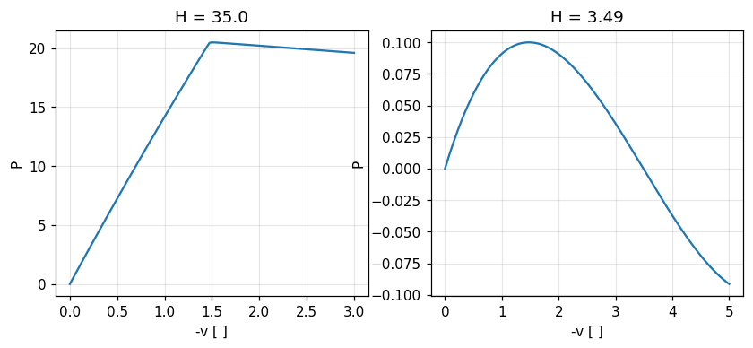

| Quantity | Ref. | Reference | feagent | Error | |
|---|---|---|---|---|---|
| critical load with [K_sigma], H = 35.0 | book | 21.35 | 21.345 | 0.02 % | ✅ |
| nonlinear collapse load, H = 35.0 | book | 20.47 | 20.484 | 0.07 % | ✅ |
| critical load with [K_sigma], H = 3.49 | book | 0.52 | 0.51938 | 0.12 % | ✅ |
| nonlinear collapse load, H = 3.49 | book | 0.1 | 0.099951 | 0.05 % | ✅ |

**Notes**: With H = 35 the critical load is Euler buckling of the bar (pi^2 EI/L^2 sin alpha), with H = 3.49 the snap of the strut AE sin^3 alpha/cos^2 alpha. The H = 35 collapse is a bifurcation: to follow it a transverse force imperfection of 1e-4 P is added at midspan (16 elements). With H = 3.49 the closed form AE sin^3 alpha/cos^2 alpha is 0.5194 and the book prints 0.520. The [N1] variant (initial-displacement stiffness) is not in feagent.

*Code*: `validation/books/cook/ch14.py`

<a id="cook-14-5-cantilever-column-buckling"></a>

### Sez. 14.5, Eq. 14.5-8..14.5-10, Fig. 14.5-2 - Cantilever column: critical load with one beam element

✅ · PDF page 463 · beam, buckling

With one element and the consistent [k_sigma] the book finds lambda_cr = 2.4860 EI/L^2 (exact pi^2/4 = 2.4674) and the mode w2 = 0.6379 L theta2; with the bar [k_sigma] it would get 3 EI/L^2.

**Model**: One vertical feagent beam (EI = L = 1) clamped at the base, tip load, Model.buckling; then 10 elements.

| Quantity | Ref. | Reference | feagent | Error | |
|---|---|---|---|---|---|
| critical load, 1 element [EI/L^2] | book | 2.486 | 2.486 | 0.00 % | ✅ |
| mode: w2 / theta2 [L] | book | 0.6379 | 0.63785 | 0.01 % | ✅ |
| critical load, 10 elements (exact pi^2/4) [EI/L^2] | exact | 2.4674 | 2.4674 | 0.00 % | ✅ |

**Notes**: The bar [k_sigma] variant follows from the same eigenproblem with the P/L term only: it is checked in closed form in the condensation case.

*Code*: `validation/books/cook/ch14.py`

<a id="cook-14-5-buckling-condensation"></a>

### Sez. 14.5, Eq. 14.5-11, 14.5-12 - Condensation of the rotation in cantilever buckling

✅ · PDF page 464 · beam, buckling

Eliminating theta2 with the static transformation T = [1; 3/(2L)] (as in Guyan reduction, with k_sigma in place of the mass) the critical load rises to 2.5 EI/L^2.

**Model**: K and k_sigma of the feagent beam element (stiffness_local, geometric_stiffness_local) reduced on w2 with T = [1; 3/(2L)].

| Quantity | Ref. | Reference | feagent | Error | |
|---|---|---|---|---|---|
| critical load with theta2 condensed [EI/L^2] | book | 2.5 | 2.5 | 0.00 % | ✅ |
| critical load with the bar k_sigma [EI/L^2] | book | 3 | 3 | 0.00 % | ✅ |

**Notes**: With the bar part P/L only instead of the consistent k_sigma, the same problem without condensation gives 3 EI/L^2 as the book says.

*Code*: `validation/books/cook/ch14.py`

## Chapter 15

<a id="cook-15-3-weighted-residual-bar"></a>

### Sez. 15.3, Eq. 15.3-1..15.3-14, Tabella 15.3-1, Fig. 15.3-1 - Weighted-residual methods on a bar with linear axial load

📐 · PDF page 479 · bar

For u,xx + c x = 0 with u(0) = 0 and u,x(L) = b (b = 0, c = L = 1) the book compares the exact solution (u(L/2) = 0.2292, u(L) = 0.3333, u,x(0) = 0.5) with collocation, subdomain, least squares and Galerkin; Galerkin gives exact displacements at the nodes but u,x(0) = 0.5833 and u,x(L) = 0.0833.

**Model**: Exact column: 32 feagent L2 bars with load q = c x (add_bar_line_load with nodal values). Galerkin column: a single feagent L3 bar (the trial space a1 x + a2 x^2 with u(0) = 0 is that of the quadratic element). Collocation, subdomain and least squares: the book's algebra evaluated with numpy.

| Quantity | Ref. | Reference | feagent | Error | |
|---|---|---|---|---|---|
| exact: u(L/2) | book | 0.2292 | 0.22917 | 0.01 % | ✅ |
| exact: u(L) | book | 0.3333 | 0.33333 | 0.01 % | ✅ |
| Galerkin (L3 bar): u(L/2) | book | 0.2292 | 0.22917 | 0.01 % | ✅ |
| Galerkin (L3 bar): u(L) | book | 0.3333 | 0.33333 | 0.01 % | ✅ |
| Galerkin (L3 bar): u,x(0) | book | 0.5833 | 0.58333 | 0.01 % | ✅ |
| Galerkin (L3 bar): u,x(L/2) | book | 0.3333 | 0.33333 | 0.01 % | ✅ |
| Galerkin (L3 bar): u,x(L) | book | 0.0833 | 0.083333 | 0.04 % | ✅ |
| collocation: u(L/2) | book | 0.125 | 0.125 | 0.00 % | ✅ |
| collocation: u(L) | book | 0.1667 | 0.16667 | 0.02 % | ✅ |
| collocation: u,x(0) | book | 0.3333 | 0.33333 | 0.01 % | ✅ |
| subdomain: u(L/2) | book | 0.1875 | 0.1875 | 0.00 % | ✅ |
| subdomain: u(L) | book | 0.25 | 0.25 | 0.00 % | ✅ |
| subdomain: u,x(0) | book | 0.5 | 0.5 | 0.00 % | ✅ |

**Notes**: The printed coefficients reveal the points used: collocation at x = L/3, subdomain and least squares with the integral of the residual over the whole bar.

*Code*: `validation/books/cook/ch15.py`

<a id="cook-15-4-galerkin-bar-beam"></a>

### Sez. 15.4, Eq. 15.4-1..15.4-20 - Galerkin for the bar and for beam dynamics: the standard matrices

📐 · PDF page 481 · bar, beam, dynamics_modal

The book shows that Galerkin's method returns [k] = int B^T AE B dx and {r} = int N^T q dx for the bar and [K]{D} + [M]{D''} = {R} with the consistent matrices for the beam, identical to the Rayleigh-Ritz ones.

**Model**: Galerkin integrals computed with numpy (linear and Hermite shape functions) against the feagent L2 bar (stiffness, add_bar_line_load) and the feagent beam (stiffness_local, consistent_mass_local).

| Quantity | Ref. | Reference | feagent | Error | |
|---|---|---|---|---|---|
| bar: int B^T AE B dx | exact | 0 | 0 | 0.00 % | ✅ |
| bar: int N^T q dx | exact | 0 | 4.4409e-16 | 0.00 % | ✅ |
| beam: int B^T EI B dx | exact | 0 | 4.4409e-15 | 0.00 % | ✅ |
| beam: int N^T rho A N dx | exact | 0 | 1.1102e-16 | 0.00 % | ✅ |

**Notes**: Test data: L = 2, AE = 3, q linear from 1 to 4; beam EI = 5, rho A = 0.7.

*Code*: `validation/books/cook/ch15.py`

<a id="cook-15-4-heat-bar-galerkin"></a>

### Sez. 15.4, Eq. 15.4-21..15.4-24, Fig. 15.4-3 - Steady conduction in a bar: 2-node Galerkin element

📐 · PDF page 485 · heat_steady

Bar with insulated lateral surface: (A k/L)[[1,-1],[-1,1]]{T} = {A q1, A q2}; with T1 = T0 and outgoing flux q_L at the right T2 = T0 - q_L L/k; swapping the conditions T1 = T_L + q0 L/k.

**Model**: FieldModel('heat') with one L2 element (area A, conductivity k), prescribed temperature at one end and outgoing flux at the other (negative add_flux = outgoing).

| Quantity | Ref. | Reference | feagent | Error | |
|---|---|---|---|---|---|
| (A k/L)[[1,-1],[-1,1]] | exact | 0 | 0 | 0.00 % | ✅ |
| T2 = T0 - q_L L/k | exact | 76 | 76 | 0.00 % | ✅ |
| swapped conditions: T1 = T_L + q0 L/k | exact | 124 | 124 | 0.00 % | ✅ |

**Notes**: Test data: A = 0.02, k = 50, L = 0.4, T0 = 100, q = 3000.

*Code*: `validation/books/cook/ch15.py`

<a id="cook-15-6-quasiharmonic-galerkin"></a>

### Sez. 15.6, Eq. 15.6-1..15.6-7 - 2D quasi-harmonic equation: Galerkin conductivity matrix and vectors

📐 · PDF page 488 · heat_steady, potential_flow

For (kx phi,x),x + (ky phi,y),y + Q = 0 the book derives [k] = int ([N,x]^T kx [N,x] + [N,y]^T ky [N,y]) dA and {r} = int [N]^T Q dA + int [N]^T q_B dS.

**Model**: Distorted feagent Q4 FieldElement with orthotropic conductivity kx, ky (conduction, source, add_flux) against the book's integrals computed with numpy.

| Quantity | Ref. | Reference | feagent | Error | |
|---|---|---|---|---|---|
| conductivity matrix | exact | 0 | 2.2204e-16 | 0.00 % | ✅ |
| load vector (source + boundary flux) | exact | 0 | 8.8818e-16 | 0.00 % | ✅ |

**Notes**: Test data: quadrilateral (0,0), (2,0.2), (1.8,1.5), (0.1,1.2), kx = 3, ky = 0.5, unit thickness, Q = 7, q_B = 2 on side 2-3.

*Code*: `validation/books/cook/ch15.py`

## Chapter 16

<a id="cook-16-2-heat-bar-convection"></a>

### Sez. 16.2, Eq. 16.2-1..16.2-8, Fig. 16.2-1 - Bar with conduction, lateral convection and source: matrices and solution

📐 · PDF page 495 · heat_steady

For a linear element the book derives [k] = (A k/L)[[1,-1],[-1,1]], [h_ls] = (h p L/6)[[2,1],[1,2]], {r_Q} = (Q A L/2){1,1} and {r_ls} = (h p T_f L/2){1,1}.

**Model**: FieldModel('heat') with L2 elements (area A, perimeter p), lateral convection (add_lateral_convection) and volume source (add_source); assembled matrices compared with the book's formulas, then a 40-element fin against the exact solution.

| Quantity | Ref. | Reference | feagent | Error | |
|---|---|---|---|---|---|
| [k] + [h_ls] | exact | 0 | 0 | 0.00 % | ✅ |
| {r_Q} + {r_ls} | exact | 0 | 5.6843e-14 | 0.00 % | ✅ |
| tip temperature, 40 elements | exact | 50.106 | 50.103 | 0.01 % | ✅ |

**Notes**: Data of the book's Probl. 16.2 (k = 180, h = 12, A = 0.1, p = 1, L = 2), which has no printed answer; for the solution T0 = 100 at the base, insulated tip, T_f = 20, Q = 0 are assumed: exact T_f + (T0 - T_f) cosh(m(L - x))/cosh(mL).

*Code*: `validation/books/cook/ch16.py`

<a id="cook-16-5-q4-heat-matrices"></a>

### Sez. 16.5, Eq. 16.5-5..16.5-10, Fig. 16.5-1 - Q4 element for conduction: edge convection and point source

📐 · PDF page 502 · heat_steady

With convection h towards T_f on side 3-4 of length L34 the book obtains [h] = (tau h L34/6)[[2,1],[1,2]] on nodes 3 and 4 and {r_h} = (tau h T_f L34/2){0,0,1,1}; a point source Q_P gives {r_Q} = [N]_P^T Q_P.

**Model**: One feagent Q4 FieldElement of thickness tau with convection on side 3-4 (add_convection, side 2 in feagent numbering); the edge matrix and vector are obtained as the difference between assemblies with and without convection.

| Quantity | Ref. | Reference | feagent | Error | |
|---|---|---|---|---|---|
| convection matrix of side 3-4 | exact | 0 | 2.2204e-16 | 0.00 % | ✅ |
| convection vector of side 3-4 | exact | 0 | 1.4211e-14 | 0.00 % | ✅ |
| point source: shares add to Q_P | exact | 1 | 1 | 0.00 % | ✅ |
| point source: moment of shares at P | exact | 0 | 0 | 0.00 % | ✅ |

**Notes**: Test data: quadrilateral (0,0), (3,0), (2.5,2), (0.5,1.5), tau = 0.2, h = 8, T_f = 30. The interior point source is not a feagent load (nodal only): its form [N]_P^T Q_P is checked with the element shape functions (sum Q_P, reproduction of the point).

*Code*: `validation/books/cook/ch16.py`

<a id="cook-16-6-thermal-transient-trapezoid"></a>

### Sez. 16.6, Eq. 16.6-6..16.6-9 - Thermal transients: generalized trapezoidal rule and critical step

📐 · PDF page 504 · heat_transient

For [K]{T} + [C]{T'} = {R} with the generalized trapezoidal rule the book derives the critical step dt_cr = 2/((1 - 2 beta) lambda_max) for beta < 1/2; beta = 1/2 (Crank-Nicolson), 2/3 (Galerkin) and 1 (backward Euler) are unconditionally stable.

**Model**: Bar of 10 FieldModel L2 elements with capacity (rho c = 1), end at T = 0, initial condition T = 1; FieldModel.eigenvalues for lambda_max and FieldModel.solve_transient(theta) with steps around the critical one.

| Quantity | Ref. | Reference | feagent | Error | |
|---|---|---|---|---|---|
| beta = 0.0: dt = 0.98 dt_cr bounded | book | 1 | 1 | 0.00 % | ✅ |
| beta = 0.0: dt = 1.02 dt_cr divergent | book | 1 | 1 | 0.00 % | ✅ |
| beta = 0.25: dt = 0.98 dt_cr bounded | book | 1 | 1 | 0.00 % | ✅ |
| beta = 0.25: dt = 1.02 dt_cr divergent | book | 1 | 1 | 0.00 % | ✅ |
| beta = 0.500: stable with dt = 50/lambda_max | book | 1 | 1 | 0.00 % | ✅ |
| beta = 0.667: stable with dt = 50/lambda_max | book | 1 | 1 | 0.00 % | ✅ |
| beta = 1.000: stable with dt = 50/lambda_max | book | 1 | 1 | 0.00 % | ✅ |

**Notes**: The book's beta is feagent's theta. With theta = 0 and theta = 0.25 the integration runs at 0.98 and 1.02 times the critical step: the solution stays bounded in the first case and grows in the second.

*Code*: `validation/books/cook/ch16.py`

<a id="cook-16-7-potential-flow-cylinder"></a>

### Sez. 16.7, Fig. 16.7-1 - Potential flow around a cylinder in a channel: potential and stream function

🟡 · PDF page 507 · potential_flow

The book sets up a uniform flow u0 entering a channel with a cylindrical obstacle: for the potential phi,n = u0 at the inlet, phi = 0 on the centreline CD, zero flux on walls and cylinder; for the stream function psi = u0 y at the inlet, psi = 0 on AB and on the cylinder, psi = u0 H on the wall, psi,x = 0 on CD.

**Model**: Upstream quadrant modelled with Q8 of FieldModel('potential') and FieldModel('stream') on an own mapped mesh (block around the cylinder plus inlet block), with the boundary conditions of Fig. 16.7-1b and c.

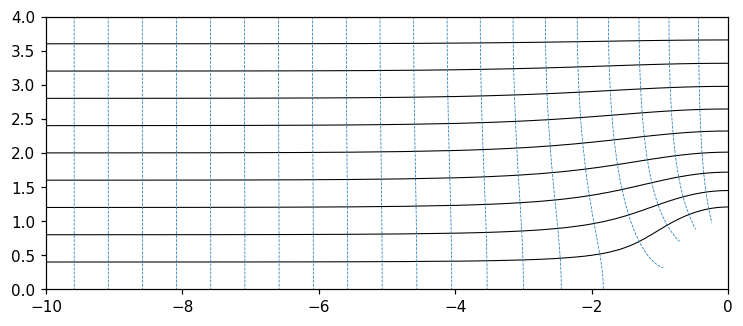

| Quantity | Ref. | Reference | feagent | Error | |
|---|---|---|---|---|---|
| flow through CD from the potential (conservation: u0 H) | exact | 4 | 4.0013 | 0.03 % | ✅ |
| velocity above the cylinder: potential vs stream function | other | 2.1118 | 2.1356 | 1.12 % | ✅ |

**Notes**: The book gives neither dimensions nor results: radius a = 1, half-height H = 4, upstream length 10 are assumed. The flow rate u0 H through CD and the agreement of the velocity above the cylinder from phi and from psi are checked; in a channel this velocity exceeds 2 u0 (isolated cylinder) because of blockage: 2.112 u0 from the potential. The gradient of psi on the cylinder (where psi is prescribed) converges more slowly: 1.1 % deviation with the mesh used (24 x 24 Q8 around the cylinder), 2 % with the halved one.

*Code*: `validation/books/cook/ch16.py`

<a id="cook-16-9-slosh-one-element"></a>

### Sez. 16.9, Eq. 16.9-7, 16.9-8, Fig. 16.9-2b - Liquid sloshing in a tank with one 'mock-fluid' element

✅ · PDF page 514 · dynamics_modal, other

Plane tank of width a and depth b with a single element: the under-integrated volumetric stiffness enforces w3 = -w4 and the sloshing mode remains with omega^2 = 3 g/b for a = b (theory (pi g/a) tanh(pi b/a) = 3.13 g/b).

**Model**: One feagent PlaneQ4 in plane strain with bulk modulus B and almost zero shear (nu -> 0.5, E = 3B(1 - 2nu)), one-point reduced integration, consistent mass; free-surface stiffness rho g a/6 [[2,1],[1,2]] as a superelement (add_superelement); only w3 and w4 free.

| Quantity | Ref. | Reference | feagent | Error | |
|---|---|---|---|---|---|
| omega^2, reduced integration [g/b] | book | 3 | 3 | 0.00 % | ✅ |
| theory (pi g/a) tanh(pi b/a) [g/b] | book | 3.13 | 3.1299 | 0.00 % | ✅ |
| full integration: mode locked | book | 1 | 1 | 0.00 % | ✅ |

**Notes**: Data: a = b = 1, rho = 1, g = 1, B = 1e4. With full 2x2 integration the volumetric stiffness locks the mode (much larger omega^2): this is why the book under-integrates.

*Code*: `validation/books/cook/ch16.py`

<a id="cook-16-9-acoustic-pipe-spring"></a>

### Sez. 16.9, Eq. 16.9-9, 16.9-10, Fig. 16.9-2c - Acoustic modes of air in a pipe with two elements

✅ · PDF page 514 · bar, dynamics_modal

Pipe of length L_T = 2L closed by rigid ends: with two 'mock-fluid' elements the book finds omega^2 = 3B/(rho L^2) = 12 c^2/L_T^2, that is omega = 3.46 c/L_T against the exact pi c/L_T.

**Model**: Displacements: 2 feagent L2 bars with E = B and consistent mass; pressure: FieldModel with capacity 1/c^2 (eigenvalues K x = lambda C x, acoustic modes); then 40 elements.

| Quantity | Ref. | Reference | feagent | Error | |
|---|---|---|---|---|---|
| omega, bars (2 elements) [c/L_T] | book | 3.4641 | 3.4641 | 0.00 % | ✅ |
| omega, pressure (2 elements) [c/L_T] | book | 3.4641 | 3.4641 | 0.00 % | ✅ |
| omega, 40 elements (exact pi) [c/L_T] | exact | 3.1416 | 3.1424 | 0.03 % | ✅ |

**Notes**: Data: B = 1.4e5, rho = 1.2, L_T = 2. The pressure formulation (FieldModel) and the displacement formulation (bars) give the same first mode; the case with a spring on the plug has no numerical values in the book.

*Code*: `validation/books/cook/ch16.py`

## Chapter 17

<a id="cook-17-2-nonlinear-spring-methods"></a>

### Sez. 17.2, Eq. 17.2-1..17.2-16, Fig. 17.2-1..17.2-9 - Nonlinear spring: direct substitution, Newton-Raphson, modified Newton

📐 · PDF page 522 · spring, nonlinear_material

The book presents the methods for a spring of stiffness k0 + kN(u) and proposes (Probl. 17.2) the softening spring k = 0.2 - u with P = 0.006, whose equilibrium (0.2 - u) u = P has root u = (0.2 - sqrt(0.016))/2 = 0.036754.

**Model**: feagent spring with a piecewise nonlinear law N(Delta) (NonlinearElastic, 400 segments on the curve) solved with solve_inelastic; the book's iterative schemes on one spring written in numpy.

| Quantity | Ref. | Reference | feagent | Error | |
|---|---|---|---|---|---|
| displacement, feagent NonlinearElastic spring | exact | 0.036754 | 0.036754 | 0.00 % | ✅ |
| Newton-Raphson | exact | 0.036754 | 0.036754 | 0.00 % | ✅ |
| modified Newton | exact | 0.036754 | 0.036754 | 0.00 % | ✅ |
| direct substitution | exact | 0.036754 | 0.036754 | 0.00 % | ✅ |

**Notes**: The book prints no numerical results: the reference is the exact root. Newton converges in a few iterations, direct substitution and modified Newton in many more, as described in the text.

*Code*: `validation/books/cook/ch17.py`

<a id="cook-17-3-tapered-bar-plasticity"></a>

### Sez. 17.3, Eq. 17.3-1..17.3-7, Fig. 17.3-1..17.3-3 - Elastic-plastic tapered bar: incremental tangent-stiffness method

📐 · PDF page 531 · bar, nonlinear_material

For a tapered bar the book describes the bilinear law E, E_t, sigma_Y with H = E E_t/(E - E_t), the tangent-stiffness and initial-stiffness methods, and elastic unloading with isotropic or kinematic hardening.

**Model**: 4 feagent L2 bars with decreasing area (2, 1.6, 1.2, 0.8) clamped at the left, axial tip load; bilinear law J2Plasticity.bilinear (E, E_t, sigma_Y) with isotropic hardening; solve_inelastic loading, then unloading.

| Quantity | Ref. | Reference | feagent | Error | |
|---|---|---|---|---|---|
| tip displacement at P = 1.4 | exact | 0.063708 | 0.063708 | 0.00 % | ✅ |
| plastic strain of element 4 | exact | 0.03375 | 0.03375 | 0.00 % | ✅ |
| permanent displacement after unloading | exact | 0.04125 | 0.04125 | 0.00 % | ✅ |

**Notes**: The book gives no numbers: the bar is statically determinate, so the exact tip displacement follows element by element from the bilinear law. Free data: E = 200, E_t = 20, sigma_Y = 1, L_e = 1, P = 1.4 (elements 3 and 4 yield), then unloading to zero: the permanent displacement sum eps_p L remains.

*Code*: `validation/books/cook/ch17.py`

<a id="cook-17-4-uniaxial-plasticity"></a>

### Sez. 17.4, Eq. 17.4-16..17.4-19 - Uniaxial von Mises plasticity with kinematic hardening

📐 · PDF page 538 · nonlinear_material

Specializing von Mises plasticity to the uniaxial case the book recovers d eps_p = d eps E/(E + H) and the elastic-plastic modulus E_ep = E H/(E + H) = E_t, equal to the bilinear law of Sec. 17.3.

**Model**: feagent uniaxial update J2Plasticity.update_1d with kinematic hardening (H_kin = H).

| Quantity | Ref. | Reference | feagent | Error | |
|---|---|---|---|---|---|
| plastic increment d eps E/(E + H) | exact | 0.0088889 | 0.0088889 | 0.00 % | ✅ |
| elastic-plastic modulus E H/(E + H) | exact | 22.222 | 22.222 | 0.00 % | ✅ |
| stress after the increment | exact | 1.2222 | 1.2222 | 0.00 % | ✅ |
| on reversal yielding resumes at sigma_max - 2 sigma_Y | book | 1 | 1 | 0.00 % | ✅ |

**Notes**: Test data: E = 200, H = 25, sigma_Y = 1; strain increment beyond yield and reversal (Bauschinger effect: new yield at sigma_max - 2 sigma_Y).

*Code*: `validation/books/cook/ch17.py`

<a id="cook-17-6-bar-dynamic-plasticity"></a>

### Sez. 17.6, Fig. 17.6-1, 17.6-2 - Elastic and plastic waves in an elastic-plastic bar (central differences)

✅ · PDF page 544 · bar, dynamics_transient, nonlinear_material

The bar of Sec. 13.10 (L = 20 in, A = 1 in^2, E = 30e6 psi, rho = 7.4e-4) with sigma_Y = 40 ksi, E_t = E/4 and P0 = 2 A sigma_Y = 80,000 lb, dt = 2.4e-6 s for 83 steps. At x = 9.75 in the elastic wave arrives first (c_e, t = 0.0484 ms) bringing the stress to -40 ksi, then the plastic wave (c_e/2, t = 0.0968 ms) bringing it to -80 ksi.

**Model**: 40 feagent L2 bars with lumped masses and a bilinear isotropic law (J2Plasticity.bilinear, E_t = E/4), clamped at the right, step force at the left; solve_inelastic_explicit (central differences).

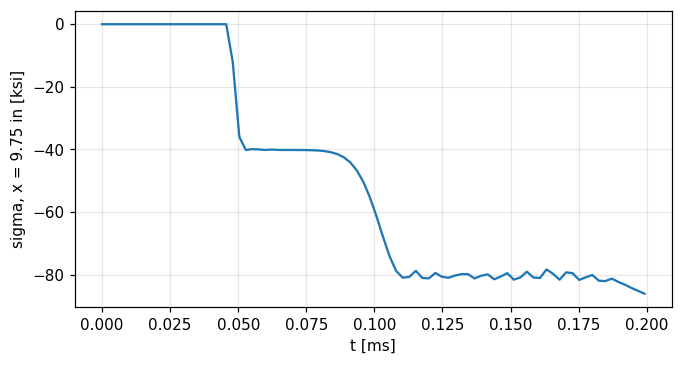

| Quantity | Ref. | Reference | feagent | Error | |
|---|---|---|---|---|---|
| mean stress between elastic and plastic wave [psi] | exact | -40000 | -40518 | 1.30 % | ✅ |
| mean stress after the plastic wave [psi] | exact | -80000 | -81021 | 1.28 % | ✅ |
| elastic wave arrival (t = 0.0484 ms) [s] | book | 4.8424e-05 | 5.0400e-05 | 4.08 % | ✅ |
| plastic wave arrival (t = 0.0968 ms) [s] | book | 9.6848e-05 | 1.0080e-04 | 4.08 % | ✅ |

**Notes**: The histories are plotted: the stress averages on the two plateaus (between the two arrivals and after the plastic wave) are compared with the exact -40 and -80 ksi, and the arrival times (half step) with 9.75/c_e and 9.75/(c_e/2).

*Code*: `validation/books/cook/ch17.py`

<a id="cook-17-7-cantilever-tip-moment"></a>

### Sez. 17.7, Eq. 17.7-2..17.7-7, Fig. 17.7-1a - Cantilever under a tip moment in large rotations (planar corotational)

✅ · PDF page 551 · frame, nonlinear_geometric

Under a tip moment the cantilever bends into a circular arc: v = (EI/M)(1 - cos(M L/EI)), u = (EI/M) sin(M L/EI) - L, rotation M L/EI; with M = 2 pi EI/L it closes into a ring.

**Model**: Cantilever of 20 feagent beams in the X-Y plane, tip moment, corotational analysis (solve_corotational) in 40 steps up to M = 2 pi EI/L.

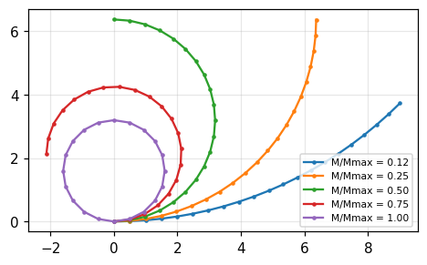

| Quantity | Ref. | Reference | feagent | Error | |
|---|---|---|---|---|---|
| tip deflection, rotation 1.571 rad | exact | 6.3662 | 6.3678 | 0.03 % | ✅ |
| tip axial displacement, rotation 1.571 rad | exact | -3.6338 | -3.6322 | 0.05 % | ✅ |
| tip deflection, rotation 3.142 rad | exact | 6.3662 | 6.3727 | 0.10 % | ✅ |
| tip axial displacement, rotation 3.142 rad | exact | -10 | -10 | 0.00 % | ✅ |
| M = 2 pi EI/L: the tip returns to the root (u = -L) | exact | -10 | -10 | 0.00 % | ✅ |

**Notes**: Straight elements approximate the arc with chords: O(1/n^2) error (0.1 % with 20 elements). Data: E = 1e4, I = 1/12, L = 10.

*Code*: `validation/books/cook/ch17.py`

## Chapter 18

<a id="cook-18-2-ill-conditioning-springs"></a>

### Sez. 18.2, Eq. 18.2-1..18.2-3, Fig. 18.2-1 - Ill-conditioning: nearly singular system and stiff spring on a soft spring

📐 · PDF page 563 · spring

The book shows that x - y = 4, -x + 1.02 y = -2 changes its solution by 100 % when 1.02 becomes 1.01, and that with k1 = 40 resting on k2 = 0.0014 the reduced coefficient K22 = (k1 + k2) - k1 is 0.0010 instead of 0.0014 with 5 digits, and K becomes singular with 4 digits.

**Model**: Two feagent springs in series (k2 = 0.0014 to ground, k1 = 40 between the nodes) for K; Gauss elimination with a 4, 5 and 6 digit decimal mantissa emulated in Python.

| Quantity | Ref. | Reference | feagent | Error | |
|---|---|---|---|---|---|
| y with coefficient 1.02 | exact | 100 | 100 | 0.00 % | ✅ |
| ratio of solutions (doubling) | book | 2 | 2 | 0.00 % | ✅ |
| Reduced K22, 6 digit mantissa | book | 0.0014 | 0.0014 | 0.00 % | ✅ |
| Reduced K22, 5 digit mantissa | book | 0.001 | 0.001 | 0.00 % | ✅ |
| Reduced K22, 4 digits (singular matrix) | book | 0 | 0 | 0.00 % | ✅ |

**Notes**: In double precision feagent does not show the effect: the short mantissa is emulated by rounding every operation, on the matrix assembled by feagent.

*Code*: `validation/books/cook/ch18.py`

<a id="cook-18-3-condition-bar"></a>

### Sez. 18.3, Fig. 18.3-1, Eq. 18.3-1..18.3-10 - Condition number: two-element bar and growth estimates

📐 · PDF page 567 · bar, beam

The book defines C(K) = lambda_max/lambda_min of the scaled matrix and estimates its growth as (h_max/h_min)^(2m-1) N^(2m/n): for a beam (m = 2, n = 1) an element ten times shorter multiplies C by about 1000 and doubling N multiplies it by 16.

**Model**: Two-element bar with stiffnesses 6AE/L and AE/L; feagent beam cantilevers and feagent bar chains with N elements; condition number of the matrix scaled to unit diagonal.

| Quantity | Ref. | Reference | feagent | Error | |
|---|---|---|---|---|---|
| C(K) of the two-element bar | exact | 2.2153 | 2.2153 | 0.00 % | ✅ |
| beam: growth of C when N doubles (64 -> 128) | book | 16 | 15.993 | 0.05 % | ✅ |
| bar: growth of C when N doubles | exact | 4 | 4.0003 | 0.01 % | ✅ |
| beam: short element 10 -> 100 times (factor ~1000) | book | 1000 | 984.65 | 1.54 % | ✅ |

**Notes**: The estimate is asymptotic: the factor 1000 is reached between length ratios 10 and 100 (between 1 and 10 the factor is only 34). For the bar (m = 1) doubling N gives 4. The book's two-element bar has C = (1 + 1/sqrt7)/(1 - 1/sqrt7).

*Code*: `validation/books/cook/ch18.py`

<a id="cook-18-4-diagonal-decay-cantilever"></a>

### Sez. 18.4, Tabella 18.4-1 - Diagonal decay ratios and node numbering in a long cantilever

🟡 · PDF page 571 · beam

Numbering from tip to root, the last ratios are 8, 2, 8 for every N and the deflection is exact; numbering from root to tip the ratios grow like N^3 and N (1e3, 1e6, 2e8; 4e1, 4e2, 2e3) and on a machine with about 11 digits the N = 1000 deflection is 0.1197 times the theoretical one.

**Model**: Cantilever of N = 10, 100, 1000 equal feagent beams (EI = 8e6, length 1000, tip load); Gauss elimination without pivoting on the feagent matrix in both numberings, ratios r_i = K_ii / P_ii.

| Quantity | Ref. | Reference | feagent | Error | |
|---|---|---|---|---|---|
| w/w theory, tip-first numbering, N = 10 | book | 1 | 1 | 0.00 % | ✅ |
| r_2N-2, tip-first numbering, N = 10 | book | 8 | 8 | 0.00 % | ✅ |
| r_2N-1, tip-first numbering, N = 10 | book | 2 | 2 | 0.00 % | ✅ |
| r_2N, tip-first numbering, N = 10 | book | 8 | 8 | 0.00 % | ✅ |
| w/w theory, tip-first numbering, N = 100 | book | 1 | 1 | 0.00 % | ✅ |
| r_2N-2, tip-first numbering, N = 100 | book | 8 | 8 | 0.00 % | ✅ |
| r_2N-1, tip-first numbering, N = 100 | book | 2 | 2 | 0.00 % | ✅ |
| r_2N, tip-first numbering, N = 100 | book | 8 | 8 | 0.00 % | ✅ |
| w/w theory, tip-first numbering, N = 1000 | book | 1 | 1 | 0.00 % | ✅ |
| r_2N-2, tip-first numbering, N = 1000 | book | 8 | 8 | 0.00 % | ✅ |
| r_2N-1, tip-first numbering, N = 1000 | book | 2 | 2 | 0.00 % | ✅ |
| r_2N, tip-first numbering, N = 1000 | book | 8 | 8 | 0.00 % | ✅ |
| w/w theory, root-first numbering, N = 10 | book | 1 | 1 | 0.00 % | ✅ |
| r_2N-2, root-first numbering, N = 10 | book | 5.3 | 5.256 | 0.83 % | ✅ |
| r_2N-1, root-first numbering, N = 10 | book | 1000 | 1000 | 0.00 % | ✅ |
| r_2N, root-first numbering, N = 10 | book | 40 | 40 | 0.00 % | ✅ |
| r_2N-2, root-first numbering, N = 100 | book | 7.7 | 7.6848 | 0.20 % | ✅ |
| r_2N-1, root-first numbering, N = 100 | book | 1.0000e+06 | 1e+06 | 0.00 % | ✅ |
| r_2N, root-first numbering, N = 100 | book | 400 | 400 | 0.00 % | ✅ |

**Notes**: feagent works with 16 digits: all deflections come out exact (ratio 1.0000), so the book's 0.9993 and 0.1197 (digit loss of the 11-digit machine) cannot be reproduced. For the same reason with N = 1000 and root-to-tip numbering the 16-digit computation gives r = 1.0e9 and 4.0e3 instead of the printed 2e8 and 2e3: the book's pivots are already corrupted by round-off. The other ratios coincide.

*Code*: `validation/books/cook/ch18.py`

<a id="cook-18-6-bar-discretization-error"></a>

### Sez. 18.6, Eq. 18.6-1..18.6-9, Fig. 18.6-1 - Discretization error in a bar under distributed load

📐 · PDF page 573 · bar

The book shows that with consistent loads the nodal displacements of the bar are exact, that the strain error is bounded by h max|u''| and vanishes at the element centre, and that the displacement error between nodes is at most h^2/8 max|u''|.

**Model**: feagent bar clamped at the left, 4 L2 elements, uniform axial load q with consistent nodal forces (add_bar_line_load).

| Quantity | Ref. | Reference | feagent | Error | |
|---|---|---|---|---|---|
| largest nodal displacement error | exact | 0 | 3.5527e-15 | 0.00 % | ✅ |
| mid-element displacement error = h^2/8 |u''| | exact | 0.125 | 0.125 | 0.00 % | ✅ |
| strain at the centre of element 2 (exact) | exact | 2.5 | 2.5 | 0.00 % | ✅ |
| strain error at the element end = (h/2)|u''| <= h|u''| | exact | 0.5 | 0.5 | 0.00 % | ✅ |

**Notes**: Free data: L = 4, EA = 1, q = 1 (u'' = -q/EA constant). The linear shape functions give the maximum error h^2/8 |u''| at mid-element.

*Code*: `validation/books/cook/ch18.py`

<a id="cook-18-7-laplacian-mesh-estimate"></a>

### Sez. 18.7, Eq. 18.7-3, Fig. 18.7-1 - A priori estimate of relative error on a graded mesh

⛔ · PDF page 579 · plane_stress

The book evaluates an a priori error estimate (N = 72 bilinear elements, aspect ratio 2 and size ratio 8): about 0.22 on displacements and 1.9 on stresses.

**Notes**: It is an order-of-magnitude estimate without a mesh or problem defined node by node: there is no model to redo with feagent.

*Code*: `validation/books/cook/ch18.py`

<a id="cook-18-7-cantilever-regular-refinement"></a>

### Sez. 18.7, Fig. 18.7-4, Tabella 18.7-1 - Cantilever with bilinear elements: regular refinement and Richardson extrapolation

✅ · PDF page 582 · plane_stress

Cantilever L = 2.40, h = 0.40, E = 1e4, nu = 0.25, P = 100 at the tip. The book tabulates the deflection for the three integrations and the three meshes and extrapolates it with p = 2; beam theory with shear gives 8.640 + 0.180 = 8.820.

**Model**: feagent Q4 in plane stress on 4x2, 8x4 and 16x8 meshes (N = 8, 32, 128): 2x2 integration (Full), one point (Reduced) and one point with hourglass control (integration='reduced', hourglass=True); clamped left end, P = 100 at the free top corner.

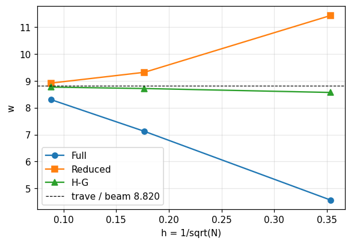

| Quantity | Ref. | Reference | feagent | Error | |
|---|---|---|---|---|---|
| deflection, Full, N = 8 | book | 4.562 | 4.5624 | 0.01 % | ✅ |
| deflection, Full, N = 32 | book | 7.124 | 7.124 | 0.00 % | ✅ |
| deflection, Full, N = 128 | book | 8.302 | 8.3019 | 0.00 % | ✅ |
| Richardson extrapolation p = 2, Full, meshes 8-32 | book | 7.978 | 7.9779 | 0.00 % | ✅ |
| Richardson extrapolation p = 2, Full, meshes 32-128 | book | 8.695 | 8.6945 | 0.01 % | ✅ |
| deflection, Reduced, N = 8 (bottom corner) | book | 11.44 | 11.44 | 0.00 % | ✅ |
| deflection, Reduced, N = 32 | book | 9.323 | 9.3233 | 0.00 % | ✅ |
| deflection, Reduced, N = 128 | book | 8.922 | 8.922 | 0.00 % | ✅ |
| Richardson extrapolation p = 2, Reduced, meshes 8-32 | book | 8.617 | 8.6177 | 0.01 % | ✅ |
| Richardson extrapolation p = 2, Reduced, meshes 32-128 | book | 8.788 | 8.7882 | 0.00 % | ✅ |
| deflection, H-G, N = 8 | book | 8.572 | 8.5718 | 0.00 % | ✅ |
| deflection, H-G, N = 32 | book | 8.719 | 8.7192 | 0.00 % | ✅ |
| deflection, H-G, N = 128 | book | 8.771 | 8.7707 | 0.00 % | ✅ |
| Richardson extrapolation p = 2, H-G, meshes 8-32 | book | 8.768 | 8.7684 | 0.00 % | ✅ |
| Richardson extrapolation p = 2, H-G, meshes 32-128 | book | 8.788 | 8.7879 | 0.00 % | ✅ |
| beam theory with shear (t = 1) | book | 8.82 | 8.82 | 0.00 % | ✅ |
| H-G on a 32x16 mesh against beam theory | exact | 8.82 | 8.7878 | 0.37 % | ✅ |

**Notes**: Thickness: Fig. 18.7-4 shows 0.10, but every number of the table (and the beam theory value 8.820) corresponds to t = 1.0: with t = 0.10 the deflections would be 10 times larger. t = 1.0 is used. The deflection is read at the mid-height node of the free end, with P at the top corner: this reproduces every cell except Reduced N = 8, where the book prints 11.440, which is the deflection of the bottom corner (at mid-height feagent gives 11.483); the book also uses 11.440 for the extrapolated 8.617, which is recovered only with that value. That cell is therefore compared with the bottom corner.

*Code*: `validation/books/cook/ch18.py`

<a id="cook-18-7-beam-with-hole-irregular"></a>

### Sez. 18.7, Fig. 18.7-6 - Cantilever with a large central hole: maximum stress under mesh refinement

🟡 · PDF page 582 · plane_stress

Beam L = 2.50, depth 0.50, thickness 0.10, central hole r = 0.20, E = 1e4, nu = 0.25, end load P = 0.10. The book finds sigma_max = 51.37, 61.15, 67.18 at element centres with three irregular meshes, extrapolates 93.3 and quotes the photoelastic value 98.4 in pure bending at the top edge of the hole.

**Model**: Upper half of the beam with own mapped meshes (radial block around the hole and two rectangular blocks) of Q8 (160 and 640 elements); clamped at x = 0, vertical displacement only on the axis y = 0; uniform shear at the right end or pure bending.

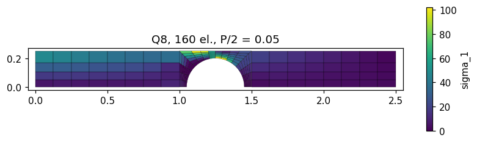

| Quantity | Ref. | Reference | feagent | Error | |
|---|---|---|---|---|---|
| convergence: nodal sigma_max Q8 640 vs 160 elements | other | 120.8 | 121.19 | 0.33 % | ✅ |
| |sigma| at the top edge of the hole in pure bending (photoelasticity) | book | 98.4 | 95.183 | 3.27 % | ✅ |

**Notes**: The book meshes cannot be rebuilt node by node. The load P = 0.10 is taken on the whole beam (upper half loaded with P/2): with this reading the element-centre values of coarse meshes have the order of the book's (62 with 40 elements) and pure bending with the same moment at the hole (M = 0.125) gives 95.2 at the top edge of the hole, against the photoelastic 98.4 (3 %). Under shear the maximum stress converges to about 121 (Q8, nodal value), well above the book's linear extrapolation 93.3: shear bends the two ligaments above and below the hole (Vierendeel action), which the book's coarse meshes miss.

*Code*: `validation/books/cook/ch18.py`

<a id="cook-18-8-q4-eigenvalue-test"></a>

### Sez. 18.8, Fig. 18.8-1, Eq. 18.8-1, 18.8-2 - Eigenvalues of the stiffness matrix of a square plane-strain Q4

✅ · PDF page 584 · plane_strain

Unit square, E = 1, nu = 0.3, unit thickness: the book lists three zero eigenvalues of the rigid-body motions and five nonzero ones, 1.92308 (uniform extension), 0.76923 (twice) and 0.57692 (twice, flexural modes).

**Model**: One feagent PlaneQ4 (2x2 Gauss), unit square, plane strain, unsupported.

| Quantity | Ref. | Reference | feagent | Error | |
|---|---|---|---|---|---|
| eigenvalue 1 (rigid body) | book | 0 | -1.1164e-16 | 0.00 % | ✅ |
| eigenvalue 2 (rigid body) | book | 0 | -9.2611e-17 | 0.00 % | ✅ |
| eigenvalue 3 (rigid body) | book | 0 | 1.0871e-16 | 0.00 % | ✅ |
| eigenvalue 4 | book | 0.57692 | 0.57692 | 0.00 % | ✅ |
| eigenvalue 5 | book | 0.57692 | 0.57692 | 0.00 % | ✅ |
| eigenvalue 6 | book | 0.76923 | 0.76923 | 0.00 % | ✅ |
| eigenvalue 7 | book | 0.76923 | 0.76923 | 0.00 % | ✅ |
| eigenvalue 8 | book | 1.9231 | 1.9231 | 0.00 % | ✅ |

**Notes**: The eigenvalues agree to all printed digits.

*Code*: `validation/books/cook/ch18.py`

<a id="cook-18-8-single-element-cantilever-test"></a>

### Sez. 18.8, Fig. 18.8-2 - Single-element test: cantilever in pure bending for varying L/H

✅ · PDF page 585 · plane_stress

The book suggests testing a formulation with a single cantilever element as the aspect ratio L/H grows. The end rotation in pure bending is measured against beam theory.

**Model**: A single feagent plane element (2x2 Q4 and QM6 with incompatible modes), plane stress, nodal force couple at the free end, L/H = 1, 2, 5, 10.

| Quantity | Ref. | Reference | feagent | Error | |
|---|---|---|---|---|---|
| Q4: rotation / beam theory, L/H = 1 | exact | 0.67407 | 0.67407 | 0.00 % | ✅ |
| QM6: rotation / beam theory, L/H = 1 | exact | 1 | 1 | 0.00 % | ✅ |
| Q4: rotation / beam theory, L/H = 2 | exact | 0.37917 | 0.37917 | 0.00 % | ✅ |
| QM6: rotation / beam theory, L/H = 2 | exact | 1 | 1 | 0.00 % | ✅ |
| Q4: rotation / beam theory, L/H = 5 | exact | 0.093333 | 0.093333 | 0.00 % | ✅ |
| QM6: rotation / beam theory, L/H = 5 | exact | 1 | 1 | 0.00 % | ✅ |
| Q4: rotation / beam theory, L/H = 10 | exact | 0.025278 | 0.025278 | 0.00 % | ✅ |
| QM6: rotation / beam theory, L/H = 10 | exact | 1 | 1 | 0.00 % | ✅ |

**Notes**: The book prints no numbers: the reference is the closed form of the rectangular Q4 in pure bending, (1 - nu^2)/(1 + (1 - nu)/2 (L/H)^2), which describes the parasitic shear stiffening; QM6 is exact for every L/H. Free data: E = 1, nu = 0.3, H = 1.

*Code*: `validation/books/cook/ch18.py`
