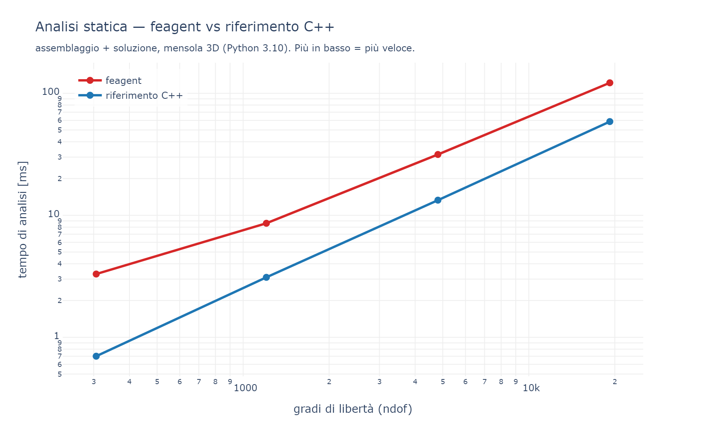
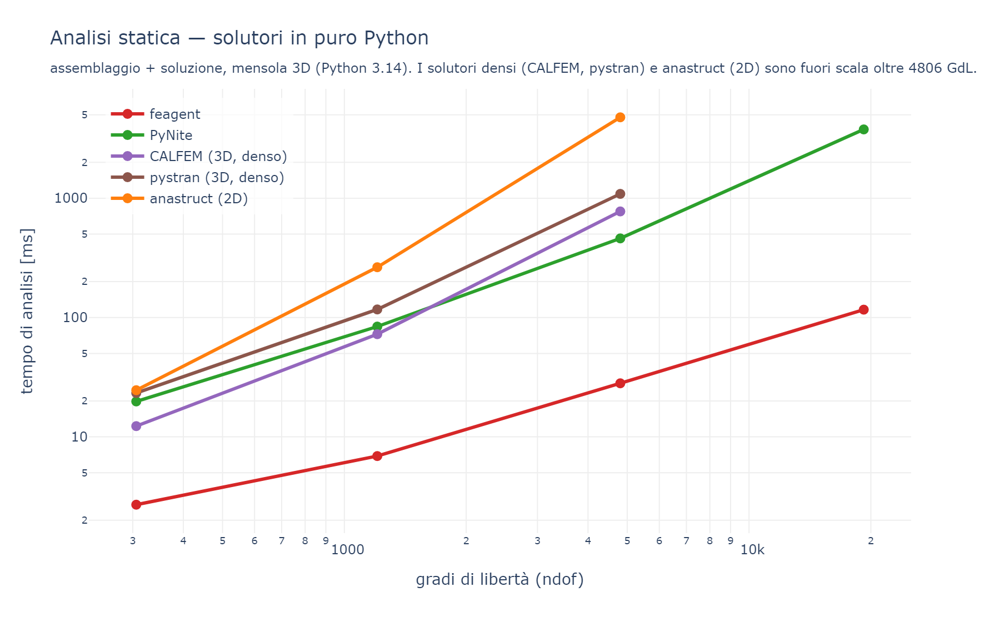
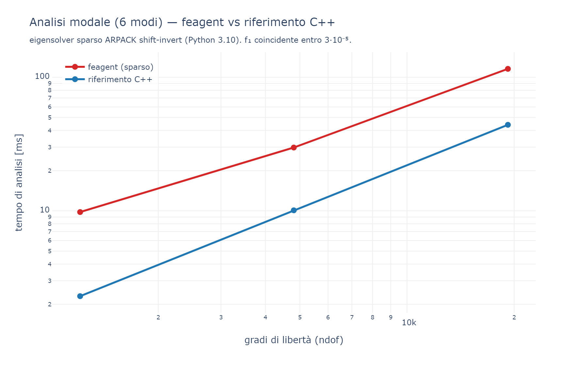
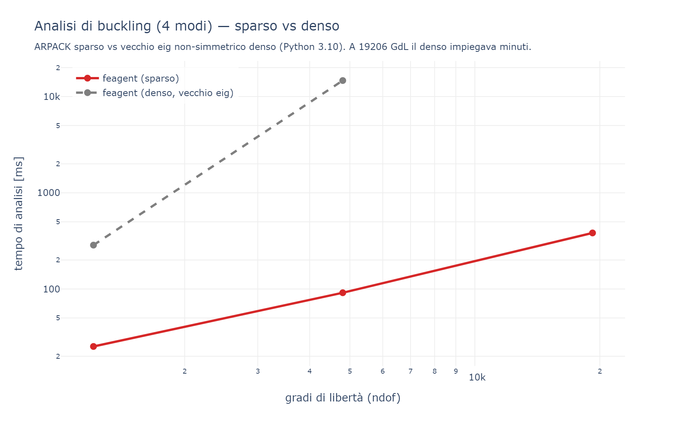
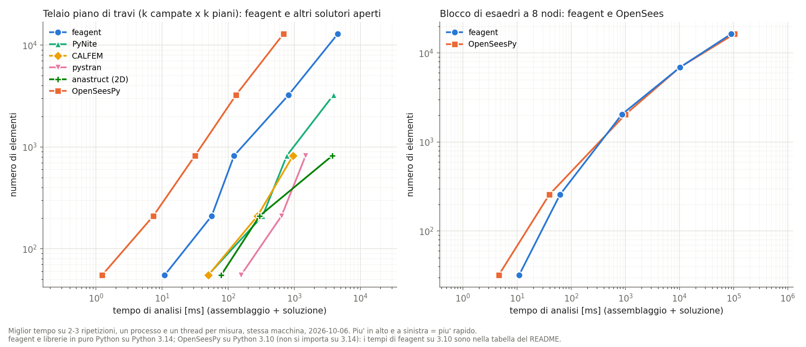

# 29 - Prestazioni e Benchmark

feagent è scritto in Python/NumPy/SciPy, ma adotta tecniche di vettorizzazione
e algebra sparsa che lo avvicinano ai solutori compilati (C++ compilati) e lo
rendono nettamente più rapido degli altri solutori in puro Python.

Tutti i confronti usano lo stesso modello: una **mensola 3D** di `N` elementi
trave (lunghezza totale 50 m), carico distribuito + forza in punta per la statica,
massa propria per la modale, compressione assiale per il buckling. Si misura il
tempo della **sola analisi** (assemblaggio + soluzione), escludendo la
costruzione del modello. Le misure sono eseguite isolate (un benchmark per volta)
sulla stessa macchina; i grafici sono prodotti da `benchmark/gen_benchmark_charts.py`
a partire dagli script `benchmark/benchmark_multi.py` (statica) e
`benchmark/benchmark_eigen.py` (modale/buckling).

Solutori a confronto: **feagent**, **openseespy** (motore FEM C++ compilato, nel seguito "riferimento C++"),
**PyNite** (frame 3D in puro Python), **CALFEM** (`calfem-python`, trave 3D
`beam3e`, assemblaggio denso), **pystran** (frame 3D in puro Python, denso) e
**anastruct** (frame 2D). Tutti concordano sulla freccia in punta (errore
relativo ≤ ~3·10⁻⁵, in genere a precisione macchina), quindi il confronto sui
tempi è significativo.

> il riferimento C++ si importa su Python 3.10 (problema di DLL su 3.14): i confronti
> sono eseguiti su Python 3.10. I solutori in puro Python (feagent,
> PyNite, CALFEM, pystran, anastruct) sono confrontati su Python 3.14.

## Analisi statica — feagent vs riferimento C++



| GdL | feagent | riferimento C++ | rapporto |
|----:|----------:|-----------------:|---------:|
| 306 | 3.3 ms | 0.7 ms | 4.7× |
| 1 206 | 8.6 ms | 3.1 ms | 2.8× |
| 4 806 | 32 ms | 13 ms | 2.4× |
| 19 206 | 122 ms | 59 ms | **2.1×** |

La freccia in punta coincide col riferimento C++ a precisione macchina sui modelli ben
condizionati. Il divario si **riduce al crescere del problema** (l'overhead Python
si ammortizza): a 19 000 GdL feagent è circa **2× il riferimento C++**, un risultato
notevole per un solutore in puro Python.

## Analisi statica — solutori in puro Python



| GdL | feagent | PyNite | CALFEM (3D) | pystran (3D) | anastruct (2D) |
|----:|----------:|-------:|------------:|-------------:|---------------:|
| 306 | 2.7 ms | 20 ms | 12 ms | 23 ms | 25 ms |
| 1 206 | 6.9 ms | 84 ms | 73 ms | 117 ms | 264 ms |
| 4 806 | 28 ms | 461 ms | 775 ms | 1 087 ms | 4 765 ms |
| 19 206 | 116 ms | 3 773 ms | fuori scala | fuori scala | fuori scala |

feagent è di gran lunga il più rapido fra i solutori in puro Python: **~16× più
veloce di PyNite**, **~28× di CALFEM**, **~39× di pystran** e **~170× di anastruct**
a 4806 GdL. CALFEM, pystran e anastruct usano assemblaggio/soluzione densi
(O(n³), memoria O(n²)): oltre ~5000 GdL diventano impraticabili, mentre feagent
(sparso) sale a decine di migliaia di GdL. Tutti danno la stessa freccia
(errore relativo ≤ ~3·10⁻⁵).

## Analisi modale (6 modi)



Eigensolver sparso ARPACK (shift-invert a σ=0):

| GdL | feagent | riferimento C++ | errore f₁ |
|----:|----------:|-----------:|----------:|
| 1 206 | 9.8 ms | 2.3 ms | 7·10⁻⁹ |
| 4 806 | 30 ms | 10 ms | 5·10⁻⁷ |
| 19 206 | 116 ms | 44 ms | 2·10⁻⁵ |

Circa **2.6–4× il riferimento C++**, con le prime frequenze coincidenti. Prima del percorso
sparso la modale usava un `eigh` denso con condensazione di Guyan, oltre 100× più
lenta su modelli grandi.

## Analisi di buckling (4 moltiplicatori critici)



Eigensolver sparso generalizzato `(−K_g) φ = μ K φ`, μ = 1/λ:

| GdL | feagent (sparso) | feagent (denso, vecchio `eig`) | speed-up |
|----:|-------------------:|---------------------------------:|---------:|
| 1 206 | 25 ms | 286 ms | 11× |
| 4 806 | 92 ms | 14 676 ms | **160×** |
| 19 206 | 383 ms | minuti | — |

Il primo moltiplicatore coincide con la soluzione di Eulero. Il passaggio
dall'`eig` non-simmetrico denso all'`eigsh` sparso porta a uno **speed-up fino a
~160×** sui modelli grandi.

## Cosa rende veloce il solutore

- **Forme chiuse** per le forze nodali equivalenti dei carichi distribuiti
  (niente quadratura di Gauss).
- **Assemblaggio vettorizzato** con `np.matmul` in batch su `(ne, 12, 12)`.
- **Cache geometriche** (vettore d'asse, `R`, `T`, `K` locale) con chiave sui valori.
- **Indice dei carichi per elemento** calcolato in una passata e riusato.
- **Eigensolver sparsi** (ARPACK) per modale e buckling.
- **`solve_many`**: più combinazioni con una sola fattorizzazione.
- **pypardiso** opzionale (MKL) come solutore sparso (`pip install feagent[fast]`).

## Riproducibilità

```bash
# i solutori extra si installano con:
pip install calfem-python pystran anastruct PyNiteFEA

python   benchmark/benchmark_multi.py    # statica: feagent, PyNite, CALFEM, pystran, anastruct
py -3.10 benchmark/benchmark_multi.py    # aggiunge il riferimento C++ (openseespy, Python 3.10)
py -3.10 benchmark/benchmark_eigen.py    # modale + buckling vs riferimento C++
python   benchmark/gen_benchmark_charts.py   # rigenera i grafici di questa pagina
```

I tempi assoluti dipendono dalla macchina; contano i rapporti.

## Tempo di analisi e numero di elementi (ottobre 2026)



Confronto aggiornato con la versione 0.8.1 su due famiglie di modelli, con il
tempo in ascissa e il numero di elementi in ordinata:

* **telaio piano di travi** di k campate per k piani (2k² + k elementi): feagent,
  OpenSees, PyNite, CALFEM, pystran e anastruct. La mensola usata sopra non è
  adatta a molti elementi: è così mal condizionata che a 12 800 elementi
  OpenSees ne sbaglia la freccia;
* **blocco di esaedri a 8 nodi**: feagent (`Hex8`) e OpenSees (`stdBrick`),
  gli unici della lista con elementi solidi.

Tutti i solutori danno lo stesso spostamento (scarti sotto 1e-10). Ogni misura
gira in un processo separato e a un solo thread: alcune librerie alterano lo
stato di numpy nel processo, e con BLAS multi-thread i tempi dipendono dal
carico della macchina più che dal solutore. Per feagent l'unione delle catene
di travi allineate è disattivata.

* Fra i solutori in puro Python feagent è il più rapido da circa 200 elementi,
  da 6 a 30 volte a 820 elementi.
* Sul telaio OpenSees (C++) è 3-7 volte più rapido sui modelli grandi: metà del
  tempo di feagent va nella fattorizzazione sparsa (SuperLU, un thread), il
  resto nelle matrici di rotazione calcolate in Python. Il backend MKL Pardiso
  (`feagent[fast]`) non è incluso.
* Sui solidi feagent e OpenSees sono alla pari: domina la fattorizzazione.

Tabelle complete nel README; misure con `benchmark/benchmark_elements.py`,
grafico con `benchmark/gen_elements_chart.py`.

## Calcolo parallelo e multithread (ottobre 2026)

Due ottimizzazioni, **spente di default**: le attiva l'utente.

| Opzione | Cosa fa | Dove conviene |
|---|---|---|
| Calcolo parallelo | distribuisce su più processi le analisi indipendenti: casi di carico, combinazioni (a blocchi, una fattorizzazione per blocco), casi mobili, analisi dinamiche | modelli grandi, molte combinazioni, time-history e non lineari |
| Algebra lineare multithread | fissa i thread di BLAS/LAPACK (e di MKL Pardiso, se installato) | solutore denso e analisi modali sui modelli medi |

Si usano processi e non thread perché il tempo di feagent sta nei cicli Python
sugli elementi (carichi equivalenti, estrazione delle azioni interne), che con
il GIL non girano in parallelo. Ogni processo riceve una copia del modello e
restituisce risultati **identici** a quelli sequenziali (scarto nullo su
spostamenti, reazioni e forze d'estremità nei test).

Misure su una CPU a 16 thread logici, graticcio di 9 648 GdL:

| Combinazioni | Sequenziale | 4 processi | 8 processi |
|---|---|---|---|
| 40 | 3,0 s | 1,6 s (×1,9) | 1,5 s (×2,1) |
| 160 | 10,4 s | 5,1 s (×2,1) | 4,0 s (×2,6) |

Il guadagno sulle combinazioni statiche è limitato dal ritorno dei risultati al
processo principale; è molto più alto sulle analisi lunghe e indipendenti
(time-history dei sette accelerogrammi, non lineari per combinazione). La
vettorizzazione del post-processing, prevista nella issue #7, ridurrà il tempo
per combinazione anche in sequenza.

Sul multithread, una misura che sorprende: con il default delle librerie
(16 thread) il solutore denso a 2 900 GdL impiega 2,8 s, con 4 thread 0,6 s e
con un solo thread 0,9 s, perché i thread logici si contendono gli stessi core.
In una seconda serie di misure: 1 thread 0,96 s, 4 thread 0,83 s, 8 thread (i core
fisici di quella CPU) 0,67 s, 16 thread 3,56 s. Il massimo sta sui core fisici.

I valori automatici si ricavano dal PC dell'utente: core fisici letti dal
sistema operativo (`psutil` se installato, altrimenti le API di Windows,
`/proc/cpuinfo` su Linux, `sysctl` su macOS), RAM totale e disponibile.

* **Thread**: i core fisici.
* **Processi**: i core fisici meno uno, che resta al processo principale e
  all'interfaccia (2 se i core sono due).
* **Tetto della RAM**: a ogni calcolo i processi contemporanei si limitano a
  quanti ne regge il 60 % della RAM disponibile, stimando per ciascuno 150 MB
  più 40 volte il modello serializzato. Se la RAM basta per un solo processo
  il calcolo resta in sequenza; il registro dice quando il tetto è intervenuto.

Su un i7-10700 (8 core fisici, 16 logici) l'automatico dà 7 processi e
8 thread. `feagent doctor` mostra cosa è stato rilevato, e così la sezione
Calcolo delle opzioni della GUI.

**Nell'interfaccia**: Strumenti > Opzioni > Calcolo. Le scelte restano nel
browser e valgono anche per le analisi lanciate dall'IA sulla stessa sessione;
il gruppo di processi parte appena si attiva la spunta, così la prima analisi
non ne paga l'avvio. Sul server online il parallelo resta spento.

**Da riga di comando**: `--parallel`, `--workers N` (implica `--parallel`),
`--multithread`, `--threads N` (implica `--multithread`), prima o dopo il
comando:

```bash
feagent solve modello.xlsx --combos --workers 4 --threads 2
```

**Dalla libreria**:

```python
import feagent.parallel as par

par.configure(parallel=True, workers=4)      # per tutto il programma
results = m.solve_many(combos)

with par.use(parallel=True, multithread=True, threads=8):   # solo nel blocco
    results = m.solve_many(combos)

m.solve_many(combos, parallel=True)          # solo per questa chiamata
```

Oppure con le variabili d'ambiente `FEAGENT_PARALLEL=1`, `FEAGENT_WORKERS`,
`FEAGENT_MULTITHREAD`, `FEAGENT_THREADS`. Su Windows e macOS i processi partono
con `spawn`: lo script deve proteggere il codice principale con
`if __name__ == "__main__":`. Se il modello non si può serializzare (per
esempio contiene una lambda) feagent avvisa e prosegue in sequenza.
