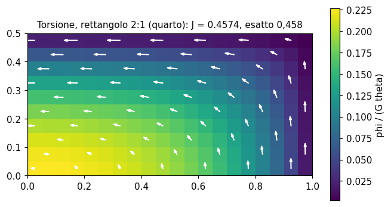
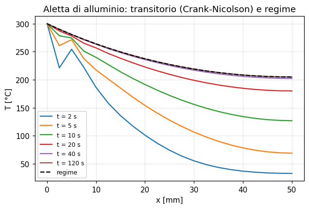

# 60 - Problemi di campo: calore, torsione, potenziale, filtrazione

Il modulo `feagent.field` risolve i problemi **scalari** governati dall'equazione
quasi-armonica, che nei testi di elementi finiti seguono subito l'analisi delle
tensioni (Cook, Malkus & Plesha cap. 15-16; Seshu cap. 2-4 e 6; Cook, *Modeling*,
cap. 8):

```
div(k grad phi) + Q = c dphi/dt
```

| `problem` | phi | k | Q | grandezza derivata |
|---|---|---|---|---|
| `heat` | temperatura | conducibilita' | calore generato per volume | flusso `q = -k grad T` |
| `torsion` | funzione di Prandtl | 1 | `2 G theta` | `tau_xz = dphi/dy`, `tau_yz = -dphi/dx`, `T = 2 int phi dA` |
| `potential` | potenziale di velocita' | 1 | 0 | `v = grad phi` |
| `stream` | funzione di corrente | 1 | 0 | `u = dpsi/dy`, `v = -dpsi/dx` |
| `seepage` | carico piezometrico | permeabilita' | 0 | velocita' di Darcy `v = -k grad h` |
| `generic` | qualunque | k | Q | `-k grad phi` |

La discretizzazione di Galerkin da' `C dphi/dt + K phi = F` con

```
K = int B^T k B dV + int h N^T N dS           (conduzione + convezione)
C = int rho c N^T N dV                         (capacita')
F = int N^T Q dV + int N^T q dS + int h phi_inf N^T dS
```

## Elementi

Gli elementi di campo usano **le stesse funzioni di forma, quadrature e
numerazioni di lati e facce** degli elementi strutturali, quindi una mesh
strutturale si riusa cosi' com'e':

| tipo | geometria | note |
|---|---|---|
| `L2`, `L3` | barra 1D lungo una linea qualunque | `area` della sezione, `perimeter` per la convezione laterale delle alette; `L3`: estremi, poi nodo medio |
| `T3`, `T6`, `Q4`, `Q8`, `Q9` | piano X-Y | spessore `t`, oppure `axisym=True` (X = raggio, Y = asse, anello completo) |
| `Tet4`, `Tet10`, `Hex8`, `Wedge6`, `Pyramid5` | solidi 3D | facce come in `feagent.solid` |

## Condizioni al contorno e carichi

| metodo | significato |
|---|---|
| `set_value(nodo, valore)` | valore imposto (anche funzione del tempo nei transitori) |
| `fix_boundary(valore, exclude)` | impone il valore su tutto il contorno libero della mesh piana (torsione) |
| `add_source(elem, Q)` | generazione per unita' di volume (costante o valori nodali) |
| `add_point_source(nodo, Q)` | sorgente concentrata |
| `add_flux(elem, lato, q)` | flusso imposto entrante |
| `add_convection(elem, lato, h, phi_inf)` | convezione su un lato o una faccia |
| `add_lateral_convection(elem, h, phi_inf, faces)` | convezione sulla superficie laterale: alette 1D (perimetro) o facce delle piastre |
| `add_nodal_convection(nodo, hA, phi_inf)` | convezione concentrata (punta di un'aletta) |
| `add_radiation(elem, lato, eps, phi_inf)` | irraggiamento, non lineare, risolto con Newton; temperature assolute `phi + temperature_offset` |

## Analisi

* `solve()`: regime stazionario (Newton se c'e' irraggiamento) -> `FieldResult`;
* `solve_transient(dt, t_end, initial, theta=0.5, lumped=False)`: metodo theta
  (Crank-Nicolson, Eulero all'indietro con `theta = 1`, Galerkin con `2/3`,
  esplicito con `0`) -> `TransientFieldResult` (`value_history`, `at(t)`, `final()`);
* `eigenvalues(n)`: autovalori `K x = lambda C x` (costanti di tempo `1/lambda`;
  con `rho c = 1/c^2` sono i modi acustici `omega^2` di un fluido).

Risultati (`FieldResult`): `value`, `values`, `value_at`, `gradient`, `flux`,
`velocity`, `nodal_gradients`, `nodal_flows` (la "reazione": flusso che i nodi a
valore imposto immettono nel corpo), `convection_flow`, `radiation_flow`; per la
torsione `torque`, `torsion_constant`, `shear_stress`, `max_shear_stress`.

## Accoppiamento con le tensioni termiche

`FieldResult.to_model_temperatures(model, reference)` applica il campo di
temperatura come variazione termica `T - reference` (valori nodali) agli
elementi piani e solidi di un `feagent.Model` costruito con gli stessi id di nodi
ed elementi: il campo termico calcolato diventa il carico dell'analisi delle
tensioni (`Model.add_solid_thermal`).

```python
from feagent import Material, Model
from feagent.field import FieldModel, rect_mesh

nodes, els, _ = rect_mesh(0.4, 0.1, 20, 5, "Q8")
fm, m = FieldModel("heat"), Model()
for k, (x, y) in nodes.items():
    fm.add_node(k, x, y)
    m.add_node(k, x, y, 0.0)
for e, nn in els:
    fm.add_element(e, nn, 45.0, t=0.02)
    m.add_plane(e, nn, Material(210e9, 0.3, 1.2e-5), "stress", t=0.02)
for k, (x, y) in nodes.items():
    if x == 0.0:
        fm.set_value(k, 200.0)
for e in range(1, 21):                       # lato superiore convettivo
    fm.add_convection(e + 80, 2, 25.0, 20.0)
campo = fm.solve()
campo.to_model_temperatures(m, reference=20.0)
```

## Esempi di verifica



*Torsione di Saint-Venant di un rettangolo 2:1 (un quarto con simmetria, Q8):
funzione di Prandtl e tensioni tangenziali; costante torsionale entro lo 0,2 %
del valore esatto 0,229 a b³.*



*Aletta di alluminio (Seshu, Es. 4.10 e 6.7): profili di temperatura nel
transitorio e a regime.*

I test `tests/test_field.py` confrontano il modulo con soluzioni in forma chiusa:
aletta con punta adiabatica (cosh), parete con generazione (parabola), lastra con
temperatura sinusoidale al bordo (sinh), torsione di cerchio, quadrato e
rettangolo, cilindro cavo assialsimmetrico (logaritmo), transitorio della lastra
semi-infinita (serie di Fourier), irraggiamento di una parete, campi uniformi di
potenziale, corrente e filtrazione. Gli esempi svolti dei libri sono nelle pagine
62-65.

Riferimenti: Cook, Malkus, Plesha & Witt, *Concepts and Applications of FEA*;
Seshu, *Textbook of Finite Element Analysis*; Lewis, Nithiarasu & Seetharamu,
*Fundamentals of the FEM for Heat and Fluid Flow*; Timoshenko & Goodier, *Theory
of Elasticity* (torsione).
