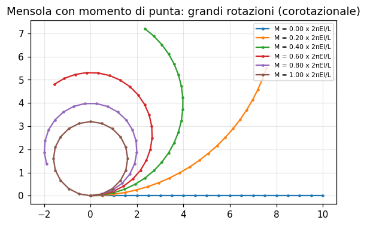
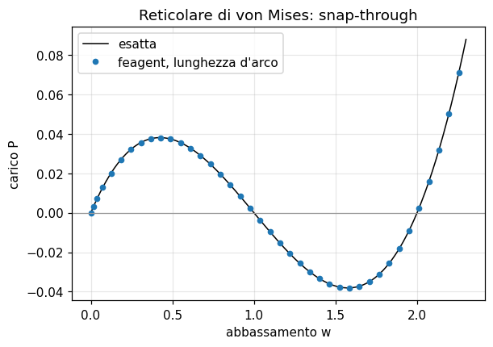
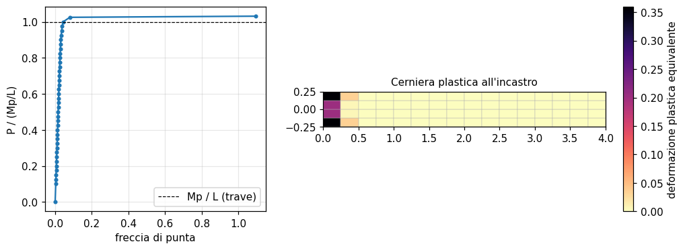
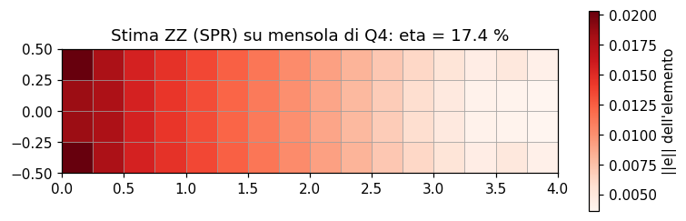

# 61 - Elementi e analisi dai libri di testo

feagent e' stato esteso rifacendo **tutti gli esempi svolti** di quattro testi
classici di elementi finiti; dove un esempio richiedeva un elemento o un'analisi
mancante, la funzione e' stata aggiunta alla libreria e alla GUI, verificata contro
soluzioni in forma chiusa e poi usata per rifare l'esempio:

* R.D. Cook, D.S. Malkus, M.E. Plesha, *Concepts and Applications of Finite
  Element Analysis*, 3a ed., Wiley 1989 (pagina [62](it-62-esempi-cook-concepts.html));
* R.D. Cook, *Finite Element Modeling for Stress Analysis*, Wiley 1995
  (pagina [63](it-63-esempi-cook-modeling.html));
* P. Seshu, *Textbook of Finite Element Analysis*, PHI 2003 (pagina [64](it-64-esempi-seshu.html));
* S.S. Bhavikatti, *Finite Element Analysis*, New Age 2005 (pagina [65](it-65-esempi-bhavikatti.html)).

I problemi di campo (calore, torsione, moto a potenziale, filtrazione) hanno una
pagina propria: [60](it-60-problemi-di-campo.html). Questa pagina descrive le altre
novita'; il riepilogo dei risultati degli esempi e' in fondo.

## Elementi piani: Q9 e regole d'integrazione

`Model.add_plane` accetta il **Q9 lagrangiano** (9 nodi: angoli, nodi di spigolo
(1-2), (2-3), (3-4), (4-1), nodo centrale) e l'opzione `integration`:

| `integration` | regola | uso |
|---|---|---|
| `"full"` (default) | Gauss completo (T3 1, T6 3, Q4 2x2, Q8/Q9 3x3) | caso generale |
| `"reduced"` | un ordine in meno (Q4 1 punto, Q8/Q9 2x2, T6 1 punto) | elimina il locking a taglio; Q4 con `hourglass=True` |
| `"selective"` | taglio `gxy` ridotto, termini normali completi | flessione con Q4 senza modi incompatibili |
| `"volumetric"` | parte volumetrica `K m m^T` ridotta | deformazione piana e assialsimmetria quasi incomprimibili |

Il Q4 a un punto ha due modi a energia nulla (*hourglass*). Con `hourglass=True`
si aggiunge la rigidezza di stabilizzazione: la proiezione della rigidezza del QM6
sui vettori hourglass di Flanagan-Belytschko, che per un rettangolo restituisce
l'energia esatta della flessione pura e non irrigidisce i campi lineari (Cook et
al., par. 6.12). La mensola della Tabella 18.7-1 di Cook (P = 100, L = 2,40,
h = 0,40, E = 10⁴, nu = 0,25) da':

| mesh | Full libro | Full feagent | H-G libro | H-G feagent |
|---|---|---|---|---|
| 4 x 2 | 4,562 | 4,564 | 8,572 | 8,573 |
| 8 x 4 | 7,124 | 7,126 | 8,719 | 8,721 |
| 16 x 8 | 8,302 | 8,305 | 8,771 | 8,773 |

## Barre isoparametriche

`Model.add_bar(id, nodi, materiale, A)` crea una barra a sola rigidezza assiale a
2 nodi (`L2`) o 3 nodi (`L3`: estremi, poi nodo medio), in qualunque direzione,
con area costante o **variabile** (un valore per nodo, interpolato: aste
rastremate). Peso proprio con `add_solid_body_force`, temperatura con
`add_solid_thermal`, carichi lungo l'asse con `add_bar_line_load` (costanti o
lineari/parabolici con valori nodali). E' l'elemento dei primi capitoli di Seshu e
Bhavikatti: con la `L3` l'asta appesa sotto peso proprio e' esatta con un elemento.

## Suolo alla Winkler

* `feagent.foundation.add_beam_foundation(model, trave, k_y=, k_z=, k_x=, k_rx=)`:
  rigidezza consistente `int N^T diag(k) N dx` con le funzioni di Hermite della
  trave (la classica `k L/420 [156 22L 54 -13L ...]`); `foundation_pressure`
  restituisce la reazione del suolo lungo la trave;
* `add_plate_foundation(model, guscio, k, lumped=False)`: modulo di reazione sotto
  gusci Q4 e triangoli (consigliati i triangoli sottili DKT: con la piastra di
  Mindlin la freccia sotto un carico concentrato non converge).

Entrambe entrano come superelementi (statica, modale, buckling, dinamica lineare) e
si salvano nei fogli Excel `Foundation` e `PlateFoundation`. Verifiche: trave
lunga con forza concentrata `w0 = P beta/(2k)` entro lo 0,01 %, piastra infinita
`w0 = P/(8 sqrt(k D))` entro lo 0,3 %.

## Dinamica esplicita alle differenze centrali

`Model.solve_time_history(..., method="central_difference")` (e
`feagent.dynamics.central_difference_integrate` sulle matrici) integra le equazioni
del moto con lo schema esplicito; con masse diagonali non si fattorizza nulla. Il
passo e' controllato: se `dt > 2/omega_max` l'analisi si ferma con un errore che
indica il passo critico (Cook et al., par. 13.10: propagazione d'onda nella barra).

## Grandi spostamenti di telai piani

`feagent.corotational.solve_corotational(model, n_steps, control, ...)` analizza
telai piani (X-Y oppure X-Z con Z verticale) di travi di Eulero-Bernoulli, bielle e
barre con la formulazione corotazionale: rotazioni rigide esatte, anche oltre 2 pi.
Controlli: di carico, di spostamento di un GdL, in **lunghezza d'arco** (per
snap-through e snap-back).

*Mensola con momento di punta crescente fino a 2 pi EI/L: la trave si chiude ad
anello (Cook et al., par. 17.7); spostamenti di punta entro lo 0,3 % della
soluzione esatta.*

*Reticolare di von Mises: il percorso seguito in lunghezza d'arco coincide con la
soluzione esatta anche oltre il punto limite.*

## Plasticita', gioco e molle non lineari

`feagent.inelastic.solve_inelastic(model, steps, plastic=, gaps=, springs=)` e'
un'analisi incrementale di Newton-Raphson in cui sono non lineari solo gli elementi
indicati:

* `J2Plasticity(E, sigma_y, nu, H_iso, H_kin)` (o `J2Plasticity.bilinear(E,
  sigma_y, E_t)`): plasticita' di von Mises con incrudimento isotropo e cinematico,
  ritorno radiale e operatore tangente consistente, per barre, bielle ed elementi
  piani (tensione piana con `s_zz = 0` imposta nel punto, deformazione piana,
  assialsimmetria; in deformazione piana usare i Q8 a integrazione ridotta per
  evitare il locking volumetrico del flusso plastico);
* `Gap(gap, k, side)`: molla che reagisce dopo aver chiuso un gioco (appoggi a
  gioco, battute);
* `NonlinearElastic(points)`: molla con legge forza-allungamento lineare a tratti.

I passi che non convergono vengono dimezzati; `steps` puo' essere una sequenza di
fattori anche decrescenti (scarico, cicli: effetto Bauschinger con incrudimento
cinematico). `solve_inelastic_explicit` usa le differenze centrali (onda elastica e
onda plastica nella barra di Cook, par. 17.6).

*Mensola in tensione piana: la curva carico-freccia tende al carico di collasso
Mp/L (1,03 Mp/L con questa mesh, 1,01 raffinando); a destra la cerniera plastica.*

## Stima dell'errore di Zienkiewicz-Zhu

`feagent.error_estimation.zz_error(model, result, method="spr")` recupera tensioni
nodali continue (SPR, *superconvergent patch recovery*, oppure media nodale) e stima
l'errore nella norma dell'energia elemento per elemento; `eta` e' l'errore relativo
globale e `refinement_ratio` indica gli elementi da raffinare.

*Errore stimato per elemento in una mensola di Q4: si concentra all'incastro.*

## Test

`tests/test_field.py`, `tests/test_inelastic.py`, `tests/test_corotational.py`,
`tests/test_error_estimation.py`, `tests/test_books_io.py` (fogli Excel) e
`tests/test_books_examples.py` (tutti gli esempi dei libri).

<!-- riepilogo-libri -->

## Riepilogo degli esempi dei libri

| Libro | Pagina | Esempi | ✅ | 🟡 | 📐 | ⛔ | Confronti superati |
|---|---|---|---|---|---|---|---|
| R.D. Cook, *Concepts and Applications of Finite Element Analysis* | [62](it-62-esempi-cook-concepts.html) | 135 | 36 | 19 | 77 | 3 | 785/785 |
| R.D. Cook, *Finite Element Modeling for Stress Analysis* | [63](it-63-esempi-cook-modeling.html) | 54 | 29 | 13 | 12 | 0 | 452/452 |
| P. Seshu, *Textbook of Finite Element Analysis* | [64](it-64-esempi-seshu.html) | 44 | 21 | 2 | 19 | 2 | 422/422 |
| S.S. Bhavikatti, *Finite Element Analysis* | [65](it-65-esempi-bhavikatti.html) | 58 | 21 | 2 | 35 | 0 | 361/361 |
