# 63 - Esempi del libro Cook (Modeling)

Questa pagina raccoglie **tutti gli esempi svolti** del libro *Finite Element Modeling for Stress Analysis* (R.D. Cook, Wiley, 1995) rifatti con feagent. Per ogni esempio: riferimento nel libro, modello feagent, confronto numerico fra il valore del libro e quello di feagent, note (dati mancanti, refusi del libro corretti, differenze di modello). I testi sono riassunti con parole nostre; i dati numerici servono a rifare il calcolo. Il codice di ogni esempio e' in `validation/books/cookmodeling/`; per rieseguirli:

```bash
python -m validation.books.run_books cookmodeling
python scripts/_gen_book_docs.py
```

**Esiti**: ✅ riprodotto e confrontato; 🟡 riprodotto in parte (dati o risultati del libro incompleti); 📐 ricavo di formule verificato numericamente; ⛔ non riproducibile (motivo nelle note). La colonna *scarto* e' l'errore relativo massimo dei confronti; *rif.* indica il riferimento del confronto: libro, soluzione esatta o valore corretto di un refuso.

**54 esempi**: 29 riprodotti, 13 in parte, 12 ricavi verificati, 0 non riproducibili; 452 confronti numerici, 452 entro la tolleranza.

## Riepilogo

| Esempio | Titolo | Esito | Confronti | Scarto max |
|---|---|---|---|---|
| [Sez. 1.4, Fig. 1.4-1 (Problem 1.9)](#cookmod-1-4-tapered-bar-discretization) | Barra rastremata discretizzata con elementi a gradini | ✅ | 6/6 | 3.20 % |
| [Sez. 2.5, Figg. 2.5-1d e 2.5-4](#cookmod-2-5-bar-uniform-axial-load) | Barra con carico assiale uniforme: spostamenti nodali esatti, tensioni a gradini | ✅ | 7/7 | 0.00 % |
| [Sez. 2.6, Example 1, Fig. 2.6-1](#cookmod-2-6-ex1-bar-thermal-free) | Barra a due elementi riscaldata con un solo estremo vincolato | ✅ | 4/4 | 0.00 % |
| [Sez. 2.6, Example 2, Eqq. 2.6-7, 2.6-8](#cookmod-2-6-ex2-bar-thermal-fixed) | Barra a due elementi incastrata agli estremi e riscaldata | ✅ | 3/3 | 0.00 % |
| [Sez. 2.6, Eqq. 2.6-9, 2.6-10](#cookmod-2-6-spurious-thermal-stress) | Tensione termica spuria in una barra con DeltaT lineare | 📐 | 4/4 | 0.00 % |
| [Sez. 2.7 An Application, Figg. 2.7-1...2.7-4](#cookmod-2-7-oval-ring) | Anello ovale piano con forze concentrate e pressione interna | ✅ | 14/14 | 0.46 % |
| [Sez. 3.2, Fig. 3.2-2](#cookmod-3-2-cst-pure-bending) | Mensola in flessione pura modellata con triangoli a deformazione costante | ✅ | 5/5 | 3.98 % |
| [Sez. 3.6, Eq. 3.6-1](#cookmod-3-6-q4-locking-ratio) | Sovra-rigidezza flessionale del Q4 rettangolare (locking) | 📐 | 5/5 | 0.00 % |
| [Sez. 3.11, Fig. 3.11-1](#cookmod-3-11-cantilever-element-comparison) | Mensola con forza all'estremo: confronto fra CST, Q4, Q6, LST e Q8 | ✅ | 20/20 | 0.17 % |
| [Sez. 3.12 An Application, Tab. 3.12-1](#cookmod-3-12-square-plate-pressurized-hole) | Piastra quadrata con foro centrale in pressione | 🟡 | 25/25 | 3.99 % |
| [Sez. 4.5, Figg. 4.5-1, 4.5-2, Eqq. 4.5-1...4.5-3](#cookmod-4-5-gauss-quadrature) | Regole di Gauss a 1, 2 e 3 punti in 1D e 2x2, 3x3 in 2D | 📐 | 16/16 | 0.00 % |
| [Sez. 4.6-4.7, Figg. 4.6-1, 4.6-2, 4.7-1](#cookmod-4-6-hourglass-instability) | Modi spuri (hourglass) del Q4 a un punto di Gauss e del Q8 a quattro punti | ✅ | 8/8 | 0.00 % |
| [Sez. 4.9, Fig. 4.9-1a](#cookmod-4-9-patch-test) | Patch test per sigma_x costante con elementi a 4 nodi | ✅ | 9/9 | 0.00 % |
| [Sez. 4.13, Fig. 4.13-2, Eqq. 4.13-6...4.13-11](#cookmod-4-13-lagrange-penalty-bar) | Vincolo u1 = u2 su una barra a due elementi: moltiplicatori di Lagrange e penalita' | ✅ | 12/12 | 0.00 % |
| [Sez. 5.5, Fig. 5.5-1, Eqq. 5.5-3...5.5-7](#cookmod-5-5-homogenized-perforated-plate) | Proprieta' elastiche equivalenti di una lastra forata da una cella ripetitiva | 📐 | 12/12 | 0.39 % |
| [Sez. 5.7, Fig. 5.7-3, Eqq. 5.7-1, 5.7-2](#cookmod-5-7-bolt-pretension-smeared) | Bulloni di flangia spalmati e pretensione per raffreddamento | 📐 | 4/4 | 0.00 % |
| [Sez. 5.10, Fig. 5.10-1, Eqq. 5.10-1, 5.10-2](#cookmod-5-10-ill-conditioning-springs) | Mal condizionamento: parte rigida sostenuta da una parte flessibile | ✅ | 7/7 | 0.00 % |
| [Sez. 5.10, Fig. 5.10-3](#cookmod-5-10-folded-strip-ill-conditioning) | Striscia piegata ad arco di gusci piani: degrado della tensione al diminuire dello spessore | 🟡 | 6/6 | 1.18 % |
| [Sez. 5.14, Fig. 5.14-1](#cookmod-5-14-scf-correction-factor) | Fattore correttivo da un caso secondario per la tensione vicino a un foro | 🟡 | 5/5 | 4.00 % |
| [Sez. 5.15, Eq. 5.15-1, Fig. 5.15-2](#cookmod-5-15-richardson-extrapolation) | Estrapolazione a h -> 0 da due mesh | 📐 | 4/4 | 0.26 % |
| [Sez. 5.16, Figg. 5.16-1, 5.16-2, Eqq. 5.16-1, 5.16-2](#cookmod-5-16-zz-error-adaptive) | Stimatore d'errore Z2 in energia e raffinamento guidato | 🟡 | 8/8 | 0.52 % |
| [Sez. 6.3 A 3D Application, Figg. 6.3-1, 6.3-2, Eq. 6.3-1](#cookmod-6-3-curved-beam-3d) | Trave curva a sezione trapezia in flessione pura con solidi Hex8 | ✅ | 7/7 | 0.64 % |
| [Sez. 6.5 An Axisymmetric Application, Figg. 6.5-1...6.5-4](#cookmod-6-5-shrink-fit-spinning-disks) | Disco rastremato con anello calettato a caldo, poi in rotazione | 🟡 | 8/8 | 11.86 % |
| [Sez. 7.1, Fig. 7.1-4, Eqq. 7.1-5, 7.1-6](#cookmod-7-1-membrane-string-action) | Trave con cerniere fisse: quota di carico portata per effetto fune | ✅ | 5/5 | 13.39 % |
| [Sez. 7.2 Test Cases, Fig. 7.2-6a](#cookmod-7-2-square-plate-benchmarks) | Piastra quadrata appoggiata o incastrata: freccia al centro | ✅ | 6/6 | 0.36 % |
| [Sez. 7.2 Test Cases, Fig. 7.2-6b](#cookmod-7-2-rhombic-plate) | Piastra romboidale a 30 gradi appoggiata con carico uniforme | ✅ | 3/3 | 2.71 % |
| [Sez. 7.2 Test Cases, Fig. 7.2-6c,d](#cookmod-7-2-twisted-strip-plate) | Torsione di una striscia piana a mensola | ✅ | 5/5 | 4.28 % |
| [Sez. 7.3 A Plate Application, Figg. 7.3-1...7.3-3](#cookmod-7-3-plate-winkler-point-load) | Piastra su suolo alla Winkler caricata da una forza concentrata | ✅ | 5/5 | 9.01 % |
| [Sez. 7.4, Eq. 7.4-1](#cookmod-7-4-boundary-layer-length) | Ampiezza dello strato limite flessionale nei gusci | 📐 | 5/5 | 4.26 % |
| [Sez. 7.5 Test Cases, Fig. 7.5-2](#cookmod-7-5-shell-obstacle-course) | Benchmark per gusci: volta cilindrica, cilindro pizzicato, emisfero, trave svergolata | ✅ | 14/14 | 4.12 % |
| [Sez. 7.5, Fig. 7.5-3](#cookmod-7-5-conical-frusta-sphere) | Sfera in pressione modellata con tronchi di cono: momenti flettenti spuri | 🟡 | 3/3 | 0.11 % |
| [Sez. 7.6 An Axisymmetric Shell Application, Figg. 7.6-1, 7.6-2](#cookmod-7-6-spherical-segment-axisym-shell) | Zona sferica incastrata all'equatore con carico di linea sul bordo superiore | 🟡 | 7/7 | 5.36 % |
| [Sez. 7.7 A General Shell Application, Figg. 7.7-1...7.7-3](#cookmod-7-7-slit-tube-cantilever) | Tubo sottile tagliato longitudinalmente, a mensola, con forza trasversale | 🟡 | 9/9 | 8.85 % |
| [Sez. 8.2, Fig. 8.2-1, Eq. 8.2-1](#cookmod-8-2-bar-conductivity) | Matrice di conducibilita' di una barra a superficie laterale isolata | 📐 | 4/4 | 0.00 % |
| [Sez. 8.4, Eqq. 8.4-1...8.4-5 (Problem 8.11)](#cookmod-8-4-crank-nicolson-scheme) | Integrazione nel tempo dei transitori termici col metodo del trapezio generalizzato | 📐 | 5/5 | 0.55 % |
| [Sez. 8.6 An Application, Figg. 8.6-1...8.6-5, Tab. 8.6-1](#cookmod-8-6-pipe-flange-thermal-stress) | Giunto a flangia saldato su tubo: campo termico stazionario e tensioni termiche | 🟡 | 20/20 | 24.09 % |
| [Sez. 9.3, Eqq. 9.3-1...9.3-5](#cookmod-9-3-mass-matrices) | Matrici di massa concentrata e consistente di barra e trave | 📐 | 5/5 | 0.00 % |
| [Sez. 9.4 Example, Fig. 9.4-1, Eqq. 9.4-4...9.4-7](#cookmod-9-4-cantilever-one-element-modal) | Frequenze di una mensola con un solo elemento trave: massa consistente e concentrata | ✅ | 6/6 | 0.18 % |
| [Sez. 9.6 Example, Eqq. 9.6-6...9.6-8](#cookmod-9-6-guyan-one-element) | Riduzione di Guyan della mensola a un elemento | ✅ | 3/3 | 0.01 % |
| [Sez. 9.11, Eqq. 9.11-1, 9.11-2](#cookmod-9-11-frequency-estimates) | Stima della prima frequenza con rigidezza statica e massa efficace m/2 | ✅ | 4/4 | 0.02 % |
| [Sez. 9.11, Fig. 9.11-4](#cookmod-9-11-guyan-cantilever-plate) | Piastra quadrata a mensola: frequenze complete e ridotte con Guyan a 6 master | 🟡 | 8/8 | 4.40 % |
| [Sez. 9.11, Fig. 9.11-6, Eqq. 9.11-3...9.11-5](#cookmod-9-11-spin-softening) | Ammorbidimento da rotazione di un sistema massa-molla su disco rotante | 📐 | 3/3 | 0.00 % |
| [Sez. 9.12 An Application, Figg. 9.12-1...9.12-3, Tab. 9.12-1](#cookmod-9-12-frame-modes-harmonic) | Telaio ad angolo retto: modi propri e risposta armonica | ✅ | 31/31 | 2.37 % |
| [Sez. 9.13 An Application, Figg. 9.13-1...9.13-3, Tabb. 9.13-1, 9.13-2](#cookmod-9-13-frame-impulse-response) | Telaio sotto impulso rettangolare: sovrapposizione modale e spettro di risposta | 🟡 | 40/40 | 6.84 % |
| [Sez. 10.2, Figg. 10.2-1...10.2-3 (Problems 10.2, 10.3)](#cookmod-10-2-nonlinear-spring-algorithms) | Molla non lineare: metodo incrementale, Newton-Raphson e Newton-Raphson modificato | ✅ | 7/7 | 0.16 % |
| [Sez. 10.3, Fig. 10.3-1a,b, Eq. 10.3-1](#cookmod-10-3-rigid-bar-stress-stiffness) | Barra rigida su molla con forza assiale: rigidezza geometrica P/L | 📐 | 3/3 | 0.00 % |
| [Sez. 10.3, Eqq. 10.3-3...10.3-5 (Problem 10.4)](#cookmod-10-3-one-element-buckling) | Carico critico di una mensola con un solo elemento trave | ✅ | 5/5 | 0.02 % |
| [Sez. 10.4, Fig. 10.4-1, Eqq. 10.4-1...10.4-3 (Problem 10.5)](#cookmod-10-4-beam-on-wall-snap) | Asta inclinata con rullo su parete: rigidezza variabile, punto limite e snap-through | ✅ | 8/8 | 0.80 % |
| [Sez. 10.4, Fig. 10.4-2a,b,e](#cookmod-10-4-geometric-nonlinear-tests) | Casi test di non linearita' geometrica: barra rigida con molla rotazionale, mensola con momento, membrana | 🟡 | 8/8 | 0.10 % |
| [Sez. 10.5, Figg. 10.5-2, 10.5-3](#cookmod-10-5-plastic-block-sampling) | Plasticita': i punti di Gauss come campionatori dello snervamento in un blocco inflesso | ✅ | 9/9 | 0.21 % |
| [Sez. 10.6, Figg. 10.6-2, 10.6-3 (Problem 10.12)](#cookmod-10-6-gap-two-springs) | Due molle in serie con gioco g verso una parete: elemento gap a penalita' | ✅ | 4/4 | 0.00 % |
| [Sez. 10.8 Applications, Figg. 10.8-1, 10.8-2](#cookmod-10-8-frame-geometric-nonlinearity) | Telaio snello: buckling lineare e risposta a grandi spostamenti con snap | ✅ | 7/7 | 0.46 % |
| [Sez. 10.8 Applications, 'Plastic Action in a Beam', Figg. 10.8-3, 10.8-4](#cookmod-10-8-plastic-beam-plane-stress) | Trave in tensione piana con plasticita' bilineare: carico, scarico e tensioni residue | 🟡 | 6/6 | 6.23 % |
| [Sez. 10.8 Applications, 'Beam With Contact Nonlinearity', Fig. 10.8-5](#cookmod-10-8-beam-gap-contact) | Trave con gioco iniziale su un appoggio intermedio e distacco all'estremo | ✅ | 5/5 | 0.27 % |

## Capitolo 1

<a id="cookmod-1-4-tapered-bar-discretization"></a>

### Sez. 1.4, Fig. 1.4-1 (Problem 1.9) - Barra rastremata discretizzata con elementi a gradini

✅ · pag. PDF 19 · bar

Una barra a sezione variabile caricata da una forza assiale all'estremo viene sostituita da elementi uniformi a gradini, con l'area presa al centro di ogni elemento. Il libro discute l'errore di discretizzazione, che diminuisce infittendo la mesh, senza stampare numeri. Dati scelti come nel Problem 1.9: sezione rettangolare di spessore costante t = 1, altezza da h0 = 10 a h1 = 30, L = 100, E = 200000, P = 1000.

**Modello**: Barre L2 a sezione costante (area al centro dell'elemento) con 4, 8, 16 e 64 elementi; per confronto barre L2 con area lineare interpolata dai valori nodali.

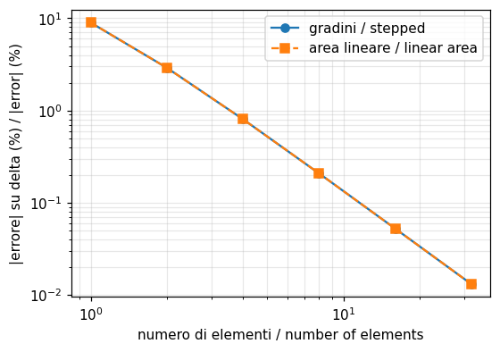

| Grandezza | Rif. | Riferimento | feagent | Scarto | |
|---|---|---|---|---|---|
| spostamento, 4 gradini (somma esatta dei gradini) | esatta | 0.027244 | 0.027244 | 0.00 % | ✅ |
| spostamento, 8 gradini (somma esatta dei gradini) | esatta | 0.027408 | 0.027408 | 0.00 % | ✅ |
| spostamento, 16 gradini (somma esatta dei gradini) | esatta | 0.027451 | 0.027451 | 0.00 % | ✅ |
| rapporto fra gli errori con 4 e 8 gradini (convergenza h^2) | esatta | 4 | 3.8721 | 3.20 % | ✅ |
| spostamento, 64 gradini | esatta | 0.027465 | 0.027464 | 0.00 % | ✅ |
| 16 barre ad area lineare contro 16 gradini (rigidezza E A_media / L) | altro | 0.027451 | 0.027451 | 0.00 % | ✅ |

**Note**: Il libro non stampa risultati numerici: il riferimento e' la soluzione esatta delta = P L ln(h1/h0) / (E t (h1 - h0)). Con 4 gradini l'errore e' circa -0,8 % (la barra a gradini e' piu' rigida, perche' l'area al centro di ogni tratto supera la media armonica) e si riduce col quadrato del passo (rapporto 3,9 fra 4 e 8 gradini). La barra L2 con area lineare da' la stessa rigidezza E A_media / L dei gradini, come chiede di mostrare il Problem 2.1 del libro (la formulazione standard non coincide con la rigidezza esatta del tratto rastremato).

*Codice*: `validation/books/cookmodeling/ch01.py`

## Capitolo 2

<a id="cookmod-2-5-bar-uniform-axial-load"></a>

### Sez. 2.5, Figg. 2.5-1d e 2.5-4 - Barra con carico assiale uniforme: spostamenti nodali esatti, tensioni a gradini

✅ · pag. PDF 38 · bar

Barra incastrata a un estremo e caricata da un carico assiale uniforme q, divisa in tre elementi uguali. Il libro mostra in grafico che gli spostamenti nodali sono esatti, le tensioni sono costanti a tratti, il valore al centro dell'elemento e la media nodale sono i piu' accurati e la tensione massima all'incastro e' sottostimata. Dati scelti: q = 1, L = 1000, A = 100, E = 200000.

**Modello**: 3 barre L2 di lunghezza L, carico assiale uniforme q con forze nodali consistenti (add_bar_line_load), estremo x = 0 incastrato.

| Grandezza | Rif. | Riferimento | feagent | Scarto | |
|---|---|---|---|---|---|
| spostamento del nodo 2 [mm] | esatta | 0.125 | 0.125 | 0.00 % | ✅ |
| spostamento del nodo 3 [mm] | esatta | 0.2 | 0.2 | 0.00 % | ✅ |
| spostamento del nodo 4 [mm] | esatta | 0.225 | 0.225 | 0.00 % | ✅ |
| tensione al centro dell'elemento 1 [MPa] | esatta | 25 | 25 | 0.00 % | ✅ |
| tensione al centro dell'elemento 2 [MPa] | esatta | 15 | 15 | 0.00 % | ✅ |
| tensione al centro dell'elemento 3 [MPa] | esatta | 5 | 5 | 0.00 % | ✅ |
| tensione all'incastro, rapporto FE / esatta (5/6) | esatta | 0.83333 | 0.83333 | 0.00 % | ✅ |

**Note**: Il libro non stampa numeri: i riferimenti sono le soluzioni esatte u = q (3 L x - x^2 / 2) / (E A) e sigma = q (3 L - x) / A.

*Codice*: `validation/books/cookmodeling/ch02.py`

<a id="cookmod-2-6-ex1-bar-thermal-free"></a>

### Sez. 2.6, Example 1, Fig. 2.6-1 - Barra a due elementi riscaldata con un solo estremo vincolato

✅ · pag. PDF 40 · bar, thermal_stress

Barra di due elementi vincolata a un solo estremo, scaldata uniformemente di DeltaT e caricata da due forze P opposte. Il libro risolve in forma simbolica: u2 = alfa L DeltaT, u3 = 2 alfa L DeltaT + P L / (A E), tensione nulla nel primo elemento e P / A nel secondo. Valori scelti: E = 200000 MPa, A = 100 mm2, L = 1000 mm, alfa = 12e-6, DeltaT = 50, P = 1000 N.

**Modello**: 2 barre L2 uguali, variazione termica uniforme (add_solid_thermal), u1 = 0, forze -P al nodo 2 e +P al nodo 3.

| Grandezza | Rif. | Riferimento | feagent | Scarto | |
|---|---|---|---|---|---|
| u2 = alfa L DeltaT [mm] | libro | 0.6 | 0.6 | 0.00 % | ✅ |
| u3 = 2 alfa L DeltaT + P L / (A E) [mm] | libro | 1.25 | 1.25 | 0.00 % | ✅ |
| tensione nell'elemento 1 (nulla) [MPa] | libro | 0 | -2.1684e-14 | 0.00 % | ✅ |
| tensione nell'elemento 2 = P / A [MPa] | libro | 10 | 10 | 0.00 % | ✅ |

**Note**: Riferimenti: formule simboliche del libro (Eqq. 2.6-4 e 2.6-6) valutate con i dati scelti.

*Codice*: `validation/books/cookmodeling/ch02.py`

<a id="cookmod-2-6-ex2-bar-thermal-fixed"></a>

### Sez. 2.6, Example 2, Eqq. 2.6-7, 2.6-8 - Barra a due elementi incastrata agli estremi e riscaldata

✅ · pag. PDF 42 · bar, thermal_stress

La barra dell'esempio precedente e' incastrata a entrambi gli estremi: u2 = -P L / (2 A E), sigma1 = -P / (2A) - E alfa DeltaT, sigma2 = +P / (2A) - E alfa DeltaT. Stessi dati numerici dell'Esempio 1.

**Modello**: 2 barre L2, u1 = u3 = 0, forza -P al nodo 2, DeltaT uniforme.

| Grandezza | Rif. | Riferimento | feagent | Scarto | |
|---|---|---|---|---|---|
| u2 = -P L / (2 A E) [mm] | libro | -0.025 | -0.025 | 0.00 % | ✅ |
| sigma1 = -P/(2A) - E alfa DeltaT [MPa] | libro | -125 | -125 | 0.00 % | ✅ |
| sigma2 = +P/(2A) - E alfa DeltaT [MPa] | libro | -115 | -115 | 0.00 % | ✅ |

**Note**: I segni delle Eqq. 2.6-8 sono illeggibili nell'OCR e sono stati ricostruiti dall'Eq. 2.6-5: sigma1 = E u2 / L - E alfa DeltaT, sigma2 = -E u2 / L - E alfa DeltaT. Il libro osserva che i risultati sono esatti perche' il campo richiesto e' rappresentabile dagli elementi.

*Codice*: `validation/books/cookmodeling/ch02.py`

<a id="cookmod-2-6-spurious-thermal-stress"></a>

### Sez. 2.6, Eqq. 2.6-9, 2.6-10 - Tensione termica spuria in una barra con DeltaT lineare

📐 · pag. PDF 42 · bar, thermal_stress

Una barra libera con DeltaT = c x deve restare scarica, ma con l'elemento a deformazione costante la tensione calcolata e' sigma = E alfa c (L/2 - x): spuria, nulla solo al centro. u2 = alfa c L^2 / 2. Valori scelti: c = 0,05 gradi/mm, L = 1000 mm.

**Modello**: 1 barra L2 vincolata al nodo 1, temperature nodali 0 e c L interpolate linearmente (add_solid_thermal con valori nodali).

| Grandezza | Rif. | Riferimento | feagent | Scarto | |
|---|---|---|---|---|---|
| u2 = alfa c L^2 / 2 [mm] | libro | 0.3 | 0.3 | 0.00 % | ✅ |
| tensione spuria al nodo 1 = E alfa c L / 2 [MPa] | libro | 60 | 60 | 0.00 % | ✅ |
| tensione spuria al nodo 2 = -E alfa c L / 2 [MPa] | libro | -60 | -60 | 0.00 % | ✅ |
| tensione al centro (corretta, nulla) [MPa] | libro | 0 | 0 | 0.00 % | ✅ |

**Note**: feagent riproduce la formula del libro: tensioni ai nodi +-E alfa c L / 2 e tensione nulla al centro, dove il libro consiglia di valutare DeltaT.

*Codice*: `validation/books/cookmodeling/ch02.py`

<a id="cookmod-2-7-oval-ring"></a>

### Sez. 2.7 An Application, Figg. 2.7-1...2.7-4 - Anello ovale piano con forze concentrate e pressione interna

✅ · pag. PDF 43 · beam_2d

Anello ovale piatto (due semicirconferenze di raggio medio 40 mm unite da tratti rettilinei di 120 mm, sezione 9 x 5 mm, acciaio E = 200 GPa) caricato da due forze opposte F = 300 N verso l'interno e da una pressione di 1 MPa sui tratti rettilinei centrali. Il libro confronta un anello circolare equivalente con due mesh di travi del quadrante: spostamenti di A e D, tensione assiale e di flessione in A e D.

**Modello**: Travi di Eulero-Bernoulli nel piano X-Y su un quadrante: mesh grezza con una corda sull'arco AB a 45 gradi piu' BC e CD; mesh fine (Fig. 2.7-4c) con due corde sull'arco e CD diviso in due elementi. Simmetria: in A bloccati v e la rotazione, in D bloccati u e la rotazione. Carichi nodali lavoro-equivalenti f = p t b / 2 in C e D e momento m = p t b^2 / 12 in C; F/2 = 150 N in A.

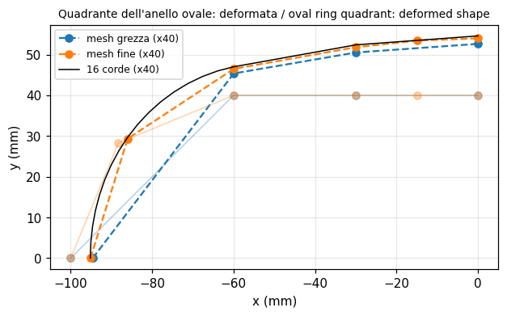

| Grandezza | Rif. | Riferimento | feagent | Scarto | |
|---|---|---|---|---|---|
| uA, mesh grezza [mm] | libro | 0.135 | 0.1353 | 0.22 % | ✅ |
| vD, mesh grezza [mm] | libro | 0.316 | 0.316 | 0.00 % | ✅ |
| tensione assiale in A, mesh grezza [MPa] | libro | 0 | -4.0422e-14 | 0.00 % | ✅ |
| tensione assiale in D, mesh grezza [MPa] | libro | -3.33 | -3.3333 | 0.10 % | ✅ |
| tensione di flessione in A, mesh grezza [MPa] | libro | 166 | 166.1 | 0.06 % | ✅ |
| tensione di flessione in D, mesh grezza [MPa] | libro | 117 | 117.24 | 0.20 % | ✅ |
| uA, mesh fine [mm] | libro | 0.121 | 0.12156 | 0.46 % | ✅ |
| vD, mesh fine [mm] | libro | 0.349 | 0.35003 | 0.30 % | ✅ |
| tensione assiale in A, mesh fine [MPa] | libro | 1.8 | 1.804 | 0.22 % | ✅ |
| tensione assiale in D, mesh fine [MPa] | libro | -3.33 | -3.3333 | 0.10 % | ✅ |
| tensione di flessione in A, mesh fine [MPa] | libro | 163 | 163.13 | 0.08 % | ✅ |
| tensione di flessione in D, mesh fine [MPa] | libro | 116 | 116.04 | 0.03 % | ✅ |
| raggio dell'anello equivalente [mm] | libro | 78.2 | 78.197 | 0.00 % | ✅ |
| anello equivalente: spostamento radiale 0,143 F r^3 / (E I) [mm] | libro | 0.338 | 0.33766 | 0.10 % | ✅ |

**Note**: Riprodotte le due mesh del libro. Nella mesh fine anche il tratto caricato CD e' diviso in due (tre frecce di carico nella Fig. 2.7-4c): con CD intero la flessione in D verrebbe 120 MPa invece di 116, perche' il momento d'estremita' calcolato come k d non contiene il momento d'incastro perfetto del carico distribuito. La tensione assiale in A della mesh grezza e' nulla perche' l'asta AB a 45 gradi porta solo taglio (spiegazione del libro). Con 16 corde sull'arco (mesh convergente) uA = 0,121 mm e vD = 0,365 mm: il libro suggerisce proprio un ulteriore raffinamento. La deformabilita' a taglio e' trascurata, come nel libro (h/R piccolo).

*Codice*: `validation/books/cookmodeling/ch02.py`

## Capitolo 3

<a id="cookmod-3-2-cst-pure-bending"></a>

### Sez. 3.2, Fig. 3.2-2 - Mensola in flessione pura modellata con triangoli a deformazione costante

✅ · pag. PDF 57 · plane_stress

Una trave lunga 5a e alta a, modellata con una sola fila di CST, e' sollecitata a flessione pura. Il libro osserva che la sigma_x sull'asse neutro ha un andamento a onda quadra invece di essere nulla, che frecce e tensioni sono circa un quarto di quelle corrette e che con gli LST la flessione pura e' riprodotta esattamente. Dati scelti: a = 1, P = 1, E = 1000, nu = 0,25.

**Modello**: 10 triangoli T3 (5 quadrati a x a divisi dalla diagonale), una sola fila; stessa mesh con T6 per confronto. Nodo superiore dell'incastro su carrello, inferiore a cerniera; coppia di forze P all'estremo libero.

| Grandezza | Rif. | Riferimento | feagent | Scarto | |
|---|---|---|---|---|---|
| freccia all'estremo, CST / esatta (circa 1/4) | libro | 0.25 | 0.24004 | 3.98 % | ✅ |
| sigma_x del primo CST / valore esatto al lembo (circa 1/4) | libro | 0.25 | 0.25717 | 2.87 % | ✅ |
| sigma_x dei due triangoli di un quadrato: uguale e opposta (onda quadra) | altro | -1 | -1 | 0.00 % | ✅ |
| freccia all'estremo con T6 (esatta) | esatta | 0.15 | 0.15 | 0.00 % | ✅ |
| sigma_x al lembo con T6 (esatta, 6 P / a) | esatta | 6 | 6 | 0.00 % | ✅ |

**Note**: Il libro non da' numeri, solo il rapporto di circa 1/4: feagent da' 0,240 per la freccia e 0,257 per la tensione (costante del primo triangolo rispetto al valore esatto al lembo, 6 P / a). Il confronto con 1/4 e' quindi fatto con tolleranza del 10 %. La sigma_x cambia segno da un triangolo all'altro sopra e sotto l'asse (onda quadra). Con i T6 freccia e tensioni sono esatte.

*Codice*: `validation/books/cookmodeling/ch03.py`

<a id="cookmod-3-6-q4-locking-ratio"></a>

### Sez. 3.6, Eq. 3.6-1 - Sovra-rigidezza flessionale del Q4 rettangolare (locking)

📐 · pag. PDF 62 · plane_stress

Il libro ricava il rapporto fra il momento M2 che il Q4 richiede per ruotare i lati verticali di theta e il momento M1 del blocco esatto: M2/M1 = [1/(1-nu) + (a/b)^2/2] / (1+nu), che cresce senza limite con a/b (locking). Il rimedio e' il Q6 con modi incompatibili.

**Modello**: Un PlaneQ4 rettangolare 2a x 2b (stiffness() della libreria) con i lati verticali ruotati di theta; stesso elemento con modi incompatibili (QM6).

| Grandezza | Rif. | Riferimento | feagent | Scarto | |
|---|---|---|---|---|---|
| Q4: M2/M1 con a/b = 1, nu = 0.0 | libro | 1.5 | 1.5 | 0.00 % | ✅ |
| Q4: M2/M1 con a/b = 2, nu = 0.3 | libro | 2.6374 | 2.6374 | 0.00 % | ✅ |
| Q4: M2/M1 con a/b = 5, nu = 0.25 | libro | 11.067 | 11.067 | 0.00 % | ✅ |
| Q4: M2/M1 con a/b = 0.5, nu = 0.3 | libro | 1.1951 | 1.1951 | 0.00 % | ✅ |
| QM6: M2/M1 con a/b = 5 (nessun locking) | esatta | 1 | 1 | 0.00 % | ✅ |

**Note**: Formula del libro verificata sulla matrice di rigidezza del Q4 di feagent per quattro combinazioni di a/b e nu. Il QM6 di feagent da' M2/M1 = 1 (flessione pura esatta sul rettangolo).

*Codice*: `validation/books/cookmodeling/ch03.py`

<a id="cookmod-3-11-cantilever-element-comparison"></a>

### Sez. 3.11, Fig. 3.11-1 - Mensola con forza all'estremo: confronto fra CST, Q4, Q6, LST e Q8

✅ · pag. PDF 73 · plane_stress, beam_2d

Mensola L = 10, altezza 2, spessore 1, E = 1e4, nu = 0,3, forza P = 20 all'estremo. La teoria della trave da' v_C = 1,031 (con il taglio) e sigma_xB = 300 al lembo inferiore dell'incastro. Il libro confronta freccia e tensione di dieci modelli.

**Modello**: Mensola 10 x 2 in tensione piana: una trave di Timoshenko (area di taglio 5/6 A), 10 T3, 5 Q4, 5 QM6 (Q4 incompatible=True), 4 T6, 2 Q8 a integrazione ridotta 2x2, in mesh regolari e distorte. Vincoli e carichi della Fig. 3.11-1b (forze nodali all'estremo libero, reazioni d'incastro distribuite con forze applicate ai nodi su carrello). Tensioni dei quadrilateri estrapolate in B dai punti di Gauss 2x2.

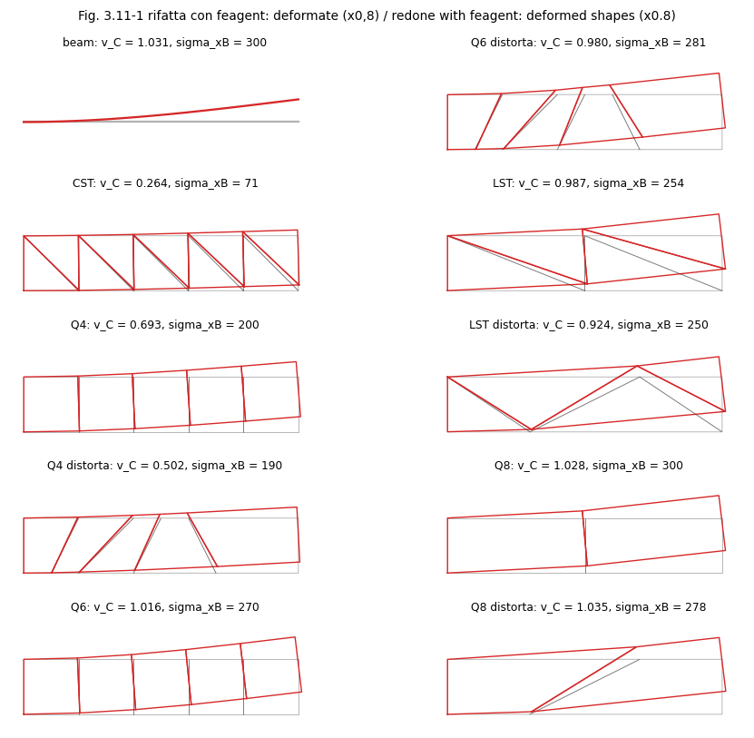

| Grandezza | Rif. | Riferimento | feagent | Scarto | |
|---|---|---|---|---|---|
| sigma_xB, trave a 2 nodi | libro | 300 | 300 | 0.00 % | ✅ |
| v_C, trave a 2 nodi | libro | 1.031 | 1.0312 | 0.02 % | ✅ |
| sigma_xB, CST | libro | 71 | 71.017 | 0.02 % | ✅ |
| v_C, CST | libro | 0.264 | 0.26381 | 0.07 % | ✅ |
| sigma_xB, Q4 | libro | 200 | 200 | 0.00 % | ✅ |
| v_C, Q4 | libro | 0.693 | 0.69333 | 0.05 % | ✅ |
| sigma_xB, Q4 distorta | libro | 190 | 190.33 | 0.17 % | ✅ |
| v_C, Q4 distorta | libro | 0.502 | 0.5018 | 0.04 % | ✅ |
| sigma_xB, Q6 | libro | 270 | 270 | 0.00 % | ✅ |
| v_C, Q6 | libro | 1.016 | 1.016 | 0.00 % | ✅ |
| sigma_xB, Q6 distorta | libro | 281 | 280.67 | 0.12 % | ✅ |
| v_C, Q6 distorta | libro | 0.98 | 0.9799 | 0.01 % | ✅ |
| sigma_xB, LST | libro | 254 | 253.84 | 0.06 % | ✅ |
| v_C, LST | libro | 0.987 | 0.98745 | 0.05 % | ✅ |
| sigma_xB, LST distorta | libro | 250 | 250.32 | 0.13 % | ✅ |
| v_C, LST distorta | libro | 0.924 | 0.92425 | 0.03 % | ✅ |
| sigma_xB, Q8 | libro | 300 | 300 | 0.00 % | ✅ |
| v_C, Q8 | libro | 1.028 | 1.0281 | 0.01 % | ✅ |
| sigma_xB, Q8 distorta | libro | 278 | 277.52 | 0.17 % | ✅ |
| v_C, Q8 distorta | libro | 1.035 | 1.035 | 0.00 % | ✅ |

**Note**: Coordinate delle mesh distorte lette sulla figura (nodi inferiori x = 0, 1, 2, 4, 7, 10 e superiori x = 0, 2, 4, 5, 6, 10; lato interno di Q8 e T6 da (3, -1) a (7, 1)). Tutti i venti valori coincidono con il libro a meno degli arrotondamenti se: il Q6 del libro e' il QM6 (modi incompatibili con la correzione di Taylor), il Q8 e' integrato con 2x2 punti (con 3x3 la mesh regolare da' v_C = 1,007 e sigma_xB = 275) e la tensione in B dei quadrilateri e' estrapolata dai punti di Gauss (nelle mesh distorte il valore calcolato direttamente al nodo sarebbe 256 per il Q4, 373 per il Q6, 359 per il Q8).

*Codice*: `validation/books/cookmodeling/ch03.py`

<a id="cookmod-3-12-square-plate-pressurized-hole"></a>

### Sez. 3.12 An Application, Tab. 3.12-1 - Piastra quadrata con foro centrale in pressione

🟡 · pag. PDF 73 · plane_stress

Piastra quadrata 20 x 20 mm, spessore 1 mm, con foro centrale di raggio 7 mm in pressione p = 1 MPa (E = 1e7 MPa come stampato, nu = 0,3). Il libro confronta spostamenti e sigma1 nei punti A...F con una mesh grezza simmetrica e una piu' fine non simmetrica, e conclude che sigma1 massima e' circa 3,1 MPa, in A e C oppure in E (prove sperimentali: 2,9 MPa in B e D, 2,7 MPa in E).

**Modello**: Quadrilateri QM6 (Q4 con modi incompatibili) su un quadrante in tensione piana: mesh grezza di 9 elementi ricostruita dalla Fig. 3.12-2a (nodi sull'arco a 0, 22,5, 45, 67,5 e 90 gradi) e mesh mappata 24 x 12 infittita verso il foro come riferimento convergente; pressione sui lati dell'arco (add_solid_pressure), u = 0 su AB e v = 0 su CD. Tensione principale massima dalle medie nodali.

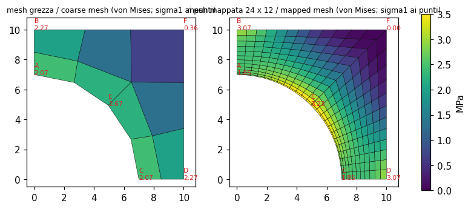

| Grandezza | Rif. | Riferimento | feagent | Scarto | |
|---|---|---|---|---|---|
| 10^6 v in A, mesh grezza [mm] | libro | 2.08 | 2.0893 | 0.45 % | ✅ |
| sigma1 in A, mesh grezza [MPa] | libro | 2.11 | 2.0709 | 1.85 % | ✅ |
| 10^6 v in B, mesh grezza [mm] | libro | 1.78 | 1.7845 | 0.25 % | ✅ |
| sigma1 in B, mesh grezza [MPa] | libro | 2.28 | 2.271 | 0.39 % | ✅ |
| 10^6 u in C, mesh grezza [mm] | libro | 2.08 | 2.0893 | 0.45 % | ✅ |
| sigma1 in C, mesh grezza [MPa] | libro | 2.11 | 2.0709 | 1.85 % | ✅ |
| 10^6 u in D, mesh grezza [mm] | libro | 1.78 | 1.7845 | 0.25 % | ✅ |
| sigma1 in D, mesh grezza [MPa] | libro | 2.28 | 2.271 | 0.39 % | ✅ |
| 10^6 u in E, mesh grezza [mm] | libro | 1.22 | 1.2079 | 0.99 % | ✅ |
| 10^6 v in E, mesh grezza [mm] | libro | 1.22 | 1.2079 | 0.99 % | ✅ |
| sigma1 in E, mesh grezza [MPa] | libro | 2.68 | 2.6675 | 0.47 % | ✅ |
| 10^6 u in F, mesh grezza [mm] | libro | 0.97 | 0.96901 | 0.10 % | ✅ |
| 10^6 v in F, mesh grezza [mm] | libro | 0.97 | 0.96901 | 0.10 % | ✅ |
| sigma1 in F, mesh grezza [MPa] | libro | 0.38 | 0.36485 | 3.99 % | ✅ |
| 10^6 spostamento in A, mesh mappata contro mesh fine del libro [mm] | libro | 2.28 | 2.3344 | 2.39 % | ✅ |
| sigma1 in A, mesh mappata contro mesh fine del libro [MPa] | libro | 1.92 | 1.8523 | 3.53 % | ✅ |
| 10^6 spostamento in B, mesh mappata contro mesh fine del libro [mm] | libro | 1.96 | 2.0098 | 2.54 % | ✅ |
| sigma1 in B, mesh mappata contro mesh fine del libro [MPa] | libro | 3.01 | 3.0718 | 2.05 % | ✅ |
| 10^6 spostamento in C, mesh mappata contro mesh fine del libro [mm] | libro | 2.34 | 2.3344 | 0.24 % | ✅ |
| sigma1 in C, mesh mappata contro mesh fine del libro [MPa] | libro | 1.84 | 1.8523 | 0.67 % | ✅ |
| 10^6 spostamento in D, mesh mappata contro mesh fine del libro [mm] | libro | 2.01 | 2.0098 | 0.01 % | ✅ |
| sigma1 in D, mesh mappata contro mesh fine del libro [MPa] | libro | 3.12 | 3.0718 | 1.55 % | ✅ |
| 10^6 spostamento in E, mesh mappata contro mesh fine del libro [mm] | libro | 1.27 | 1.2597 | 0.81 % | ✅ |
| sigma1 in E, mesh mappata contro mesh fine del libro [MPa] | libro | 3.16 | 3.2307 | 2.24 % | ✅ |
| tensione media sul legamento F / ((a - r) t) [MPa] | libro | 2.3 | 2.3333 | 1.45 % | ✅ |

**Note**: Le mesh del libro sono solo disegnate. La mesh grezza ricostruita (coordinate lette sulla figura, simmetrizzate rispetto alla diagonale) riproduce la tabella 3.12-1 entro il 2 %; la mesh fine non simmetrica non e' ricostruibile e viene sostituita da una mesh mappata convergente, che si confronta coi valori della mesh fine del libro con tolleranza del 5 % (la mesh fine del libro non e' ancora convergente: il libro stesso chiede un altro raffinamento). La mesh convergente (stabile raddoppiando gli elementi e passando ai Q8) da' sigma1 = 3,10 MPa in B e D e 3,23 MPa in E, che e' il massimo; in A e C sigma1 = 1,85 MPa. Il testo del libro indica il massimo 'in A e C oppure in E', mentre la sua stessa tabella lo pone in B, D ed E: probabile svista per B e D. L'errore in energia eta del libro (0,373 e 0,183) richiede lo stimatore ZZ, non ancora disponibile.

*Codice*: `validation/books/cookmodeling/ch03.py`

## Capitolo 4

<a id="cookmod-4-5-gauss-quadrature"></a>

### Sez. 4.5, Figg. 4.5-1, 4.5-2, Eqq. 4.5-1...4.5-3 - Regole di Gauss a 1, 2 e 3 punti in 1D e 2x2, 3x3 in 2D

📐 · pag. PDF 92 · numerics

Il libro elenca punti e pesi delle regole di Gauss di ordine 1, 2 e 3 (xi = 0, W = 2; xi = +-1/sqrt(3), W = 1; xi = 0 con W = 8/9 e xi = +-sqrt(0,6) con W = 5/9), i pesi della regola 3x3 nel quadrato (25/81, 40/81, 64/81) e la proprieta' che n punti integrano esattamente i polinomi di grado 2n - 1.

**Modello**: Regole di Gauss-Legendre usate da feagent per gli elementi (feagent.solid._gl e feagent.plane._quad_rule).

| Grandezza | Rif. | Riferimento | feagent | Scarto | |
|---|---|---|---|---|---|
| n=1 W | libro | 2 | 2 | 0.00 % | ✅ |
| n=1 xi | libro | 0 | 0 | 0.00 % | ✅ |
| n=2 xi | libro | 0.57735 | 0.57735 | 0.00 % | ✅ |
| n=2 W | libro | 1 | 1 | 0.00 % | ✅ |
| n=3 xi | libro | 0.7746 | 0.7746 | 0.00 % | ✅ |
| n=3 W0 | libro | 0.88889 | 0.88889 | 0.00 % | ✅ |
| n=3 W1 | libro | 0.55556 | 0.55556 | 0.00 % | ✅ |
| regola 3x3: peso dei punti (angoli) | libro | 0.30864 | 0.30864 | 0.00 % | ✅ |
| regola 3x3: peso dei punti (lati) | libro | 0.49383 | 0.49383 | 0.00 % | ✅ |
| regola 3x3: peso dei punti (centro) | libro | 0.79012 | 0.79012 | 0.00 % | ✅ |
| 1 punti: integrale di xi^0 + xi^1 (esatto) | esatta | 2 | 2 | 0.00 % | ✅ |
| 1 punti: xi^2 non integrato esattamente (1 = vero) | esatta | 1 | 1 | 0.00 % | ✅ |
| 2 punti: integrale di xi^2 + xi^3 (esatto) | esatta | 0.66667 | 0.66667 | 0.00 % | ✅ |
| 2 punti: xi^4 non integrato esattamente (1 = vero) | esatta | 1 | 1 | 0.00 % | ✅ |
| 3 punti: integrale di xi^4 + xi^5 (esatto) | esatta | 0.4 | 0.4 | 0.00 % | ✅ |
| 3 punti: xi^6 non integrato esattamente (1 = vero) | esatta | 1 | 1 | 0.00 % | ✅ |

**Note**: Verificati punti, pesi ed esattezza sui monomi di grado 2n - 1 (e la perdita di esattezza al grado 2n).

*Codice*: `validation/books/cookmodeling/ch04.py`

<a id="cookmod-4-6-hourglass-instability"></a>

### Sez. 4.6-4.7, Figg. 4.6-1, 4.6-2, 4.7-1 - Modi spuri (hourglass) del Q4 a un punto di Gauss e del Q8 a quattro punti

✅ · pag. PDF 94 · plane_stress, numerics

Con troppo pochi punti di Gauss alcuni modi di deformazione non producono deformazione nei punti di integrazione: la mesh 2 x 2 di Q4 a un punto ha tre instabilita' (u = cxy, v = -cxy e il modo misto), una mensola di Q4 a un punto puo' avere spostamenti enormi, il Q8 a quattro punti ha un modo a clessidra u = x (1 - 3 y^2), v = y (3 x^2 - 1) che non si propaga fra elementi adiacenti.

**Modello**: Q4 con integration='reduced' (1 punto) in una mesh 2 x 2 e in una mensola 8 x 1 incastrata; Q8 con integration='reduced' (2 x 2 punti), singolo e in coppia; per confronto Q4 a 2 x 2 punti e Q4 ridotto stabilizzato (hourglass=True). Modi a energia nulla contati dagli autovalori della rigidezza assemblata.

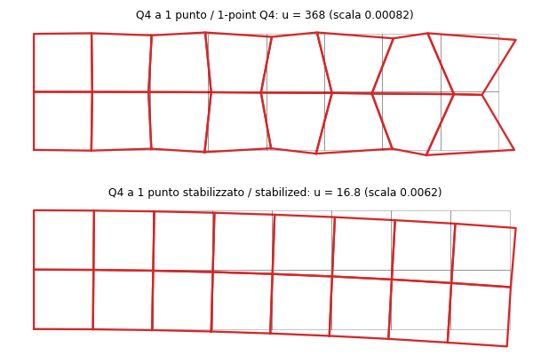

| Grandezza | Rif. | Riferimento | feagent | Scarto | |
|---|---|---|---|---|---|
| modi a energia nulla, mesh 2 x 2 di Q4 a 1 punto (3 rigidi + 3 spuri) | libro | 6 | 6 | 0.00 % | ✅ |
| modi a energia nulla, mesh 2 x 2 di Q4 a 2 x 2 punti (solo rigidi) | libro | 3 | 3 | 0.00 % | ✅ |
| modi a energia nulla, Q4 a 1 punto stabilizzati | libro | 3 | 3 | 0.00 % | ✅ |
| modi a energia nulla, un Q8 a 2 x 2 punti (3 rigidi + 1 clessidra) | libro | 4 | 4 | 0.00 % | ✅ |
| energia del modo u = x(1 - 3y^2), v = y(3x^2 - 1) nel Q8 ridotto | libro | 0 | 3.9690e-15 | 0.00 % | ✅ |
| modi a energia nulla, due Q8 a 2 x 2 punti (modo non comunicabile) | libro | 3 | 3 | 0.00 % | ✅ |
| mensola di Q4 a 1 punto: spostamento del carico maggiore della lunghezza (1 = vero) | libro | 1 | 1 | 0.00 % | ✅ |
| risultante delle sigma_x ai punti di Gauss di una sezione (= P) | esatta | 1 | 1 | 0.00 % | ✅ |

**Note**: Il catalogo segnalava il caso come non riproducibile: ora feagent espone l'integrazione ridotta degli elementi piani. I conteggi dei modi a energia nulla coincidono con la descrizione del libro (3 moti rigidi piu' 3 instabilita' nella mesh 2 x 2; 3 piu' 1 nel Q8 singolo; nessuna instabilita' con due Q8). Nella mensola 8 x 2 di Q4 a un punto, con una forza assiale unitaria sul nodo d'angolo, lo spostamento del carico e' 368 contro 15,3 del Q4 a 2 x 2 punti: piu' della lunghezza della barra, come avverte il libro (che non da' numeri); le tensioni ai punti di Gauss restano invece in equilibrio con il carico (Fig. 4.7-1). Con una sola fila di elementi la mesh e' proprio labile e feagent rifiuta l'analisi.

*Codice*: `validation/books/cookmodeling/ch04.py`

<a id="cookmod-4-9-patch-test"></a>

### Sez. 4.9, Fig. 4.9-1a - Patch test per sigma_x costante con elementi a 4 nodi

✅ · pag. PDF 99 · plane_stress

Una patch di elementi con almeno un nodo interno, caricata da forze F, 2F, F sui lati verticali alti 2H, deve dare sigma_x = 2F / (H t) costante in ogni punto e le altre tensioni nulle. La figura del libro e' qualitativa.

**Modello**: Patch di quattro quadrilateri distorti attorno a un nodo interno fuori centro (coordinate scelte), con Q4, QM6 e Q8 (questi ultimi con nodi medi); forze nodali lavoro-equivalenti alla trazione uniforme sui lati verticali, vincoli minimi contro i moti rigidi.

| Grandezza | Rif. | Riferimento | feagent | Scarto | |
|---|---|---|---|---|---|
| Q4: sigma_x minima ai punti di Gauss | esatta | 2 | 2 | 0.00 % | ✅ |
| Q4: sigma_x massima ai punti di Gauss | esatta | 2 | 2 | 0.00 % | ✅ |
| Q4: massimo di |sigma_y| e |tau_xy| (nulli) | esatta | 0 | 1.0008e-15 | 0.00 % | ✅ |
| QM6: sigma_x minima ai punti di Gauss | esatta | 2 | 2 | 0.00 % | ✅ |
| QM6: sigma_x massima ai punti di Gauss | esatta | 2 | 2 | 0.00 % | ✅ |
| QM6: massimo di |sigma_y| e |tau_xy| (nulli) | esatta | 0 | 2.4425e-15 | 0.00 % | ✅ |
| Q8: sigma_x minima ai punti di Gauss | esatta | 2 | 2 | 0.00 % | ✅ |
| Q8: sigma_x massima ai punti di Gauss | esatta | 2 | 2 | 0.00 % | ✅ |
| Q8: massimo di |sigma_y| e |tau_xy| (nulli) | esatta | 0 | 6.9944e-15 | 0.00 % | ✅ |

**Note**: Coordinate dei nodi scelte (patch distorta, nodo interno in (0,9; 1,15)); i nodi dei lati verticali non sono equispaziati, quindi le forze nodali sono quelle lavoro-equivalenti di ciascun lato e non esattamente F, 2F, F. Tutti e tre gli elementi superano il test: il QM6 di feagent lo supera grazie alla correzione di Taylor dei modi incompatibili.

*Codice*: `validation/books/cookmodeling/ch04.py`

<a id="cookmod-4-13-lagrange-penalty-bar"></a>

### Sez. 4.13, Fig. 4.13-2, Eqq. 4.13-6...4.13-11 - Vincolo u1 = u2 su una barra a due elementi: moltiplicatori di Lagrange e penalita'

✅ · pag. PDF 107 · bar, constraints

Barra di due elementi uguali con il vincolo u1 = u2. Con i moltiplicatori di Lagrange u1 = u2 = P/k e lambda = P (forza di vincolo); con la penalita' u1 = (2 + alfa) P / ((1 + alfa) k), u2 = P/k, che tende alla soluzione libera (u1 = 2P/k) per alfa = 0 e a quella vincolata per alfa grande. Dati scelti: k = 1, P = 1.

**Modello**: Due barre L2 (k = AE/L = 1) col nodo 3 incastrato e forza P al nodo 1. Vincolo esatto con add_equal_dof; moltiplicatore di Lagrange con il sistema orlato costruito sulla rigidezza assemblata da feagent; penalita' come molla fra i nodi 1 e 2 di rigidezza alfa k (= C^T alfa C con C = [sqrt(k), -sqrt(k)]).

| Grandezza | Rif. | Riferimento | feagent | Scarto | |
|---|---|---|---|---|---|
| vincolo esatto: u1 = P/k | libro | 1 | 1 | 0.00 % | ✅ |
| vincolo esatto: u2 = P/k | libro | 1 | 1 | 0.00 % | ✅ |
| K ridotta di feagent: k22 = 2k | libro | 2 | 2 | 0.00 % | ✅ |
| |lambda| = P (forza di vincolo) | libro | 1 | 1 | 0.00 % | ✅ |
| penalita' alfa = 0: u1 = (2+alfa)P/((1+alfa)k) | libro | 2 | 2 | 0.00 % | ✅ |
| penalita' alfa = 0: u2 = P/k | libro | 1 | 1 | 0.00 % | ✅ |
| penalita' alfa = 1: u1 = (2+alfa)P/((1+alfa)k) | libro | 1.5 | 1.5 | 0.00 % | ✅ |
| penalita' alfa = 1: u2 = P/k | libro | 1 | 1 | 0.00 % | ✅ |
| penalita' alfa = 10: u1 = (2+alfa)P/((1+alfa)k) | libro | 1.0909 | 1.0909 | 0.00 % | ✅ |
| penalita' alfa = 10: u2 = P/k | libro | 1 | 1 | 0.00 % | ✅ |
| penalita' alfa = 1e+06: u1 = (2+alfa)P/((1+alfa)k) | libro | 1 | 1 | 0.00 % | ✅ |
| penalita' alfa = 1e+06: u2 = P/k | libro | 1 | 1 | 0.00 % | ✅ |

*Codice*: `validation/books/cookmodeling/ch04.py`

## Capitolo 5

<a id="cookmod-5-5-homogenized-perforated-plate"></a>

### Sez. 5.5, Fig. 5.5-1, Eqq. 5.5-3...5.5-7 - Proprieta' elastiche equivalenti di una lastra forata da una cella ripetitiva

📐 · pag. PDF 125 · plane_stress, homogenization

Procedura per 'spalmare' una foratura regolare: si isola una cella, si impongono tre stati di deformazione costante unitaria (eps_x, eps_y, gamma_xy) con condizioni di simmetria e antisimmetria sui lati e dalle reazioni si ricava la matrice di elasticita' della lastra equivalente, E = D^T [R1 R2 R3] / V. Il libro non da' numeri.

**Modello**: Cella ripetitiva a x b con un quarto di foro, mesh mappata di QM6; i tre stati di deformazione unitaria sono imposti con cedimenti (add_settlement) sui lati come nella tabella del libro; E_ij = D_i^T R_j / V con spostamenti e reazioni di feagent.

| Grandezza | Rif. | Riferimento | feagent | Scarto | |
|---|---|---|---|---|---|
| cella piena: E11 = tensione piana | esatta | 1098.9 | 1098.9 | 0.00 % | ✅ |
| cella piena: E12 = tensione piana | esatta | 329.67 | 329.67 | 0.00 % | ✅ |
| cella piena: E22 = tensione piana | esatta | 1098.9 | 1098.9 | 0.00 % | ✅ |
| cella piena: E33 = tensione piana | esatta | 384.62 | 384.62 | 0.00 % | ✅ |
| cella piena: E13 = tensione piana | esatta | 0 | 1.3006e-12 | 0.00 % | ✅ |
| cella forata: E12 / E21 = 1 (reciprocita') | esatta | 1 | 1 | 0.00 % | ✅ |
| cella forata: E11 / E22 = 1 (simmetria della cella) | esatta | 1 | 1 | 0.00 % | ✅ |
| E13 della cella + E13 della cella specchiata = 0 (ortotropia sul periodo) | esatta | 0 | 1.5490e-12 | 0.00 % | ✅ |
| E33 uguale nella cella specchiata | esatta | 186.59 | 186.59 | 0.00 % | ✅ |
| E11 con mesh doppia contro mesh base | altro | 665.06 | 664.25 | 0.12 % | ✅ |
| E33 con mesh doppia contro mesh base | altro | 186.59 | 185.85 | 0.39 % | ✅ |
| riduzione relativa del taglio maggiore di quella di E11 (1 = vero) | altro | 1 | 1 | 0.00 % | ✅ |

**Note**: Dati scelti: cella quadrata 10 x 10, foro di raggio 5 (un quarto per cella), E = 1000, nu = 0,3, tensione piana. Le D_i sono i campi affini degli stati unitari (u = x, v = y, u = y) valutati ai nodi. Verifiche: con la cella piena la procedura restituisce esattamente la matrice della tensione piana; con il foro E12 = E21 ed E11 = E22 (simmetria della cella); il modulo di taglio crolla piu' dei moduli normali; il risultato e' stabile raddoppiando la mesh (entro lo 0,5 %). Avvertenza non scritta nel libro: con una cella che contiene un quarto di foro i termini di accoppiamento E13 ed E23 non sono nulli (circa -97 su 665), perche' la cella non e' simmetrica rispetto al proprio centro; cambiano segno nella cella specchiata e si annullano sull'intero periodo, quindi la lastra equivalente e' ortotropa e quei termini vanno posti a zero.

*Codice*: `validation/books/cookmodeling/ch05.py`

<a id="cookmod-5-7-bolt-pretension-smeared"></a>

### Sez. 5.7, Fig. 5.7-3, Eqq. 5.7-1, 5.7-2 - Bulloni di flangia spalmati e pretensione per raffreddamento

📐 · pag. PDF 129 · bar, thermal_stress

In un giunto a flangia assialsimmetrico gli n bulloni si sostituiscono con un solido equivalente di uguale rigidezza assiale e la pretensione P si ottiene raffreddandolo di DeltaT, con alfa L DeltaT = P L / (A_r E_r) + P L / (A_f E_f). Dati scelti: 8 bulloni d = 16 mm, E_b = 200 GPa, L = 40 mm, alfa = 12e-6, flangia tre volte piu' rigida dei bulloni, P = 400 kN.

**Modello**: I bulloni sono una barra L2 fra i cerchi nodali A e B con A_r E_r = n (pi d^2 / 4) E_b; la flangia vista dai bulloni e' una molla di rigidezza A_f E_f / L in parallelo; raffreddamento DeltaT della sola barra (add_solid_thermal).

| Grandezza | Rif. | Riferimento | feagent | Scarto | |
|---|---|---|---|---|---|
| forza totale nei bulloni = P [N] | esatta | 4e+05 | 4e+05 | 0.00 % | ✅ |
| forza nella flangia = -P (compressione) [N] | esatta | -4e+05 | -4e+05 | 0.00 % | ✅ |
| tensione nel singolo bullone = P / (n pi d^2 / 4) [MPa] | esatta | 248.68 | 248.68 | 0.00 % | ✅ |
| accorciamento della flangia = P L / (A_f E_f) [mm] | esatta | 0.016579 | 0.016579 | 0.00 % | ✅ |

**Note**: Con il DeltaT dell'Eq. 5.7-1 la forza nella barra equivalente e' esattamente P, uguale e contraria alla compressione della flangia; la tensione nel singolo bullone e' la deformazione della barra per E_b.

*Codice*: `validation/books/cookmodeling/ch05.py`

<a id="cookmod-5-10-ill-conditioning-springs"></a>

### Sez. 5.10, Fig. 5.10-1, Eqq. 5.10-1, 5.10-2 - Mal condizionamento: parte rigida sostenuta da una parte flessibile

✅ · pag. PDF 137 · springs, numerics

Con la parte rigida k1 sostenuta dalla flessibile k2, l'eliminazione produce (k1 + k2) - k1: con k1 = 1 e k2 = 4,444444e-6 e sette cifre resta 0,4e-5, una sola cifra significativa; con sei cifre la matrice risulta singolare. Il problema non si presenta se la parte flessibile e' sostenuta da quella rigida.

**Modello**: Due molle in serie (add_spring) con k1 = 1 e k2 = 4,444444e-6 e la configurazione inversa; il passo di eliminazione e' ripetuto in aritmetica decimale a 7 e 6 cifre per riprodurre il ragionamento del libro sulle cifre significative.

| Grandezza | Rif. | Riferimento | feagent | Scarto | |
|---|---|---|---|---|---|
| u2 = P / k2 (doppia precisione) | esatta | 2.25e+05 | 2.25e+05 | 0.00 % | ✅ |
| u1 = P / k2 + P / k1 (doppia precisione) | esatta | 2.25e+05 | 2.25e+05 | 0.00 % | ✅ |
| pivot (k1 + k2) - k1 con 7 cifre (libro: 0,4e-5, una cifra significativa) | libro | 4.0000e-06 | 4.0000e-06 | 0.00 % | ✅ |
| pivot con 6 cifre: nullo (matrice singolare) | libro | 0 | 0 | 0.00 % | ✅ |
| K22 = k1 + k2 assemblata da feagent | libro | 1 | 1 | 0.00 % | ✅ |
| parte flessibile sostenuta dalla rigida: u2 = P / k1 | esatta | 1 | 1 | 0.00 % | ✅ |
| k1/k2 = 1e17: matrice dichiarata singolare o soluzione non affidabile (1 = vero) | libro | 1 | 1 | 0.00 % | ✅ |

**Note**: In doppia precisione feagent risolve il caso del libro con errore relativo circa 1e-11 e ne stima il condizionamento; in aritmetica a 7 cifre il pivot ridotto vale 4e-6 invece di 4,444e-6 (una cifra corretta, come nel libro), a 6 cifre e' nullo. Con k2 = 1e-17 (rapporto oltre 1e16) feagent dichiara la matrice singolare, come il programma a sei cifre del libro.

*Codice*: `validation/books/cookmodeling/ch05.py`

<a id="cookmod-5-10-folded-strip-ill-conditioning"></a>

### Sez. 5.10, Fig. 5.10-3 - Striscia piegata ad arco di gusci piani: degrado della tensione al diminuire dello spessore

🟡 · pag. PDF 139 · shell, numerics

Struttura sottile ad arco, simile a una striscia di carta piegata: la rigidezza di membrana e' molto maggiore di quella flessionale e il sistema diventa mal condizionato al diminuire dello spessore. Il libro riporta che la tensione di membrana x nell'elemento A ha errore del 5 % per t = 0,6e-n, errore grave per t = 0,2e-n e matrice singolare per t = 0,1e-n (esponente illeggibile, dipendente dal programma e dal calcolatore).

**Modello**: 7 gusci ShellQ4 (membrana + flessione) larghi 5 su un arco ricostruito dalla figura (due archi di raggio 10 con centri distanti 5, elemento A orizzontale in sommita'), basi incastrate; forze 1 (verso -x) e 2 (verso +x) sui nodi di A.

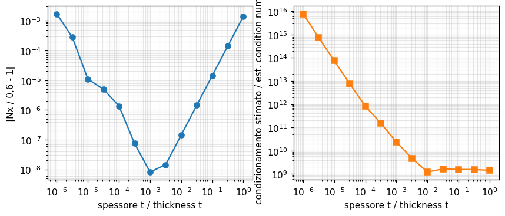

| Grandezza | Rif. | Riferimento | feagent | Scarto | |
|---|---|---|---|---|---|
| Nx nell'elemento A, t = 0.01 (limite 3/5) | esatta | 0.6 | 0.6 | 0.00 % | ✅ |
| Nx nell'elemento A, t = 0.001 (limite 3/5) | esatta | 0.6 | 0.6 | 0.00 % | ✅ |
| Nx nell'elemento A, t = 0.0001 (limite 3/5) | esatta | 0.6 | 0.6 | 0.00 % | ✅ |
| Nx nell'elemento A, t = 1e-05 (limite 3/5) | esatta | 0.6 | 0.59999 | 0.00 % | ✅ |
| log10 del rapporto dei condizionamenti fra t = 1e-5 e 1e-4 (circa 2) | altro | 2 | 1.9765 | 1.18 % | ✅ |
| t = 1e-6: soluzione segnalata come non affidabile (1 = vero) | libro | 1 | 1 | 0.00 % | ✅ |

**Note**: Geometria letta sulla figura (nodi dell'arco a 63,3 e 37,8 gradi, basi in x = -9,1 e 14,1), E = 1e7, nu = 0,3 scelti. Per t -> 0 l'elemento A diventa rigido e lo sforzo di membrana tende a Nx = 3 / 5 (parte simmetrica dei carichi, autoequilibrata in A): e' il riferimento. In doppia precisione feagent resta esatto a 1e-6 fino a t = 1e-4; a t = 1e-5 (condizionamento stimato circa 6e13) l'errore e' 2e-5, poi degrada: a t = 1e-6 l'errore e' l'1 % e la soluzione e' segnalata come non affidabile. Il condizionamento cresce come 1/t^2. Dall'ottobre 2026 la molla di drilling dei gusci e' riferita alla rigidezza flessionale (prima a quella di membrana, che frenava le rotazioni rigide nei gusci sottili): negli spessori estremi pesa meno, e l'errore a t = 1e-5 e 1e-6 e' salito da 1e-5 e 0,2 %. Le soglie del libro (singola precisione) non sono confrontabili.

*Codice*: `validation/books/cookmodeling/ch05.py`

<a id="cookmod-5-14-scf-correction-factor"></a>

### Sez. 5.14, Fig. 5.14-1 - Fattore correttivo da un caso secondario per la tensione vicino a un foro

🟡 · pag. PDF 146 · plane_stress

Per correggere la tensione di picco di una mesh grossolana si risolve con la stessa mesh locale un caso secondario di soluzione nota e si scala il risultato col rapporto esatto/calcolato. Nel libro: primario 221, secondario 92,8 contro 130 esatto, fattore 1,40, stima 310 contro 337 della mesh molto fine (unita' arbitrarie).

**Modello**: Q4 su un quadrante: mesh locale 2 x 2 ricostruita dalla figura (anello sottile fra r = 0,5 e 0,67 a, poi fino al contorno) nel quadrato forato caricato da forze concentrate e, identica, nella striscia tesa del caso secondario (piu' un elemento fino all'estremo, x = 2,34 a); mesh mappate 32 x 16 come soluzione 'esatta'. Tensione in E dalle medie nodali.

| Grandezza | Rif. | Riferimento | feagent | Scarto | |
|---|---|---|---|---|---|
| caso primario: mesh 2 x 2 / soluzione esatta (libro 221/337) | libro | 0.65579 | 0.68199 | 4.00 % | ✅ |
| caso secondario: mesh 2 x 2 / esatto (libro 92,8/130) | libro | 0.71385 | 0.73504 | 2.97 % | ✅ |
| fattore correttivo esatto/calcolato del secondario | libro | 1.4 | 1.3605 | 2.82 % | ✅ |
| stima corretta del primario / esatta (libro 310/337) | libro | 0.91988 | 0.92782 | 0.86 % | ✅ |
| secondario: K sulla sezione lorda contro formula di Peterson | esatta | 4.3117 | 4.3526 | 0.95 % | ✅ |

**Note**: Dimensioni e carichi non sono stampati: dalla figura il raggio del foro e' meta' del semilato e la striscia ha la stessa altezza del quadrato, lunghezza 2 x 2,34 volte il semilato; si confrontano quindi i rapporti adimensionali. La soluzione 'esatta' del secondario (32 x 16) da' K = 4,35 sulla sezione lorda, contro 4,31 della formula di Peterson per d/W = 0,5. Con i Q4 i rapporti sono entro il 4 % dal libro (fattore 1,36 contro 1,40; stima corretta / esatta 0,93 contro 0,92).

*Codice*: `validation/books/cookmodeling/ch05.py`

<a id="cookmod-5-15-richardson-extrapolation"></a>

### Sez. 5.15, Eq. 5.15-1, Fig. 5.15-2 - Estrapolazione a h -> 0 da due mesh

📐 · pag. PDF 150 · bar, plane_stress

Se l'errore e' proporzionale a h^q, da due analisi con passi h1 e h2 si estrapola phi_0 = (phi1 h2^q - phi2 h1^q) / (h2^q - h1^q). Il libro avverte che con convergenza non monotona l'estrapolazione puo' peggiorare il risultato.

**Modello**: Formula del libro applicata a risultati di feagent: barra rastremata a gradini del par. 1.4 (errore in h^2), cilindro spesso con Q4 assialsimmetrici, anello ovale del par. 2.7.

| Grandezza | Rif. | Riferimento | feagent | Scarto | |
|---|---|---|---|---|---|
| barra: estrapolazione da 4 e 8 gradini | esatta | 0.027465 | 0.027463 | 0.01 % | ✅ |
| cilindro spesso: u(a) con 8 Q4 | esatta | 0.0019067 | 0.0019018 | 0.26 % | ✅ |
| cilindro spesso: u(a) estrapolato da 4 e 8 Q4 con q = 2 | esatta | 0.0019067 | 0.0019065 | 0.01 % | ✅ |
| anello ovale (par. 2.7), u_A con 4, 8, 16, 256 corde: convergenza non monotona (1 = vero) | libro | 1 | 1 | 0.00 % | ✅ |

**Note**: Barra: con 4 e 8 gradini e q = 2 l'errore scende dallo 0,2 % a meno di 1e-4. Cilindro spesso in pressione (soluzione di Lame') con Q4 assialsimmetrici: lo spostamento interno con 8 elementi sbaglia dello 0,25 %, quello estrapolato da 4 e 8 elementi dello 0,01 %. L'anello ovale del par. 2.7, raffinando le corde dell'arco, converge in modo non monotono: e' il caso in cui il libro sconsiglia l'estrapolazione.

*Codice*: `validation/books/cookmodeling/ch05.py`

<a id="cookmod-5-16-zz-error-adaptive"></a>

### Sez. 5.16, Figg. 5.16-1, 5.16-2, Eqq. 5.16-1, 5.16-2 - Stimatore d'errore Z2 in energia e raffinamento guidato

🟡 · pag. PDF 151 · plane_stress, error_estimation

Lo stimatore di Zienkiewicz-Zhu confronta il campo di tensione per elementi, discontinuo, con quello continuo ottenuto mediando ai nodi: eta = sqrt(U_e / (U + U_e)). Nella barra a carico uniforme il campo mediato e' esatto tranne che negli elementi d'estremita'. Il libro riporta eta = 0,373 e 0,183 per le due mesh della piastra forata e un esempio adattivo con triangoli LST (40, 228, 286 GdL; eta = 0,27, 0,07, 0,04) di geometria non quotata.

**Modello**: feagent.error_estimation.zz_error (media nodale e SPR). Fig. 5.16-1: striscia di 6 Q4 con nu = 0 sotto carico assiale uniforme di volume (equivale alla barra). Piastra forata del par. 3.12: mesh grezza ricostruita e mesh mappate sempre piu' fini, con la mappa dell'errore per elemento.

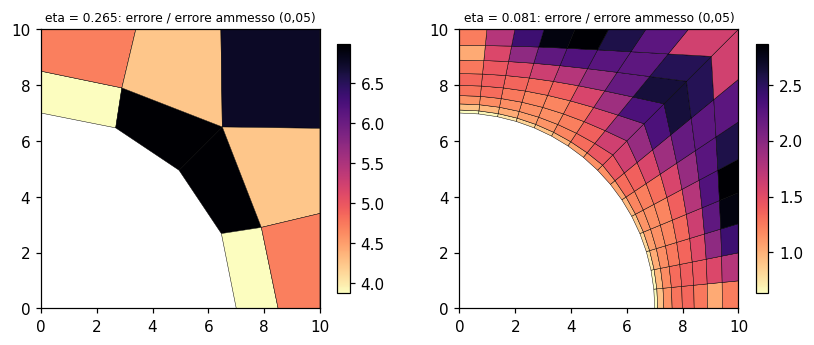

| Grandezza | Rif. | Riferimento | feagent | Scarto | |
|---|---|---|---|---|---|
| barra: tensione mediata al nodo interno x = 1 (esatta) | esatta | 5 | 5 | 0.00 % | ✅ |
| barra: tensione mediata al nodo interno x = 3 (esatta) | esatta | 3 | 3 | 0.00 % | ✅ |
| barra: tensione mediata al nodo interno x = 5 (esatta) | esatta | 1 | 1 | 0.00 % | ✅ |
| barra: all'incastro la media e' quella dell'elemento (5,5 contro 6 esatto) | altro | 5.5 | 5.5 | 0.00 % | ✅ |
| piastra forata: eta decresce raffinando la mesh (1 = vero) | libro | 1 | 1 | 0.00 % | ✅ |
| piastra forata: eta dimezza col passo (ordine circa 1, Q4) | altro | 1 | 1.0051 | 0.51 % | ✅ |
| mesh 32 x 16: eta sotto il traguardo 0,05 del libro (1 = vero) | libro | 1 | 1 | 0.00 % | ✅ |
| piastra forata, mesh grezza: eta con media nodale contro SPR | altro | 0.26543 | 0.26404 | 0.52 % | ✅ |

**Note**: Riprodotto il comportamento della Fig. 5.16-1 (tensione mediata esatta ai nodi interni) e la decrescita di eta con la mesh fino sotto il traguardo 0,05 del libro. Sulla mesh grezza ricostruita della piastra forata feagent stima eta = 0,26 (media e SPR) contro 0,373 del libro: lo scarto non e' risolvibile senza conoscere come il programma del libro costruisce i campi per il Q6 (nodo per nodo o dai punti di Gauss, modi incompatibili inclusi o no); il valore del libro non e' quindi confrontato. L'esempio adattivo della Fig. 5.16-2 non e' rifacibile (geometria e carichi non quotati).

*Codice*: `validation/books/cookmodeling/ch05.py`

## Capitolo 6

<a id="cookmod-6-3-curved-beam-3d"></a>

### Sez. 6.3 A 3D Application, Figg. 6.3-1, 6.3-2, Eq. 6.3-1 - Trave curva a sezione trapezia in flessione pura con solidi Hex8

✅ · pag. PDF 162 · solid_3d

Trave curva (raggio interno 44 mm, altezza radiale 88 mm, sezione trapezia larga 130 mm all'interno e 28 mm all'esterno, acciaio) in flessione pura nel proprio piano. Il momento si applica ruotando una faccia dello spicchio attorno a r_c, scelto per annullare la reazione radiale in A (60 mm: 2001 N, 70 mm: 357 N, estrapolato 72,2 mm). Risultati del libro: M = 8,804e6 N mm, sigma_theta = 146 MPa in A e 65 MPa in E, contro 119 MPa della teoria della trave curva.

**Modello**: Uno strato di Hex8 con modi incompatibili in uno spicchio di 5 gradi, mesh 8 x 6 infittita verso il bordo interno sulla meta' sezione. Faccia 1: v = 0, u = 0 in A, w = 0 sul piano di simmetria; faccia 2: assi d'appoggio ruotati (set_support_axes) e cedimento circonferenziale v = 0,0001 (r_c - r) con add_settlement.

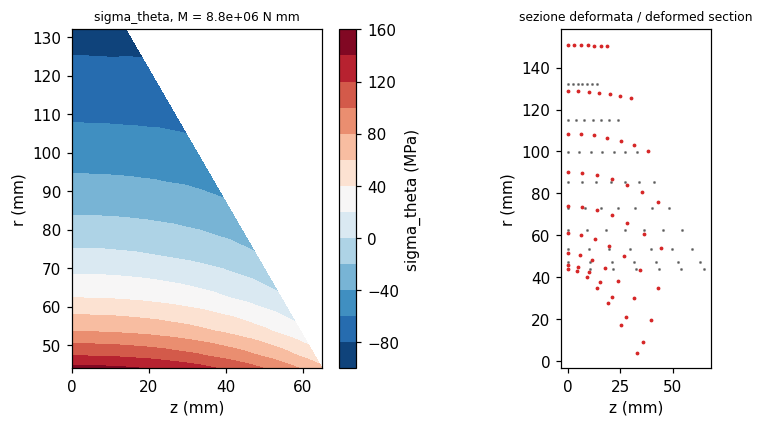

| Grandezza | Rif. | Riferimento | feagent | Scarto | |
|---|---|---|---|---|---|
| r_c che annulla la reazione radiale in A [mm] | libro | 72.2 | 72.137 | 0.09 % | ✅ |
| reazione radiale in A con r_c [N] | esatta | 0 | 2.2737e-13 | 0.00 % | ✅ |
| momento M dalle reazioni della faccia 1 [N mm] | libro | 8.8040e+06 | 8.7995e+06 | 0.05 % | ✅ |
| sigma_theta in A [MPa] | libro | 146 | 146.23 | 0.16 % | ✅ |
| sigma_theta in E [MPa] | libro | 65 | 64.814 | 0.29 % | ✅ |
| teoria della trave curva 13,46e-6 M [MPa] | libro | 119 | 118.44 | 0.47 % | ✅ |
| sigma_r massima (libro: circa 25) [MPa] | libro | 25 | 24.841 | 0.64 % | ✅ |

**Note**: La mesh del libro e' solo disegnata: la mesh 8 x 6 graduata riproduce r_c, M e le tensioni in A ed E entro lo 0,5 %. Le reazioni radiali delle due analisi di prova dipendono di piu' dalla mesh (feagent: 1823 e 321 N contro 2001 e 357 N del libro; segno opposto per la convenzione delle reazioni) e non sono confrontate. sigma_r massima circa 25 MPa come nel libro.

*Codice*: `validation/books/cookmodeling/ch06.py`

<a id="cookmod-6-5-shrink-fit-spinning-disks"></a>

### Sez. 6.5 An Axisymmetric Application, Figg. 6.5-1...6.5-4 - Disco rastremato con anello calettato a caldo, poi in rotazione

🟡 · pag. PDF 167 · axisymmetric, thermal_stress

Un anello di spessore costante e' calettato a caldo su un disco rastremato (interferenza pari a 100 gradi di differenza di temperatura) e l'insieme ruota. Il libro stima la pressione di contatto con un anello sottile (p = 95 MPa) e la velocita' di distacco con il disco pieno rotante (298 rad/s), poi commenta i contorni FE: sigma_r discontinua lungo BE (-136 in B), sigma_theta nell'anello fino a 178 MPa, sigma_r media circa 100 MPa su BE in rotazione a 298 rad/s.

**Modello**: Q8 assialsimmetrici in tre strati: disco interno con 9 colonne (r da 0 a 400 mm, spessore da 120 a 42 mm), anello con 8 colonne (r da 400 a 700 mm, spessore 42 mm), elementi di 20 mm ai due lati di BE (mesh ricostruita dalla Fig. 6.5-1); nodi comuni su BE (incollaggio). Calettamento: DeltaT = -100 gradi per elemento sul solo anello; rotazione: forze centrifughe consistenti omega^2 M_e {r} costruite con la massa consistente degli elementi.

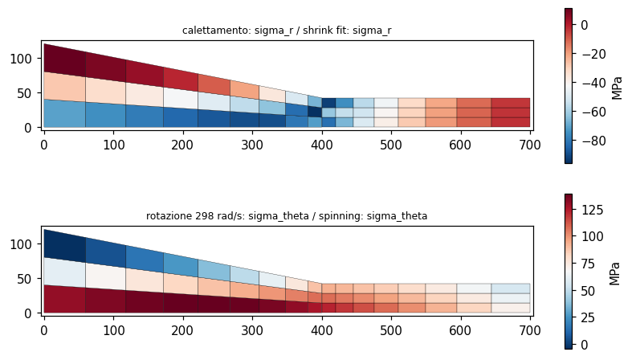

| Grandezza | Rif. | Riferimento | feagent | Scarto | |
|---|---|---|---|---|---|
| pressione di calettamento stimata (Eq. 6.5-2) [MPa] | libro | 95 | 94.737 | 0.28 % | ✅ |
| velocita' di distacco stimata (Eq. 6.5-3) [rad/s] | libro | 298 | 297.98 | 0.01 % | ✅ |
| calettamento: pressione media su BE (risultante) contro la stima a mano 95 [MPa] | libro | 95 | 83.738 | 11.86 % | ✅ |
| calettamento: -sigma_r media dei valori nodali su BE contro la risultante [MPa] | altro | 83.738 | 83.205 | 0.64 % | ✅ |
| calettamento: sigma_theta massima nell'anello [MPa] | libro | 178 | 173.56 | 2.49 % | ✅ |
| rotazione a 298 rad/s: sigma_r media lungo BE (libro circa 100) [MPa] | libro | 100 | 98.257 | 1.74 % | ✅ |
| calettamento: salto di sigma_r fra i due lati di BE oltre 50 MPa (1 = vero) | libro | 1 | 1 | 0.00 % | ✅ |
| velocita' di primo distacco su BE (Eq. 6.5-5, nessun valore nel libro) [rad/s] | libro | - | 250.87 | - | ✅ |

**Note**: Mesh ricostruita dal disegno e risultati del libro solo a curve di livello: confronti con tolleranze del 10 %. Calettamento: la pressione media su BE, dalla risultante radiale delle forze interne dell'anello, vale 84 MPa contro i 95 della stima a mano con l'anello sottile (il libro parla solo di accordo approssimato; tolleranza 15 %), con forti discontinuita' di sigma_r fra i due lati come nella Fig. 6.5-3a; sigma_theta massima al baricentro degli elementi dell'anello 174 MPa (libro 178). Rotazione: sigma_r media su BE circa 99 MPa. Le stime eta del libro (0,28; 0,17; 0,09; 0,004) dipendono dalla mesh e non sono confrontate (feagent: 0,17; 0,05; 0,02; 0,016). feagent non ha ancora un carico centrifugo nativo: le forze nodali sono costruite nel caso con la massa consistente dell'elemento.

*Codice*: `validation/books/cookmodeling/ch06.py`

## Capitolo 7

<a id="cookmod-7-1-membrane-string-action"></a>

### Sez. 7.1, Fig. 7.1-4, Eqq. 7.1-5, 7.1-6 - Trave con cerniere fisse: quota di carico portata per effetto fune

✅ · pag. PDF 184 · beam_2d, geometric_nonlinear

Una trave appoggiata su cerniere che non possono avvicinarsi sviluppa uno sforzo normale di trazione che porta parte del carico ('effetto fune'). Il libro approssima q = (E b t^4 / L^4) [21,3 (w_c/t)^3 + 6,40 (w_c/t)] e osserva che per w_c/t = 0,5 fune e flessione portano circa meta' del carico ciascuna. Dati scelti: L = 200, b = 10, t = 2, E = 200000.

**Modello**: 40 travi di Eulero-Bernoulli corotazionali (feagent.corotational.solve_corotational) con controllo dello spostamento in mezzeria; cerniere fisse agli estremi, carico uniforme come forze nodali.

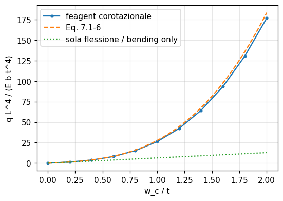

| Grandezza | Rif. | Riferimento | feagent | Scarto | |
|---|---|---|---|---|---|
| carico per w_c/t = 0.5: corotazionale contro soluzione esatta | esatta | 0.11289 | 0.11288 | 0.01 % | ✅ |
| carico per w_c/t = 0.5 contro la formula approssimata 7.1-6 (5 %) | libro | 0.11725 | 0.11288 | 3.72 % | ✅ |
| carico per w_c/t = 2.0: corotazionale contro soluzione esatta | esatta | 3.5377 | 3.5315 | 0.17 % | ✅ |
| carico per w_c/t = 2.0 contro la formula approssimata 7.1-6 (5 %) | libro | 3.664 | 3.5315 | 3.62 % | ✅ |
| w_c/t = 0,5: quota portata dalla flessione (libro: circa meta') | libro | 0.5 | 0.56696 | 13.39 % | ✅ |

**Note**: La formula del libro somma due forme deformate diverse ed e' approssimata: rispetto alla soluzione esatta della trave-tirante (teoria di von Karman, N dal vincolo di lunghezza) sovrastima il carico del 4 % a w_c/t = 0,5 e del 4 % a w_c/t = 2. La soluzione corotazionale di feagent coincide con quella esatta entro lo 0,2 %. A w_c/t = 0,5 la flessione da sola porterebbe il 57 % del carico.

*Codice*: `validation/books/cookmodeling/ch07.py`

<a id="cookmod-7-2-square-plate-benchmarks"></a>

### Sez. 7.2 Test Cases, Fig. 7.2-6a - Piastra quadrata appoggiata o incastrata: freccia al centro

✅ · pag. PDF 190 · plate

Piastra quadrata di lato L, nu = 0,3, appoggiata o incastrata, con carico uniforme q o forza centrale P: w = alfa q L^4 / D oppure alfa P L^2 / D con alfa = 0,00406; 0,0116; 0,00126; 0,00560.

**Modello**: Quadrante con mesh uniforme 16 x 16: triangoli sottili DKT (add_shell_tri formulation='thin') per tutti i casi; Q4 di Mindlin (add_shell) per il carico uniforme. Appoggio 'soft' (solo w = 0), incastro w = theta = 0, simmetria sui lati interni.

| Grandezza | Rif. | Riferimento | feagent | Scarto | |
|---|---|---|---|---|---|
| alfa, appoggiata, carico uniforme, DKT | libro | 0.00406 | 0.0040588 | 0.03 % | ✅ |
| alfa, appoggiata, carico uniforme, Q4 Mindlin | libro | 0.00406 | 0.0040747 | 0.36 % | ✅ |
| alfa, appoggiata, forza centrale, DKT | libro | 0.0116 | 0.011614 | 0.12 % | ✅ |
| alfa, incastrata, carico uniforme, DKT | esatta | 0.001265 | 0.0012676 | 0.20 % | ✅ |
| alfa, incastrata, carico uniforme, Q4 Mindlin | esatta | 0.001265 | 0.0012669 | 0.15 % | ✅ |
| alfa, incastrata, forza centrale, DKT | esatta | 0.005612 | 0.0056254 | 0.24 % | ✅ |

**Note**: Per le piastre incastrate il libro stampa 0,00126 e 0,00560: si confronta con i valori di Timoshenko a quattro cifre (0,001265 e 0,005612). I DKT convergono a meno dello 0,3 % dai valori del libro con 16 x 16 quadrati sul quadrante. I Q4 di Mindlin (t/L = 0,01) danno l'1 % in piu' con carico uniforme; con la forza concentrata non sono confrontati, perche' in teoria di Mindlin la freccia sotto il carico non converge (il libro lo ricorda nel par. 7.1).

*Codice*: `validation/books/cookmodeling/ch07.py`

<a id="cookmod-7-2-rhombic-plate"></a>

### Sez. 7.2 Test Cases, Fig. 7.2-6b - Piastra romboidale a 30 gradi appoggiata con carico uniforme

✅ · pag. PDF 190 · plate

Rombo con angolo acuto di 30 gradi, appoggiato, carico uniforme: all'angolo ottuso i momenti sono infiniti e di segno opposto; il libro raccomanda l'appoggio 'soft' con gli elementi di Mindlin perche' quello 'hard' puo' dare frecce molto errate. Il libro non riporta valori numerici.

**Modello**: Mesh n x n parallela ai lati del rombo (n = 8, 16, 32) di triangoli DKT e di Q4 di Mindlin; appoggio 'soft' (w = 0) e, per i Q4, anche 'hard' (rotazione attorno alla normale al lato bloccata con assi d'appoggio ruotati).

| Grandezza | Rif. | Riferimento | feagent | Scarto | |
|---|---|---|---|---|---|
| freccia al centro, DKT estrapolata (Morley 4,08e-4) | esatta | 4.0800e-04 | 4.1044e-04 | 0.60 % | ✅ |
| freccia al centro, DKT 32 x 32 | esatta | 4.0800e-04 | 4.1906e-04 | 2.71 % | ✅ |
| Q4 Mindlin 24 x 24: freccia con appoggio 'hard' sotto il 90 % di quella 'soft' (1 = vero) | libro | 1 | 1 | 0.00 % | ✅ |

**Note**: Riferimento di letteratura (soluzione di Morley per nu = 0,3, citata dal libro tramite [7.2]): w_c = 4,08e-4 q L^4 / D. I DKT convergono dall'alto (8: 5,00; 16: 4,38; 32: 4,19 e-4); l'estrapolazione di Richardson con l'ordine stimato dalle tre mesh da' 4,10e-4 (0,5 %). Con i Q4 di Mindlin l'appoggio 'hard' da' a n = 24 una freccia del 17 % piu' bassa di quello 'soft', come avverte il libro.

*Codice*: `validation/books/cookmodeling/ch07.py`

<a id="cookmod-7-2-twisted-strip-plate"></a>

### Sez. 7.2 Test Cases, Fig. 7.2-6c,d - Torsione di una striscia piana a mensola

✅ · pag. PDF 190 · plate

Striscia piana a mensola torta da un momento unitario all'estremo, applicato come coppia di forze verticali o come momenti nodali. Con E = 1e7, nu = 0,25, t = 0,05 il valore di riferimento e' w3 = 0,0029 L. Si usa uno o due elementi per provare l'effetto della forma.

**Modello**: Striscia larga 1 e lunga L = 12 incastrata: due triangoli DKT, un Q4 di Mindlin, mesh 32 x 8 di DKT come soluzione convergente; carico (c) forze verticali opposte agli angoli liberi, carico (d) momenti nodali 0,5 attorno all'asse.

| Grandezza | Rif. | Riferimento | feagent | Scarto | |
|---|---|---|---|---|---|
| w3 / L, mesh DKT 32 x 8, carico (c) | libro | 0.0029 | 0.0029272 | 0.94 % | ✅ |
| w3 / L, mesh DKT 32 x 8, carico (d) | libro | 0.0029 | 0.0029272 | 0.94 % | ✅ |
| w3 / L, Q4 di Mindlin 8 x 2 | libro | 0.0029 | 0.0029299 | 1.03 % | ✅ |
| w3 / L con due triangoli DKT (nessun valore stampato) | libro | - | 0.0032781 | - | ✅ |
| w3 / L con un solo Q4 di Mindlin (MITC4) | libro | 0.0029 | 0.0027758 | 4.28 % | ✅ |

**Note**: Il libro non da' L: con il rapporto w3/L indipendente da L soltanto per strisce lunghe si assume L = 12 (striscia 12 x 1 del benchmark [7.1]); con L = 1 la soluzione convergente sarebbe 0,0023 L. La mesh fine di DKT da' 0,00293 L (teoria di de Saint-Venant 0,0030 L). Due DKT danno 0,0033 L. Un solo Q4 di Mindlin da' 0,00278 L (-4 %). Fino all'ottobre 2026 il Q4 integrava il taglio in un solo punto: una sola fila di elementi nella larghezza aveva un modo quasi a energia nulla in torsione e dava 0,047 L, 16 volte troppo; con il taglio assunto MITC4 (Bathe e Dvorkin 1985) il modo non c'e' piu'.

*Codice*: `validation/books/cookmodeling/ch07.py`

<a id="cookmod-7-3-plate-winkler-point-load"></a>

### Sez. 7.3 A Plate Application, Figg. 7.3-1...7.3-3 - Piastra su suolo alla Winkler caricata da una forza concentrata

✅ · pag. PDF 191 · plate, foundation

Grande piastra (t = 30 mm, acciaio) su suolo alla Winkler k0 = 0,2 MPa/mm caricata da P = 1 N. Stima preliminare con forma cosinusoidale: 10,2e-6 mm. Il libro trova 12,7e-6 mm sotto il carico, freccia nulla a circa 825 mm e sollevamento massimo 0,2e-6 mm.

**Modello**: Quadrante 11 x 11 di quadrati da 150 mm, ciascuno di quattro triangoli DKT sovrapposti con E e k dimezzati (equivale alla somma divisa per due del libro); suolo con feagent.foundation.add_plate_foundation (rigidezza concentrata ai nodi); simmetria theta = 0 sugli assi, P/4 nell'origine.

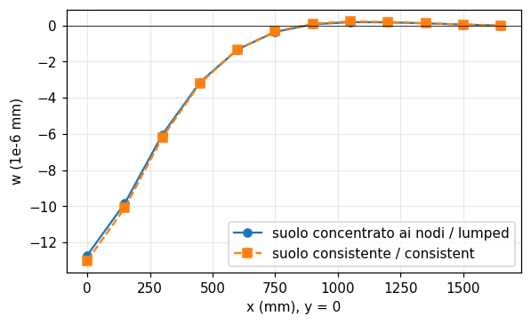

| Grandezza | Rif. | Riferimento | feagent | Scarto | |
|---|---|---|---|---|---|
| freccia sotto il carico [1e-6 mm] | libro | 12.7 | 12.711 | 0.08 % | ✅ |
| freccia contro la piastra infinita P / (8 sqrt(k D)) [mm] | esatta | 1.2569e-05 | 1.2711e-05 | 1.12 % | ✅ |
| ascissa del passaggio per lo zero [mm] | libro | 825 | 878.83 | 6.52 % | ✅ |
| sollevamento massimo lungo l'asse x [1e-6 mm] | libro | 0.2 | 0.18197 | 9.01 % | ✅ |
| stima preliminare P / ((pi/2 - 2/pi) k0 R^2) [1e-6 mm] | libro | 10.2 | 10.183 | 0.16 % | ✅ |

**Note**: Con il suolo concentrato ai nodi la freccia coincide col libro (12,71e-6 mm); con la rigidezza consistente sarebbe 13,0e-6. La soluzione della piastra infinita P / (8 sqrt(k D)) = 12,57e-6 mm conferma il valore. Il passaggio per lo zero, interpolato linearmente fra i nodi come nel grafico del libro, cade a 879 mm contro 'circa 825' (lettura del grafico): tolleranza 7 %. Il suolo e' bilatero (tira dove la piastra si solleva), come nel libro.

*Codice*: `validation/books/cookmodeling/ch07.py`

<a id="cookmod-7-4-boundary-layer-length"></a>

### Sez. 7.4, Eq. 7.4-1 - Ampiezza dello strato limite flessionale nei gusci

📐 · pag. PDF 195 · axisymmetric, shell

Con un carico di linea all'estremo di un cilindro la risposta flessionale decade come e^(-lambda x) cos(lambda x), lambda = [3 (1 - nu^2)]^(1/4) / sqrt(R t): a lambda x = 3 pi / 4 resta il 7 %. Il libro usa sqrt(R t) come ampiezza dello strato limite (1,8 mm per la lattina).

**Modello**: Lattina cilindrica (R = 33 mm, t = 0,1 mm) modellata con 200 Q8 assialsimmetrici nello spessore lungo 20 mm, carico radiale di linea all'estremo; confronto con la soluzione e^(-lambda x) cos(lambda x) del cilindro.

| Grandezza | Rif. | Riferimento | feagent | Scarto | |
|---|---|---|---|---|---|
| sqrt(R t) per la lattina [mm] | libro | 1.8 | 1.8166 | 0.92 % | ✅ |
| |e^(-lambda x) cos(lambda x)| a lambda x = 3 pi / 4 | libro | 0.07 | 0.06702 | 4.26 % | ✅ |
| freccia all'estremo Q / (2 lambda^3 D) [mm] | esatta | 0.077057 | 0.077087 | 0.04 % | ✅ |
| primo zero della freccia, pi / (2 lambda) [mm] | esatta | 2.2199 | 2.22 | 0.01 % | ✅ |
| rapporto w / w0 a lambda x = 3 pi / 4 | esatta | -0.06702 | -0.066955 | 0.10 % | ✅ |

**Note**: feagent riproduce la soluzione del cilindro: freccia all'estremo Q / (2 lambda^3 D), primo zero a pi / (2 lambda), rapporto -0,067 a lambda x = 3 pi / 4. Nota: con la formula del libro lambda x = 3 pi / 4 corrisponde a x = 1,8 sqrt(R t) (circa 3,3 mm per la lattina), non a sqrt(R t); sqrt(R t) e' quindi una regola pratica un po' stretta, valida per l'ordine di grandezza.

*Codice*: `validation/books/cookmodeling/ch07.py`

<a id="cookmod-7-5-shell-obstacle-course"></a>

### Sez. 7.5 Test Cases, Fig. 7.5-2 - Benchmark per gusci: volta cilindrica, cilindro pizzicato, emisfero, trave svergolata

✅ · pag. PDF 198 · shell

La 'corsa a ostacoli' di MacNeal e Harder: volta cilindrica sotto peso proprio (0,3024), cilindro pizzicato (0,1825e-4), emisfero con quattro forze radiali (0,0924), trave svergolata di 90 gradi con t = 0,0032 e forze 1e-6 (5256e-6 e 1294e-6).

**Modello**: Triangoli sottili DKT con membrana GT9 (add_shell_tri formulation='thin'): volta di Scordelis-Lo su un quarto 16 x 16, cilindro pizzicato su un ottavo 24 x 24, quarto di emisfero suddiviso in 32^2 triangoli, trave svergolata 24 x 4 (48 x 8 nel caso sottile). Q4 di Mindlin MITC4 (add_shell) su volta, cilindro e trave svergolata 24 x 4.

| Grandezza | Rif. | Riferimento | feagent | Scarto | |
|---|---|---|---|---|---|
| volta di Scordelis-Lo, DKT 16 x 16 | libro | 0.3024 | 0.29874 | 1.21 % | ✅ |
| cilindro pizzicato, DKT 24 x 24 | libro | 1.8250e-05 | 1.8297e-05 | 0.26 % | ✅ |
| emisfero, DKT 32^2 | libro | 0.0924 | 0.091339 | 1.15 % | ✅ |
| trave svergolata, t = 0,32, carico nel piano all'estremo (MacNeal-Harder) | altro | 0.005424 | 0.0053874 | 0.67 % | ✅ |
| trave svergolata, t = 0,32, carico fuori piano (MacNeal-Harder) | altro | 0.001754 | 0.0017205 | 1.91 % | ✅ |
| trave svergolata del libro (t = 0,0032, F = 1e-6), carico nel piano, DKT 48 x 8 | libro | 0.005256 | 0.0050396 | 4.12 % | ✅ |
| trave svergolata del libro, carico fuori piano, DKT 48 x 8 | libro | 0.001294 | 0.0012516 | 3.28 % | ✅ |
| trave svergolata del libro, carico nel piano, DKT 24 x 4 (ancora rigida, vedi note) | libro | - | 0.0033491 | - | ✅ |
| volta di Scordelis-Lo, Q4 MITC4 16 x 16 | libro | 0.3024 | 0.30468 | 0.76 % | ✅ |
| cilindro pizzicato, Q4 MITC4 24 x 24 | libro | 1.8250e-05 | 1.7768e-05 | 2.64 % | ✅ |
| trave svergolata, t = 0,32, carico nel piano, Q4 MITC4 24 x 4 | altro | 0.005424 | 0.0054035 | 0.38 % | ✅ |
| trave svergolata, t = 0,32, carico fuori piano, Q4 MITC4 24 x 4 | altro | 0.001754 | 0.0017165 | 2.14 % | ✅ |
| trave svergolata del libro, carico nel piano, Q4 MITC4 24 x 4 | libro | 0.005256 | 0.0050899 | 3.16 % | ✅ |
| trave svergolata del libro, carico fuori piano, Q4 MITC4 24 x 4 | libro | 0.001294 | 0.0012716 | 1.73 % | ✅ |

**Note**: Con i DKT: volta -1,2 % (32 x 32: -0,7 %, i gusci piatti convergono a circa 0,300), cilindro +0,3 %, emisfero -1,1 % (convergenza lenta dal basso: 48^2 triangoli danno -0,3 %). Trave svergolata: con lo spessore originale di MacNeal e Harder (t = 0,32, F = 1: 5,424e-3 e 1,754e-3) i DKT sono entro il 2 %; nel caso sottile del libro (t = 0,0032) i DKT 24 x 4 sono ancora rigidi del 35 % circa (0,64 e 0,68 del riferimento) e convergono infittendo (48 x 8: -4 % e -3 %). I Q4 MITC4: volta +0,8 %, cilindro -2,6 % (convergenza dal basso), trave svergolata -0,4 % e -2,1 %, caso sottile -3,2 % e -1,7 %. Correzioni dell'ottobre 2026 emerse da questo caso: il Q4 integrava il taglio in un punto (modi spuri: volta 0,453, +50 %; cilindro oltre il riferimento e in crescita) e non aveva ne' bracci rigidi di svergolamento ne' legame di drilling negli elementi svergolati (trave svergolata divergente); il drilling di stabilizzazione di Q4 e triangoli era riferito alla rigidezza di membrana e frenava le rotazioni rigide; i triangoli GT9 leggevano come rotazione nel piano la flessione dei vicini non complanari (trave svergolata sottile 10-30 volte troppo rigida, ora letta attorno alla normale nodale).

*Codice*: `validation/books/cookmodeling/ch07.py`

<a id="cookmod-7-5-conical-frusta-sphere"></a>

### Sez. 7.5, Fig. 7.5-3 - Sfera in pressione modellata con tronchi di cono: momenti flettenti spuri

🟡 · pag. PDF 199 · shell

Una sfera in pressione non ha momenti, ma modellata con pochi tronchi di cono mostra momenti flettenti spuri che spariscono infittendo. Il libro non da' dimensioni ne' numeri.

**Modello**: feagent non ha elementi di guscio assialsimmetrici: si usa uno spicchio di 2 gradi di triangoli piatti DKT (ogni fascia e' un tronco di cono), con assi d'appoggio ruotati per la simmetria ciclica; mezza sfera R = 100, t = 1, p = 1 con 4, 8, 16 e 32 facce lungo il meridiano.

| Grandezza | Rif. | Riferimento | feagent | Scarto | |
|---|---|---|---|---|---|
| sforzo di membrana all'equatore, 32 facce (p R / 2) [N/mm] | esatta | 50 | 50.057 | 0.11 % | ✅ |
| momento spurio nella meta' inferiore: 4 facce oltre 5 volte 16 facce (1 = vero) | libro | 1 | 1 | 0.00 % | ✅ |
| momento spurio massimo nella meta' inferiore, 4 facce [N mm/mm] | libro | - | 0.25283 | - | ✅ |

**Note**: Dati scelti. Lo sforzo di membrana converge a p R / 2 = 50; il momento spurio massimo nella meta' inferiore (lontano dal polo, dove lo spicchio degenera) scende da 0,25 con 4 facce a 0,03 con 16 (6 M / t^2 dal 3 % allo 0,3 % della tensione di membrana). L'elemento non e' quello del libro (cono assialsimmetrico).

*Codice*: `validation/books/cookmodeling/ch07.py`

<a id="cookmod-7-6-spherical-segment-axisym-shell"></a>

### Sez. 7.6 An Axisymmetric Shell Application, Figg. 7.6-1, 7.6-2 - Zona sferica incastrata all'equatore con carico di linea sul bordo superiore

🟡 · pag. PDF 200 · shell

Zona di sfera (R = 800 mm, t = 1 mm, acciaio) dall'equatore incastrato al parallelo a 30 gradi, aperta in alto e caricata da 5 N/mm verso il basso sul bordo. Il libro (elementi di guscio assialsimmetrici) trova: membrana -4,33 MPa alla base, momento meridiano massimo -17,7 N mm/mm a 17 mm dal bordo, M_B = 1,70, sigma_theta = -175 MPa in A.

**Modello**: Spicchio di 0,5 gradi di triangoli DKT con 64 elementi lungo il meridiano graduati da 4 mm (estremi) a 20 mm (centro), come la mesh del libro; simmetria ciclica con assi d'appoggio ruotati; base incastrata, carico verticale 5 N/mm sul bordo superiore. M_B e la forza verticale dalle reazioni della base.

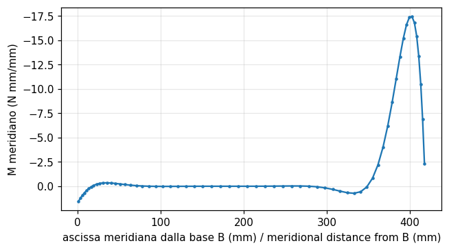

| Grandezza | Rif. | Riferimento | feagent | Scarto | |
|---|---|---|---|---|---|
| forza verticale alla base per unita' di lunghezza (0,866 q) [N/mm] | esatta | 4.33 | 4.3301 | 0.00 % | ✅ |
| tensione meridiana di membrana alla base (compressione) [MPa] | libro | 4.33 | 4.2963 | 0.78 % | ✅ |
| momento meridiano massimo vicino al bordo [N mm/mm] | libro | 17.7 | 17.434 | 1.50 % | ✅ |
| distanza del momento massimo dal bordo superiore [mm] | libro | 17 | 16.088 | 5.36 % | ✅ |
| momento all'incastro [N mm/mm] | libro | 1.7 | 1.7016 | 0.10 % | ✅ |
| tensione circonferenziale vicino ad A [MPa] | libro | -175 | -172.71 | 1.31 % | ✅ |
| tensione di flessione massima 6 M / t^2 [MPa] | libro | 106 | 104.6 | 1.32 % | ✅ |

**Note**: feagent non ha gusci assialsimmetrici: lo spicchio di gusci piatti e' un elemento diverso, percio' il caso e' 'partial' anche se i risultati concordano: M_max -17,4 a 16 mm (con 128 elementi -17,5 a 17 mm), M_B = 1,70, N_B = 4,33, sigma_theta in A -173 MPa al baricentro del triangolo di bordo (-174 con 128 elementi). Il segno dei momenti dipende dalla terna locale dei triangoli.

*Codice*: `validation/books/cookmodeling/ch07.py`

<a id="cookmod-7-7-slit-tube-cantilever"></a>

### Sez. 7.7 A General Shell Application, Figg. 7.7-1...7.7-3 - Tubo sottile tagliato longitudinalmente, a mensola, con forza trasversale

🟡 · pag. PDF 202 · shell

Tubo di raggio medio 25 mm, spessore 2 mm, lungo 280 mm, tagliato lungo una generatrice, incastrato e caricato da P = 1 N trasversale al centro del disco d'estremita'. Oltre alla flessione (373e-6 mm) il tubo si torce attorno al centro di taglio a x = -2R con ingobbamento impedito all'incastro: teoria theta = -11,2e-6 rad, v = -933e-6 mm, sigma_z = 0,169 MPa. FE del libro: frecce 682e-6 e 1252e-6 mm ai lati, media 967e-6, theta = -11,4e-6, centro di taglio a -45,6 mm.

**Modello**: Meta' tubo (antisimmetria) con mesh 10 x 14 come nel libro: ogni quadrilatero e' fatto di quattro triangoli sottili sovrapposti (membrana GT9 + DKT, E dimezzato) invece del Q6 + quattro DKT del libro; semidisco di estremita' di 10 triangoli; incastro in z = 0, u = w = theta_y = 0 sulla generatrice continua in y = 0, taglio libero. Mesh 20 x 28 come riferimento convergente.

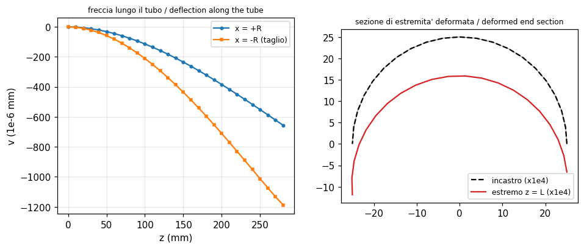

| Grandezza | Rif. | Riferimento | feagent | Scarto | |
|---|---|---|---|---|---|
| freccia di trave P L^3 / (3 E I) [1e-6 mm] | libro | 373 | 372.67 | 0.09 % | ✅ |
| flessione P L R / I [MPa] | libro | 0.0713 | 0.071301 | 0.00 % | ✅ |
| rotazione con ingobbamento impedito [1e-6 rad] | libro | -11.2 | -11.186 | 0.13 % | ✅ |
| sigma_z da ingobbamento impedito [MPa] | libro | 0.169 | 0.16901 | 0.01 % | ✅ |
| freccia in x = +R, mesh del libro [1e-6 mm] | libro | 682 | 642.33 | 5.82 % | ✅ |
| freccia in x = -R, mesh del libro [1e-6 mm] | libro | 1252 | 1161.9 | 7.20 % | ✅ |
| rotazione dell'estremo, mesh del libro [1e-6 rad] | libro | -11.4 | -10.392 | 8.85 % | ✅ |
| freccia media, mesh 20 x 28, contro la teoria [1e-6 mm] | esatta | 933 | 918.7 | 1.53 % | ✅ |
| ascissa del centro di taglio del modello [mm] | libro | -45.6 | -45.198 | 0.88 % | ✅ |

**Note**: Formule della torsione con ingobbamento impedito verificate (theta, v, sigma_z). Con la mesh del libro feagent da' 642e-6 e 1162e-6 mm (media 902e-6, -7 % dal libro) e theta = 10,4e-6: l'elemento e' diverso (il Q6 di membrana del libro e' piu' flessibile sulla mesh grossolana); con la mesh 20 x 28 la media converge a 922e-6 (-1,2 % dalla teoria, 933e-6). Il centro di taglio del modello, dal secondo carico equivalente a 0,5 N in x = -2R, cade a -45,2 mm (libro -45,6). Tolleranze del 10 % sui valori della mesh grossolana.

*Codice*: `validation/books/cookmodeling/ch07.py`

## Capitolo 8

<a id="cookmod-8-2-bar-conductivity"></a>

### Sez. 8.2, Fig. 8.2-1, Eq. 8.2-1 - Matrice di conducibilita' di una barra a superficie laterale isolata

📐 · pag. PDF 218 · heat_steady

Per una barra di sezione A, lunghezza L e conducibilita' k, con superficie laterale isolata, la matrice di conducibilita' e' (A k / L) [[1, -1], [-1, 1]], identica alla rigidezza assiale A E / L. Dati scelti: A = 100 mm2, L = 50 mm, k = 0,045 W/(mm C).

**Modello**: Elemento L2 di FieldModel('heat') (conduction()), confrontato con la formula del libro e con la rigidezza della barra L2 strutturale (add_bar) con E = k; barra rastremata a gradini divisa in elementi per il flusso.

| Grandezza | Rif. | Riferimento | feagent | Scarto | |
|---|---|---|---|---|---|
| k11 = A k / L [W/C] | esatta | 0.09 | 0.09 | 0.00 % | ✅ |
| k12 = -A k / L [W/C] | esatta | -0.09 | -0.09 | 0.00 % | ✅ |
| differenza con la rigidezza assiale della barra con E = k | esatta | 0 | 0 | 0.00 % | ✅ |
| portata termica di due tratti in serie [W] | esatta | 5 | 5 | 0.00 % | ✅ |

**Note**: Matrice verificata termine a termine; l'analogia con la barra strutturale e' esatta. Per una barra con due tratti di sezione diversa la portata termica fra estremi a temperatura imposta coincide con quella delle resistenze in serie.

*Codice*: `validation/books/cookmodeling/ch08.py`

<a id="cookmod-8-4-crank-nicolson-scheme"></a>

### Sez. 8.4, Eqq. 8.4-1...8.4-5 (Problem 8.11) - Integrazione nel tempo dei transitori termici col metodo del trapezio generalizzato

📐 · pag. PDF 222 · heat_transient

Il libro integra K T + C dT/dt = Q con (gamma K + C/dt) T_n+1 = (1 - gamma) Q_n + gamma Q_n+1 - [(1 - gamma) K - C/dt] T_n: incondizionatamente stabile per gamma >= 1/2, del secondo ordine per gamma = 1/2 (Crank-Nicolson). Il Problem 8.11 (2 dT/dt + 6T = 8) non ha risposta stampata.

**Modello**: FieldModel.solve_transient (metodo theta) su un sistema a un GdL costruito con un elemento L2: 2 dT/dt + 6 T = 8 (Problem 8.11), confrontato con la ricorrenza dell'Eq. 8.4-5 scritta con numpy e con la soluzione esatta.

| Grandezza | Rif. | Riferimento | feagent | Scarto | |
|---|---|---|---|---|---|
| differenza massima fra feagent e la ricorrenza del libro [C] | esatta | 0 | 2.2204e-16 | 0.00 % | ✅ |
| Crank-Nicolson: rapporto degli errori dimezzando dt | esatta | 4 | 4.0067 | 0.17 % | ✅ |
| Eulero all'indietro: rapporto degli errori dimezzando dt | esatta | 2 | 2.011 | 0.55 % | ✅ |
| T(1) con Crank-Nicolson, dt = 0,05 [C] | esatta | 1.267 | 1.2673 | 0.03 % | ✅ |
| dt = 1: Crank-Nicolson limitato, esplicito divergente (1 = vero) | libro | 1 | 1 | 0.00 % | ✅ |

**Note**: Condizione iniziale T(0) = 0 scelta; soluzione esatta T = 4/3 (1 - e^(-3t)). feagent coincide con la ricorrenza del libro a meno degli arrotondamenti; l'errore di Crank-Nicolson si riduce di 4 volte dimezzando dt, quello di Eulero all'indietro di 2; con dt = 1 il metodo esplicito (gamma = 0) diverge mentre gamma = 1/2 resta limitato.

*Codice*: `validation/books/cookmodeling/ch08.py`

<a id="cookmod-8-6-pipe-flange-thermal-stress"></a>

### Sez. 8.6 An Application, Figg. 8.6-1...8.6-5, Tab. 8.6-1 - Giunto a flangia saldato su tubo: campo termico stazionario e tensioni termiche

🟡 · pag. PDF 225 · heat_steady, thermal_stress, axisymmetric

Flangia saldata su un tubo con fluido interno a 0 C (h = 5000 W/m2C) e vapore esterno a 100 C (h = 20000 W/m2C), k = 20 W/mC. Il libro trova T minima 3,59 C sul foro, massima 99,99 C, flusso radiale 170000 W/m2 vicino ad AH, e nella tabella 8.6-1 le tensioni massime e minime (sigma_r, sigma_theta, sigma_z, von Mises) per le due condizioni d'appoggio.

**Modello**: Mesh assialsimmetrica di 106 Q8 ricostruita dalla Fig. 8.6-1 (tubo r 77-84, mozzo r 84-102 largo 48, corona r 102-156 larga 39, cordone esterno di 18 mm, tratto saldato interno fino a z = 18); nodi distinti lungo IJ (18 < z < 48) per l'interfaccia non conduttiva e non saldata. Campo termico con FieldModel('heat') (Q8 axisym, convezione con add_convection), poi le stesse mesh e gli stessi id in un Model di elementi piani 'axisym' caricato con FieldResult.to_model_temperatures; due analisi: solo B vincolato assialmente, oppure tutto BC.

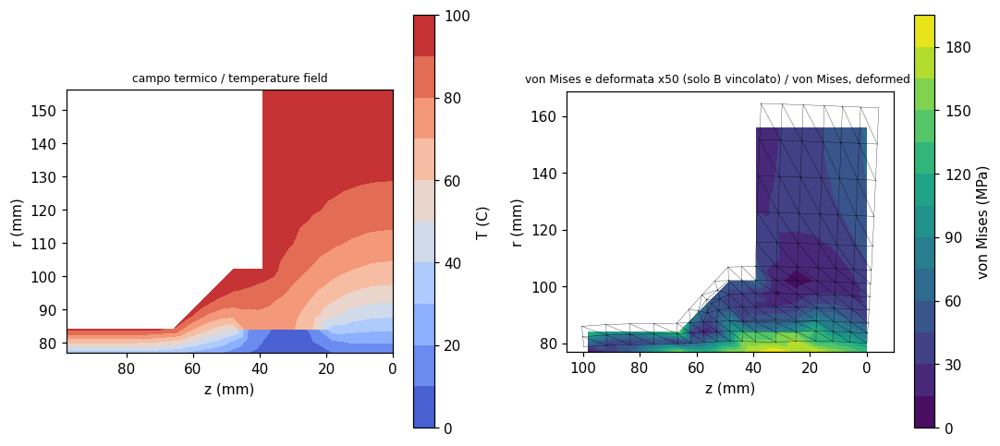

| Grandezza | Rif. | Riferimento | feagent | Scarto | |
|---|---|---|---|---|---|
| temperatura minima (foro, AB) [C] | libro | 3.59 | 3.5468 | 1.20 % | ✅ |
| temperatura massima (esterno) [C] | libro | 99.99 | 99.99 | 0.00 % | ✅ |
| flusso radiale vicino ad AH [W/m2] | libro | 1.7e+05 | 1.6837e+05 | 0.96 % | ✅ |
| flusso limite k DeltaT / Delta r (Eq. 8.6-1) [W/m2] | libro | 2.86e+05 | 2.8571e+05 | 0.10 % | ✅ |
| stima alfa E DeltaT (100 C) [MPa] | libro | 240 | 240 | 0.00 % | ✅ |
| stima alfa E DeltaT (30 C) [MPa] | libro | 72 | 72 | 0.00 % | ✅ |
| sigma_theta massima sul foro, solo B vincolato [MPa] | libro | 216 | 217.13 | 0.53 % | ✅ |
| sigma_r massima, solo B vincolato (spigoli) [MPa] | libro | 113 | 101.18 | 10.46 % | ✅ |
| sigma_r minima, solo B vincolato (spigolo G) [MPa] | libro | -68 | -60.941 | 10.38 % | ✅ |
| sigma_theta minima, solo B vincolato (spigolo G) [MPa] | libro | -142 | -134.99 | 4.94 % | ✅ |
| sigma_z massima, solo B vincolato (spigoli) [MPa] | libro | 244 | 185.22 | 24.09 % | ✅ |
| sigma_z minima, solo B vincolato (spigolo G) [MPa] | libro | -199 | -172.92 | 13.11 % | ✅ |
| von Mises massima, solo B vincolato (spigoli) [MPa] | libro | 222 | 192.16 | 13.44 % | ✅ |
| sigma_theta massima sul foro, tutto BC vincolato [MPa] | libro | 229 | 220.49 | 3.72 % | ✅ |
| sigma_r massima, tutto BC vincolato (spigoli) [MPa] | libro | 105 | 86.165 | 17.94 % | ✅ |
| sigma_r minima, tutto BC vincolato (spigolo G) [MPa] | libro | -107 | -97.469 | 8.91 % | ✅ |
| sigma_theta minima, tutto BC vincolato (spigolo G) [MPa] | libro | -225 | -221.32 | 1.64 % | ✅ |
| sigma_z massima, tutto BC vincolato (spigoli) [MPa] | libro | 257 | 247.36 | 3.75 % | ✅ |
| sigma_z minima, tutto BC vincolato (spigolo G) [MPa] | libro | -279 | -254.2 | 8.89 % | ✅ |
| von Mises massima, tutto BC vincolato (spigoli) [MPa] | libro | 242 | 218.47 | 9.72 % | ✅ |

**Note**: Geometria della flangia e delle saldature solo in parte quotata: posizioni di I e J e cordone interno ricostruiti dal disegno. Il campo termico coincide col libro (T minima 3,55 C contro 3,59; flusso 168000 W/m2). La sigma_theta massima sul foro (216 e 229 MPa nel libro) e' riprodotta entro il 4 %. Gli altri estremi della tabella cadono negli spigoli rientranti G, I, J, dove la tensione e' teoricamente infinita (il libro stesso definisce i contorni 'un pasticcio'): dipendono dalla mesh (raddoppiando gli elementi sigma_r massima passa da 101 a 152 MPa) e sono confrontati con tolleranza del 25 %. Stime del libro alfa E DeltaT = 240 e 72 MPa verificate.

*Codice*: `validation/books/cookmodeling/ch08.py`

## Capitolo 9

<a id="cookmod-9-3-mass-matrices"></a>

### Sez. 9.3, Eqq. 9.3-1...9.3-5 - Matrici di massa concentrata e consistente di barra e trave

📐 · pag. PDF 240 · dynamics

Barra: massa concentrata diag(rho A L / 2) e consistente rho A L [[1/3, 1/6], [1/6, 1/3]] per gli spostamenti laterali lineari. Trave piana: matrice consistente rho A L / 420 [[156, 22L, 54, -13L], ...]. Dati scelti: rho = 7,85, A = 2, L = 3.

**Modello**: Matrici di feagent: barra L2 (consistent_mass e lumped_masses di add_bar) e trave (BeamElement3D.consistent_mass_local, blocco flessionale v1, theta1, v2, theta2), confrontate con le formule del libro.

| Grandezza | Rif. | Riferimento | feagent | Scarto | |
|---|---|---|---|---|---|
| barra: m11 concentrata = rho A L / 2 | esatta | 23.55 | 23.55 | 0.00 % | ✅ |
| barra consistente: m11 = rho A L / 3 | esatta | 15.7 | 15.7 | 0.00 % | ✅ |
| barra consistente: m12 = rho A L / 6 | esatta | 7.85 | 7.85 | 0.00 % | ✅ |
| trave consistente: scarto massimo dall'Eq. 9.3-5 | esatta | 0 | 3.5527e-15 | 0.00 % | ✅ |
| trave consistente: m22 = 4 rho A L^3 / 420 | esatta | 4.0371 | 4.0371 | 0.00 % | ✅ |

**Note**: Tutti i termini coincidono; la massa a rotazione 'arbitraria' del libro (rho A L^3 / 24) non e' usata da feagent, che nella massa concentrata delle travi non mette inerzia rotazionale.

*Codice*: `validation/books/cookmodeling/ch09.py`

<a id="cookmod-9-4-cantilever-one-element-modal"></a>

### Sez. 9.4 Example, Fig. 9.4-1, Eqq. 9.4-4...9.4-7 - Frequenze di una mensola con un solo elemento trave: massa consistente e concentrata

✅ · pag. PDF 243 · dynamics, beam_2d

Con la massa consistente omega1 = 3,533 e omega2 = 34,81 sqrt(EI / (rho A L^4)), modi theta2 = 1,38/L e 7,62/L; con la massa concentrata omega1 = 2,449, theta2 = 1,50/L. Esatti 3,516 e 22,03.

**Modello**: Una trave di Eulero-Bernoulli incastrata (E I = 1, rho A = 1, L = 1) con i soli GdL v2 e theta2; Model.modal con mass='consistent' e con mass='lumped' (massa rho A L / 2 sulla traslazione, rotazione condensata).

| Grandezza | Rif. | Riferimento | feagent | Scarto | |
|---|---|---|---|---|---|
| omega1 consistente | libro | 3.533 | 3.5327 | 0.01 % | ✅ |
| omega2 consistente | libro | 34.81 | 34.807 | 0.01 % | ✅ |
| modo 1 theta2/v2 [1/L] | libro | 1.38 | 1.3775 | 0.18 % | ✅ |
| modo 2 theta2/v2 [1/L] | libro | 7.62 | 7.6225 | 0.03 % | ✅ |
| omega1 concentrata | libro | 2.449 | 2.4495 | 0.02 % | ✅ |
| modo concentrato theta2/v2 [1/L] | libro | 1.5 | 1.5 | 0.00 % | ✅ |

*Codice*: `validation/books/cookmodeling/ch09.py`

<a id="cookmod-9-6-guyan-one-element"></a>

### Sez. 9.6 Example, Eqq. 9.6-6...9.6-8 - Riduzione di Guyan della mensola a un elemento

✅ · pag. PDF 246 · dynamics, reduction

Con v2 come master la rotazione schiava vale theta2 = 1,5 v2 / L, la rigidezza ridotta e' 3 E I / L^3 e la frequenza 3,568 sqrt(EI / (rho A L^4)), piu' alta dei 3,533 del sistema completo perche' la riduzione e' un vincolo.

**Modello**: Mensola di un elemento del par. 9.4 ridotta con feagent.reduction.guyan al solo master v2 (massa consistente); trasformazione T dalla matrice della riduzione.

| Grandezza | Rif. | Riferimento | feagent | Scarto | |
|---|---|---|---|---|---|
| trasformazione theta2 = 1,5 v2 / L [1/L] | esatta | 1.5 | 1.5 | 0.00 % | ✅ |
| rigidezza ridotta 3 E I / L^3 [EI/L^3] | esatta | 3 | 3 | 0.00 % | ✅ |
| frequenza del sistema ridotto | libro | 3.568 | 3.5675 | 0.01 % | ✅ |

*Codice*: `validation/books/cookmodeling/ch09.py`

<a id="cookmod-9-11-frequency-estimates"></a>

### Sez. 9.11, Eqq. 9.11-1, 9.11-2 - Stima della prima frequenza con rigidezza statica e massa efficace m/2

✅ · pag. PDF 260 · dynamics

Stima rapida omega = sqrt(k / (m/2)): trave appoggiata 9,80 sqrt(EI / (m L^3)) contro 9,87 esatto; mensola 2,45, il 30 % in meno dell'esatto 3,52.

**Modello**: Rigidezza k = P / Delta calcolata da feagent con una forza statica (trave appoggiata in mezzeria, mensola all'estremo; 40 travi), massa efficace m/2; frequenze esatte con la modale consistente della stessa mesh.

| Grandezza | Rif. | Riferimento | feagent | Scarto | |
|---|---|---|---|---|---|
| appoggiata: stima sqrt(k / (m/2)) | libro | 9.8 | 9.798 | 0.02 % | ✅ |
| appoggiata: frequenza dalla modale | libro | 9.87 | 9.8696 | 0.00 % | ✅ |
| mensola: stima sqrt(k / (m/2)) | libro | 2.45 | 2.4495 | 0.02 % | ✅ |
| mensola: frequenza dalla modale | libro | 3.516 | 3.516 | 0.00 % | ✅ |

*Codice*: `validation/books/cookmodeling/ch09.py`

<a id="cookmod-9-11-guyan-cantilever-plate"></a>

### Sez. 9.11, Fig. 9.11-4 - Piastra quadrata a mensola: frequenze complete e ridotte con Guyan a 6 master

🟡 · pag. PDF 261 · dynamics, plate, reduction

Piastra sottile quadrata incastrata su un lato: con 90 GdL le prime quattro frequenze sono 3,469; 8,535; 21,45; 27,059; ridotte a 6 master 3,473; 8,604; 22,69; 29,49. La riduzione alza soprattutto le frequenze alte.

**Modello**: Mesh 5 x 5 di quadrati divisi dalla diagonale come nella figura (50 triangoli DKT 'thin', 90 GdL liberi), incastro su un lato, massa consistente; riduzione di Guyan ai 6 spostamenti laterali indicati nella figura (tre nodi sul bordo libero, tre a 3/5 della luce). Frequenze adimensionali omega sqrt(rho t L^4 / D).

| Grandezza | Rif. | Riferimento | feagent | Scarto | |
|---|---|---|---|---|---|
| omega1, sistema completo (elemento diverso) | libro | 3.469 | 3.4612 | 0.22 % | ✅ |
| omega1: rapporto ridotto / completo | libro | 1.0012 | 1.001 | 0.01 % | ✅ |
| omega2, sistema completo (elemento diverso) | libro | 8.535 | 8.5888 | 0.63 % | ✅ |
| omega2: rapporto ridotto / completo | libro | 1.0081 | 1.0085 | 0.04 % | ✅ |
| omega3, sistema completo (elemento diverso) | libro | 21.45 | 22.068 | 2.88 % | ✅ |
| omega3: rapporto ridotto / completo | libro | 1.0578 | 1.0561 | 0.16 % | ✅ |
| omega4, sistema completo (elemento diverso) | libro | 27.059 | 28.251 | 4.40 % | ✅ |
| omega4: rapporto ridotto / completo | libro | 1.0898 | 1.0926 | 0.25 % | ✅ |

**Note**: L'elemento di piastra del libro (rif. [9.7]) non e' specificato: con i DKT di feagent le frequenze complete differiscono di 0,2; 0,6; 2,9; 4,4 %. Gli incrementi dovuti alla riduzione di Guyan coincidono invece con quelli del libro entro lo 0,3 % (1,0010; 1,0085; 1,056; 1,093 contro 1,0012; 1,0081; 1,058; 1,090).

*Codice*: `validation/books/cookmodeling/ch09.py`

<a id="cookmod-9-11-spin-softening"></a>

### Sez. 9.11, Fig. 9.11-6, Eqq. 9.11-3...9.11-5 - Ammorbidimento da rotazione di un sistema massa-molla su disco rotante

📐 · pag. PDF 264 · dynamics

Una barra rigida su un disco che ruota a velocita' Omega, con masse e molle agli estremi, oscilla a omega = (k/m - Omega^2)^(1/2): la rotazione abbassa la frequenza ('spin softening'). Dati scelti: k = 100, m = 1, a = 0,1, R = 1.

**Modello**: Barra rigida ABC (trave molto rigida) con perno in B, masse m in A e C (add_nodal_mass), molle radiali k (add_elastic_support); feagent non ha la rigidezza centrifuga, che si aggiunge come superelemento di rigidezza -m Omega^2 sulla direzione radiale di A e C (Eq. 9.11-3 linearizzata).

| Grandezza | Rif. | Riferimento | feagent | Scarto | |
|---|---|---|---|---|---|
| Omega = 0: omega = (k/m - Omega^2)^(1/2) [rad/s] | esatta | 10 | 10 | 0.00 % | ✅ |
| Omega = 4: omega = (k/m - Omega^2)^(1/2) [rad/s] | esatta | 9.1652 | 9.1652 | 0.00 % | ✅ |
| Omega = 8: omega = (k/m - Omega^2)^(1/2) [rad/s] | esatta | 6 | 6 | 0.00 % | ✅ |

**Note**: Verifica della formula del libro con la modale di feagent; il termine di ammorbidimento e' inserito a mano perche' feagent non calcola gli effetti delle forze d'inerzia di trascinamento.

*Codice*: `validation/books/cookmodeling/ch09.py`

<a id="cookmod-9-12-frame-modes-harmonic"></a>

### Sez. 9.12 An Application, Figg. 9.12-1...9.12-3, Tab. 9.12-1 - Telaio ad angolo retto: modi propri e risposta armonica

✅ · pag. PDF 268 · dynamics, beam_2d

Telaio d'acciaio a sezione quadrata 0,1 m, montante di 3 m incernierato in A e traverso di 2 m su carrello in C. Il libro stima f1 = 3,20 Hz (k = 111100 N/m, massa efficace 275 kg), calcola le prime dieci frequenze (3,315 ... 649,6 Hz), le componenti dei modi normalizzati a massa unitaria e la risposta a 3000 sin(Omega t) N in C: in risonanza col modo 4 u16 = 75,5e-6 m.

**Modello**: 50 travi di Timoshenko da 0,1 m (30 sul montante AB, 20 sul traverso BC), massa concentrata (Model.modal mass='lumped'); risposta armonica per sovrapposizione dei primi 5 modi con smorzamento modale del 2 %, calcolata coi modi normalizzati di feagent.

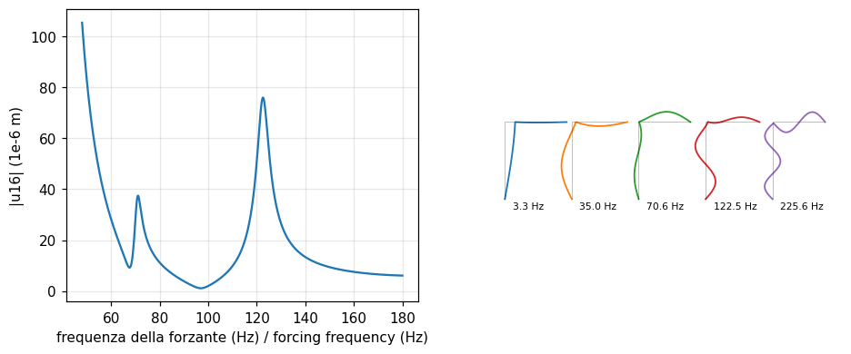

| Grandezza | Rif. | Riferimento | feagent | Scarto | |
|---|---|---|---|---|---|
| frequenza 1 [Hz] | libro | 3.315 | 3.3056 | 0.28 % | ✅ |
| frequenza 2 [Hz] | libro | 35.08 | 34.993 | 0.25 % | ✅ |
| frequenza 3 [Hz] | libro | 70.77 | 70.602 | 0.24 % | ✅ |
| frequenza 4 [Hz] | libro | 122.7 | 122.46 | 0.20 % | ✅ |
| frequenza 5 [Hz] | libro | 226 | 225.61 | 0.17 % | ✅ |
| frequenza 6 [Hz] | libro | 269.4 | 268.94 | 0.17 % | ✅ |
| frequenza 7 [Hz] | libro | 396.6 | 395.73 | 0.22 % | ✅ |
| frequenza 8 [Hz] | libro | 420.8 | 420.52 | 0.07 % | ✅ |
| frequenza 9 [Hz] | libro | 552.3 | 552.14 | 0.03 % | ✅ |
| frequenza 10 [Hz] | libro | 649.6 | 649.73 | 0.02 % | ✅ |
| 1000 |u| nodo 16, modo 1 | libro | 38.6 | 38.633 | 0.09 % | ✅ |
| 1000 |u| nodo 16, modo 2 | libro | 81.5 | 81.625 | 0.15 % | ✅ |
| 1000 |u| nodo 16, modo 3 | libro | 23.8 | 23.872 | 0.30 % | ✅ |
| 1000 |u| nodo 16, modo 4 | libro | 27.7 | 27.829 | 0.46 % | ✅ |
| 1000 |u| nodo 16, modo 5 | libro | 62.7 | 63.11 | 0.65 % | ✅ |
| 1000 |theta| nodo 41, modo 1 | libro | 1 | 0.98464 | 1.54 % | ✅ |
| 1000 |theta| nodo 41, modo 2 | libro | 7 | 6.9958 | 0.06 % | ✅ |
| 1000 |theta| nodo 41, modo 3 | libro | 19.4 | 19.426 | 0.13 % | ✅ |
| 1000 |theta| nodo 41, modo 4 | libro | 52.6 | 52.715 | 0.22 % | ✅ |
| 1000 |theta| nodo 41, modo 5 | libro | 248.9 | 252.76 | 1.55 % | ✅ |
| 1000 |u| nodo 51, modo 1 | libro | 62.3 | 62.281 | 0.03 % | ✅ |
| 1000 |u| nodo 51, modo 2 | libro | 33.1 | 33.101 | 0.00 % | ✅ |
| 1000 |u| nodo 51, modo 3 | libro | 3.4 | 3.3711 | 0.85 % | ✅ |
| 1000 |u| nodo 51, modo 4 | libro | 21.6 | 21.647 | 0.22 % | ✅ |
| 1000 |u| nodo 51, modo 5 | libro | 9.2 | 9.2279 | 0.30 % | ✅ |
| rigidezza orizzontale in C (Eq. 9.12-1) [N/m] | libro | 1.111e+05 | 1.1091e+05 | 0.17 % | ✅ |
| f1 stimata con massa efficace 275 kg [Hz] | libro | 3.2 | 3.1963 | 0.12 % | ✅ |
| carico modale del modo 4 [N] | libro | 64.8 | 64.952 | 0.24 % | ✅ |
| ampiezza modale massima del modo 4 (Eq. 9.12-3) | libro | 0.00273 | 0.0027427 | 0.47 % | ✅ |
| ampiezza di u16 con Omega = omega4 [m] | libro | 7.5500e-05 | 7.5930e-05 | 0.57 % | ✅ |
| reazione orizzontale in A con Omega = omega4 (circa) [N] | libro | 4800 | 4686.1 | 2.37 % | ✅ |

**Note**: Le frequenze coincidono entro lo 0,3 % usando le travi di Timoshenko (il libro fornisce G) e la massa concentrata (con le travi di Eulero-Bernoulli il modo 10 sale a 677 Hz). Il libro avverte che i dati vengono da tre programmi diversi: le componenti modali della Tab. 9.12-1 sono riprodotte con travi di Eulero-Bernoulli e massa consistente (con Timoshenko theta41 dei modi 3 e 4 scende del 3 %, segno che la tabella viene da un programma senza deformabilita' a taglio); confronto in valore assoluto (il segno di un modo e' arbitrario) entro il 2 %. La reazione orizzontale in A a risonanza col modo 4 risulta 4,8 kN, 1,6 volte la forza, come nel libro.

*Codice*: `validation/books/cookmodeling/ch09.py`

<a id="cookmod-9-13-frame-impulse-response"></a>

### Sez. 9.13 An Application, Figg. 9.13-1...9.13-3, Tabb. 9.13-1, 9.13-2 - Telaio sotto impulso rettangolare: sovrapposizione modale e spettro di risposta

🟡 · pag. PDF 271 · dynamics

Una forza orizzontale di 100 kN agisce in C per 0,01 s. Il libro stima a = 364 m/s2, v = 3,64 m/s, u = 0,181 m e tabella i massimi di u16, della sua velocita' e accelerazione e di theta41 e derivate al crescere dei modi (Tab. 9.13-1), poi i contributi modali dello spettro di risposta (Tab. 9.13-2).

**Modello**: Telaio del par. 9.12; Model.solve_time_history_modal con 1, 2, 3, 4, 5, 10, 15 modi, integrazione esatta a tratti, dt = 1e-4 s fino a 0,4 s, smorzamento 2 %; spettro di risposta dell'impulso rettangolare calcolato coi modi di feagent e combinazione SRSS.

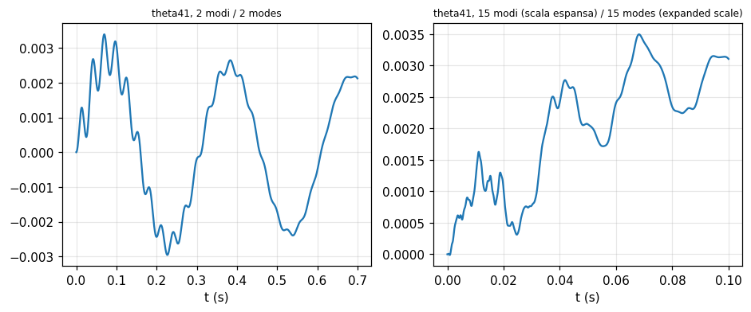

| Grandezza | Rif. | Riferimento | feagent | Scarto | |
|---|---|---|---|---|---|
| 1e3 u16 massimo, 1 modi [m] | libro | 112 | 112.65 | 0.58 % | ✅ |
| v16 massimo, 1 modi [m/s] | libro | 2.38 | 2.3899 | 0.42 % | ✅ |
| a16 massimo, 1 modi [m/s2] | libro | 242 | 240.57 | 0.59 % | ✅ |
| 1e3 theta41 massimo, 1 modi [rad] | libro | 2.8 | 2.8235 | 0.84 % | ✅ |
| thetadot41 massimo, 1 modi [rad/s] | libro | 0.06 | 0.059902 | 0.16 % | ✅ |
| thetaddot41 massimo, 1 modi [rad/s2] | libro | 6 | 6.0299 | 0.50 % | ✅ |
| 1e3 u16 massimo, 2 modi [m] | libro | 119 | 119.4 | 0.34 % | ✅ |
| v16 massimo, 2 modi [m/s] | libro | 4.33 | 4.3473 | 0.40 % | ✅ |
| a16 massimo, 2 modi [m/s2] | libro | 463 | 462.8 | 0.04 % | ✅ |
| 1e3 theta41 massimo, 2 modi [rad] | libro | 3.37 | 3.3925 | 0.67 % | ✅ |
| thetadot41 massimo, 2 modi [rad/s] | libro | 0.211 | 0.21184 | 0.40 % | ✅ |
| thetaddot41 massimo, 2 modi [rad/s2] | libro | 40 | 39.58 | 1.05 % | ✅ |
| a16 massimo, 3 modi [m/s2] | libro | 464 | 463.18 | 0.18 % | ✅ |
| thetaddot41 massimo, 3 modi [rad/s2] | libro | 44 | 44.22 | 0.50 % | ✅ |
| a16 massimo, 4 modi [m/s2] | libro | 529 | 530.5 | 0.28 % | ✅ |
| thetaddot41 massimo, 4 modi [rad/s2] | libro | 174 | 177.44 | 1.98 % | ✅ |
| 1e3 u16 massimo, 5 modi [m] | libro | 119 | 119.38 | 0.32 % | ✅ |
| v16 massimo, 5 modi [m/s] | libro | 4.31 | 4.3283 | 0.42 % | ✅ |
| a16 massimo, 5 modi [m/s2] | libro | 553 | 556.63 | 0.66 % | ✅ |
| 1e3 theta41 massimo, 5 modi [rad] | libro | 3.47 | 3.4917 | 0.63 % | ✅ |
| thetadot41 massimo, 5 modi [rad/s] | libro | 0.368 | 0.37468 | 1.82 % | ✅ |
| thetaddot41 massimo, 5 modi [rad/s2] | libro | 441 | 460.37 | 4.39 % | ✅ |
| a16 massimo, 10 modi [m/s2] | libro | 830 | 829.57 | 0.05 % | ✅ |
| thetaddot41 massimo, 10 modi [rad/s2] | libro | 862 | 872.91 | 1.27 % | ✅ |
| 1e3 u16 massimo, 15 modi [m] | libro | 119 | 119.38 | 0.32 % | ✅ |
| v16 massimo, 15 modi [m/s] | libro | 4.39 | 4.405 | 0.34 % | ✅ |
| a16 massimo, 15 modi [m/s2] | libro | 1341 | 1360.4 | 1.45 % | ✅ |
| 1e3 theta41 massimo, 15 modi [rad] | libro | 3.47 | 3.4937 | 0.68 % | ✅ |
| thetadot41 massimo, 15 modi [rad/s] | libro | 0.603 | 0.60351 | 0.08 % | ✅ |
| thetaddot41 massimo, 15 modi [rad/s2] | libro | 1524 | 1628.2 | 6.84 % | ✅ |
| spostamento massimo in C, 15 modi [m] | libro | 0.181 | 0.18194 | 0.52 % | ✅ |
| velocita' massima in C, 15 modi [m/s] | libro | 4.27 | 4.275 | 0.12 % | ✅ |
| accelerazione massima in C, 15 modi (stampato 173) [m/s2] | corretto | 1730 | 1728.4 | 0.09 % | ✅ |
| stima u = v sqrt(m/k) (Eq. 9.13-3b) [m] | libro | 0.181 | 0.18092 | 0.05 % | ✅ |
| spettro: modo 1, u16 [1e-3 m] | libro | 115 | 115.62 | 0.54 % | ✅ |
| spettro: modo 2, velocita' di 16 [m/s] | libro | 2.17 | 2.1894 | 0.90 % | ✅ |
| spettro SRSS 1-15: u16 [1e-3 m] | libro | 116 | 116.05 | 0.04 % | ✅ |
| spettro SRSS 1-15: velocita' di 16 [m/s] | libro | 3.25 | 3.2613 | 0.35 % | ✅ |
| spettro SRSS 1-15: accelerazione di 16 [m/s2] | libro | 719 | 753.37 | 4.78 % | ✅ |
| spettro SRSS 1-15: theta41 [1e-3 rad] | libro | 3.09 | 3.0569 | 1.07 % | ✅ |

**Note**: Spostamenti e velocita' coincidono entro il 2 %; le accelerazioni, dominate dai modi alti (massa concentrata con inerzia rotazionale non documentata nel libro), scartano fino al 7 % per theta41 con 15 modi: tolleranza 8 % sulle accelerazioni. Refuso del libro: l'accelerazione massima del nodo 51 con 15 modi e' stampata 173 m/s2, ma la tabella da' gia' 1341 m/s2 per il nodo 16; feagent da' 1728 m/s2, quindi il valore corretto e' circa 1730 (manca una cifra). Spettro: la prima riga della Tab. 9.13-2 non coincide con la Tab. 9.13-1 nemmeno nel libro (spettro non smorzato); i contributi e le combinazioni SRSS sono confrontati entro il 5 %.

*Codice*: `validation/books/cookmodeling/ch09.py`

## Capitolo 10

<a id="cookmod-10-2-nonlinear-spring-algorithms"></a>

### Sez. 10.2, Figg. 10.2-1...10.2-3 (Problems 10.2, 10.3) - Molla non lineare: metodo incrementale, Newton-Raphson e Newton-Raphson modificato

✅ · pag. PDF 287 · nonlinear

Problem 10.2: molla 'softening' k = 5 / (2 + u), quindi P = 5u / (2 + u), con P = 2 e 4,5 (soluzioni esatte u = 4/3 e 18). Problem 10.3: molla 'hardening' k = 2 + u^2, P = 2u + u^3. Il libro descrive la deriva del metodo puramente incrementale e la convergenza di NR e NR modificato, senza risposte stampate.

**Modello**: Molla a due nodi con legge forza-allungamento non lineare (feagent.inelastic.NonlinearElastic, tabella fitta) risolta con solve_inelastic (Newton-Raphson incrementale); il metodo puramente incrementale e il Newton-Raphson modificato del libro sono ripetuti con numpy sulla stessa legge per mostrarne il comportamento.

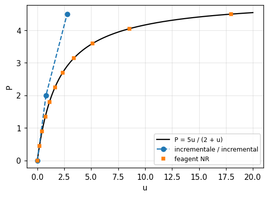

| Grandezza | Rif. | Riferimento | feagent | Scarto | |
|---|---|---|---|---|---|
| molla softening, P = 2.0: u (Newton-Raphson di feagent) | esatta | 1.3333 | 1.3333 | 0.00 % | ✅ |
| molla softening, P = 4.5: u (Newton-Raphson di feagent) | esatta | 18 | 18 | 0.00 % | ✅ |
| metodo incrementale, P = 2 (deriva) | esatta | 0.8 | 0.8 | 0.00 % | ✅ |
| metodo incrementale, P = 4,5 (deriva) | esatta | 2.76 | 2.76 | 0.00 % | ✅ |
| due iterazioni di Newton-Raphson a P = 2 | esatta | 1.3333 | 1.3311 | 0.16 % | ✅ |
| NR modificato piu' lontano dalla soluzione dopo due iterazioni (1 = vero) | libro | 1 | 1 | 0.00 % | ✅ |
| molla hardening k = 2 + u^2, P = 2 | esatta | 0.77092 | 0.77092 | 0.00 % | ✅ |

**Note**: Riferimenti: soluzioni esatte dei problemi. Il metodo incrementale in due passi (P = 2 e 4,5) da' u = 0,80 e 2,76 contro 1,33 e 18: la deriva del libro. Due iterazioni di NR a P = 2 arrivano a 1,3312 (errore 0,2 %), il NR modificato si ferma piu' lontano. Sulla molla 'hardening' NR converge a u = 0,7709 per P = 2.

*Codice*: `validation/books/cookmodeling/ch10.py`

<a id="cookmod-10-3-rigid-bar-stress-stiffness"></a>

### Sez. 10.3, Fig. 10.3-1a,b, Eq. 10.3-1 - Barra rigida su molla con forza assiale: rigidezza geometrica P/L

📐 · pag. PDF 291 · buckling, geometric_stiffness

Per una barra rigida di lunghezza L su una molla k caricata da P assiale e F laterale: (k + P/L) v2 = F; la trazione irrigidisce, la compressione ammorbidisce e P = -k L e' il carico critico. Dati scelti: L = 2, k = 10, F = 1, P = +-5.

**Modello**: Trave molto rigida incernierata a sinistra, molla laterale k all'estremo destro (add_elastic_support); analisi P-Delta (solve_pdelta) con forza assiale P e forza laterale F, buckling lineare (Model.buckling) con P di compressione.

| Grandezza | Rif. | Riferimento | feagent | Scarto | |
|---|---|---|---|---|---|
| P = 5: v2 = F / (k + P/L) | esatta | 0.08 | 0.08 | 0.00 % | ✅ |
| P = -5: v2 = F / (k + P/L) | esatta | 0.13333 | 0.13333 | 0.00 % | ✅ |
| carico critico -P = k L | esatta | 20 | 20 | 0.00 % | ✅ |

*Codice*: `validation/books/cookmodeling/ch10.py`

<a id="cookmod-10-3-one-element-buckling"></a>

### Sez. 10.3, Eqq. 10.3-3...10.3-5 (Problem 10.4) - Carico critico di una mensola con un solo elemento trave

✅ · pag. PDF 292 · buckling

Con la matrice geometrica consistente P/(30L) [[36, 3L, ...]] un solo elemento da' P_cr = 2,486 E I / L^2 contro 2,467 (pi^2/4) della teoria. Il Problem 10.4 chiede gli altri casi senza risposta stampata.

**Modello**: Una trave di Eulero-Bernoulli incastrata (E I = 1, L = 1) con rigidezza geometrica consistente, Model.buckling con forza assiale unitaria; per il Problem 10.4: appoggiata con un elemento, doppio incastro con due, incastro-appoggio con uno.

| Grandezza | Rif. | Riferimento | feagent | Scarto | |
|---|---|---|---|---|---|
| mensola, un elemento [EI/L^2] | libro | 2.486 | 2.486 | 0.00 % | ✅ |
| mensola, teoria pi^2/4 [EI/L^2] | libro | 2.467 | 2.4674 | 0.02 % | ✅ |
| appoggiata, un elemento (Problem 10.4a) [EI/L^2] | esatta | 12 | 12 | 0.00 % | ✅ |
| doppio incastro, due elementi (Problem 10.4b) [EI/L^2] | esatta | 40 | 40 | 0.00 % | ✅ |
| incastro-appoggio, un elemento (Problem 10.4c) [EI/L^2] | esatta | 30 | 30 | 0.00 % | ✅ |

**Note**: Per il Problem 10.4 i valori a un elemento si ricavano dalla stessa matrice: appoggiata 12 (contro pi^2 = 9,87), doppio incastro con due elementi 40 (contro 4 pi^2 = 39,5), incastro-appoggio 30 (contro 20,19); confrontati con la soluzione del determinante 2x2 o 1x1 della matrice del libro.

*Codice*: `validation/books/cookmodeling/ch10.py`

<a id="cookmod-10-4-beam-on-wall-snap"></a>

### Sez. 10.4, Fig. 10.4-1, Eqq. 10.4-1...10.4-3 (Problem 10.5) - Asta inclinata con rullo su parete: rigidezza variabile, punto limite e snap-through

✅ · pag. PDF 293 · geometric_nonlinear

Per c << L: F = [AE/(2L^3) (2c - v)(c - v) + k] v, rigidezza tangente AE/(2L^3)(2c^2 - 6cv + 3v^2) + k, compressione P = AE (2c - v) v / (2 L^2). Con k = 0 c'e' un punto limite a v = (1 - sqrt(3)/3) c e lo snap-through fino a v = 2c; con k > AE c^2 / (2 L^3) la rigidezza resta positiva.

**Modello**: Barra L2 corotazionale (feagent.corotational.solve_corotational) fra la cerniera e il rullo sulla parete, molla lineare k (add_elastic_support); con k = 0 controllo in lunghezza d'arco per seguire lo snap-through, con k grande controllo di spostamento. Dati scelti: L = 100, c = 2, EA = 1e4.

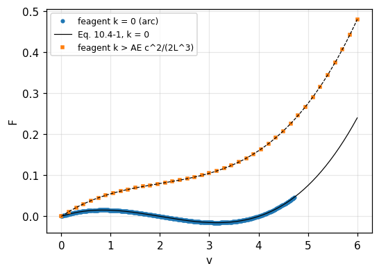

| Grandezza | Rif. | Riferimento | feagent | Scarto | |
|---|---|---|---|---|---|
| k = 0: forza al punto limite (Eq. 10.4-1) | libro | 0.015396 | 0.015389 | 0.05 % | ✅ |
| k = 0: spostamento del punto limite (1 - sqrt(3)/3) c (passo d'arco) | libro | 0.8453 | 0.8521 | 0.80 % | ✅ |
| k = 0: F nulla a v = 2c (snap-through attraversato) | libro | 0 | 2.2839e-07 | 0.00 % | ✅ |
| k = 0: F per v = 0.5 contro l'Eq. 10.4-1 | libro | 0.013125 | 0.013118 | 0.06 % | ✅ |
| k = 0: F per v = 1.0 contro l'Eq. 10.4-1 | libro | 0.015 | 0.014994 | 0.04 % | ✅ |
| k = 0: F per v = 3.0 contro l'Eq. 10.4-1 | libro | -0.015 | -0.014994 | 0.04 % | ✅ |
| k > AE c^2 / (2 L^3): F crescente con v (1 = vero) | libro | 1 | 1 | 0.00 % | ✅ |
| k grande: F per v = c | libro | 0.08 | 0.080001 | 0.00 % | ✅ |

**Note**: Il percorso corotazionale e' quello esatto dell'asta (allungamento calcolato senza approssimazioni); le formule del libro sono la sua forma ribassata e coincidono a meno di (c/L)^2 = 4e-4. Con k = 0 la lunghezza d'arco attraversa il punto limite e torna a F = 0 a v = 2c (configurazione ribaltata).

*Codice*: `validation/books/cookmodeling/ch10.py`

<a id="cookmod-10-4-geometric-nonlinear-tests"></a>

### Sez. 10.4, Fig. 10.4-2a,b,e - Casi test di non linearita' geometrica: barra rigida con molla rotazionale, mensola con momento, membrana

🟡 · pag. PDF 295 · geometric_nonlinear

(a) Barra rigida su molla rotazionale: carico critico lineare k_theta / L, a grandi rotazioni P = k_theta theta / (L sin theta). (b) Mensola con momento: u = (1 - cos phi) L / phi, phi = M L / E I. (e) Membrana quadrata sotto pressione: w_c = c t [(q/E)(b/t)^4]^(1/3), c = 0,2866.

**Modello**: Analisi corotazionale (solve_corotational): (a) trave verticale molto rigida con molla rotazionale k_theta alla base (add_elastic_support rz) e carico verticale, inclinata di 0,001 rad per innescare il ramo, controllo dello spostamento orizzontale in sommita' (P = k_theta (theta - theta0) / (L sin theta)); (b) mensola di 20 travi con momento all'estremo fino a M L / E I = 2 pi (chiusura ad anello).

| Grandezza | Rif. | Riferimento | feagent | Scarto | |
|---|---|---|---|---|---|
| (a) carico critico lineare k_theta / L | esatta | 10 | 10 | 0.00 % | ✅ |
| (a) P a theta = 11.6 gradi | esatta | 10.019 | 10.019 | 0.00 % | ✅ |
| (a) P a theta = 23.6 gradi | esatta | 10.265 | 10.265 | 0.00 % | ✅ |
| (a) P a theta = 53.2 gradi | esatta | 11.585 | 11.585 | 0.00 % | ✅ |
| (b) spostamento laterale per phi = 1.57 | esatta | 0.63662 | 0.63678 | 0.03 % | ✅ |
| (b) spostamento laterale per phi = 3.14 | esatta | 0.63662 | 0.63727 | 0.10 % | ✅ |
| (b) spostamento laterale per phi = 6.28 | esatta | 0 | -3.1745e-13 | 0.00 % | ✅ |
| (b) phi = 2 pi: l'estremo torna sull'incastro (u_x = -L) | esatta | 0 | 3.8544e-12 | 0.00 % | ✅ |

**Note**: Casi (a) e (b) rifatti; la membrana (e) richiede gusci a grandi spostamenti, non ancora disponibili in feagent (l'analisi corotazionale vale per telai piani): non rifatta. Con 20 elementi rettilinei la mensola chiusa ad anello ha l'errore della corda (circa 0,4 % sullo spostamento a phi = pi).

*Codice*: `validation/books/cookmodeling/ch10.py`

<a id="cookmod-10-5-plastic-block-sampling"></a>

### Sez. 10.5, Figg. 10.5-2, 10.5-3 - Plasticita': i punti di Gauss come campionatori dello snervamento in un blocco inflesso

✅ · pag. PDF 297 · plasticity, plane_stress

Lo snervamento e' rilevato solo quando raggiunge i punti di campionamento: con un solo elemento nell'altezza i punti di Gauss stanno a h / (2 sqrt 3) dall'asse e il blocco resta elastico fino a una curvatura sqrt(3) volte quella di primo snervamento; servono piu' elementi per una buona relazione momento-curvatura. Il libro non da' numeri.

**Modello**: Blocco 1 x 1 in tensione piana (nu = 0) di Q8 a 2x2 punti di Gauss con 1, 2 e 8 elementi nell'altezza, plasticita' bilineare (feagent.inelastic.J2Plasticity, E = 1000, sigma_y = 1, E_t = 100), curvatura imposta ruotando la faccia libera (add_settlement) e solve_inelastic; momento dalle reazioni.

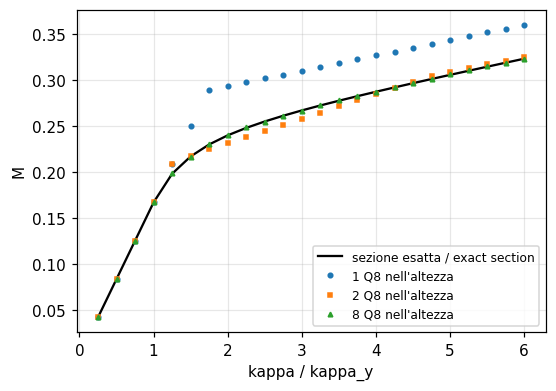

| Grandezza | Rif. | Riferimento | feagent | Scarto | |
|---|---|---|---|---|---|
| 1 elemento: nessuno snervamento a 1,7 kappa_y, snervamento a 1,8 (1 = vero) | libro | 1 | 1 | 0.00 % | ✅ |
| 1 elemento: momento a 1,5 kappa_y uguale a quello elastico | esatta | 0.25 | 0.25 | 0.00 % | ✅ |
| 8 elementi: snervamento gia' a 1,5 kappa_y (1 = vero) | libro | 1 | 1 | 0.00 % | ✅ |
| 8 elementi: M a 0.5 kappa_y contro la sezione esatta | esatta | 0.083333 | 0.083333 | 0.00 % | ✅ |
| 8 elementi: M a 1.5 kappa_y contro la sezione esatta | esatta | 0.21667 | 0.21657 | 0.05 % | ✅ |
| 8 elementi: M a 1.7 kappa_y contro la sezione esatta | esatta | 0.22738 | 0.22709 | 0.13 % | ✅ |
| 8 elementi: M a 1.8 kappa_y contro la sezione esatta | esatta | 0.23185 | 0.23235 | 0.21 % | ✅ |
| 8 elementi: M a 3 kappa_y contro la sezione esatta | esatta | 0.26667 | 0.26641 | 0.10 % | ✅ |
| 8 elementi: M a 6 kappa_y contro la sezione esatta | esatta | 0.32292 | 0.32297 | 0.02 % | ✅ |

**Note**: Riferimento: relazione momento-curvatura esatta della sezione bilineare. Con un elemento lo snervamento compare fra 1,7 e 1,8 volte la curvatura di primo snervamento (sqrt 3 = 1,73) e il momento a 1,5 volte resta quello elastico (+8 % sull'esatto); con 8 elementi la curva e' entro l'1 %.

*Codice*: `validation/books/cookmodeling/ch10.py`

<a id="cookmod-10-6-gap-two-springs"></a>

### Sez. 10.6, Figg. 10.6-2, 10.6-3 (Problem 10.12) - Due molle in serie con gioco g verso una parete: elemento gap a penalita'

✅ · pag. PDF 300 · contact

Il gioco g si chiude quando u_B > g; la molla di contatto k3 rigida applica allora la reazione della parete. Problem 10.12: k1 = k2 = 1 N/mm, k3 = 100 N/mm, g = 1 mm, P = 3 N, senza risposta stampata.

**Modello**: Molle k1 (parete-A) e k2 (A-B) lineari, molla k3 fra B e la parete con feagent.inelastic.Gap (gioco g, solo compressione); solve_inelastic.

| Grandezza | Rif. | Riferimento | feagent | Scarto | |
|---|---|---|---|---|---|
| u_A a P = 3 N [mm] | esatta | 2.005 | 2.005 | 0.00 % | ✅ |
| u_B a P = 3 N [mm] | esatta | 1.01 | 1.01 | 0.00 % | ✅ |
| forza nel gap [N] | esatta | 0.99502 | 0.99502 | 0.00 % | ✅ |
| P = 1 N: u_B = u_A (gap aperto) [mm] | esatta | 0 | 0 | 0.00 % | ✅ |

**Note**: Soluzione esatta: u_A = 2,00498 mm, u_B = 1,00995 mm (la molla di contatto si accorcia di 0,0099 mm), forza di contatto 0,995 N; prima della chiusura u_B = u_A (la chiusura avviene a P = 1 N).

*Codice*: `validation/books/cookmodeling/ch10.py`

<a id="cookmod-10-8-frame-geometric-nonlinearity"></a>

### Sez. 10.8 Applications, Figg. 10.8-1, 10.8-2 - Telaio snello: buckling lineare e risposta a grandi spostamenti con snap

✅ · pag. PDF 305 · buckling, geometric_nonlinear

Telaio ABCD in acciaio con sezione 8 x 8 mm caricato da P orizzontale in C. Stima a mano 146 N; il buckling lineare da' 137 N (114 N con l'imperfezione, con D che si sposta a sinistra). L'analisi non lineare del telaio perfetto non mostra instabilita'; con l'imperfezione D va prima a destra, poi inverte e il telaio scatta a P = 86 N.

**Modello**: 19 travi di Eulero-Bernoulli (5 su AB, 2 su BC, 12 su CD); buckling lineare con Model.buckling; risposta a grandi spostamenti con feagent.corotational.solve_corotational in lunghezza d'arco; imperfezione: ultimo elemento di CD inclinato con D spostato di 2 mm a sinistra.

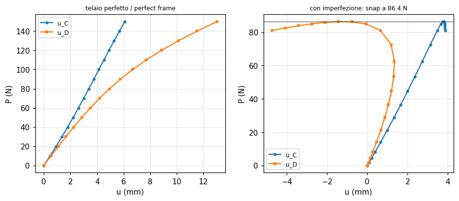

| Grandezza | Rif. | Riferimento | feagent | Scarto | |
|---|---|---|---|---|---|
| buckling lineare, telaio perfetto [N] | libro | 137 | 137.18 | 0.13 % | ✅ |
| buckling lineare, con imperfezione [N] | libro | 114 | 114.48 | 0.42 % | ✅ |
| modo con imperfezione: D si sposta in verso opposto a C (1 = vero) | libro | 1 | 1 | 0.00 % | ✅ |
| stima 5 P_cr = pi^2 E I / (4 L^2) [N] | libro | 146 | 146.22 | 0.15 % | ✅ |
| carico di snap (punto limite), con imperfezione [N] | libro | 86 | 86.396 | 0.46 % | ✅ |
| D va prima a destra e poi inverte (1 = vero) | libro | 1 | 1 | 0.00 % | ✅ |
| telaio perfetto: percorso stabile fino a 150 N (1 = vero) | libro | 1 | 1 | 0.00 % | ✅ |

**Note**: Buckling lineare e punto limite coincidono col libro. A P = 150 N il telaio perfetto ha u_C = 6,1 mm e u_D = 13,0 mm (dal grafico del libro circa 7 e 12, non confrontati). Osservazione su feagent: con la tolleranza di default (1e-9) la lunghezza d'arco si ferma al primo passo su questo telaio, mentre il controllo di carico converge; con tol = 1e-7 il percorso e' completo.

*Codice*: `validation/books/cookmodeling/ch10.py`

<a id="cookmod-10-8-plastic-beam-plane-stress"></a>

### Sez. 10.8 Applications, 'Plastic Action in a Beam', Figg. 10.8-3, 10.8-4 - Trave in tensione piana con plasticita' bilineare: carico, scarico e tensioni residue

🟡 · pag. PDF 307 · plasticity, plane_stress

Trave a doppio sbalzo appoggiata nel punto A sul piano di simmetria, caricata da q sul lembo superiore. La formula di Navier da' sigma_x = sigma_Y per q = 5,83 N/mm. Il libro riporta a pieno carico in B sigma_x = 71, sigma_y = -8, sigma_e = 75 MPa, le tensioni residue dopo lo scarico (-10 MPa in B, alternate lungo AB) e le curve carico-spostamento.

**Modello**: Mesh 12 x 6 di Q4 da 2 x 2 mm sulla meta' simmetrica (24 x 12 mm, spessore 1), u = 0 lungo AB, A bloccato; plasticita' di von Mises bilineare a incrudimento cinematico (feagent.inelastic.J2Plasticity.bilinear) con solve_inelastic: q da 0 a 8 N/mm in 16 passi e scarico in 8. Tensioni in B estrapolate dai punti di Gauss.

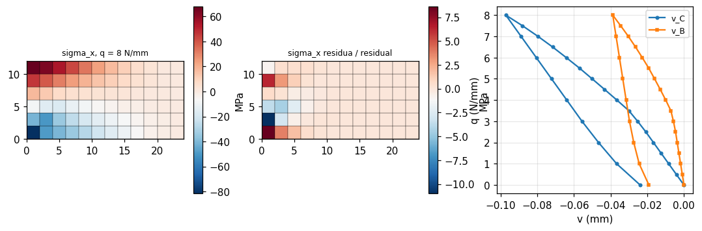

| Grandezza | Rif. | Riferimento | feagent | Scarto | |
|---|---|---|---|---|---|
| q di primo snervamento (Navier) [N/mm] | libro | 5.83 | 5.8333 | 0.06 % | ✅ |
| sigma_x in B, q = 8 N/mm [MPa] | libro | 71 | 75.421 | 6.23 % | ✅ |
| sigma_x in B contro la teoria della trave elasto-plastica [MPa] | esatta | 76.621 | 75.421 | 1.57 % | ✅ |
| sigma_x residua in B dopo lo scarico [MPa] | libro | -10 | -10.313 | 3.13 % | ✅ |
| residue lungo AB dall'alto: compressione, trazione, trazione, compressione (1 = vero) | libro | 1 | 1 | 0.00 % | ✅ |
| v_C a pieno carico (grafico del libro non confrontabile) [mm] | libro | - | -0.097195 | - | ✅ |

**Note**: Il libro non dichiara la regola d'incrudimento (si usa la cinematica, che consiglia per i metalli) ne' come calcola le tensioni nodali. feagent da' sigma_x in B 75,4 MPa a pieno carico, vicino alla teoria della trave elasto-plastica (76,6 MPa, sezione AB con M = 288 q); il 71 del libro e' piu' basso del 6 % (tolleranza 7 %). sigma_y in B non e' confrontata: con i Q4 l'estrapolazione dai punti di Gauss non ricostruisce il -8 della pressione sul lembo. La residua in B (-10,3 contro -10) e il segno alternato lungo AB nella parte alta coincidono. Gli spostamenti del grafico del libro (v_C circa 1,2 mm) sono circa dieci volte quelli di feagent (0,097 mm), che concordano con la teoria della trave con E = 50 GPa: non confrontati (probabile scala o modulo diverso nel grafico).

*Codice*: `validation/books/cookmodeling/ch10.py`

<a id="cookmod-10-8-beam-gap-contact"></a>

### Sez. 10.8 Applications, 'Beam With Contact Nonlinearity', Fig. 10.8-5 - Trave con gioco iniziale su un appoggio intermedio e distacco all'estremo

✅ · pag. PDF 308 · contact, beam_2d

Trave incernierata in A, caricata in B (100 mm), con appoggio in C (200 mm) a 0,5 mm di gioco e appoggio in D (300 mm) inizialmente a contatto, che reagiscono solo verso l'alto. A P = 20 N: v_B = -1,03 mm, v_C = -0,502 mm, D si solleva di 0,42 mm; sequenza degli appoggi A-D, A-C-D, A-C.

**Modello**: 15 travi da 20 mm (sezione 4 x 4 mm, E = 200 GPa); appoggi C e D come molle verticali da 5000 N/mm verso nodi fissi, con feagent.inelastic.Gap (gioco 0,5 mm in C, nullo in D, solo compressione); P in B da 0 a 20 N in 40 passi con solve_inelastic.

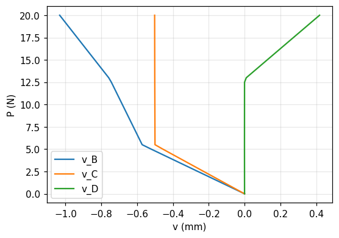

| Grandezza | Rif. | Riferimento | feagent | Scarto | |
|---|---|---|---|---|---|
| v_B a P = 20 N [mm] | libro | -1.03 | -1.0323 | 0.22 % | ✅ |
| v_C a P = 20 N [mm] | libro | -0.502 | -0.502 | 0.00 % | ✅ |
| sollevamento di D a P = 20 N [mm] | libro | 0.42 | 0.41888 | 0.27 % | ✅ |
| teoria: P L^3 / (48 E I) + 0,25 [mm] | libro | 1.03 | 1.0312 | 0.12 % | ✅ |
| chiusura del gioco in C fra i passi che comprendono 5,49 N (1 = vero) | libro | 1 | 1 | 0.00 % | ✅ |

**Note**: Il contatto in C si chiude fra 5,0 e 5,5 N (trave appoggiata A-D: 0,5 / 0,0911 = 5,49 N) e D si stacca fra 12,5 e 13 N.

*Codice*: `validation/books/cookmodeling/ch10.py`
