# 64 - Esempi del libro Seshu

Questa pagina raccoglie **tutti gli esempi svolti** del libro *Textbook of Finite Element Analysis* (P. Seshu, PHI Learning, 2003) rifatti con feagent. Per ogni esempio: riferimento nel libro, modello feagent, confronto numerico fra il valore del libro e quello di feagent, note (dati mancanti, refusi del libro corretti, differenze di modello). I testi sono riassunti con parole nostre; i dati numerici servono a rifare il calcolo. Il codice di ogni esempio e' in `validation/books/seshu/`; per rieseguirli:

```bash
python -m validation.books.run_books seshu
python scripts/_gen_book_docs.py
```

**Esiti**: ✅ riprodotto e confrontato; 🟡 riprodotto in parte (dati o risultati del libro incompleti); 📐 ricavo di formule verificato numericamente; ⛔ non riproducibile (motivo nelle note). La colonna *scarto* e' l'errore relativo massimo dei confronti; *rif.* indica il riferimento del confronto: libro, soluzione esatta o valore corretto di un refuso.

**44 esempi**: 21 riprodotti, 2 in parte, 19 ricavi verificati, 2 non riproducibili; 422 confronti numerici, 422 entro la tolleranza.

## Riepilogo

| Esempio | Titolo | Esito | Confronti | Scarto max |
|---|---|---|---|---|
| [Example 2.1](#seshu-ex-2-1) | Asta con carico assiale uniforme: residui pesati a un parametro | 📐 | 3/3 | 0.00 % |
| [Example 2.2](#seshu-ex-2-2) | Moto laminare su piano inclinato (residui pesati) | 📐 | 3/3 | 0.00 % |
| [Example 2.3](#seshu-ex-2-3) | Mensola con carico uniforme: residui pesati | 📐 | 3/3 | 0.00 % |
| [Example 2.4](#seshu-ex-2-4) | Trave appoggiata con carico uniforme: collocazione e Galerkin con seni | 📐 | 6/6 | 1.50 % |
| [Example 2.5](#seshu-ex-2-5) | Cilindro lungo con sorgente di calore uniforme (Galerkin) | 📐 | 3/3 | 0.00 % |
| [Example 2.6](#seshu-ex-2-6) | Asta con carico linearmente variabile q = ax (Galerkin cubico) | 📐 | 4/4 | 0.00 % |
| [Example 2.7](#seshu-ex-2-7) | Piastra rettangolare appoggiata con carico uniforme (Galerkin a un termine) | 📐 | 4/4 | 0.07 % |
| [Example 2.8 + Tabella 2.1](#seshu-ex-2-8) | Aletta di alluminio: Galerkin quadratico, cubico e quartico | 📐 | 13/13 | 0.25 % |
| [Example 2.9](#seshu-ex-2-9) | Forma debole per l'asta con carico q = ax, prova quadratica | 📐 | 7/7 | 0.00 % |
| [Example 2.10](#seshu-ex-2-10) | Trave appoggiata in forma debole con prova quadratica | 📐 | 4/4 | 0.00 % |
| [Example 2.11](#seshu-ex-2-11) | Assemblaggio di due elementi di barra | 📐 | 4/4 | 0.00 % |
| [Example 2.12](#seshu-ex-2-12) | Asta d'acciaio caricata in punta (2 elementi) | ✅ | 3/3 | 0.08 % |
| [Example 2.13](#seshu-ex-2-13) | Asta con carico distribuito e concentrato (4 elementi) | ✅ | 5/5 | 0.16 % |
| [Example 2.14](#seshu-ex-2-14) | Parete piana con sorgente di calore uniforme (4 elementi) | ✅ | 4/4 | 0.00 % |
| [Example 3.1](#seshu-ex-3-1) | Asta con carico uniforme col metodo di Rayleigh-Ritz | 📐 | 3/3 | 0.00 % |
| [Example 3.2](#seshu-ex-3-2) | Trave appoggiata con carico uniforme col metodo di Rayleigh-Ritz | 📐 | 3/3 | 0.01 % |
| [Example 3.3 + Tabella 3.1](#seshu-ex-3-3) | Aletta: Rayleigh-Ritz quadratico | 📐 | 7/7 | 0.09 % |
| [Example 4.10](#seshu-ex-4-10) | Aletta con elementi lineari di conduzione e convezione | ✅ | 9/9 | 0.00 % |
| [Example 4.1 + Tabelle 4.1-4.2](#seshu-ex-4-1) | Asta appesa sotto peso proprio con 1, 2, 4, 8 e 16 elementi lineari | ✅ | 20/20 | 0.28 % |
| [Example 4.2](#seshu-ex-4-2) | Asta appesa con un elemento di barra quadratico | ✅ | 6/6 | 0.00 % |
| [Example 4.3](#seshu-ex-4-3) | Effetto della numerazione dei nodi sulla matrice assemblata | 📐 | 4/4 | 0.00 % |
| [Example 4.4](#seshu-ex-4-4) | Tensioni termiche in un'asta (libera e incastrata) | ✅ | 4/4 | 0.00 % |
| [Example 4.5](#seshu-ex-4-5) | Traliccio iperstatico a tre aste | ✅ | 2/2 | 0.00 % |
| [Example 4.6](#seshu-ex-4-6) | Mensola con un solo elemento trave (P, M, q0) | ✅ | 10/10 | 0.00 % |
| [Example 4.7](#seshu-ex-4-7) | Trave continua su quattro appoggi (5 elementi) | ✅ | 12/12 | 0.02 % |
| [Example 4.8](#seshu-ex-4-8) | Telaio: mensola d'acciaio sostenuta da un tirante incernierato | ✅ | 5/5 | 0.37 % |
| [Example 4.9](#seshu-ex-4-9) | Trave appoggiata con carico assiale e trasversale (2 elementi telaio) | ✅ | 4/4 | 0.03 % |
| [Example 5.1](#seshu-ex-5-1) | Lastra sottile in trazione con due triangoli CST | ✅ | 13/13 | 0.33 % |
| [Example 5.2](#seshu-ex-5-2) | Integrazione di Gauss di un polinomio | 📐 | 3/3 | 0.00 % |
| [Example 5.3](#seshu-ex-5-3) | Integrazione di Gauss di cos(pi x/2) | 📐 | 5/5 | 0.00 % |
| [Example 5.4](#seshu-ex-5-4) | La lastra dell'Es. 5.1 con un elemento rettangolare bilineare | ✅ | 13/13 | 0.13 % |
| [Example 5.5](#seshu-ex-5-5) | Jacobiano di un quadrilatero regolare e distorto | 📐 | 9/9 | 0.01 % |
| [Example 5.6 + Tabelle 5.3-5.4](#seshu-ex-5-6) | Mensola modellata con elementi piani Q4 e Q8 | ✅ | 17/17 | 1.11 % |
| [Example 5.7 (Fig. 5.42)](#seshu-ex-5-7) | Concentrazione di tensione attorno a un foro circolare | 🟡 | 7/7 | 1.48 % |
| [Sezione 5.8 (Fig. 5.43-5.46)](#seshu-sec-5-8-flow) | Moto a potenziale attorno a un cilindro fra pareti (funzione di corrente) | 🟡 | 4/4 | 0.62 % |
| [Example 6.1](#seshu-ex-6-1) | Equazioni di Lagrange per un sistema a due masse e tre molle | 📐 | 5/5 | 0.00 % |
| [Example 6.2 + Tabella 6.1](#seshu-ex-6-2) | Frequenze assiali di un'asta incastrata-libera: massa concentrata e consistente | ✅ | 51/51 | 0.32 % |
| [Example 6.3 + Tabella 6.2](#seshu-ex-6-3) | Frequenze di una trave appoggiata: massa concentrata semplice, HRZ e consistente | ✅ | 58/58 | 0.33 % |
| [Example 6.4](#seshu-ex-6-4) | Autovalori dell'asta a 3 elementi col metodo di Jacobi generalizzato | ✅ | 15/15 | 100.00 % |
| [Example 6.5](#seshu-ex-6-5) | Stesso problema con l'iterazione simultanea dei vettori | ✅ | 15/15 | 234.51 % |
| [Example 6.6](#seshu-ex-6-6) | Risposta libera di un sistema a 2 GdL per sovrapposizione modale | ✅ | 11/11 | 0.00 % |
| [Example 6.7 + Tabella 6.3](#seshu-ex-6-7) | Transitorio termico nell'aletta (4 elementi, regola dei trapezi) | ✅ | 41/41 | 0.01 % |
| [Sezione 7.1 (Tabella 7.1)](#seshu-sec-7-1-crankshaft) | Vibrazioni torsionali di un albero a gomiti: travi contro modello 3D | ⛔ | 0/0 | - |
| [Sezione 7.2 (Fig. 7.13-7.16)](#seshu-sec-7-2-vessel) | Recipiente in pressione con chiusure filettate (assialsimmetrico) | ⛔ | 0/0 | - |

## Capitolo 2

<a id="seshu-ex-2-1"></a>

### Example 2.1 - Asta con carico assiale uniforme: residui pesati a un parametro

📐 · pag. PDF 27 · bar

Equazione AE u'' + q0 = 0 con u(0) = 0 e sforzo nullo in punta. La prova quadratica che rispetta entrambe le condizioni annulla il residuo con c2 = -q0/(2AE) e coincide con la soluzione esatta q0 (2Lx - x^2)/(2AE). Valori di prova: L = 1 m, A = 30 mm², E = 200 GPa, q0 = 100 N/m.

**Modello**: Metodo: prova quadratica c2 (x^2 - 2Lx) con residuo annullato (numpy). Modello feagent: asta di 4 barre L2 incastrata, carico assiale uniforme con forze nodali consistenti.

| Grandezza | Rif. | Riferimento | feagent | Scarto | |
|---|---|---|---|---|---|
| c2 dal residuo nullo [1/m] | libro | -8.3333e-06 | -8.3333e-06 | 0.00 % | ✅ |
| u(L), 4 barre feagent [m] | libro | 8.3333e-06 | 8.3333e-06 | 0.00 % | ✅ |
| u(L/2), 4 barre feagent [m] | esatta | 6.2500e-06 | 6.2500e-06 | 0.00 % | ✅ |

**Note**: Esempio simbolico: i valori numerici sono scelti per la verifica.

*Codice*: `validation/books/seshu/ch02.py`

<a id="seshu-ex-2-2"></a>

### Example 2.2 - Moto laminare su piano inclinato (residui pesati)

📐 · pag. PDF 28 · other

Velo di fluido newtoniano che scorre su un piano inclinato: mu v'' + rho g cos(theta) = 0, sforzo nullo sulla superficie libera e aderenza alla parete. La soluzione esatta e' parabolica, rho g cos(theta) (L^2 - x^2)/(2 mu). Valori di prova: acqua (mu = 1e-3 Pa s, rho = 1000 kg/m³), theta = 60°, L = 2 mm.

**Modello**: Metodo: prova quadratica c2 (x^2 - L^2) con residuo nullo. Modello feagent: FieldModel('generic') 1D con 8 elementi L2, k = mu, sorgente rho g cos(theta), velocita' nulla alla parete (x = L), flusso nullo in superficie (x = 0).

| Grandezza | Rif. | Riferimento | feagent | Scarto | |
|---|---|---|---|---|---|
| v(0) dalla prova quadratica [m/s] | esatta | 9.81 | 9.81 | 0.00 % | ✅ |
| v(0), 8 elementi feagent [m/s] | esatta | 9.81 | 9.81 | 0.00 % | ✅ |
| v(L/2), 8 elementi feagent [m/s] | esatta | 7.3575 | 7.3575 | 0.00 % | ✅ |

**Note**: Equazione di Poisson 1D: con il problema di campo generico di feagent l'analogia e' diretta (k = mu, Q = rho g cos theta). Valori numerici scelti per la verifica.

*Codice*: `validation/books/seshu/ch02.py`

<a id="seshu-ex-2-3"></a>

### Example 2.3 - Mensola con carico uniforme: residui pesati

📐 · pag. PDF 29 · beam

Mensola EI v'''' = q0 con incastro in x = 0 e momento e taglio nulli in punta. Il polinomio di quarto grado che rispetta le quattro condizioni annulla il residuo con c4 = q0/(24EI): e' la soluzione esatta, freccia in punta q0L^4/(8EI). Valori di prova: L = 2, EI = 1000, q0 = 10.

**Modello**: Metodo: polinomio di quarto grado c4 (x^4 - 4Lx^3 + 6L^2x^2) con residuo nullo. Modello feagent: mensola di 4 travi di Eulero-Bernoulli con carico uniforme.

| Grandezza | Rif. | Riferimento | feagent | Scarto | |
|---|---|---|---|---|---|
| v(L) dalla prova polinomiale | libro | 0.02 | 0.02 | 0.00 % | ✅ |
| v(L), 4 travi feagent | esatta | 0.02 | 0.02 | 0.00 % | ✅ |
| v(L/2), 4 travi feagent | esatta | 0.0070833 | 0.0070833 | 0.00 % | ✅ |

**Note**: Esempio simbolico: valori numerici scelti per la verifica.

*Codice*: `validation/books/seshu/ch02.py`

<a id="seshu-ex-2-4"></a>

### Example 2.4 - Trave appoggiata con carico uniforme: collocazione e Galerkin con seni

📐 · pag. PDF 30 · beam

Trave appoggiata EI v'''' = q0 approssimata con serie di seni. Collocazione in L/4: c1 = sqrt(2) q0 L^4/(pi^4 EI); collocazione a due termini in L/4 e L/3: c3 = 0,00003289 q0L^4/EI; Galerkin a un termine: c1 = 0,013071 q0L^4/EI, errore di 0,38 % sulla freccia in mezzeria rispetto a 5 q0L^4/(384 EI).

**Modello**: Metodo (numpy): collocazione a uno e due termini sin(pi x/L), sin(3 pi x/L) e Galerkin a un termine (integrali con quadratura di Gauss). Modello feagent: trave appoggiata di 8 travi di Eulero-Bernoulli.

| Grandezza | Rif. | Riferimento | feagent | Scarto | |
|---|---|---|---|---|---|
| c1, collocazione in L/4 [q0L^4/EI] | libro | 0.014518 | 0.014518 | 0.00 % | ✅ |
| c1, collocazione in L/4 e L/3 [q0L^4/EI] | libro | 0.011854 | 0.011854 | 0.00 % | ✅ |
| c3, collocazione in L/4 e L/3 [q0L^4/EI] | libro | 3.2890e-05 | 3.2891e-05 | 0.00 % | ✅ |
| c1, Galerkin a un termine [q0L^4/EI] | libro | 0.013071 | 0.013071 | 0.00 % | ✅ |
| errore della freccia in mezzeria [%] | libro | 0.38 | 0.3857 | 1.50 % | ✅ |
| v(L/2), 8 travi feagent [q0L^4/EI] | esatta | 0.013021 | 0.013021 | 0.00 % | ✅ |

**Note**: Il testo dell'Eq. 2.30 indica i punti di collocazione L/4 e L/2, ma i coefficienti stampati (c1 = 2 q0L^4/(sqrt(3) pi^4 EI), c3 = 0,00003289 q0L^4/EI) e la didascalia della Fig. 2.8 corrispondono a L/4 e L/3: con L/2 si otterrebbe c3 = 0,0000262. Si usano L/4 e L/3. Coefficienti adimensionali (q0 = L = EI = 1).

*Codice*: `validation/books/seshu/ch02.py`

<a id="seshu-ex-2-5"></a>

### Example 2.5 - Cilindro lungo con sorgente di calore uniforme (Galerkin)

📐 · pag. PDF 36 · heat_steady

Cilindro lungo di raggio R con generazione uniforme q0 e parete a Tw. Il Galerkin a un parametro restituisce c2 = -q0/(4k), cioe' la soluzione esatta T - Tw = q0 (R^2 - r^2)/(4k). Valori di prova: R = 0,05 m, k = 15 W/m°C, q0 = 1e6 W/m³, Tw = 80 °C.

**Modello**: Metodo (numpy): prova T = Tw - (q0R/2k)(r-R) + c2 (r-R)^2, Galerkin pesato con r dr. Modello feagent: FieldModel('heat') assialsimmetrico, striscia radiale di 20 elementi Q8 con sorgente uniforme e temperatura imposta in r = R.

| Grandezza | Rif. | Riferimento | feagent | Scarto | |
|---|---|---|---|---|---|
| c2 di Galerkin [°C/m²] | esatta | -16667 | -16667 | 0.00 % | ✅ |
| T sull'asse, 20 Q8 assialsimmetrici [°C] | esatta | 121.67 | 121.67 | 0.00 % | ✅ |
| T in r = R/2 [°C] | esatta | 111.25 | 111.25 | 0.00 % | ✅ |

**Note**: Esempio simbolico, valori numerici scelti. Il risultato stampato e' poco leggibile nella scansione; il valore di c2 e' ricavato dal calcolo.

*Codice*: `validation/books/seshu/ch02.py`

<a id="seshu-ex-2-6"></a>

### Example 2.6 - Asta con carico linearmente variabile q = ax (Galerkin cubico)

📐 · pag. PDF 37 · bar

AE u'' + ax = 0, u(0) = 0, sforzo nullo in x = L. Il Galerkin a due termini da' c2 = 0 e c3 = -a/(6AE): la soluzione esatta a (3L^2x - x^3)/(6AE), con u(L) = aL^3/(3AE). Valori di prova: L = 1 m, AE = 6e6 N, a = 1000 N/m².

**Modello**: Metodo (numpy): Galerkin con le funzioni (x^2 - 2Lx) e (x^3 - 3L^2x). Modello feagent: 4 barre L2 con carico lineare per valori nodali (forze consistenti).

| Grandezza | Rif. | Riferimento | feagent | Scarto | |
|---|---|---|---|---|---|
| c2 di Galerkin [1/m] | libro | 0 | 3.0316e-19 | 0.00 % | ✅ |
| c3 di Galerkin [1/m²] | libro | -2.7778e-05 | -2.7778e-05 | 0.00 % | ✅ |
| u(L), 4 barre feagent [m] | libro | 5.5556e-05 | 5.5556e-05 | 0.00 % | ✅ |
| u(L/4), 4 barre feagent [m] | esatta | 2.0399e-05 | 2.0399e-05 | 0.00 % | ✅ |

**Note**: Esempio simbolico, valori numerici scelti.

*Codice*: `validation/books/seshu/ch02.py`

<a id="seshu-ex-2-7"></a>

### Example 2.7 - Piastra rettangolare appoggiata con carico uniforme (Galerkin a un termine)

📐 · pag. PDF 39 · plate

Piastra appoggiata sui quattro lati con carico q0: il termine di Galerkin c11 = 16 q0 / (pi^6 D [(1/a)^2 + (1/b)^2]^2). Per la piastra quadrata la freccia al centro vale 0,00416 q0a^4/D contro la soluzione di Navier 0,00406 q0a^4/D.

**Modello**: Metodo (numpy): Galerkin con sin(pi x/a) sin(pi y/b), integrali con quadratura di Gauss. Modello feagent: piastra quadrata 16x16 gusci Q4 sottili (a/t = 100), appoggio semplice (uz = 0) sul contorno.

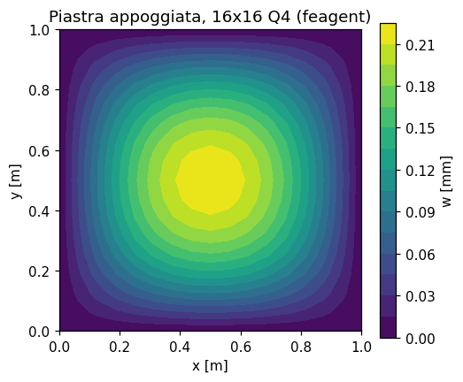

| Grandezza | Rif. | Riferimento | feagent | Scarto | |
|---|---|---|---|---|---|
| c11 di Galerkin, a x b = 1 x 1,5 m [m] | libro | 4.3552e-04 | 4.3552e-04 | 0.00 % | ✅ |
| freccia al centro, Galerkin a un termine [q0a^4/D] | libro | 0.00416 | 0.0041606 | 0.02 % | ✅ |
| freccia al centro, serie di Navier [q0a^4/D] | esatta | 0.00406 | 0.0040624 | 0.06 % | ✅ |
| freccia al centro, 16x16 gusci feagent [m] | esatta | 2.2180e-04 | 2.2197e-04 | 0.07 % | ✅ |

**Note**: Valori di prova: a = b = 1 m (e b = 1,5 m per il caso rettangolare), t = 10 mm, E = 200 GPa, nu = 0,3, q0 = 1 kPa. Il riferimento esatto e' la serie di Navier.

*Codice*: `validation/books/seshu/ch02.py`

<a id="seshu-ex-2-8"></a>

### Example 2.8 + Tabella 2.1 - Aletta di alluminio: Galerkin quadratico, cubico e quartico

📐 · pag. PDF 40 · heat_steady

Aletta cilindrica d = 1 mm, L = 50 mm, k = 200 W/m°C, h = 20 W/m²°C, parete a 300 °C, aria a 30 °C: T'' = 400 (T - 30). Il libro ricava i coefficienti di Galerkin per prove di secondo, terzo e quarto grado e li confronta con la soluzione esatta in coseno iperbolico (Tabella 2.1).

**Modello**: Metodo (numpy): Galerkin con polinomi globali che rispettano T(0) = 300 °C e punta isolata. Modello feagent: l'aletta dell'Es. 4.10 (FieldModel, elementi L2 con convezione laterale) con 32 elementi.

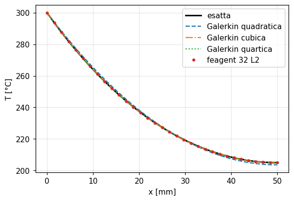

| Grandezza | Rif. | Riferimento | feagent | Scarto | |
|---|---|---|---|---|---|
| c2, prova quadratica (stampato 38751,43) [°C/m²] | corretto | 38571 | 38571 | 0.00 % | ✅ |
| T(L) della Tab. 2.1 ricalcolata col c2 stampato [°C] | libro | 203.12 | 203.12 | 0.00 % | ✅ |
| c2, prova cubica [°C/m²] | libro | 48860 | 48860 | 0.00 % | ✅ |
| c3, prova cubica [°C/m³] | libro | -1.0923e+05 | -1.0923e+05 | 0.00 % | ✅ |
| c2, prova quartica [°C/m²] | libro | 53703 | 53703 | 0.00 % | ✅ |
| c3, prova quartica [°C/m³] | libro | -2.5567e+05 | -2.5567e+05 | 0.00 % | ✅ |
| c4, prova quartica [°C/m⁴] | libro | 1.3200e+06 | 1.3167e+06 | 0.25 % | ✅ |
| T in x = 0.025 m, prova cubica [°C] | libro | 227.16 | 227.16 | 0.00 % | ✅ |
| T in x = 0.05 m, prova cubica [°C] | libro | 205.16 | 205.16 | 0.00 % | ✅ |
| T in x = 0.025 m, prova quartica stampata [°C] | libro | 227.27 | 227.27 | 0.00 % | ✅ |
| T in x = 0.05 m, prova quartica stampata [°C] | libro | 204.91 | 204.91 | 0.00 % | ✅ |
| T in x = 0,025 m, esatta [°C] | libro | 227.31 | 227.31 | 0.00 % | ✅ |
| T in punta, 32 elementi feagent [°C] | esatta | 204.97 | 204.97 | 0.00 % | ✅ |

**Note**: Refuso del libro: il c2 della prova quadratica vale 38571,43 (forma chiusa c2 = (2/3) 270 m^2 / (4/3 + 8 m^2 L^2/15)), non 38751,43 (cifre scambiate); la colonna quadratica della Tabella 2.1 e' calcolata col valore errato (in punta 203,12 invece di 203,57 °C). I coefficienti cubici e quartici tornano; la colonna quartica della tabella usa c4 arrotondato a 1,32e6, con c4 pieno la punta e' a 204,97 °C invece di 204,91. Temperature confrontate in x = 0,025 e 0,05 m.

*Codice*: `validation/books/seshu/ch02.py`

<a id="seshu-ex-2-9"></a>

### Example 2.9 - Forma debole per l'asta con carico q = ax, prova quadratica

📐 · pag. PDF 43 · bar

Stesso problema dell'Es. 2.6 risolto con la forma debole e una prova quadratica, che deve rispettare solo u(0) = 0: u = aL (7Lx - 3x^2)/(12AE). Con i residui pesati originali la stessa prova da' 5aL (2Lx - x^2)/(16AE). Gli elementi lineari convergono alla soluzione esatta.

**Modello**: Metodo (numpy): forma debole con u = c1 x + c2 x^2 e pesi x, x^2; residui pesati originali con c (x^2 - 2Lx). Modello feagent: 1, 2, 4 e 8 barre L2.

| Grandezza | Rif. | Riferimento | feagent | Scarto | |
|---|---|---|---|---|---|
| c1, forma debole [aL^2/AE] | libro | 0.58333 | 0.58333 | 0.00 % | ✅ |
| c2, forma debole [aL/AE] | libro | -0.25 | -0.25 | 0.00 % | ✅ |
| c, residui pesati originali [aL/AE] | libro | -0.3125 | -0.3125 | 0.00 % | ✅ |
| u(L), 1 barre feagent [aL^3/AE] | esatta | 0.33333 | 0.33333 | 0.00 % | ✅ |
| u(L), 2 barre feagent [aL^3/AE] | esatta | 0.33333 | 0.33333 | 0.00 % | ✅ |
| u(L), 4 barre feagent [aL^3/AE] | esatta | 0.33333 | 0.33333 | 0.00 % | ✅ |
| u(L), 8 barre feagent [aL^3/AE] | esatta | 0.33333 | 0.33333 | 0.00 % | ✅ |

**Note**: Coefficienti adimensionali (a = L = AE = 1). Le barre L2 di feagent con carico consistente sono esatte ai nodi.

*Codice*: `validation/books/seshu/ch02.py`

<a id="seshu-ex-2-10"></a>

### Example 2.10 - Trave appoggiata in forma debole con prova quadratica

📐 · pag. PDF 48 · beam

Trave appoggiata con carico uniforme risolta in forma debole con la sola parabola x(L - x): c = q0L^2/(24EI). La freccia in mezzeria e' in difetto del 20 %, ma le rotazioni agli appoggi coincidono con quelle esatte q0L^3/(24EI).

**Modello**: Metodo (numpy): forma debole int EI v'' W'' = int W q con v = W = x(L - x). Modello feagent: 4 travi di Eulero-Bernoulli appoggiate.

| Grandezza | Rif. | Riferimento | feagent | Scarto | |
|---|---|---|---|---|---|
| coefficiente c [q0L^2/EI] | libro | 0.041667 | 0.041667 | 0.00 % | ✅ |
| errore della freccia in mezzeria [%] | libro | 20 | 20 | 0.00 % | ✅ |
| rotazione all'appoggio, prova quadratica [q0L^3/EI] | libro | 0.041667 | 0.041667 | 0.00 % | ✅ |
| rotazione all'appoggio, 4 travi feagent [q0L^3/EI] | esatta | 0.041667 | 0.041667 | 0.00 % | ✅ |

**Note**: Coefficienti adimensionali (q0 = L = EI = 1).

*Codice*: `validation/books/seshu/ch02.py`

<a id="seshu-ex-2-11"></a>

### Example 2.11 - Assemblaggio di due elementi di barra

📐 · pag. PDF 61 · bar

Asta di lunghezza 2l divisa in due elementi lineari con carico uniforme q0: la matrice assemblata e' AE/l [[1,-1,0],[-1,2,-1],[0,-1,1]] e il vettore dei carichi consistenti q0 l [1/2, 1, 1/2].

**Modello**: Modello feagent: 2 barre L2 di lunghezza l, matrice di rigidezza assemblata (Model.assemble_stiffness) e vettore dei carichi (Model.assemble_loads) sui GdL ux.

| Grandezza | Rif. | Riferimento | feagent | Scarto | |
|---|---|---|---|---|---|
| scarto massimo della matrice assemblata [AE/l] | libro | 0 | 0 | 0.00 % | ✅ |
| K22 assemblato [AE/l] | libro | 2 | 2 | 0.00 % | ✅ |
| forza consistente nodo 1 [q0 l] | libro | 0.5 | 0.5 | 0.00 % | ✅ |
| forza consistente nodo 2 [q0 l] | libro | 1 | 1 | 0.00 % | ✅ |

**Note**: Valori di prova: l = 0,5 m, AE = 6e6 N, q0 = 100 N/m.

*Codice*: `validation/books/seshu/ch02.py`

<a id="seshu-ex-2-12"></a>

### Example 2.12 - Asta d'acciaio caricata in punta (2 elementi)

✅ · pag. PDF 65 · bar

Asta d'acciaio lunga 1 m, sezione 3 x 10 mm, E = 200 GPa, con 100 N in punta: spostamenti nodali e reazione d'incastro.

**Modello**: Modello feagent: 2 barre L2 da 0,5 m, incastro in x = 0, forza assiale in punta.

| Grandezza | Rif. | Riferimento | feagent | Scarto | |
|---|---|---|---|---|---|
| u2 [mm] | libro | 0.00834 | 0.0083333 | 0.08 % | ✅ |
| u3 [mm] | libro | 0.01667 | 0.016667 | 0.02 % | ✅ |
| reazione R1 [N] | libro | -100 | -100 | 0.00 % | ✅ |

*Codice*: `validation/books/seshu/ch02.py`

<a id="seshu-ex-2-13"></a>

### Example 2.13 - Asta con carico distribuito e concentrato (4 elementi)

✅ · pag. PDF 66 · bar

La stessa asta dell'Es. 2.12 con 100 N/m sulla prima meta' e 100 N in x = 0,75 m: spostamenti nodali (i nodi 4 e 5 traslano insieme) e reazione di 150 N.

**Modello**: Modello feagent: 4 barre L2 da 0,25 m, carico assiale uniforme sulle prime due, forza nodale al nodo 4.

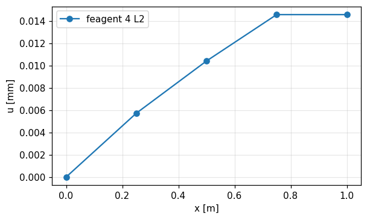

| Grandezza | Rif. | Riferimento | feagent | Scarto | |
|---|---|---|---|---|---|
| u2 [mm] | libro | 0.00573 | 0.0057292 | 0.01 % | ✅ |
| u3 [mm] | libro | 0.0104 | 0.010417 | 0.16 % | ✅ |
| u4 [mm] | libro | 0.0146 | 0.014583 | 0.11 % | ✅ |
| u5 [mm] | libro | 0.0146 | 0.014583 | 0.11 % | ✅ |
| reazione R1 [N] | libro | -150 | -150 | 0.00 % | ✅ |

*Codice*: `validation/books/seshu/ch02.py`

<a id="seshu-ex-2-14"></a>

### Example 2.14 - Parete piana con sorgente di calore uniforme (4 elementi)

✅ · pag. PDF 69 · heat_steady

Parete di spessore 2L con generazione uniforme q0 e facce a Tw: temperature interne T2 = T4 = 3q0L^2/(8k) + Tw e T3 = q0L^2/(2k) + Tw, coincidenti con la soluzione esatta.

**Modello**: Modello feagent: FieldModel('heat') 1D con 4 elementi L2 di lunghezza L/2, sorgente uniforme, temperatura imposta sulle due facce.

| Grandezza | Rif. | Riferimento | feagent | Scarto | |
|---|---|---|---|---|---|
| T2 [°C] | libro | 96.875 | 96.875 | 0.00 % | ✅ |
| T3 [°C] | libro | 112.5 | 112.5 | 0.00 % | ✅ |
| T4 [°C] | libro | 96.875 | 96.875 | 0.00 % | ✅ |
| flusso uscente da una faccia (= q0 L) [W/m²] | libro | 50000 | 50000 | 0.00 % | ✅ |

**Note**: Esempio simbolico: L = 0,05 m, k = 20 W/m°C, q0 = 1e6 W/m³, Tw = 50 °C.

*Codice*: `validation/books/seshu/ch02.py`

## Capitolo 3

<a id="seshu-ex-3-1"></a>

### Example 3.1 - Asta con carico uniforme col metodo di Rayleigh-Ritz

📐 · pag. PDF 85 · bar

Asta incastrata-libera con carico assiale uniforme q0. La prova quadratica, che rispetta solo la condizione essenziale u(0) = 0, da' c1 = q0L/AE e c2 = -q0/(2AE), cioe' la soluzione esatta dell'Es. 2.1.

**Modello**: Metodo (numpy): energia potenziale totale con u = c1 x + c2 x^2, stazionarieta' rispetto a c1 e c2. Modello feagent: 4 barre L2 incastrate con carico uniforme.

| Grandezza | Rif. | Riferimento | feagent | Scarto | |
|---|---|---|---|---|---|
| c1 [q0L/AE] | libro | 1 | 1 | 0.00 % | ✅ |
| c2 [q0/AE] | libro | -0.5 | -0.5 | 0.00 % | ✅ |
| u(L), 4 barre feagent [q0L^2/AE] | esatta | 0.5 | 0.5 | 0.00 % | ✅ |

**Note**: Coefficienti adimensionali (q0 = L = AE = 1).

*Codice*: `validation/books/seshu/ch03.py`

<a id="seshu-ex-3-2"></a>

### Example 3.2 - Trave appoggiata con carico uniforme col metodo di Rayleigh-Ritz

📐 · pag. PDF 87 · beam

Trave appoggiata con carico uniforme: il Rayleigh-Ritz a un termine con il seno da' c1 = 4 q0L^4/(pi^5 EI) = 0,01307 q0L^4/EI, lo stesso valore del Galerkin dell'Es. 2.4, contro la freccia esatta 5/384 = 0,01302.

**Modello**: Metodo (numpy): energia potenziale con v = c1 sin(pi x/L), integrali con quadratura di Gauss. Modello feagent: 8 travi di Eulero-Bernoulli appoggiate.

| Grandezza | Rif. | Riferimento | feagent | Scarto | |
|---|---|---|---|---|---|
| c1 di Rayleigh-Ritz [q0L^4/EI] | libro | 0.01307 | 0.013071 | 0.01 % | ✅ |
| c1 = 4/pi^5 [q0L^4/EI] | esatta | 0.013071 | 0.013071 | 0.00 % | ✅ |
| v(L/2), 8 travi feagent [q0L^4/EI] | esatta | 0.013021 | 0.013021 | 0.00 % | ✅ |

**Note**: Coefficienti adimensionali (q0 = L = EI = 1).

*Codice*: `validation/books/seshu/ch03.py`

<a id="seshu-ex-3-3"></a>

### Example 3.3 + Tabella 3.1 - Aletta: Rayleigh-Ritz quadratico

📐 · pag. PDF 89 · heat_steady

La stessa aletta dell'Es. 2.8 risolta minimizzando il funzionale: la prova deve rispettare solo T(0) = 300 °C (la punta isolata e' una condizione naturale). Il libro trova c1 = -3923,36 e c2 = 40498,44 e confronta con Galerkin ed esatta (Tabella 3.1).

**Modello**: Metodo (numpy): funzionale della conduzione con convezione laterale, prova T = 300 + c1 x + c2 x^2. Modello feagent: aletta dell'Es. 4.10 con 32 elementi L2.

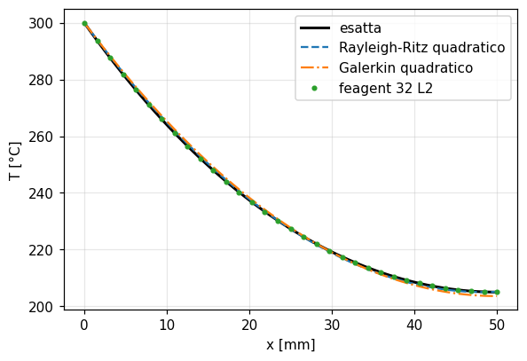

| Grandezza | Rif. | Riferimento | feagent | Scarto | |
|---|---|---|---|---|---|
| c1 [°C/m] | libro | -3923.4 | -3921.6 | 0.04 % | ✅ |
| c2 [°C/m²] | libro | 40498 | 40461 | 0.09 % | ✅ |
| T in x = 0.01 m, Rayleigh-Ritz [°C] | libro | 264.82 | 264.83 | 0.00 % | ✅ |
| T in x = 0.025 m, Rayleigh-Ritz [°C] | libro | 227.23 | 227.25 | 0.01 % | ✅ |
| T in x = 0.04 m, Rayleigh-Ritz [°C] | libro | 207.86 | 207.87 | 0.01 % | ✅ |
| T in x = 0.05 m, Rayleigh-Ritz [°C] | libro | 205.08 | 205.07 | 0.00 % | ✅ |
| T in x = 0,025 m, 32 elementi feagent [°C] | esatta | 227.31 | 227.3 | 0.00 % | ✅ |

**Note**: I coefficienti calcolati (c1 = -3921,61, c2 = 40461,1) differiscono da quelli stampati dello 0,04 % e dello 0,09 %: i valori del libro soddisfano la prima equazione di stazionarieta' con m^2 = 400,0 ma la seconda con m^2 = 399,78, segno di un arrotondamento nei passaggi a mano; le temperature della tabella tornano entro 0,01 °C. La colonna Galerkin della Tabella 3.1 ripete il c2 quadratico errato dell'Es. 2.8 (vedi quella scheda): qui si confronta solo la colonna Rayleigh-Ritz. In punta il libro stampa 205,08 °C (troncato nella scansione), confrontato a 0,02 °C.

*Codice*: `validation/books/seshu/ch03.py`

## Capitolo 4

<a id="seshu-ex-4-10"></a>

### Example 4.10 - Aletta con elementi lineari di conduzione e convezione

✅ · pag. PDF 144 · heat_steady

Aletta cilindrica di alluminio (d = 1 mm, L = 50 mm, k = 200 W/m°C) a sbalzo da una parete a 300 °C in aria a 30 °C (h = 20 W/m²°C), punta isolata. Il libro risolve con 1, 2 e 4 elementi lineari e confronta con la soluzione esatta.

**Modello**: FieldModel('heat') con 1, 2 e 4 elementi L2 (area e perimetro della sezione circolare), convezione laterale su ogni elemento, temperatura imposta alla base.

| Grandezza | Rif. | Riferimento | feagent | Scarto | |
|---|---|---|---|---|---|
| T2, 1 elementi [°C] | libro | 198.75 | 198.75 | 0.00 % | ✅ |
| T2, 2 elementi [°C] | libro | 226.19 | 226.18 | 0.00 % | ✅ |
| T3, 2 elementi [°C] | libro | 203.55 | 203.55 | 0.00 % | ✅ |
| T2, 4 elementi [°C] | libro | 256.37 | 256.37 | 0.00 % | ✅ |
| T3, 4 elementi [°C] | libro | 227.03 | 227.03 | 0.00 % | ✅ |
| T4, 4 elementi [°C] | libro | 210.14 | 210.14 | 0.00 % | ✅ |
| T5, 4 elementi [°C] | libro | 204.63 | 204.63 | 0.00 % | ✅ |
| T in punta, soluzione esatta [°C] | libro | 204.97 | 204.97 | 0.00 % | ✅ |
| T in punta, 64 elementi [°C] | esatta | 204.97 | 204.97 | 0.00 % | ✅ |

*Codice*: `validation/books/seshu/ch04.py`

<a id="seshu-ex-4-1"></a>

### Example 4.1 + Tabelle 4.1-4.2 - Asta appesa sotto peso proprio con 1, 2, 4, 8 e 16 elementi lineari

✅ · pag. PDF 104 · bar

Asta d'acciaio lunga 1 m, A = 5 cm², appesa all'estremo superiore. Gli spostamenti nodali sono esatti con qualunque mesh (punta 0,191 µm), le tensioni sono costanti a tratti (1/2; 3/4 e 1/4; 7/8 ... 1/8 di rho g L) e la loro media ai nodi coincide con l'esatta; all'interno degli elementi lo spostamento converge (Tabella 4.2, x = 0,33 L).

**Modello**: Modello feagent: 1, 2, 4, 8 e 16 barre L2, peso proprio come forza di volume (add_solid_body_force, forze nodali consistenti), estremo superiore fisso.

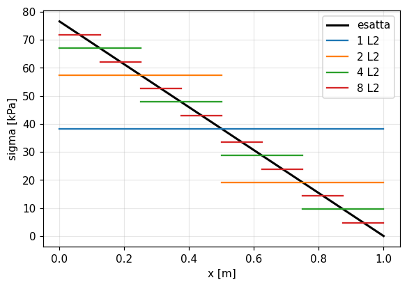

| Grandezza | Rif. | Riferimento | feagent | Scarto | |
|---|---|---|---|---|---|
| u in punta, 1 elementi [µm] | libro | 0.191 | 0.19129 | 0.15 % | ✅ |
| u in punta, 2 elementi [µm] | libro | 0.191 | 0.19129 | 0.15 % | ✅ |
| u in punta, 4 elementi [µm] | libro | 0.191 | 0.19129 | 0.15 % | ✅ |
| u in punta, 8 elementi [µm] | libro | 0.191 | 0.1913 | 0.15 % | ✅ |
| u in punta, 16 elementi [µm] | libro | 0.191 | 0.1913 | 0.15 % | ✅ |
| u in x = 0,25 m, 4 elementi [µm] | libro | 0.0836 | 0.083692 | 0.11 % | ✅ |
| u in x = 0,0625 m, 16 elementi [µm] | libro | 0.0231 | 0.023165 | 0.28 % | ✅ |
| tensione elemento 1, 1 elementi [Pa] | libro | 38259 | 38259 | 0.00 % | ✅ |
| tensione elemento 1, 2 elementi [Pa] | libro | 57388 | 57388 | 0.00 % | ✅ |
| tensione elemento 2, 2 elementi [Pa] | libro | 19130 | 19129 | 0.00 % | ✅ |
| tensione elemento 1, 4 elementi [Pa] | libro | 66953 | 66953 | 0.00 % | ✅ |
| tensione elemento 2, 4 elementi [Pa] | libro | 47824 | 47824 | 0.00 % | ✅ |
| tensione elemento 3, 4 elementi [Pa] | libro | 28694 | 28694 | 0.00 % | ✅ |
| tensione elemento 4, 4 elementi [Pa] | libro | 9564.8 | 9564.7 | 0.00 % | ✅ |
| media delle tensioni al nodo x = L/2 (4 el.) [Pa] | esatta | 38259 | 38259 | 0.00 % | ✅ |
| u(0,33 L)/esatto, 1 elementi | libro | 0.598 | 0.5988 | 0.13 % | ✅ |
| u(0,33 L)/esatto, 2 elementi | libro | 0.898 | 0.8982 | 0.02 % | ✅ |
| u(0,33 L)/esatto, 4 elementi | libro | 0.975 | 0.97532 | 0.03 % | ✅ |
| u(0,33 L)/esatto, 8 elementi | libro | 0.993 | 0.99347 | 0.05 % | ✅ |
| u(0,33 L)/esatto, 16 elementi | libro | 0.998 | 0.99857 | 0.06 % | ✅ |

**Note**: g = 9,81 m/s² (implicito nel libro).

*Codice*: `validation/books/seshu/ch04.py`

<a id="seshu-ex-4-2"></a>

### Example 4.2 - Asta appesa con un elemento di barra quadratico

✅ · pag. PDF 113 · bar

L'asta dell'Es. 4.1 con un solo elemento quadratico: forze nodali consistenti rho A g l (1/6, 1/6, 4/6), spostamenti esatti in punta (rho g L^2/(2E)) e in mezzeria (3 rho g L^2/(8E)) e tensione lineare esatta.

**Modello**: Modello feagent: una barra L3 (nodi: estremi, poi nodo medio), peso proprio come forza di volume.

| Grandezza | Rif. | Riferimento | feagent | Scarto | |
|---|---|---|---|---|---|
| u in punta [m] | libro | 1.9129e-07 | 1.9129e-07 | 0.00 % | ✅ |
| u in mezzeria [m] | libro | 1.4347e-07 | 1.4347e-07 | 0.00 % | ✅ |
| forza consistente al nodo medio [rho A g l] | libro | 0.66667 | 0.66667 | 0.00 % | ✅ |
| forza consistente all'estremo [rho A g l] | libro | 0.16667 | 0.16667 | 0.00 % | ✅ |
| tensione in x = 0.25 L [Pa] | esatta | 57388 | 57388 | 0.00 % | ✅ |
| tensione in x = 0.75 L [Pa] | esatta | 19130 | 19129 | 0.00 % | ✅ |

*Codice*: `validation/books/seshu/ch04.py`

<a id="seshu-ex-4-3"></a>

### Example 4.3 - Effetto della numerazione dei nodi sulla matrice assemblata

📐 · pag. PDF 115 · bar

La stessa asta di sei elementi numerata in due modi: con la numerazione sequenziale la matrice e' tridiagonale (semibanda 1), con quella alternata i termini non nulli si allontanano dalla diagonale (semibanda 6). Si confrontano le due matrici con le Fig. 4.9 e 4.10.

**Modello**: Modello feagent: 6 barre L2 con AE/l = 1, nodi numerati in sequenza (mesh 1) e nell'ordine 1, 7, 2, 6, 3, 5, 4 (mesh 2); matrice da Model.assemble_stiffness sui GdL ux.

| Grandezza | Rif. | Riferimento | feagent | Scarto | |
|---|---|---|---|---|---|
| scarto massimo, mesh 1 | libro | 0 | 0 | 0.00 % | ✅ |
| scarto massimo, mesh 2 | libro | 0 | 0 | 0.00 % | ✅ |
| semibanda, mesh 1 | libro | 1 | 1 | 0.00 % | ✅ |
| semibanda, mesh 2 | libro | 6 | 6 | 0.00 % | ✅ |

**Note**: Esempio concettuale sulla memorizzazione a banda; verificato confrontando le matrici assemblate da feagent con quelle stampate.

*Codice*: `validation/books/seshu/ch04.py`

<a id="seshu-ex-4-4"></a>

### Example 4.4 - Tensioni termiche in un'asta (libera e incastrata)

✅ · pag. PDF 118 · bar

Asta riscaldata uniformemente di T: se un estremo e' libero si allunga di L alpha T senza tensioni; se e' incastrata a entrambi gli estremi la tensione vale -E alpha T.

**Modello**: Modello feagent: 2 barre L2 con variazione termica uniforme (add_solid_thermal), incastro-libero e incastro-incastro.

| Grandezza | Rif. | Riferimento | feagent | Scarto | |
|---|---|---|---|---|---|
| u2, incastro-libero [m] | libro | 3.0000e-04 | 3.0000e-04 | 0.00 % | ✅ |
| u3, incastro-libero [m] | libro | 6.0000e-04 | 6.0000e-04 | 0.00 % | ✅ |
| tensione, incastro-libero [Pa] | libro | 0 | -2.1684e-08 | 0.00 % | ✅ |
| tensione, incastro-incastro [Pa] | libro | -1.2000e+08 | -1.2000e+08 | 0.00 % | ✅ |

**Note**: Esempio simbolico: L = 1 m, A = 1 cm², E = 200 GPa, alpha = 1,2e-5 1/°C, T = 50 °C.

*Codice*: `validation/books/seshu/ch04.py`

<a id="seshu-ex-4-5"></a>

### Example 4.5 - Traliccio iperstatico a tre aste

✅ · pag. PDF 121 · truss

Asta verticale di lunghezza L e due aste inclinate di alpha, appese allo stesso soffitto e collegate in basso, con carico verticale P: spostamento verticale P L / (AE (1 + 2 cos^3 alpha)), orizzontale nullo.

**Modello**: Modello feagent: 3 bielle (add_truss) nel piano X-Y, nodi d'attacco incastrati, nodo libero con uz bloccato.

| Grandezza | Rif. | Riferimento | feagent | Scarto | |
|---|---|---|---|---|---|
| spostamento verticale del nodo 3 [m] | libro | 2.1748e-04 | 2.1748e-04 | 0.00 % | ✅ |
| spostamento orizzontale del nodo 3 [m] | libro | 0 | 0 | 0.00 % | ✅ |

**Note**: Esempio simbolico: L = 1 m, alpha = 30°, A = 1 cm², E = 200 GPa, P = 10 kN. Nell'OCR l'esponente compare come cos^2: sulla pagina e' cos^3, coerente con la rigidezza assemblata.

*Codice*: `validation/books/seshu/ch04.py`

<a id="seshu-ex-4-6"></a>

### Example 4.6 - Mensola con un solo elemento trave (P, M, q0)

✅ · pag. PDF 132 · beam

Mensola con forza e coppia in punta e carico uniforme, risolta con un solo elemento: freccia e rotazione in punta sono esatte per tutti e tre i carichi; all'interno la cubica di Hermite e' esatta per P e M ma non per q0 (in mezzeria q0L^4/(24EI) contro 17 q0L^4/(384EI)).

**Modello**: Modello feagent: un elemento trave di Eulero-Bernoulli incastrato, tre load case (forza P, coppia M, carico uniforme q0 con forze consistenti).

| Grandezza | Rif. | Riferimento | feagent | Scarto | |
|---|---|---|---|---|---|
| freccia in punta, carico P | esatta | 0.026667 | 0.026667 | 0.00 % | ✅ |
| rotazione in punta, carico P | esatta | 0.02 | 0.02 | 0.00 % | ✅ |
| freccia interpolata in L/2, carico P | esatta | 0.0083333 | 0.0083333 | 0.00 % | ✅ |
| freccia in punta, carico M | esatta | 0.01 | 0.01 | 0.00 % | ✅ |
| rotazione in punta, carico M | esatta | 0.01 | 0.01 | 0.00 % | ✅ |
| freccia interpolata in L/2, carico M | esatta | 0.0025 | 0.0025 | 0.00 % | ✅ |
| freccia in punta, carico q | esatta | 0.006 | 0.006 | 0.00 % | ✅ |
| rotazione in punta, carico q | esatta | 0.004 | 0.004 | 0.00 % | ✅ |
| freccia interpolata in L/2, carico q | libro | 0.002 | 0.002 | 0.00 % | ✅ |
| freccia esatta in L/2 sotto q0 (17/384) | esatta | 0.002125 | 0.002125 | 0.00 % | ✅ |

**Note**: Esempio simbolico: L = 2, EI = 1000, P = 10, M = 5, q0 = 3. Lo spostamento interno e' interpolato con le funzioni di Hermite dell'elemento; per q0 il riferimento e' l'Eq. 4.132 del libro (q0L^4/(24EI) in mezzeria).

*Codice*: `validation/books/seshu/ch04.py`

<a id="seshu-ex-4-7"></a>

### Example 4.7 - Trave continua su quattro appoggi (5 elementi)

✅ · pag. PDF 133 · beam

Trave continua A-B (2 m, incastro in A), B-C (1 m), C-D (2 m) con 1 kN a meta' di AB e 12 kN/m su CD. Spostamenti e rotazioni nodali con EI = 1 e reazioni (Fig. 4.21).

**Modello**: Modello feagent: 5 travi di Eulero-Bernoulli da 1 m (EI = 1), incastro in A, appoggi in B, C, D; forza di 1 kN e carico uniforme di 12 kN/m (forze consistenti).

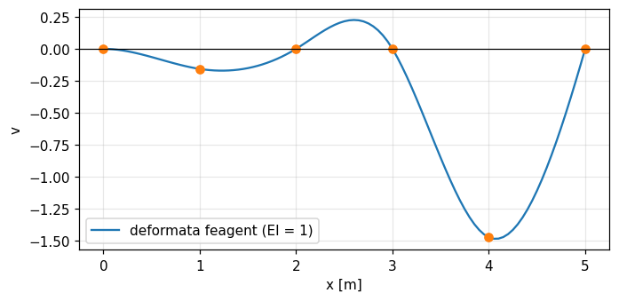

| Grandezza | Rif. | Riferimento | feagent | Scarto | |
|---|---|---|---|---|---|
| v2 [m (EI=1)] | libro | -0.157 | -0.15697 | 0.02 % | ✅ |
| theta2 [rad (EI=1)] | libro | -0.1153 | -0.1153 | 0.00 % | ✅ |
| theta3 [rad (EI=1)] | libro | 0.4612 | 0.46121 | 0.00 % | ✅ |
| theta4 [rad (EI=1)] | libro | -1.2586 | -1.2586 | 0.00 % | ✅ |
| v5 [m (EI=1)] | libro | -1.472 | -1.472 | 0.00 % | ✅ |
| theta5 [rad (EI=1)] | libro | -0.3427 | -0.34267 | 0.01 % | ✅ |
| theta6 [rad (EI=1)] | libro | 2.6293 | 2.6293 | 0.00 % | ✅ |
| reazione in A [kN] | libro | 1.1918 | 1.1918 | 0.00 % | ✅ |
| momento d'incastro in A [kNm] | libro | 0.7112 | 0.71121 | 0.00 % | ✅ |
| reazione in B (verso il basso) [kN] | libro | 4.9763 | 4.9763 | 0.00 % | ✅ |
| reazione in C al netto della forza nodale equivalente [kN] | libro | 12.841 | 12.841 | 0.00 % | ✅ |
| reazione in D al netto della forza nodale equivalente [kN] | libro | 3.944 | 3.944 | 0.00 % | ✅ |

**Note**: Le Eq. 4.136 scrivono i carichi in N, ma gli spostamenti stampati corrispondono ai carichi in kN con EI = 1. Nella Fig. 4.21 le reazioni in C e D (12,8405 e 3,944) sono quelle del sistema discreto, al netto delle forze nodali equivalenti di 6 kN del carico distribuito: le reazioni vere sono 18,8405 e 9,944 kN. In B la reazione (4,9763 kN) e' diretta verso il basso.

*Codice*: `validation/books/seshu/ch04.py`

<a id="seshu-ex-4-8"></a>

### Example 4.8 - Telaio: mensola d'acciaio sostenuta da un tirante incernierato

✅ · pag. PDF 137 · frame, truss

Trave d'acciaio orizzontale di 3 m (A = 2000 mm², I = 1e6 mm^4) incastrata al muro e sostenuta all'estremo da un tondo d = 20 mm lungo 5 m, incernierato al muro 4 m piu' in alto; 10 kN all'estremo. Spostamenti e rotazioni del nodo caricato e del tirante.

**Modello**: Modello feagent (N, mm): trave 1-2 e tondo 3-4 come travi piane; il nodo 4 coincide col 2 con le sole traslazioni uguali (add_equal_dof), come la cerniera del libro; incastro in 1, cerniera in 3.

| Grandezza | Rif. | Riferimento | feagent | Scarto | |
|---|---|---|---|---|---|
| u2 (stampato -0,12) [mm] | corretto | -0.056019 | -0.05609 | 0.13 % | ✅ |
| v2 verso il basso (stampato 2,564) [mm] | corretto | 1.282 | 1.2819 | 0.01 % | ✅ |
| theta2 (stampato 0,0013) [rad] | corretto | 6.3861e-04 | 6.4096e-04 | 0.37 % | ✅ |
| theta3 (stampato 3,26e-4) [rad] | corretto | 1.6242e-04 | 1.6280e-04 | 0.24 % | ✅ |
| theta4 (stampato 3,26e-4) [rad] | corretto | 1.6242e-04 | 1.6280e-04 | 0.24 % | ✅ |

**Note**: Errore del libro: la soluzione stampata (u2 = -0,12 mm, v2 = 2,564 mm, theta2 = 0,0013, theta3 = theta4 = 3,26e-4) e' circa il doppio di quella del sistema ridotto stampato nella stessa pagina (Eq. 4.148), che risolto da' u2 = -0,0560 mm, v2 = 1,282 mm, theta2 = 6,39e-4, theta3 = theta4 = 1,62e-4 rad; lo stesso risultato si ottiene a mano (rigidezza verticale del nodo circa 7800 N/mm). Si confronta con la soluzione dell'Eq. 4.148.

*Codice*: `validation/books/seshu/ch04.py`

<a id="seshu-ex-4-9"></a>

### Example 4.9 - Trave appoggiata con carico assiale e trasversale (2 elementi telaio)

✅ · pag. PDF 140 · frame, buckling

Trave appoggiata compressa da Pa e caricata in mezzeria da Pt. L'elemento di telaio lineare non accoppia sforzo assiale e flessione: la freccia resta Pt L^3/(48 EI) qualunque sia Pa, mentre la soluzione esatta della trave-colonna e' Pt L^3/(48 EI) 3 (tan b - b)/b^3 con b = sqrt(Pa L^2/(4 EI)).

**Modello**: Modello feagent: 2 e 8 travi piane (EI = AE = 1, L = 2); analisi lineare (Model.solve) e del secondo ordine con la rigidezza geometrica (Model.solve_pdelta).

| Grandezza | Rif. | Riferimento | feagent | Scarto | |
|---|---|---|---|---|---|
| freccia lineare (indipendente da Pa) | libro | 0.16667 | 0.16667 | 0.00 % | ✅ |
| accorciamento assiale | libro | 1 | 1 | 0.00 % | ✅ |
| freccia del secondo ordine, 2 elementi | esatta | 0.20846 | 0.20839 | 0.03 % | ✅ |
| freccia del secondo ordine, 8 elementi | esatta | 0.20846 | 0.20846 | 0.00 % | ✅ |

**Note**: Valori di prova Pa = 0,5 e Pt = 1 (Pa/Pcr = 0,2). L'analisi P-Delta di feagent aggiunge l'accoppiamento che manca all'elemento lineare e riproduce la soluzione esatta.

*Codice*: `validation/books/seshu/ch04.py`

## Capitolo 5

<a id="seshu-ex-5-1"></a>

### Example 5.1 - Lastra sottile in trazione con due triangoli CST

✅ · pag. PDF 183 · plane_stress

Lastra 4 x 3 cm spessa 1 cm (E = 2e7 N/cm², nu = 0,3) tirata da 1 N/cm sul lato destro. Con due CST si ottiene lo stato di tensione uniforme esatto: u3 = u4 = 2e-7 cm, v2 = v4 = -4,5e-8 cm, eps_x = 5e-8, eps_y = -1,5e-8; si confrontano anche alcuni termini della matrice di rigidezza dell'elemento 1.

**Modello**: Modello feagent: due elementi piani T3 in tensione piana (nodi 1-3-2 e 3-4-2), u1 = v1 = u2 = 0, 1,5 N ai nodi 3 e 4.

| Grandezza | Rif. | Riferimento | feagent | Scarto | |
|---|---|---|---|---|---|
| u3 [cm] | libro | 2.0000e-07 | 2.0000e-07 | 0.00 % | ✅ |
| u4 [cm] | libro | 2.0000e-07 | 2.0000e-07 | 0.00 % | ✅ |
| v2 [cm] | libro | -4.5000e-08 | -4.5000e-08 | 0.00 % | ✅ |
| v4 [cm] | libro | -4.5000e-08 | -4.5000e-08 | 0.00 % | ✅ |
| v3 [cm] | libro | 0 | -4.4316e-23 | 0.00 % | ✅ |
| eps_x | libro | 5.0000e-08 | 5.0000e-08 | 0.00 % | ✅ |
| eps_y | libro | -1.5000e-08 | -1.5000e-08 | 0.00 % | ✅ |
| rigidezza k(u1,u1), elemento 1 [1e7 N/cm] | libro | 1.34 | 1.337 | 0.22 % | ✅ |
| rigidezza k(v1,v1), elemento 1 [1e7 N/cm] | libro | 1.75 | 1.7537 | 0.21 % | ✅ |
| rigidezza k(u3,u3), elemento 1 [1e7 N/cm] | libro | 0.824 | 0.82418 | 0.02 % | ✅ |
| rigidezza k(v3,v3), elemento 1 [1e7 N/cm] | libro | 0.288 | 0.28846 | 0.16 % | ✅ |
| rigidezza k(u2,u2), elemento 1 [1e7 N/cm] | libro | 0.513 | 0.51282 | 0.03 % | ✅ |
| rigidezza k(v2,v2), elemento 1 [1e7 N/cm] | libro | 1.47 | 1.4652 | 0.33 % | ✅ |

**Note**: Esponenti degli spostamenti ricostruiti dalla pagina (OCR incerto).

*Codice*: `validation/books/seshu/ch05.py`

<a id="seshu-ex-5-2"></a>

### Example 5.2 - Integrazione di Gauss di un polinomio

📐 · pag. PDF 209 · other

Integrale di 2 + x + x^2 su [-1, 1]: la regola a un punto da' 4, quella a due punti 4,6667, esatta perche' integra esattamente i polinomi fino al terzo grado.

**Modello**: Regole di Gauss-Legendre di feagent (feagent.solid._gl, le stesse usate dagli elementi) a 1 e 2 punti.

| Grandezza | Rif. | Riferimento | feagent | Scarto | |
|---|---|---|---|---|---|
| Gauss a 1 punti | libro | 4 | 4 | 0.00 % | ✅ |
| Gauss a 2 punti | libro | 4.6667 | 4.6667 | 0.00 % | ✅ |
| integrale esatto | esatta | 4.6667 | 4.6667 | 0.00 % | ✅ |

*Codice*: `validation/books/seshu/ch05.py`

<a id="seshu-ex-5-3"></a>

### Example 5.3 - Integrazione di Gauss di cos(pi x/2)

📐 · pag. PDF 210 · other

Integrale di cos(pi x/2) su [-1, 1] (esatto 4/pi = 1,273239544) con 1, 2, 3 e 4 punti di Gauss: 2; 1,232381; 1,274123754; 1,273229508.

**Modello**: Regole di Gauss-Legendre di feagent (feagent.solid._gl) da 1 a 4 punti.

| Grandezza | Rif. | Riferimento | feagent | Scarto | |
|---|---|---|---|---|---|
| Gauss a 1 punti | libro | 2 | 2 | 0.00 % | ✅ |
| Gauss a 2 punti | libro | 1.2324 | 1.2324 | 0.00 % | ✅ |
| Gauss a 3 punti | libro | 1.2741 | 1.2741 | 0.00 % | ✅ |
| Gauss a 4 punti | libro | 1.2732 | 1.2732 | 0.00 % | ✅ |
| integrale esatto | esatta | 1.2732 | 1.2732 | 0.00 % | ✅ |

*Codice*: `validation/books/seshu/ch05.py`

<a id="seshu-ex-5-4"></a>

### Example 5.4 - La lastra dell'Es. 5.1 con un elemento rettangolare bilineare

✅ · pag. PDF 220 · plane_stress

Stessa lastra dell'Es. 5.1 con un solo quadrilatero bilineare: Jacobiano costante diag(2; 1,5) con |J| = 3, matrice di rigidezza 8x8 (Eq. 5.255) e gli stessi spostamenti dei due CST.

**Modello**: Modello feagent: un elemento PlaneQ4 in tensione piana con integrazione 2x2, u1 = v1 = u4 = 0, 1,5 N ai nodi 2 e 3.

| Grandezza | Rif. | Riferimento | feagent | Scarto | |
|---|---|---|---|---|---|
| J11 | libro | 2 | 2 | 0.00 % | ✅ |
| J22 | libro | 1.5 | 1.5 | 0.00 % | ✅ |
| |J| | libro | 3 | 3 | 0.00 % | ✅ |
| k(u1,u1) [1e7 N/cm] | libro | 0.891 | 0.89133 | 0.04 % | ✅ |
| k(u1,v1) [1e7 N/cm] | libro | 0.357 | 0.35714 | 0.04 % | ✅ |
| k(v1,v1) [1e7 N/cm] | libro | 1.17 | 1.1691 | 0.08 % | ✅ |
| k(u1,u2) [1e7 N/cm] | libro | -0.379 | -0.37851 | 0.13 % | ✅ |
| k(u1,u3) [1e7 N/cm] | libro | -0.446 | -0.44567 | 0.08 % | ✅ |
| u2 [cm] | libro | 2.0000e-07 | 2.0000e-07 | 0.00 % | ✅ |
| u3 [cm] | libro | 2.0000e-07 | 2.0000e-07 | 0.00 % | ✅ |
| v2 [cm] | libro | 0 | 2.3269e-23 | 0.00 % | ✅ |
| v3 [cm] | libro | -4.5000e-08 | -4.5000e-08 | 0.00 % | ✅ |
| v4 [cm] | libro | -4.5000e-08 | -4.5000e-08 | 0.00 % | ✅ |

*Codice*: `validation/books/seshu/ch05.py`

<a id="seshu-ex-5-5"></a>

### Example 5.5 - Jacobiano di un quadrilatero regolare e distorto

📐 · pag. PDF 222 · plane_stress

Quadrilatero a rombo (-1,0), (0,-1), (1,0), (0,1): |J| = 0,5 in tutti i punti di Gauss, somma 2 = area. Spostando il primo nodo in (0,5; 0) l'elemento diventa concavo: |J| = -0,0915; 0,125; 0,125; 0,3415 (somma 0,5 = area) e il primo punto di Gauss cade fuori dall'elemento, in (0,35566; 0).

**Modello**: Funzioni di forma e derivate dell'elemento PlaneQ4 di feagent (shape, dshape, jacobian) nei 2x2 punti di Gauss; controllo che feagent rifiuti l'elemento con Jacobiano di segno variabile.

| Grandezza | Rif. | Riferimento | feagent | Scarto | |
|---|---|---|---|---|---|
| |J| minimo, elemento regolare | libro | 0.5 | 0.5 | 0.00 % | ✅ |
| somma dei |J| = area | libro | 2 | 2 | 0.00 % | ✅ |
| |J| distorto in (-0.577, -0.577) | libro | -0.0915 | -0.091506 | 0.01 % | ✅ |
| |J| distorto in (-0.577, +0.577) | libro | 0.125 | 0.125 | 0.00 % | ✅ |
| |J| distorto in (+0.577, -0.577) | libro | 0.125 | 0.125 | 0.00 % | ✅ |
| |J| distorto in (+0.577, +0.577) | libro | 0.3415 | 0.34151 | 0.00 % | ✅ |
| somma dei |J| = area | libro | 0.5 | 0.5 | 0.00 % | ✅ |
| x del primo punto di Gauss mappato | libro | 0.35566 | 0.35566 | 0.00 % | ✅ |
| feagent rifiuta l'elemento distorto (1 = si') | libro | 1 | 1 | 0.00 % | ✅ |

**Note**: Per l'elemento distorto il Jacobiano e' calcolato con le funzioni di forma del Q4 di feagent applicate alle coordinate distorte, perche' feagent (correttamente) non accetta l'elemento: Model.add_plane solleva un errore di Jacobiano di segno variabile.

*Codice*: `validation/books/seshu/ch05.py`

<a id="seshu-ex-5-6"></a>

### Example 5.6 + Tabelle 5.3-5.4 - Mensola modellata con elementi piani Q4 e Q8

✅ · pag. PDF 225 · plane_stress

Mensola caricata in punta da 100 N (freccia teorica PL^3/(3EI) = 0,02 cm, rotazione 0,003): il Q4 e' troppo rigido a flessione (taglio parassita) e anche con 40 elementi sbaglia del 10 %; il Q8 arriva al 3 % con due elementi.

**Modello**: Modello feagent: mensola 10 x 1 cm in tensione piana, mesh di PlaneQ4 (1, 5x1, 5x2, 10x1, 20x1, 40x1) con integrazione piena e di PlaneQ8 (1, 2x1) con integrazione 2x2; taglio in punta con forze consistenti; rotazione dalla differenza degli spostamenti orizzontali di punta.

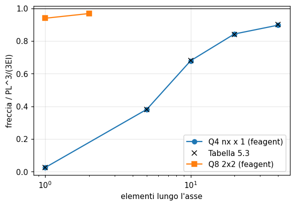

| Grandezza | Rif. | Riferimento | feagent | Scarto | |
|---|---|---|---|---|---|
| freccia teorica con EI = 0,1667e7 [cm] | esatta | 0.02 | 0.02 | 0.00 % | ✅ |
| Q4 1x1, freccia [cm] | libro | 5.1000e-04 | 5.0917e-04 | 0.16 % | ✅ |
| Q4 1x1, rotazione | libro | 7.6000e-05 | 7.5833e-05 | 0.22 % | ✅ |
| Q4 5x1, freccia [cm] | libro | 0.0076 | 0.0076375 | 0.49 % | ✅ |
| Q4 5x1, rotazione | libro | 0.00114 | 0.0011375 | 0.22 % | ✅ |
| Q4 5x2, freccia [cm] | libro | 0.0078 | 0.0078183 | 0.23 % | ✅ |
| Q4 5x2, rotazione | libro | 0.00117 | 0.0011668 | 0.28 % | ✅ |
| Q4 10x1, freccia [cm] | libro | 0.0136 | 0.013578 | 0.16 % | ✅ |
| Q4 10x1, rotazione | libro | 0.002 | 0.0020222 | 1.11 % | ✅ |
| Q4 20x1, freccia [cm] | libro | 0.0168 | 0.016855 | 0.33 % | ✅ |
| Q4 20x1, rotazione | libro | 0.0025 | 0.0025103 | 0.41 % | ✅ |
| Q4 40x1, freccia [cm] | libro | 0.018 | 0.017938 | 0.35 % | ✅ |
| Q4 40x1, rotazione | libro | 0.0027 | 0.0026716 | 1.05 % | ✅ |
| Q8 1x1, freccia [cm] | libro | 0.0188 | 0.018784 | 0.09 % | ✅ |
| Q8 1x1, rotazione | libro | 0.00287 | 0.002865 | 0.17 % | ✅ |
| Q8 2x1, freccia [cm] | libro | 0.0194 | 0.019357 | 0.22 % | ✅ |
| Q8 2x1, rotazione | libro | 0.0029 | 0.0029229 | 0.79 % | ✅ |

**Note**: Errore del libro: EI e' stampato 0,1667e10 N cm², ma con E = 2e7 N/cm² e sezione 1 x 1 cm vale 0,1667e7, l'unico valore coerente con 0,02 cm e 0,003. nu non e' dichiarato: nu = 0,3 (come negli Es. 5.1 e 5.4) riproduce la Tabella 5.3. La Tabella 5.4 del Q8 torna con l'integrazione ridotta 2x2 (la stessa del Q4 dell'Es. 5.4); con l'integrazione piena 3x3 il Q8 a un elemento da' 0,0153 cm.

*Codice*: `validation/books/seshu/ch05.py`

<a id="seshu-ex-5-7"></a>

### Example 5.7 (Fig. 5.42) - Concentrazione di tensione attorno a un foro circolare

🟡 · pag. PDF 227 · plane_stress

Lastra con foro circolare tesa in una direzione: per la lastra infinita il fattore di concentrazione al bordo del foro e' 3. Il libro, con una mesh 10 x 15 su un quarto, trova 2,813 con i Q4 e 2,795 con i Q9 e mostra che le tensioni nodali dei Q9 sono molto piu' continue fra elementi adiacenti.

**Modello**: Modello feagent: quarto di lastra quadrata (lato 2W = 40a) con foro di raggio a, mesh 10 (radiale, progressione geometrica) x 16 (circonferenziale) di PlaneQ4 e di PlaneQ9, vincoli di simmetria, trazione uniforme sul lato x = W (add_solid_surface_load); controllo con una mesh 20 x 32 di Q9.

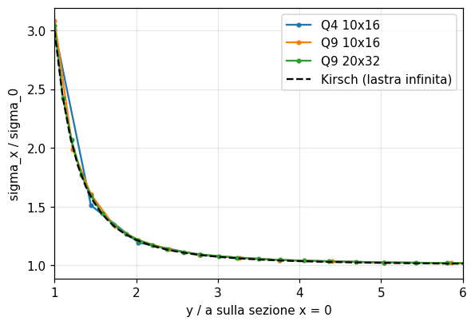

| Grandezza | Rif. | Riferimento | feagent | Scarto | |
|---|---|---|---|---|---|
| risultante della trazione (sigma0 W) [N] | libro | 20 | 20 | 0.00 % | ✅ |
| Kt al foro, Q4 10x16 (libro 2,813 con la sua mesh) | libro | - | 3.0105 | - | ✅ |
| Kt al foro, Q9 10x16 (libro 2,795 con la sua mesh) | libro | - | 3.0853 | - | ✅ |
| salto relativo di sigma_x al secondo nodo, Q4 (libro 2,12 e 1,70) | libro | - | 0.061161 | - | ✅ |
| salto relativo di sigma_x al secondo nodo, Q9 (libro 1,727 e 1,720) | libro | - | 0.020255 | - | ✅ |
| salto Q9 minore del salto Q4 (1 = si') | libro | 1 | 1 | 0.00 % | ✅ |
| Kt al foro, Q9 20x32 (media nodale) | esatta | 3 | 3.0444 | 1.48 % | ✅ |

**Note**: Il libro non da' ne' le dimensioni della lastra e del foro ne' il materiale ne' la gradazione della mesh: la geometria (W = 20a, ragione radiale 1,3) e' ricostruita per ipotesi e 16 divisioni circonferenziali al posto di 15 mettono un nodo sullo spigolo. Con questa mesh il Kt dipende molto dalla gradazione e dal modo di valutare la tensione al nodo (valore nel nodo, punti di Gauss, estrapolazione): i valori della mesh grossa sono quindi riportati senza confronto, col valore del libro nell'etichetta. I controlli quantitativi sono la mesh 20 x 32 di Q9 contro Kt = 3 (larghezza finita: circa +0,3 %) e la tesi del libro sulla continuita' delle tensioni nodali: al secondo nodo della sezione il salto fra elementi adiacenti dei Q9 e' minore di quello dei Q4 (qui circa un terzo).

*Codice*: `validation/books/seshu/ch05.py`

<a id="seshu-sec-5-8-flow"></a>

### Sezione 5.8 (Fig. 5.43-5.46) - Moto a potenziale attorno a un cilindro fra pareti (funzione di corrente)

🟡 · pag. PDF 230 · potential_flow

Moto irrotazionale di un fluido ideale attorno a un cilindro fra due pareti, risolto con la funzione di corrente. Sulla sommita' del cilindro la velocita' normalizzata vale 2 per il cilindro isolato; il libro trova 1,7878 con i Q4 e 2,012 con i Q9.

**Modello**: Modello feagent: FieldModel('stream') sul quarto ABCDE (raggio a, H = L = 20a), mesh 10 x 16 di Q4 e di Q9 come nell'Es. 5.7, psi = 0 sul cilindro e sull'asse, psi = V0 H sulla parete, psi = V0 y all'ingresso, condizione naturale sulla sezione del cilindro; controllo con 20 x 32 Q9.

| Grandezza | Rif. | Riferimento | feagent | Scarto | |
|---|---|---|---|---|---|
| u/V0 in C, Q4 10x16 (libro 1,7878 con la sua mesh) | libro | - | 1.6876 | - | ✅ |
| u/V0 in C, Q9 10x16 (libro 2,012 con la sua mesh) | libro | - | 1.9457 | - | ✅ |
| Q9 piu' vicino del Q4 alla velocita' esatta (1 = si') | libro | 1 | 1 | 0.00 % | ✅ |
| u/V0 in C, Q9 20x32 (media nodale) | esatta | 2 | 1.9876 | 0.62 % | ✅ |

**Note**: Dimensioni non date nel libro: H = L = 20a per ipotesi, cosi' che il bloccaggio delle pareti sia trascurabile (velocita' esatta circa 2,00). Con la mesh grossa il valore dipende molto dalla gradazione e da dove si valuta il gradiente: i valori sono riportati senza confronto, col valore del libro nell'etichetta. I controlli quantitativi sono la mesh 20 x 32 di Q9 contro 2 e il miglioramento del Q9 rispetto al Q4 (raffinamento p).

*Codice*: `validation/books/seshu/ch05.py`

## Capitolo 6

<a id="seshu-ex-6-1"></a>

### Example 6.1 - Equazioni di Lagrange per un sistema a due masse e tre molle

📐 · pag. PDF 251 · spring, dynamics_modal

Dalle energie cinetica e potenziale il libro ricava M = diag(m1, m2) e K = [[k1 + k2, -k2], [-k2, k2 + k3]]. Si confrontano le matrici assemblate da feagent e le pulsazioni proprie.

**Modello**: Modello feagent: due nodi con massa (add_nodal_mass) collegati fra loro e a terra da tre molle assiali (add_spring); matrici da assemble_stiffness e assemble_mass.

| Grandezza | Rif. | Riferimento | feagent | Scarto | |
|---|---|---|---|---|---|
| scarto massimo della matrice di rigidezza [N/m] | libro | 0 | 0 | 0.00 % | ✅ |
| massa del GdL 1 [kg] | libro | 2 | 2 | 0.00 % | ✅ |
| massa del GdL 2 [kg] | libro | 1 | 1 | 0.00 % | ✅ |
| prima pulsazione [rad/s] | esatta | 26.101 | 26.101 | 0.00 % | ✅ |
| seconda pulsazione [rad/s] | esatta | 50.683 | 50.683 | 0.00 % | ✅ |

**Note**: Esempio simbolico: m1 = 2, m2 = 1 kg, k1 = 1000, k2 = 500, k3 = 2000 N/m.

*Codice*: `validation/books/seshu/ch06.py`

<a id="seshu-ex-6-2"></a>

### Example 6.2 + Tabella 6.1 - Frequenze assiali di un'asta incastrata-libera: massa concentrata e consistente

✅ · pag. PDF 258 · bar, dynamics_modal

Asta d'acciaio incastrata-libera lunga 1 m: con un elemento la massa concentrata da' 1,414 sqrt(E/rho)/L, la consistente 1,732, l'esatta 1,571; con due elementi 1,531 e 3,695 (concentrata), 1,611 e 5,63 (consistente). La Tabella 6.1 mostra la convergenza delle prime cinque frequenze: la massa concentrata le sottostima, quella consistente le sovrastima.

**Modello**: Modello feagent: 1, 2, 3, 4, 8 e 16 barre L2 (rho = 7800 kg/m³), analisi modale con massa concentrata (mass='lumped') e consistente (mass='consistent').

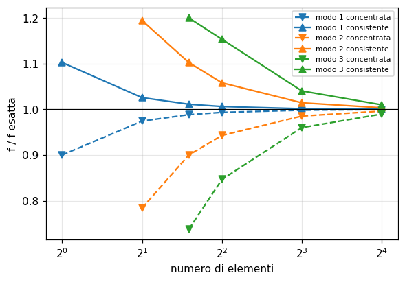

| Grandezza | Rif. | Riferimento | feagent | Scarto | |
|---|---|---|---|---|---|
| modo 1, concentrata, 1 el. [Hz] | libro | 1140 | 1139.7 | 0.02 % | ✅ |
| modo 1, concentrata, 2 el. [Hz] | libro | 1234 | 1233.6 | 0.03 % | ✅ |
| modo 2, concentrata, 2 el. [Hz] | libro | 2978 | 2978.3 | 0.01 % | ✅ |
| modo 1, concentrata, 3 el. [Hz] | libro | 1252 | 1251.5 | 0.04 % | ✅ |
| modo 2, concentrata, 3 el. [Hz] | libro | 3420 | 3419.2 | 0.02 % | ✅ |
| modo 3, concentrata, 3 el. [Hz] | libro | 4670 | 4670.7 | 0.02 % | ✅ |
| modo 1, concentrata, 4 el. [Hz] | libro | 1258 | 1257.8 | 0.02 % | ✅ |
| modo 2, concentrata, 4 el. [Hz] | libro | 3582 | 3581.9 | 0.00 % | ✅ |
| modo 3, concentrata, 4 el. [Hz] | libro | 5366 | 5360.7 | 0.10 % | ✅ |
| modo 4, concentrata, 4 el. [Hz] | libro | 6319 | 6323.4 | 0.07 % | ✅ |
| modo 1, concentrata, 8 el. [Hz] | libro | 1264 | 1263.9 | 0.01 % | ✅ |
| modo 2, concentrata, 8 el. [Hz] | libro | 3743 | 3743.1 | 0.00 % | ✅ |
| modo 3, concentrata, 8 el. [Hz] | libro | 6078 | 6078.5 | 0.01 % | ✅ |
| modo 4, concentrata, 8 el. [Hz] | libro | 8180 | 8180.2 | 0.00 % | ✅ |
| modo 5, concentrata, 8 el. [Hz] | libro | 10000 | 9967.7 | 0.32 % | ✅ |
| modo 1, concentrata, 16 el. [Hz] | libro | 1265 | 1265.4 | 0.03 % | ✅ |
| modo 2, concentrata, 16 el. [Hz] | libro | 3784 | 3784.1 | 0.00 % | ✅ |
| modo 3, concentrata, 16 el. [Hz] | libro | 6266 | 6266.3 | 0.00 % | ✅ |
| modo 4, concentrata, 16 el. [Hz] | libro | 8688 | 8688.1 | 0.00 % | ✅ |
| modo 5, concentrata, 16 el. [Hz] | libro | 11030 | 11026 | 0.03 % | ✅ |
| modo 1, consistente, 1 el. [Hz] | libro | 1396 | 1395.9 | 0.01 % | ✅ |
| modo 1, consistente, 2 el. [Hz] | libro | 1299 | 1298.7 | 0.03 % | ✅ |
| modo 2, consistente, 2 el. [Hz] | libro | 4537 | 4536.7 | 0.01 % | ✅ |
| modo 1, consistente, 3 el. [Hz] | libro | 1280 | 1280.4 | 0.03 % | ✅ |
| modo 2, consistente, 3 el. [Hz] | libro | 4188 | 4187.6 | 0.01 % | ✅ |
| modo 3, consistente, 3 el. [Hz] | libro | 7597 | 7597 | 0.00 % | ✅ |
| modo 1, consistente, 4 el. [Hz] | libro | 1274 | 1274.1 | 0.01 % | ✅ |
| modo 2, consistente, 4 el. [Hz] | libro | 4019 | 4019.2 | 0.01 % | ✅ |
| modo 3, consistente, 4 el. [Hz] | libro | 7301 | 7301.1 | 0.00 % | ✅ |
| modo 4, consistente, 4 el. [Hz] | libro | 10560 | 10558 | 0.02 % | ✅ |
| modo 1, consistente, 8 el. [Hz] | libro | 1268 | 1268 | 0.00 % | ✅ |
| modo 2, consistente, 8 el. [Hz] | libro | 3853 | 3852.9 | 0.00 % | ✅ |
| modo 3, consistente, 8 el. [Hz] | libro | 6586 | 6585.8 | 0.00 % | ✅ |
| modo 4, consistente, 8 el. [Hz] | libro | 9563 | 9563.1 | 0.00 % | ✅ |
| modo 5, consistente, 8 el. [Hz] | libro | 12850 | 12851 | 0.01 % | ✅ |
| modo 1, consistente, 16 el. [Hz] | libro | 1266 | 1266.4 | 0.03 % | ✅ |
| modo 2, consistente, 16 el. [Hz] | libro | 3812 | 3811.5 | 0.01 % | ✅ |
| modo 3, consistente, 16 el. [Hz] | libro | 6393 | 6393.3 | 0.01 % | ✅ |
| modo 4, consistente, 16 el. [Hz] | libro | 9037 | 9036.7 | 0.00 % | ✅ |
| modo 5, consistente, 16 el. [Hz] | libro | 11770 | 11767 | 0.03 % | ✅ |
| omega L/sqrt(E/rho), lumped, 1 el., modo 1 | libro | 1.414 | 1.4142 | 0.02 % | ✅ |
| omega L/sqrt(E/rho), consistent, 1 el., modo 1 | libro | 1.732 | 1.7321 | 0.00 % | ✅ |
| omega L/sqrt(E/rho), lumped, 2 el., modo 1 | libro | 1.531 | 1.5307 | 0.02 % | ✅ |
| omega L/sqrt(E/rho), lumped, 2 el., modo 2 | libro | 3.695 | 3.6955 | 0.01 % | ✅ |
| omega L/sqrt(E/rho), consistent, 2 el., modo 1 | libro | 1.611 | 1.6114 | 0.03 % | ✅ |
| omega L/sqrt(E/rho), consistent, 2 el., modo 2 | libro | 5.63 | 5.6293 | 0.01 % | ✅ |
| frequenza esatta modo 1 [Hz] | esatta | 1265.9 | 1265.9 | 0.00 % | ✅ |
| frequenza esatta modo 2 [Hz] | esatta | 3797.8 | 3797.8 | 0.00 % | ✅ |
| frequenza esatta modo 3 [Hz] | esatta | 6329.6 | 6329.6 | 0.00 % | ✅ |
| frequenza esatta modo 4 [Hz] | esatta | 8861.5 | 8861.5 | 0.00 % | ✅ |
| frequenza esatta modo 5 [Hz] | esatta | 11393 | 11393 | 0.00 % | ✅ |

**Note**: La Tabella 6.1 riporta le frequenze arrotondate al Hz, tranne il quinto modo a 8 elementi con massa concentrata, stampato 10000 Hz: il valore calcolato e' 9967,7 Hz (lo stesso della formula chiusa della catena di masse e molle), confrontato allo 0,4 %.

*Codice*: `validation/books/seshu/ch06.py`

<a id="seshu-ex-6-3"></a>

### Example 6.3 + Tabella 6.2 - Frequenze di una trave appoggiata: massa concentrata semplice, HRZ e consistente

✅ · pag. PDF 261 · beam, dynamics_modal

Trave d'acciaio appoggiata lunga 1 m con I = 100 mm^4: prime cinque frequenze flessionali con tre matrici di massa. La concentrata semplice, priva di inerzia rotazionale, da' meno modi; HRZ e consistente danno tutti i modi. Esatte: 14,52, 58,11, 130,75, 232,45, 363,2 Hz.

**Modello**: Modello feagent: 2, 4, 8 e 16 travi di Eulero-Bernoulli appoggiate; modale con massa concentrata (solo traslazionale) e consistente; massa HRZ costruita con numpy dalle matrici consistenti degli elementi di feagent.

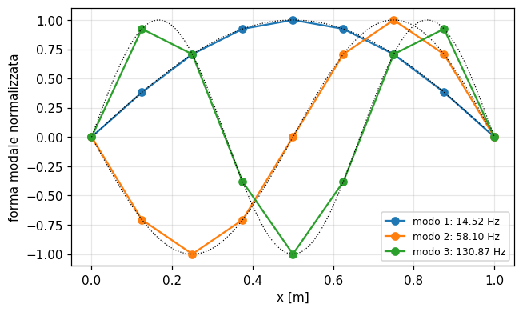

| Grandezza | Rif. | Riferimento | feagent | Scarto | |
|---|---|---|---|---|---|
| frequenza esatta modo 1 (A = 30 mm²) [Hz] | esatta | 14.52 | 14.522 | 0.01 % | ✅ |
| frequenza esatta modo 2 (A = 30 mm²) [Hz] | esatta | 58.11 | 58.088 | 0.04 % | ✅ |
| frequenza esatta modo 3 (A = 30 mm²) [Hz] | esatta | 130.75 | 130.7 | 0.04 % | ✅ |
| frequenza esatta modo 4 (A = 30 mm²) [Hz] | esatta | 232.45 | 232.35 | 0.04 % | ✅ |
| frequenza esatta modo 5 (A = 30 mm²) [Hz] | esatta | 363.2 | 363.05 | 0.04 % | ✅ |
| modo 1, lumped, 2 el. [Hz] | libro | 14.42 | 14.417 | 0.02 % | ✅ |
| modo 1, lumped, 4 el. [Hz] | libro | 14.52 | 14.518 | 0.02 % | ✅ |
| modo 2, lumped, 4 el. [Hz] | libro | 57.67 | 57.666 | 0.01 % | ✅ |
| modo 3, lumped, 4 el. [Hz] | libro | 122.4 | 122.44 | 0.03 % | ✅ |
| modo 1, lumped, 8 el. [Hz] | libro | 14.52 | 14.522 | 0.01 % | ✅ |
| modo 2, lumped, 8 el. [Hz] | libro | 58.07 | 58.07 | 0.00 % | ✅ |
| modo 3, lumped, 8 el. [Hz] | libro | 130.5 | 130.46 | 0.03 % | ✅ |
| modo 4, lumped, 8 el. [Hz] | libro | 230.7 | 230.67 | 0.01 % | ✅ |
| modo 5, lumped, 8 el. [Hz] | libro | 354.7 | 354.67 | 0.01 % | ✅ |
| modo 1, lumped, 16 el. [Hz] | libro | 14.52 | 14.522 | 0.01 % | ✅ |
| modo 2, lumped, 16 el. [Hz] | libro | 58.09 | 58.087 | 0.01 % | ✅ |
| modo 3, lumped, 16 el. [Hz] | libro | 130.7 | 130.69 | 0.01 % | ✅ |
| modo 4, lumped, 16 el. [Hz] | libro | 232.3 | 232.28 | 0.01 % | ✅ |
| modo 5, lumped, 16 el. [Hz] | libro | 362.8 | 362.76 | 0.01 % | ✅ |
| modo 1, consistent, 2 el. [Hz] | libro | 14.58 | 14.579 | 0.00 % | ✅ |
| modo 2, consistent, 2 el. [Hz] | libro | 64.47 | 64.473 | 0.00 % | ✅ |
| modo 3, consistent, 2 el. [Hz] | libro | 162.1 | 162.06 | 0.03 % | ✅ |
| modo 4, consistent, 2 el. [Hz] | libro | 295.5 | 295.45 | 0.02 % | ✅ |
| modo 1, consistent, 4 el. [Hz] | libro | 14.53 | 14.526 | 0.03 % | ✅ |
| modo 2, consistent, 4 el. [Hz] | libro | 58.32 | 58.317 | 0.00 % | ✅ |
| modo 3, consistent, 4 el. [Hz] | libro | 133.1 | 133.09 | 0.01 % | ✅ |
| modo 4, consistent, 4 el. [Hz] | libro | 257.9 | 257.89 | 0.00 % | ✅ |
| modo 5, consistent, 4 el. [Hz] | libro | 409.9 | 409.92 | 0.00 % | ✅ |
| modo 1, consistent, 8 el. [Hz] | libro | 14.52 | 14.522 | 0.02 % | ✅ |
| modo 2, consistent, 8 el. [Hz] | libro | 58.11 | 58.103 | 0.01 % | ✅ |
| modo 3, consistent, 8 el. [Hz] | libro | 130.9 | 130.87 | 0.03 % | ✅ |
| modo 4, consistent, 8 el. [Hz] | libro | 233.3 | 233.27 | 0.01 % | ✅ |
| modo 5, consistent, 8 el. [Hz] | libro | 366.4 | 366.42 | 0.00 % | ✅ |
| modo 1, consistent, 16 el. [Hz] | libro | 14.52 | 14.522 | 0.01 % | ✅ |
| modo 2, consistent, 16 el. [Hz] | libro | 58.09 | 58.089 | 0.00 % | ✅ |
| modo 3, consistent, 16 el. [Hz] | libro | 130.7 | 130.71 | 0.01 % | ✅ |
| modo 4, consistent, 16 el. [Hz] | libro | 232.4 | 232.41 | 0.01 % | ✅ |
| modo 5, consistent, 16 el. [Hz] | libro | 363.3 | 363.28 | 0.01 % | ✅ |
| modo 1, HRZ, 2 el. [Hz] | libro | 14.21 | 14.211 | 0.01 % | ✅ |
| modo 2, HRZ, 2 el. [Hz] | libro | 104.3 | 103.96 | 0.33 % | ✅ |
| modo 3, HRZ, 2 el. [Hz] | libro | 149.2 | 149.15 | 0.04 % | ✅ |
| modo 4, HRZ, 2 el. [Hz] | libro | 180 | 180.06 | 0.04 % | ✅ |
| modo 1, HRZ, 4 el. [Hz] | libro | 14.46 | 14.461 | 0.01 % | ✅ |
| modo 2, HRZ, 4 el. [Hz] | libro | 56.84 | 56.845 | 0.01 % | ✅ |
| modo 3, HRZ, 4 el. [Hz] | libro | 120.2 | 120.24 | 0.03 % | ✅ |
| modo 4, HRZ, 4 el. [Hz] | libro | 416.2 | 415.84 | 0.09 % | ✅ |
| modo 5, HRZ, 4 el. [Hz] | libro | 481.3 | 481.48 | 0.04 % | ✅ |
| modo 1, HRZ, 8 el. [Hz] | libro | 14.51 | 14.507 | 0.02 % | ✅ |
| modo 2, HRZ, 8 el. [Hz] | libro | 57.84 | 57.843 | 0.01 % | ✅ |
| modo 3, HRZ, 8 el. [Hz] | libro | 129.3 | 129.34 | 0.03 % | ✅ |
| modo 4, HRZ, 8 el. [Hz] | libro | 227.4 | 227.38 | 0.01 % | ✅ |
| modo 5, HRZ, 8 el. [Hz] | libro | 348 | 348 | 0.00 % | ✅ |
| modo 1, HRZ, 16 el. [Hz] | libro | 14.52 | 14.518 | 0.01 % | ✅ |
| modo 2, HRZ, 16 el. [Hz] | libro | 58.03 | 58.03 | 0.00 % | ✅ |
| modo 3, HRZ, 16 el. [Hz] | libro | 130.4 | 130.4 | 0.00 % | ✅ |
| modo 4, HRZ, 16 el. [Hz] | libro | 231.4 | 231.37 | 0.01 % | ✅ |
| modo 5, HRZ, 16 el. [Hz] | libro | 360.6 | 360.56 | 0.01 % | ✅ |
| modo 5, HRZ standard (m l^2/78), 64 el. [Hz] | esatta | 363.05 | 362.77 | 0.08 % | ✅ |

**Note**: Tre incongruenze del libro: (1) A e' stampata 30 cm², ma le frequenze tornano con A = 30 mm²; (2) l'intestazione della Tabella 6.2 indica 2, 3, 4 e 8 elementi, ma i valori corrispondono a 2, 4, 8 e 16 elementi (lo mostrano il numero di modi della massa concentrata e il confronto con feagent); (3) la riga HRZ torna con un'inerzia rotazionale nodale (m/2) l^2/78 = m l^2/156, la meta' di quella HRZ standard m l^2/78 indicata nel testo: si confronta con questa variante e si verifica a parte che la HRZ standard converge all'esatta. Il modo 2 a 2 elementi HRZ (104,3 stampato, 103,96 calcolato) e' confrontato allo 0,5 %.

*Codice*: `validation/books/seshu/ch06.py`

<a id="seshu-ex-6-4"></a>

### Example 6.4 - Autovalori dell'asta a 3 elementi col metodo di Jacobi generalizzato

✅ · pag. PDF 271 · bar, dynamics_modal

L'asta dell'Es. 6.2 con tre elementi: K = 1e8 [[0,36, -0,18, 0], ...] N/m e M = [[0,052, 0,013, 0], ...] kg. Il Jacobi generalizzato annulla a ogni rotazione lo stesso termine fuori diagonale di K e M e converge a 1280,43, 4187,64 e 7597 Hz con modi M-ortonormali.

**Modello**: Modello feagent: 3 barre L2, matrici K e M consistente ridotte ai GdL liberi (assemble_stiffness, assemble_mass_matrix); metodo di Jacobi generalizzato scritto con numpy; controllo con la modale di feagent.

| Grandezza | Rif. | Riferimento | feagent | Scarto | |
|---|---|---|---|---|---|
| scarto massimo di K [1e8 N/m] | libro | 0 | 3.7253e-17 | 0.00 % | ✅ |
| scarto massimo di M [kg] | libro | 0 | 2.0817e-17 | 0.00 % | ✅ |
| frequenza 1 [Hz] | libro | 1280.4 | 1280.4 | 0.00 % | ✅ |
| frequenza 2 [Hz] | libro | 4187.6 | 4187.6 | 0.00 % | ✅ |
| frequenza 3 [Hz] | libro | 7597 | 7597 | 0.00 % | ✅ |
| modo 1, componente 1 | libro | 1.5 | 1.4955 | 0.30 % | ✅ |
| modo 1, componente 2 | libro | 2.58 | 2.5903 | 0.40 % | ✅ |
| modo 1, componente 3 | libro | 3.01 | 2.9911 | 0.63 % | ✅ |
| modo 2, componente 1 | libro | -3.58 | -3.5806 | 0.02 % | ✅ |
| modo 2, componente 2 | libro | -0.005 | -3.4784e-17 | 100.00 % | ✅ |
| modo 2, componente 3 | libro | 3.59 | 3.5806 | 0.26 % | ✅ |
| modo 3, componente 1 | libro | 2.38 | 2.3776 | 0.10 % | ✅ |
| modo 3, componente 2 | libro | -4.13 | -4.1181 | 0.29 % | ✅ |
| modo 3, componente 3 | libro | 4.74 | 4.7552 | 0.32 % | ✅ |
| f3 dalla modale di feagent [Hz] | altro | 7597 | 7597 | 0.00 % | ✅ |

**Note**: I modi del libro sono stampati con tre cifre: confronto a 0,02 in valore assoluto.

*Codice*: `validation/books/seshu/ch06.py`

<a id="seshu-ex-6-5"></a>

### Example 6.5 - Stesso problema con l'iterazione simultanea dei vettori

✅ · pag. PDF 280 · bar, dynamics_modal

Le matrici dell'Es. 6.4 risolte iterando contemporaneamente tre vettori di prova resi M-ortonormali con la fattorizzazione di Cholesky. Dopo cinque iterazioni il libro ottiene 1280, 4188 e 7597 Hz e modi vicini a quelli di Jacobi.

**Modello**: Matrici K e M consistente dell'asta a 3 barre L2 di feagent; iterazione simultanea con ortonormalizzazione di Cholesky scritta con numpy, 5 iterazioni a partire dalla matrice identita'.

| Grandezza | Rif. | Riferimento | feagent | Scarto | |
|---|---|---|---|---|---|
| vettore ortonormalizzato, termine (1,1) | libro | 4.39 | 4.3853 | 0.11 % | ✅ |
| vettore ortonormalizzato, termine (3,3) | libro | 6.66 | 6.6617 | 0.03 % | ✅ |
| primo passo, termine (3,2) [1e-7] | libro | 0.343 | 0.34346 | 0.13 % | ✅ |
| frequenza 1 [Hz] | libro | 1280 | 1280.4 | 0.03 % | ✅ |
| frequenza 2 [Hz] | libro | 4188 | 4187.8 | 0.00 % | ✅ |
| frequenza 3 [Hz] | libro | 7597 | 7596.9 | 0.00 % | ✅ |
| modo 1, componente 1 | libro | 1.5 | 1.496 | 0.27 % | ✅ |
| modo 1, componente 2 | libro | 2.59 | 2.5903 | 0.01 % | ✅ |
| modo 1, componente 3 | libro | 2.99 | 2.9906 | 0.02 % | ✅ |
| modo 2, componente 1 | libro | -3.59 | -3.5956 | 0.16 % | ✅ |
| modo 2, componente 2 | libro | 0.008 | 0.026761 | 234.51 % | ✅ |
| modo 2, componente 3 | libro | 3.57 | 3.5504 | 0.55 % | ✅ |
| modo 3, componente 1 | libro | 2.37 | 2.3546 | 0.65 % | ✅ |
| modo 3, componente 2 | libro | -4.12 | -4.118 | 0.05 % | ✅ |
| modo 3, componente 3 | libro | 4.76 | 4.7781 | 0.38 % | ✅ |

**Note**: Dopo cinque iterazioni i vettori non sono ancora del tutto convergenti (il secondo modo ha 0,008 al posto di -0,005): si confrontano i vettori della quinta iterazione con quelli stampati (0,02 in valore assoluto) e il primo passo (Eq. 6.191 e 6.193).

*Codice*: `validation/books/seshu/ch06.py`

<a id="seshu-ex-6-6"></a>

### Example 6.6 - Risposta libera di un sistema a 2 GdL per sovrapposizione modale

✅ · pag. PDF 286 · spring, dynamics_transient

Sistema simmetrico a due masse con la prima spostata di 1 e rilasciata da ferma: pulsazioni sqrt(k/m) e sqrt(3k/m), x1 = (cos w1 t + cos w2 t)/2, x2 = (cos w1 t - cos w2 t)/2.

**Modello**: Modello feagent: due masse m e tre molle k (add_spring, add_nodal_mass); solve_time_history_modal con spostamento iniziale u0 e forzante nulla; controllo con l'integrazione diretta di Newmark (solve_time_history).

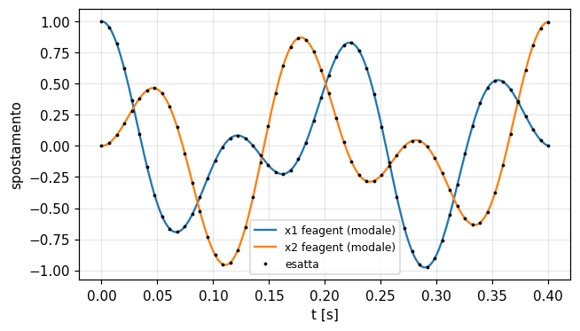

| Grandezza | Rif. | Riferimento | feagent | Scarto | |
|---|---|---|---|---|---|
| omega1 = sqrt(k/m) [rad/s] | esatta | 31.623 | 31.623 | 0.00 % | ✅ |
| omega2 = sqrt(3k/m) [rad/s] | esatta | 54.772 | 54.772 | 0.00 % | ✅ |
| x1 a t = 0.05 s, sovrapposizione modale | esatta | -0.46512 | -0.46512 | 0.00 % | ✅ |
| x2 a t = 0.05 s, sovrapposizione modale | esatta | 0.45478 | 0.45478 | 0.00 % | ✅ |
| x1 a t = 0.1 s, sovrapposizione modale | esatta | -0.15368 | -0.15368 | 0.00 % | ✅ |
| x2 a t = 0.1 s, sovrapposizione modale | esatta | -0.8461 | -0.8461 | 0.00 % | ✅ |
| x1 a t = 0.2 s, sovrapposizione modale | esatta | 0.47902 | 0.47902 | 0.00 % | ✅ |
| x2 a t = 0.2 s, sovrapposizione modale | esatta | 0.52013 | 0.52013 | 0.00 % | ✅ |
| x1 a t = 0.35 s, sovrapposizione modale | esatta | 0.51067 | 0.51067 | 0.00 % | ✅ |
| x2 a t = 0.35 s, sovrapposizione modale | esatta | -0.43834 | -0.43834 | 0.00 % | ✅ |
| x1 a t = 0,35 s, Newmark diretto | esatta | 0.51067 | 0.51069 | 0.00 % | ✅ |

**Note**: Esempio simbolico: k = 1000 N/m, m = 1 kg; risposta confrontata a t = 0,05, 0,1, 0,2 e 0,35 s.

*Codice*: `validation/books/seshu/ch06.py`

<a id="seshu-ex-6-7"></a>

### Example 6.7 + Tabella 6.3 - Transitorio termico nell'aletta (4 elementi, regola dei trapezi)

✅ · pag. PDF 301 · heat_transient

L'aletta inizialmente a 30 °C viene collegata a t = 0 alla parete a 300 °C. Il libro integra il sistema con la regola dei trapezi e passo di 1 s e riporta le temperature dei quattro nodi liberi nei primi 10 s (Tabella 6.3); a regime si ritrova la soluzione dell'Es. 4.10.

**Modello**: Modello feagent: l'aletta dell'Es. 4.10 (fin_model) con 4 elementi L2, rho = 2700 kg/m³, c = 900 J/kg°C; FieldModel.solve_transient con theta = 0,5 (Crank-Nicolson) e capacita' consistente, dt = 1 s.

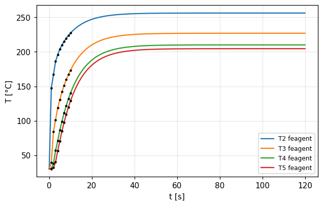

| Grandezza | Rif. | Riferimento | feagent | Scarto | |
|---|---|---|---|---|---|
| T2 a t = 1 s [°C] | libro | 147.58 | 147.58 | 0.00 % | ✅ |
| T3 a t = 1 s [°C] | libro | 39.23 | 39.23 | 0.00 % | ✅ |
| T4 a t = 1 s [°C] | libro | 30.73 | 30.729 | 0.00 % | ✅ |
| T5 a t = 1 s [°C] | libro | 30.11 | 30.114 | 0.01 % | ✅ |
| T2 a t = 2 s [°C] | libro | 166.95 | 166.95 | 0.00 % | ✅ |
| T3 a t = 2 s [°C] | libro | 84.25 | 84.251 | 0.00 % | ✅ |
| T4 a t = 2 s [°C] | libro | 37.76 | 37.761 | 0.00 % | ✅ |
| T5 a t = 2 s [°C] | libro | 31.74 | 31.741 | 0.00 % | ✅ |
| T2 a t = 3 s [°C] | libro | 186.34 | 186.34 | 0.00 % | ✅ |
| T3 a t = 3 s [°C] | libro | 101.46 | 101.46 | 0.00 % | ✅ |
| T4 a t = 3 s [°C] | libro | 57.04 | 57.044 | 0.01 % | ✅ |
| T5 a t = 3 s [°C] | libro | 39.91 | 39.914 | 0.01 % | ✅ |
| T2 a t = 4 s [°C] | libro | 195.88 | 195.88 | 0.00 % | ✅ |
| T3 a t = 4 s [°C] | libro | 118.83 | 118.83 | 0.00 % | ✅ |
| T4 a t = 4 s [°C] | libro | 70.77 | 70.772 | 0.00 % | ✅ |
| T5 a t = 4 s [°C] | libro | 56.61 | 56.613 | 0.01 % | ✅ |
| T2 a t = 5 s [°C] | libro | 204 | 204 | 0.00 % | ✅ |
| T3 a t = 5 s [°C] | libro | 130.8 | 130.8 | 0.00 % | ✅ |
| T4 a t = 5 s [°C] | libro | 86.35 | 86.354 | 0.00 % | ✅ |
| T5 a t = 5 s [°C] | libro | 70.57 | 70.573 | 0.00 % | ✅ |
| T2 a t = 6 s [°C] | libro | 209.98 | 209.98 | 0.00 % | ✅ |
| T3 a t = 6 s [°C] | libro | 141.96 | 141.96 | 0.00 % | ✅ |
| T4 a t = 6 s [°C] | libro | 99.23 | 99.225 | 0.00 % | ✅ |
| T5 a t = 6 s [°C] | libro | 85.13 | 85.132 | 0.00 % | ✅ |
| T2 a t = 7 s [°C] | libro | 215.3 | 215.3 | 0.00 % | ✅ |
| T3 a t = 7 s [°C] | libro | 151.21 | 151.21 | 0.00 % | ✅ |
| T4 a t = 7 s [°C] | libro | 111.43 | 111.43 | 0.00 % | ✅ |
| T5 a t = 7 s [°C] | libro | 97.73 | 97.729 | 0.00 % | ✅ |
| T2 a t = 8 s [°C] | libro | 219.81 | 219.81 | 0.00 % | ✅ |
| T3 a t = 8 s [°C] | libro | 159.6 | 159.6 | 0.00 % | ✅ |
| T4 a t = 8 s [°C] | libro | 122.06 | 122.06 | 0.00 % | ✅ |
| T5 a t = 8 s [°C] | libro | 109.4 | 109.4 | 0.00 % | ✅ |
| T2 a t = 9 s [°C] | libro | 223.84 | 223.84 | 0.00 % | ✅ |
| T3 a t = 9 s [°C] | libro | 166.93 | 166.93 | 0.00 % | ✅ |
| T4 a t = 9 s [°C] | libro | 131.69 | 131.69 | 0.00 % | ✅ |
| T5 a t = 9 s [°C] | libro | 119.69 | 119.69 | 0.00 % | ✅ |
| T2 a t = 10 s [°C] | libro | 227.39 | 227.39 | 0.00 % | ✅ |
| T3 a t = 10 s [°C] | libro | 173.51 | 173.51 | 0.00 % | ✅ |
| T4 a t = 10 s [°C] | libro | 140.2 | 140.2 | 0.00 % | ✅ |
| T5 a t = 10 s [°C] | libro | 128.95 | 128.95 | 0.00 % | ✅ |
| T5 a regime (Es. 4.10) [°C] | libro | 204.63 | 204.63 | 0.00 % | ✅ |

**Note**: Le temperature della tabella sono stampate con due decimali: confronto a 0,006 °C.

*Codice*: `validation/books/seshu/ch06.py`

## Capitolo 7

<a id="seshu-sec-7-1-crankshaft"></a>

### Sezione 7.1 (Tabella 7.1) - Vibrazioni torsionali di un albero a gomiti: travi contro modello 3D

⛔ · pag. PDF 305 · frame, dynamics_modal

Studio delle frequenze torsionali di un albero a gomiti di un motore in cinque configurazioni (libero, su cuscinetti, con volano e puleggia, cuscinetti come molle, masse alterne), confrontando un modello a travi con un modello solido (Tabella 7.1).

**Modello**: Nel libro: travi 3D a 6 GdL con molle-smorzatori d'appoggio e masse concentrate, confrontate con un modello solido di 8260 tetraedri. In feagent servirebbero travi 3D, molle (add_spring), masse nodali e tetraedri: tutto disponibile.

**Note**: Non riproducibile: il libro non da' la geometria dell'albero, le proprieta' delle sezioni, le masse di volano e puleggia ne' le rigidezze dei cuscinetti; riporta solo le frequenze della Tabella 7.1. Le capacita' di feagent necessarie ci sono tutte.

*Codice*: `validation/books/seshu/ch07.py`

<a id="seshu-sec-7-2-vessel"></a>

### Sezione 7.2 (Fig. 7.13-7.16) - Recipiente in pressione con chiusure filettate (assialsimmetrico)

⛔ · pag. PDF 313 · axisym

Analisi delle tensioni in un recipiente ad alta pressione (circa 2000 bar) chiuso da tappi filettati, modellato come solido di rivoluzione; il libro mostra le mappe di tensione nei filetti (Fig. 7.16).

**Modello**: Nel libro: circa 5000 triangoli assialsimmetrici e 2750 nodi, filettatura trattata come assialsimmetrica. In feagent: elementi piani T3/T6 con formulation='axisym' e pressione sui lati.

**Note**: Non riproducibile: dimensioni e materiale non sono dati (la Fig. 7.13 non ha quote utilizzabili) e i risultati sono solo mappe a colori, senza valori numerici da confrontare. feagent ha gli elementi assialsimmetrici necessari.

*Codice*: `validation/books/seshu/ch07.py`
