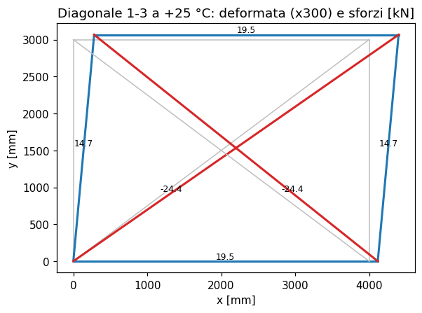
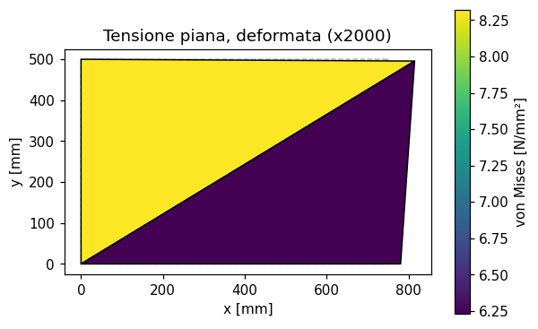
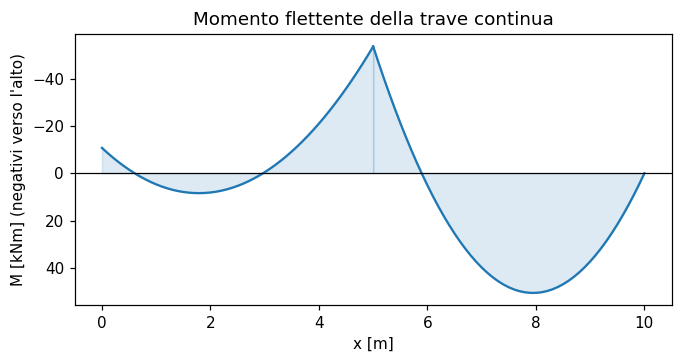
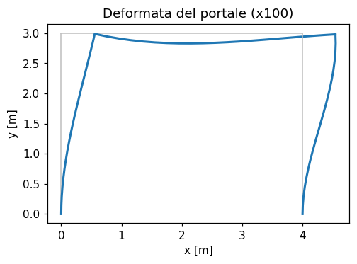

# 65 - Esempi del libro Bhavikatti

Questa pagina raccoglie **tutti gli esempi svolti** del libro *Finite Element Analysis* (S.S. Bhavikatti, New Age International, 2005) rifatti con feagent. Per ogni esempio: riferimento nel libro, modello feagent, confronto numerico fra il valore del libro e quello di feagent, note (dati mancanti, refusi del libro corretti, differenze di modello). I testi sono riassunti con parole nostre; i dati numerici servono a rifare il calcolo. Il codice di ogni esempio e' in `validation/books/bhavikatti/`; per rieseguirli:

```bash
python -m validation.books.run_books bhavikatti
python scripts/_gen_book_docs.py
```

**Esiti**: ✅ riprodotto e confrontato; 🟡 riprodotto in parte (dati o risultati del libro incompleti); 📐 ricavo di formule verificato numericamente; ⛔ non riproducibile (motivo nelle note). La colonna *scarto* e' l'errore relativo massimo dei confronti; *rif.* indica il riferimento del confronto: libro, soluzione esatta o valore corretto di un refuso.

**58 esempi**: 21 riprodotti, 2 in parte, 35 ricavi verificati, 0 non riproducibili; 361 confronti numerici, 361 entro la tolleranza.

## Riepilogo

| Esempio | Titolo | Esito | Confronti | Scarto max |
|---|---|---|---|---|
| [Example 4.1](#bhav-ex-4-1) | Integrali delle coordinate naturali di linea | 📐 | 2/2 | 0.00 % |
| [Example 4.2](#bhav-ex-4-2) | Integrali delle coordinate d'area sul triangolo | 📐 | 4/4 | 0.00 % |
| [Example 4.3](#bhav-ex-4-3) | Integrali delle coordinate di volume sul tetraedro | 📐 | 2/2 | 0.00 % |
| [Example 5.4](#bhav-ex-5-4) | Barra a 2 nodi con coordinate generalizzate | 📐 | 4/4 | 0.00 % |
| [Example 5.5](#bhav-ex-5-5) | Trave a 2 nodi: funzioni cubiche di Hermite | 📐 | 3/3 | 0.00 % |
| [Example 5.6](#bhav-ex-5-6) | Triangolo CST con coordinate generalizzate | 📐 | 2/2 | 0.00 % |
| [Example 5.7](#bhav-ex-5-7) | Barra a 2 nodi in coordinate naturali L1, L2 | 📐 | 3/3 | 0.00 % |
| [Example 5.8](#bhav-ex-5-8) | Barra a 2 nodi con xi in [-1, 1] | 📐 | 2/2 | 0.00 % |
| [Example 5.9](#bhav-ex-5-9) | Barra a 3 nodi in coordinate naturali | 📐 | 4/4 | 0.00 % |
| [Example 5.10](#bhav-ex-5-10) | CST in coordinate d'area | 📐 | 3/3 | 0.00 % |
| [Example 5.11](#bhav-ex-5-11) | Triangolo LST a 6 nodi | 📐 | 4/4 | 0.00 % |
| [Example 5.12](#bhav-ex-5-12) | Rettangolo a 4 nodi in coordinate naturali | 📐 | 4/4 | 0.00 % |
| [Example 5.13](#bhav-ex-5-13) | Rettangolo quadratico a 8 nodi dal polinomio | 📐 | 5/5 | 0.00 % |
| [Example 5.14](#bhav-ex-5-14) | Tetraedro a 4 nodi in coordinate di volume | 📐 | 3/3 | 0.00 % |
| [Example 5.15](#bhav-ex-5-15) | Esaedro a 8 nodi dal polinomio trilineare | 📐 | 3/3 | 0.00 % |
| [Example 5.16](#bhav-ex-5-16) | Funzioni di Lagrange per barre a 2, 3 e 5 nodi | 📐 | 5/5 | 0.00 % |
| [Example 5.17](#bhav-ex-5-17) | Rettangolo lagrangiano a 9 nodi | 📐 | 5/5 | 0.00 % |
| [Example 5.18](#bhav-ex-5-18) | Esaedro a 8 nodi con funzioni di Lagrange | 📐 | 3/3 | 0.00 % |
| [Example 5.19](#bhav-ex-5-19) | Rettangolo a 4 nodi con il metodo serendipity | 📐 | 2/2 | 0.00 % |
| [Example 5.20](#bhav-ex-5-20) | Rettangolo serendipity quadratico a 8 nodi | 📐 | 3/3 | 0.00 % |
| [Example 5.21](#bhav-ex-5-21) | Rettangolo serendipity cubico a 12 nodi | 📐 | 4/4 | 0.00 % |
| [Example 5.22](#bhav-ex-5-22) | Elemento a 7 nodi per degradazione del Q8 | 📐 | 5/5 | 0.00 % |
| [Example 8.1](#bhav-ex-8-1) | Tre aste concorrenti con i lavori virtuali | ✅ | 6/6 | 0.00 % |
| [Example 9.1](#bhav-ex-9-1) | Equazione della trave dalla stazionarieta' dell'energia potenziale | 📐 | 5/5 | 0.00 % |
| [Example 9.2](#bhav-ex-9-2) | Tre molle in serie: assemblaggio diretto e variazionale | 📐 | 4/4 | 0.00 % |
| [Example 9.3](#bhav-ex-9-3) | Sistema di molle con energia potenziale minima | ✅ | 2/2 | 0.03 % |
| [Example 9.4](#bhav-ex-9-4) | Tre aste concorrenti con l'energia potenziale minima | ✅ | 6/6 | 0.00 % |
| [Example 9.5](#bhav-ex-9-5) | Rayleigh-Ritz con serie di seni sulla trave appoggiata | 🟡 | 6/6 | 0.00 % |
| [Example 9.6](#bhav-ex-9-6) | Rayleigh-Ritz su barra bi-incastrata con forza in mezzeria | ✅ | 6/6 | 0.00 % |
| [Example 9.7](#bhav-ex-9-7) | Rayleigh-Ritz su barra appesa sotto peso proprio | ✅ | 6/6 | 0.00 % |
| [Example 11.1](#bhav-ex-11-1) | Piastra a gradino appesa: peso proprio e carico concentrato | ✅ | 5/5 | 0.00 % |
| [Example 11.2](#bhav-ex-11-2) | Barra rastremata: rigidezza e carichi da peso proprio | 📐 | 4/4 | 0.00 % |
| [Example 11.3](#bhav-ex-11-3) | Barra rastremata con peso proprio e forza in punta | ✅ | 4/4 | 0.01 % |
| [Example 11.4 (bar)](#bhav-ex-11-4-bar-thermal) | Barra alluminio-acciaio bi-incastrata con forza e variazione termica | ✅ | 5/5 | 0.01 % |
| [Example 11.4 (truss)](#bhav-ex-11-4-truss3) | Reticolare triangolare a tre aste con carico in sommita' | ✅ | 9/9 | 0.04 % |
| [Example 11.5 (settlement)](#bhav-ex-11-5-settlement) | Reticolare dell'Es. 11.4 con cedimento dell'appoggio | ✅ | 7/7 | 0.01 % |
| [Example 11.5 (braced frame)](#bhav-ex-11-5-frame6) | Reticolare rettangolare controventata: termica e difetto di montaggio | ✅ | 20/20 | 0.00 % |
| [Example 11.6](#bhav-ex-11-6) | Treppiede spaziale con carico verticale | ✅ | 6/6 | 0.33 % |
| [Chapter 11 Question 7](#bhav-prob-11-7) | Barra a gradino bi-incastrata con forza intermedia | ✅ | 7/7 | 0.01 % |
| [Chapter 11 Question 8](#bhav-prob-11-8) | Reticolare triangolare rettangola con due forze | ✅ | 6/6 | 0.00 % |
| [Chapter 11 Question 9](#bhav-prob-11-9) | Reticolare rettangolare con una diagonale | ✅ | 6/6 | 0.00 % |
| [Example 12.1](#bhav-ex-12-1) | Pannello rettangolare con due CST e forza orizzontale | ✅ | 15/15 | 0.25 % |
| [Example 12.2](#bhav-ex-12-2) | Carico consistente del peso proprio in un CST | 📐 | 4/4 | 0.00 % |
| [Example 12.3](#bhav-ex-12-3) | Carichi consistenti di pressioni sui lati di un CST | 📐 | 6/6 | 0.00 % |
| [Example 13.1](#bhav-ex-13-1) | Jacobiano e matrice B di un parallelogramma al punto di Gauss | 📐 | 13/13 | 0.01 % |
| [Example 13.2](#bhav-ex-13-2) | Coordinate cartesiane di un punto dato in coordinate naturali | 📐 | 2/2 | 0.00 % |
| [Example 13.3](#bhav-ex-13-3) | Forze nodali equivalenti a una forza concentrata interna | 📐 | 14/14 | 0.00 % |
| [Example 13.4](#bhav-ex-13-4) | Forze nodali di una trazione uniforme su un lato del Q4 | 📐 | 6/6 | 0.00 % |
| [Chapter 13 Question 7](#bhav-prob-13-7) | Mappa diretta e inversa in un Q4 | 📐 | 5/5 | 0.00 % |
| [Chapter 13 Question 8](#bhav-prob-13-8) | Jacobiano e B di un rettangolo al punto di Gauss | 📐 | 7/7 | 0.01 % |
| [Example 14.1](#bhav-ex-14-1) | Trave continua incastro-appoggio-appoggio con carichi diversi | ✅ | 14/14 | 0.01 % |
| [Example 14.2](#bhav-ex-14-2) | Trave incastrata-appoggiata con forza in mezzeria | ✅ | 10/10 | 0.01 % |
| [Example 14.3](#bhav-ex-14-3) | Carico consistente trapezoidale su un elemento trave | 📐 | 4/4 | 0.00 % |
| [Example 14.4](#bhav-ex-14-4) | Vettore dei carichi consistenti su una trave a due campate | 📐 | 6/6 | 0.00 % |
| [Example 14.5](#bhav-ex-14-5) | Portale piano: matrici degli elementi e soluzione | ✅ | 24/24 | 0.10 % |
| [Chapter 14 Question 2](#bhav-prob-14-2) | Trave continua su tre appoggi con carico uniforme | ✅ | 4/4 | 0.00 % |
| [Chapter 14 Question 4](#bhav-prob-14-4) | Matrice globale di un elemento di telaio inclinato a 30 gradi | ✅ | 13/13 | 0.08 % |
| [Section 14.5](#bhav-sec-14-5-timoshenko-locking) | Trave di Timoshenko a 2 nodi: locking e integrazione ridotta | 🟡 | 19/19 | 0.02 % |

## Capitolo 4

<a id="bhav-ex-4-1"></a>

### Example 4.1 - Integrali delle coordinate naturali di linea

📐 · pag. PDF 56 · other

Applicazione della formula chiusa int L1^p L2^q dx = p! q! l/(p+q+1)! a due casi: L1^2 (risultato l/3) e L1^3 L2 (risultato l/20).

**Modello**: Barra feagent a 2 nodi (L2): le sue funzioni di forma sono le coordinate di linea L1, L2; integrale numerico con Gauss-Legendre a 4 punti e |dx/ds|.

| Grandezza | Rif. | Riferimento | feagent | Scarto | |
|---|---|---|---|---|---|
| (i) int L1^2 dx = l/3 | libro | 1.2333 | 1.2333 | 0.00 % | ✅ |
| (ii) int L1^3 L2 dx = l/20 | libro | 0.185 | 0.185 | 0.00 % | ✅ |

**Note**: Puro ricavo matematico: si verifica la formula integrando numericamente le funzioni di forma della barra di feagent su una barra di lunghezza arbitraria (l = 3,7).

*Codice*: `validation/books/bhavikatti/ch04.py`

<a id="bhav-ex-4-2"></a>

### Example 4.2 - Integrali delle coordinate d'area sul triangolo

📐 · pag. PDF 62 · other

Formula int L1^p L2^q L3^r dA = p! q! r! 2A/(p+q+r+2)! applicata a L1 L2 L3, L1^3 L2 e L1^2 L2^2 L3^3.

**Modello**: Triangolo feagent T3 (PlaneT3): funzioni di forma = coordinate d'area; quadratura feagent.solid.gauss_tri(6) e area dell'elemento.

| Grandezza | Rif. | Riferimento | feagent | Scarto | |
|---|---|---|---|---|---|
| (i) L1 L2 L3: A/60 | libro | 0.092167 | 0.092167 | 0.00 % | ✅ |
| (ii) L1^3 L2: A/60 | libro | 0.092167 | 0.092167 | 0.00 % | ✅ |
| (iii) formula chiusa = A/7560 (libro: A/7960) | corretto | 7.3148e-04 | 7.3148e-04 | 0.00 % | ✅ |
| (iii) L1^2 L2^2 L3^3, integrale numerico | corretto | 7.3148e-04 | 7.3148e-04 | 0.00 % | ✅ |

**Note**: Caso (iii): il libro stampa A/7960, refuso; il valore giusto e' 2! 2! 3! 2A/9! = A/7560, confermato dall'integrazione numerica (source = corrected).

*Codice*: `validation/books/bhavikatti/ch04.py`

<a id="bhav-ex-4-3"></a>

### Example 4.3 - Integrali delle coordinate di volume sul tetraedro

📐 · pag. PDF 65 · other

Formula int L1^p L2^q L3^r L4^s dV = p! q! r! s! 6V/(p+q+r+s+3)! applicata a L1 L2 L3 L4 (V/840) e L1^2 L2 L4 (V/420).

**Modello**: Tetraedro feagent Tet4: funzioni di forma = coordinate di volume; quadratura feagent.solid.gauss_tet(4) e volume dell'elemento.

| Grandezza | Rif. | Riferimento | feagent | Scarto | |
|---|---|---|---|---|---|
| (i) L1 L2 L3 L4: V/840 | libro | 0.0029244 | 0.0029244 | 0.00 % | ✅ |
| (ii) L1^2 L2 L4: V/420 | libro | 0.0058488 | 0.0058488 | 0.00 % | ✅ |

**Note**: Verifica numerica su un tetraedro irregolare.

*Codice*: `validation/books/bhavikatti/ch04.py`

## Capitolo 5

<a id="bhav-ex-5-4"></a>

### Example 5.4 - Barra a 2 nodi con coordinate generalizzate

📐 · pag. PDF 75 · bar

Dal polinomio u = a1 + a2 x imposto ai due nodi si ricavano N1 = (x2 - x)/l e N2 = (x - x1)/l.

**Modello**: BarElement feagent a 2 nodi fra x1 = 1,5 e x2 = 4,2; confronto in 25 punti.

| Grandezza | Rif. | Riferimento | feagent | Scarto | |
|---|---|---|---|---|---|
| max |N_libro - N_feagent| | libro | 0 | 2.2204e-16 | 0.00 % | ✅ |
| max |[1 x] A^-1 - N_feagent| | libro | 0 | 1.5266e-16 | 0.00 % | ✅ |
| max |N_i(nodo j) - delta_ij| | libro | 0 | 0 | 0.00 % | ✅ |
| max |somma N_i - 1| | libro | 0 | 0 | 0.00 % | ✅ |

**Note**: Si ripete anche l'inversione della matrice dei coefficienti generalizzati con numpy.

*Codice*: `validation/books/bhavikatti/ch05.py`

<a id="bhav-ex-5-5"></a>

### Example 5.5 - Trave a 2 nodi: funzioni cubiche di Hermite

📐 · pag. PDF 76 · beam

Da w = a1 + a2 x + a3 x^2 + a4 x^3 con w e dw/dx imposti ai due nodi il libro ricava le quattro cubiche di Hermite.

**Modello**: BeamElement3D feagent di luce 2,5 (BeamElement3D.shape_functions, riga uy: colonne uy_i, rz_i, uy_j, rz_j).

| Grandezza | Rif. | Riferimento | feagent | Scarto | |
|---|---|---|---|---|---|
| max |N_libro - N_feagent| | libro | 0 | 0 | 0.00 % | ✅ |
| max |[1 x x^2 x^3] A^-1 - N_feagent| | libro | 0 | 4.4409e-16 | 0.00 % | ✅ |
| w e dw/dx ai nodi = matrice identita' | libro | 0 | 0 | 0.00 % | ✅ |

**Note**: Si verificano le formule del libro, l'inversione della matrice 4x4 dei coefficienti e le condizioni ai nodi su valori e derivate.

*Codice*: `validation/books/bhavikatti/ch05.py`

<a id="bhav-ex-5-6"></a>

### Example 5.6 - Triangolo CST con coordinate generalizzate

📐 · pag. PDF 78 · plane_stress

Da u = a1 + a2 x + a3 y il libro ricava N_i = (a_i + b_i x + c_i y)/(2A) con a_i = x_j y_k - x_k y_j, b_i = y_j - y_k, c_i = x_k - x_j.

**Modello**: PlaneT3 feagent su un triangolo qualunque; i punti di prova sono mappati in coordinate cartesiane con le funzioni di forma.

| Grandezza | Rif. | Riferimento | feagent | Scarto | |
|---|---|---|---|---|---|
| max |N_libro - N_feagent| | libro | 0 | 3.3307e-16 | 0.00 % | ✅ |
| 2A dal determinante = 2 x area feagent | esatta | 16.9 | 16.9 | 0.00 % | ✅ |

*Codice*: `validation/books/bhavikatti/ch05.py`

<a id="bhav-ex-5-7"></a>

### Example 5.7 - Barra a 2 nodi in coordinate naturali L1, L2

📐 · pag. PDF 81 · bar

Con le coordinate di linea L1 = (x2 - x)/l, L2 = (x - x1)/l (somma 1) le funzioni di forma sono N1 = L1 e N2 = L2.

**Modello**: BarElement feagent a 2 nodi fra x = 2 e x = 7.

| Grandezza | Rif. | Riferimento | feagent | Scarto | |
|---|---|---|---|---|---|
| max |L_i - N_i feagent| | libro | 0 | 1.1102e-16 | 0.00 % | ✅ |
| max |N_i(nodo j) - delta_ij| | libro | 0 | 0 | 0.00 % | ✅ |
| max |somma N_i - 1| | libro | 0 | 0 | 0.00 % | ✅ |

*Codice*: `validation/books/bhavikatti/ch05.py`

<a id="bhav-ex-5-8"></a>

### Example 5.8 - Barra a 2 nodi con xi in [-1, 1]

📐 · pag. PDF 81 · bar

Da u = a1 + a2 xi con xi = -1 e +1 ai nodi: N1 = (1 - xi)/2, N2 = (1 + xi)/2.

**Modello**: BarElement feagent a 2 nodi (coordinata naturale s = xi).

| Grandezza | Rif. | Riferimento | feagent | Scarto | |
|---|---|---|---|---|---|
| max |N_libro - N_feagent| | libro | 0 | 0 | 0.00 % | ✅ |
| A^-1 stampata = A^-1 numpy | libro | 0 | 0 | 0.00 % | ✅ |

*Codice*: `validation/books/bhavikatti/ch05.py`

<a id="bhav-ex-5-9"></a>

### Example 5.9 - Barra a 3 nodi in coordinate naturali

📐 · pag. PDF 82 · bar

Da u = a1 + a2 xi + a3 xi^2 con nodi 1, 2, 3 a xi = -1, 1, 0: N1 = xi(xi - 1)/2, N2 = xi(xi + 1)/2, N3 = 1 - xi^2.

**Modello**: BarElement feagent a 3 nodi (L3: estremi, poi nodo medio, come nel libro).

| Grandezza | Rif. | Riferimento | feagent | Scarto | |
|---|---|---|---|---|---|
| max |N_libro - N_feagent| | libro | 0 | 0 | 0.00 % | ✅ |
| A^-1 stampata = A^-1 numpy | libro | 0 | 0 | 0.00 % | ✅ |
| max |N_i(nodo j) - delta_ij| | libro | 0 | 0 | 0.00 % | ✅ |
| max |somma N_i - 1| | libro | 0 | 1.1102e-16 | 0.00 % | ✅ |

**Note**: Si confronta anche l'inversa 3x3 stampata dal libro, (1/2)[[0,0,2],[-1,1,0],[1,1,-2]].

*Codice*: `validation/books/bhavikatti/ch05.py`

<a id="bhav-ex-5-10"></a>

### Example 5.10 - CST in coordinate d'area

📐 · pag. PDF 84 · plane_stress

Con u = a1 L1 + a2 L2 + a3 L3 e L_i = 1 al nodo i il libro conclude N_i = L_i.

**Modello**: PlaneT3 feagent; le coordinate d'area sono calcolate come rapporti fra le aree dei sottotriangoli nel punto cartesiano mappato.

| Grandezza | Rif. | Riferimento | feagent | Scarto | |
|---|---|---|---|---|---|
| max |L_i (aree) - N_i feagent| | libro | 0 | 2.2204e-16 | 0.00 % | ✅ |
| max |N_i(nodo j) - delta_ij| | libro | 0 | 0 | 0.00 % | ✅ |
| max |somma N_i - 1| | libro | 0 | 0 | 0.00 % | ✅ |

*Codice*: `validation/books/bhavikatti/ch05.py`

<a id="bhav-ex-5-11"></a>

### Example 5.11 - Triangolo LST a 6 nodi

📐 · pag. PDF 85 · plane_stress

Con il polinomio quadratico completo in L1, L2, L3 e la matrice A dei valori nodali il libro ricava N_i = L_i(2L_i - 1) ai vertici e 4 L_i L_j ai lati.

**Modello**: PlaneT6 feagent (nodi 4, 5, 6 sui lati 1-2, 2-3, 3-1, come nel libro).

| Grandezza | Rif. | Riferimento | feagent | Scarto | |
|---|---|---|---|---|---|
| max |N_libro - N_feagent| | libro | 0 | 0 | 0.00 % | ✅ |
| A^-1 stampata = A^-1 numpy | libro | 0 | 0 | 0.00 % | ✅ |
| max |N_i(nodo j) - delta_ij| | libro | 0 | 0 | 0.00 % | ✅ |
| max |somma N_i - 1| | libro | 0 | 1.1102e-16 | 0.00 % | ✅ |

**Note**: Si confronta anche la A^-1 stampata con l'inversa numerica.

*Codice*: `validation/books/bhavikatti/ch05.py`

<a id="bhav-ex-5-12"></a>

### Example 5.12 - Rettangolo a 4 nodi in coordinate naturali

📐 · pag. PDF 88 · plane_stress

Da u = a1 + a2 xi + a3 eta + a4 xi eta il libro ricava N_i = (1 + xi xi_i)(1 + eta eta_i)/4.

**Modello**: PlaneQ4 feagent (nodi antiorari da (-1, -1), come nel libro).

| Grandezza | Rif. | Riferimento | feagent | Scarto | |
|---|---|---|---|---|---|
| max |N_libro - N_feagent| | libro | 0 | 0 | 0.00 % | ✅ |
| max |[1 xi eta xi eta] A^-1 - N_feagent| | libro | 0 | 1.1102e-16 | 0.00 % | ✅ |
| max |N_i(nodo j) - delta_ij| | libro | 0 | 0 | 0.00 % | ✅ |
| max |somma N_i - 1| | libro | 0 | 1.1102e-16 | 0.00 % | ✅ |

**Note**: Si ripete anche l'inversione della matrice 4x4 dei coefficienti.

*Codice*: `validation/books/bhavikatti/ch05.py`

<a id="bhav-ex-5-13"></a>

### Example 5.13 - Rettangolo quadratico a 8 nodi dal polinomio

📐 · pag. PDF 90 · plane_stress

Polinomio a 8 termini (senza xi^3 ed eta^3), matrice A 8x8 dei valori nodali, inversione: si ottengono le funzioni serendipity del Q8.

**Modello**: PlaneQ8 feagent (angoli, poi nodi di lato 1-2, 2-3, 3-4, 4-1: stessa numerazione della Fig. 5.14).

| Grandezza | Rif. | Riferimento | feagent | Scarto | |
|---|---|---|---|---|---|
| matrice A stampata = A dalle coordinate | libro | 0 | 0 | 0.00 % | ✅ |
| max |[1 xi ... xi eta^2] A^-1 - N_feagent| | libro | 0 | 1.1102e-16 | 0.00 % | ✅ |
| max |N_libro (forma chiusa) - N_feagent| | libro | 0 | 0 | 0.00 % | ✅ |
| max |N_i(nodo j) - delta_ij| | libro | 0 | 0 | 0.00 % | ✅ |
| max |somma N_i - 1| | libro | 0 | 2.2204e-16 | 0.00 % | ✅ |

**Note**: La matrice A stampata dal libro coincide con quella costruita dalle coordinate nodali; [1 xi eta ...] A^-1 coincide con le funzioni di forma di feagent.

*Codice*: `validation/books/bhavikatti/ch05.py`

<a id="bhav-ex-5-14"></a>

### Example 5.14 - Tetraedro a 4 nodi in coordinate di volume

📐 · pag. PDF 92 · solid

Con u = a1 L1 + a2 L2 + a3 L3 + a4 L4 il libro conclude N_i = L_i.

**Modello**: Tet4 feagent su un tetraedro irregolare; coordinate di volume calcolate come rapporti fra i volumi dei sottotetraedri.

| Grandezza | Rif. | Riferimento | feagent | Scarto | |
|---|---|---|---|---|---|
| max |L_i (volumi) - N_i feagent| | libro | 0 | 8.3267e-17 | 0.00 % | ✅ |
| max |N_i(nodo j) - delta_ij| | libro | 0 | 0 | 0.00 % | ✅ |
| max |somma N_i - 1| | libro | 0 | 0 | 0.00 % | ✅ |

*Codice*: `validation/books/bhavikatti/ch05.py`

<a id="bhav-ex-5-15"></a>

### Example 5.15 - Esaedro a 8 nodi dal polinomio trilineare

📐 · pag. PDF 93 · solid

Polinomio a 8 termini 1, xi, eta, zeta, xi eta, eta zeta, zeta xi, xi eta zeta; matrice A 8x8 e inversione: N_i = (1 + xi xi_i)(1 + eta eta_i)(1 + zeta zeta_i)/8.

**Modello**: Hex8 feagent; i nodi del libro (Fig. 5.16, numerazione diversa) sono associati per coordinate naturali.

| Grandezza | Rif. | Riferimento | feagent | Scarto | |
|---|---|---|---|---|---|
| matrice A stampata = A dalle coordinate | libro | 0 | 0 | 0.00 % | ✅ |
| max |[1 xi ... xi eta zeta] A^-1 - N_feagent| | libro | 0 | 1.1102e-16 | 0.00 % | ✅ |
| max |N_libro - N_feagent| | libro | 0 | 0 | 0.00 % | ✅ |

**Note**: La matrice A stampata coincide con quella dalle coordinate della Fig. 5.16.

*Codice*: `validation/books/bhavikatti/ch05.py`

<a id="bhav-ex-5-16"></a>

### Example 5.16 - Funzioni di Lagrange per barre a 2, 3 e 5 nodi

📐 · pag. PDF 95 · bar

Formula di Lagrange N_k = prod_{j != k}(x - x_j)/(x_k - x_j) per 2, 3 e 5 nodi equispaziati (nodi 1 e 2 agli estremi, poi gli interni).

**Modello**: BarElement feagent a 2 e 3 nodi su una barra fra x = 1 e x = 5; la barra a 5 nodi non esiste in feagent ed e' verificata con numpy.

| Grandezza | Rif. | Riferimento | feagent | Scarto | |
|---|---|---|---|---|---|
| 2 nodi: max |N_Lagrange - N_feagent| | libro | 0 | 1.1102e-16 | 0.00 % | ✅ |
| 3 nodi: max |N_Lagrange - N_feagent| | libro | 0 | 7.2164e-16 | 0.00 % | ✅ |
| 5 nodi (numpy): delta di Kronecker | libro | 0 | 0 | 0.00 % | ✅ |
| 5 nodi (numpy): somma N_i = 1 | libro | 0 | 2.2204e-16 | 0.00 % | ✅ |
| 5 nodi (numpy): sum N_i x_i^4 = x^4 | libro | 0 | 2.8422e-14 | 0.00 % | ✅ |

**Note**: Barra a 5 nodi: feagent non ha l'elemento; si verificano con numpy delta di Kronecker, partizione dell'unita' e riproduzione esatta di x^4 (completezza del quarto grado).

*Codice*: `validation/books/bhavikatti/ch05.py`

<a id="bhav-ex-5-17"></a>

### Example 5.17 - Rettangolo lagrangiano a 9 nodi

📐 · pag. PDF 98 · plane_stress

Prodotto delle quadratiche di Lagrange in xi ed eta: il libro scrive le nove funzioni e le forme compatte (5.41) per i vertici, xi eta (xi + xi_i)(eta + eta_i)/4, e per i nodi di lato.

**Modello**: PlaneQ9 feagent; i nodi del libro (Fig. 5.19, numerati per righe) sono associati per coordinate naturali.

| Grandezza | Rif. | Riferimento | feagent | Scarto | |
|---|---|---|---|---|---|
| max |N_libro - N_feagent| | libro | 0 | 1.1102e-16 | 0.00 % | ✅ |
| max |L_i(xi) L_j(eta) - N_feagent| | libro | 0 | 1.1102e-16 | 0.00 % | ✅ |
| vertici, forma (5.41) | libro | 0 | 1.1102e-16 | 0.00 % | ✅ |
| max |N_i(nodo j) - delta_ij| | libro | 0 | 0 | 0.00 % | ✅ |
| max |somma N_i - 1| | libro | 0 | 2.2204e-16 | 0.00 % | ✅ |

*Codice*: `validation/books/bhavikatti/ch05.py`

<a id="bhav-ex-5-18"></a>

### Example 5.18 - Esaedro a 8 nodi con funzioni di Lagrange

📐 · pag. PDF 101 · solid

Prodotto delle lineari di Lagrange nelle tre direzioni: N_i = (1 + xi xi_i)(1 + eta eta_i)(1 + zeta zeta_i)/8 con la numerazione dei nodi del libro.

**Modello**: Hex8 feagent con i nodi del libro associati per coordinate naturali.

| Grandezza | Rif. | Riferimento | feagent | Scarto | |
|---|---|---|---|---|---|
| max |L(xi) L(eta) L(zeta) - N_feagent| | libro | 0 | 0 | 0.00 % | ✅ |
| max |N_i(nodo j) - delta_ij| | libro | 0 | 0 | 0.00 % | ✅ |
| max |somma N_i - 1| | libro | 0 | 1.1102e-16 | 0.00 % | ✅ |

*Codice*: `validation/books/bhavikatti/ch05.py`

<a id="bhav-ex-5-19"></a>

### Example 5.19 - Rettangolo a 4 nodi con il metodo serendipity

📐 · pag. PDF 103 · plane_stress

N_1 si costruisce come prodotto delle rette che passano per i nodi in cui deve annullarsi, C(1 - xi)(1 - eta), con C = 1/4 dalla condizione N_1 = 1 al nodo 1.

**Modello**: PlaneQ4 feagent.

| Grandezza | Rif. | Riferimento | feagent | Scarto | |
|---|---|---|---|---|---|
| costante C del nodo 1 | libro | 0.25 | 0.25 | 0.00 % | ✅ |
| max |N_libro - N_feagent| | libro | 0 | 0 | 0.00 % | ✅ |

*Codice*: `validation/books/bhavikatti/ch05.py`

<a id="bhav-ex-5-20"></a>

### Example 5.20 - Rettangolo serendipity quadratico a 8 nodi

📐 · pag. PDF 104 · plane_stress

Con il metodo delle rette nulle (vertici: (1 - xi)(1 - eta)(-xi - eta - 1)/4; lati: (1 - xi^2)(1 + eta eta_i)/2 e analoghe) si ritrovano le funzioni dell'Es. 5.13.

**Modello**: PlaneQ8 feagent su un quadrilatero distorto (la mappa non interviene sulle funzioni di forma in coordinate naturali).

| Grandezza | Rif. | Riferimento | feagent | Scarto | |
|---|---|---|---|---|---|
| max |N_libro - N_feagent| | libro | 0 | 0 | 0.00 % | ✅ |
| max |N_i(nodo j) - delta_ij| | libro | 0 | 0 | 0.00 % | ✅ |
| max |somma N_i - 1| | libro | 0 | 2.2204e-16 | 0.00 % | ✅ |

*Codice*: `validation/books/bhavikatti/ch05.py`

<a id="bhav-ex-5-21"></a>

### Example 5.21 - Rettangolo serendipity cubico a 12 nodi

📐 · pag. PDF 106 · plane_stress

Vertici: (1 + xi xi_i)(1 + eta eta_i)[9(xi^2 + eta^2) - 10]/32, dove il cerchio xi^2 + eta^2 = 10/9 passa per gli otto nodi di lato; nodi di lato a xi_i = +-1/3: 9(1 - xi^2)(1 + 9 xi xi_i)(1 + eta eta_i)/32.

**Modello**: Nessun elemento feagent (il Q12 non esiste): verifica con numpy delle funzioni stampate.

| Grandezza | Rif. | Riferimento | feagent | Scarto | |
|---|---|---|---|---|---|
| max |N_i(nodo j) - delta_ij| (numpy) | libro | 0 | 0 | 0.00 % | ✅ |
| max |somma N_i - 1| (numpy) | libro | 0 | 3.3307e-16 | 0.00 % | ✅ |
| max errore sui 12 monomi serendipity (numpy) | libro | 0 | 3.3307e-16 | 0.00 % | ✅ |
| xi^2 + eta^2 dei nodi di lato = 10/9 (testo: 10/3) | corretto | 1.1111 | 1.1111 | 0.00 % | ✅ |

**Note**: feagent non ha il Q12: le dodici funzioni del libro sono verificate con numpy (delta di Kronecker sui 12 nodi, partizione dell'unita', riproduzione esatta dei 12 monomi della base serendipity cubica 1, xi, eta, xi^2, xi eta, eta^2, xi^3, xi^2 eta, xi eta^2, eta^3, xi^3 eta, xi eta^3). Il libro scrive il cerchio come xi^2 + eta^2 = 10/3 (raggio sqrt(10)/3 al quadrato e' 10/9): refuso senza conseguenze, la formula finale usa 10/9.

*Codice*: `validation/books/bhavikatti/ch05.py`

<a id="bhav-ex-5-22"></a>

### Example 5.22 - Elemento a 7 nodi per degradazione del Q8

📐 · pag. PDF 113 · plane_stress

Eliminando il nodo 8 (lato 4-1) con u8 = (u1 + u4)/2 si ottiene N'_1 = N1 + N8/2 = -xi(1 - xi)(1 - eta)/4, N'_4 = N4 + N8/2 = -xi(1 - xi)(1 + eta)/4, le altre invariate.

**Modello**: Funzioni del PlaneQ8 feagent combinate con numpy (il Q7 di transizione non esiste in feagent).

| Grandezza | Rif. | Riferimento | feagent | Scarto | |
|---|---|---|---|---|---|
| N'_1: libro - (Q8 feagent degradato) | libro | 0 | 5.5511e-17 | 0.00 % | ✅ |
| N'_4: libro - (Q8 feagent degradato) | libro | 0 | 1.1102e-16 | 0.00 % | ✅ |
| lato 4-1: N'_1, N'_4 lineari | libro | 0 | 2.7756e-17 | 0.00 % | ✅ |
| max |N_i(nodo j) - delta_ij| | libro | 0 | 0 | 0.00 % | ✅ |
| max |somma N_i - 1| | libro | 0 | 2.2204e-16 | 0.00 % | ✅ |

**Note**: feagent non ha l'elemento di transizione a 7 nodi: le funzioni degradate sono costruite da quelle del Q8 di feagent e verificate con numpy (forma chiusa del libro, delta di Kronecker sui 7 nodi, partizione dell'unita', variazione lineare lungo il lato 4-1).

*Codice*: `validation/books/bhavikatti/ch05.py`

## Capitolo 8

<a id="bhav-ex-8-1"></a>

### Example 8.1 - Tre aste concorrenti con i lavori virtuali

✅ · pag. PDF 137 · truss

Tre aste di uguale EA convergono in D = (2, 0) m da tre cerniere a parete, con inclinazioni di 30, 0 e 60 gradi; carico verticale di 20 kN in D. Il libro scrive le equazioni dei lavori virtuali per du = 1 e dv = 1 e ricava spostamenti e sforzi.

**Modello**: Tre bielle (add_truss) dai nodi a parete A, B, C al nodo D, EA = 1 (risultati in unita' di 1/EA); A, B, C incastrati, D libero nel piano X-Y.

| Grandezza | Rif. | Riferimento | feagent | Scarto | |
|---|---|---|---|---|---|
| u_D x EA (libro: 5,898) [kN] | corretto | -6.188 | -6.188 | 0.00 % | ✅ |
| v_D x EA (libro: -66,048) [kN] | corretto | -69.282 | -69.282 | 0.00 % | ✅ |
| F1 (libro: 26,045) [kN] | corretto | 12.679 | 12.679 | 0.00 % | ✅ |
| F2 (libro: 2,949) [kN] | corretto | -3.094 | -3.094 | 0.00 % | ✅ |
| F3 (libro: -13,562) [kN] | corretto | -15.774 | -15.774 | 0.00 % | ✅ |
| somma delle reazioni verticali = 20 kN [kN] | esatta | 20 | 20 | 0.00 % | ✅ |

**Note**: Il libro sbaglia un segno nell'equazione dello spostamento virtuale du = 1 (scrive 0,88726u - 0,07924v invece di 0,88726u + 0,07924v) e stampa u = 5,898/EA, v = 66,048/EA (verso il basso), F1 = 26,045, F2 = 2,949, F3 = -13,562 kN: questi sforzi non equilibrano il nodo D (risultante verticale 24,8 kN contro 20 kN). Si confronta feagent con la soluzione corretta u = -6,188/EA, v = -69,282/EA, F1 = 12,679, F2 = -3,094, F3 = -15,774 kN (source = corrected), che soddisfa l'equilibrio.

*Codice*: `validation/books/bhavikatti/ch08.py`

## Capitolo 9

<a id="bhav-ex-9-1"></a>

### Example 9.1 - Equazione della trave dalla stazionarieta' dell'energia potenziale

📐 · pag. PDF 144 · beam

Annullando la variazione prima dell'energia potenziale il libro ricava l'equazione di equilibrio EI w'''' = q e le condizioni al contorno naturali (momento nullo agli appoggi, momento e taglio nulli all'estremo libero della mensola).

**Modello**: Travi di Hermite feagent (4 elementi) per i due casi del libro: trave appoggiata e mensola con carico uniforme; confronto con la soluzione esatta di EI w'''' = q con le condizioni al contorno ricavate.

| Grandezza | Rif. | Riferimento | feagent | Scarto | |
|---|---|---|---|---|---|
| appoggiata: freccia in mezzeria | esatta | 0.0084375 | 0.0084375 | 0.00 % | ✅ |
| appoggiata: momento in mezzeria | esatta | 45 | 45 | 0.00 % | ✅ |
| mensola: freccia in punta | esatta | 0.081 | 0.081 | 0.00 % | ✅ |
| mensola: momento all'incastro | esatta | 180 | 180 | 0.00 % | ✅ |
| mensola: taglio all'estremo libero | esatta | 0 | 0 | 0.00 % | ✅ |

**Note**: Esempio solo simbolico: si verifica che le soluzioni del problema al contorno ricavato (freccia 5ql^4/384EI e momento ql^2/8 in mezzeria; mensola: freccia ql^4/8EI, momento all'incastro ql^2/2, taglio nullo in punta) coincidono con quelle delle travi di feagent (l = 6, q = 10, EI = 2e4).

*Codice*: `validation/books/bhavikatti/ch09.py`

<a id="bhav-ex-9-2"></a>

### Example 9.2 - Tre molle in serie: assemblaggio diretto e variazionale

📐 · pag. PDF 150 · spring

Il libro scrive la matrice di rigidezza del sistema parete - k1 - 1 - k2 - 2 - k3 - 3 sia per assemblaggio diretto sia minimizzando l'energia potenziale: [[k1+k2, -k2, 0], [-k2, k2+k3, -k3], [0, -k3, k3]].

**Modello**: Tre molle assiali (add_spring) in serie fra la parete e i nodi 1, 2, 3 lungo X; k1 = 100, k2 = 200, k3 = 300.

| Grandezza | Rif. | Riferimento | feagent | Scarto | |
|---|---|---|---|---|---|
| max |K feagent - K libro| | libro | 0 | 0 | 0.00 % | ✅ |
| u1 = K^-1 F (matrice del libro) | esatta | 0.6 | 0.6 | 0.00 % | ✅ |
| u2 = K^-1 F (matrice del libro) | esatta | 0.85 | 0.85 | 0.00 % | ✅ |
| u3 = K^-1 F (matrice del libro) | esatta | 0.95 | 0.95 | 0.00 % | ✅ |

**Note**: Esempio simbolico, rifatto con valori numerici arbitrari; si confronta anche la soluzione per F = (10, 20, 30).

*Codice*: `validation/books/bhavikatti/ch09.py`

<a id="bhav-ex-9-3"></a>

### Example 9.3 - Sistema di molle con energia potenziale minima

✅ · pag. PDF 152 · spring

Due molle in parallelo collegano la parete al nodo 1, una terza molla collega i nodi 1 e 2; si cercano gli spostamenti con il principio dell'energia potenziale minima.

**Modello**: Molle assiali: k1 = 60 e k2 = 75 N/m in parallelo fra parete e nodo 1, k3 = 100 N/m fra nodo 1 e nodo 2; forze nodali 100 e 80 N.

| Grandezza | Rif. | Riferimento | feagent | Scarto | |
|---|---|---|---|---|---|
| u1 [m] | libro | 1.333 | 1.3333 | 0.03 % | ✅ |
| u2 [m] | libro | 2.133 | 2.1333 | 0.02 % | ✅ |

*Codice*: `validation/books/bhavikatti/ch09.py`

<a id="bhav-ex-9-4"></a>

### Example 9.4 - Tre aste concorrenti con l'energia potenziale minima

✅ · pag. PDF 153 · truss

La reticolare dell'Es. 8.1 e' risolta minimizzando l'energia potenziale totale rispetto agli spostamenti u, v del nodo D.

**Modello**: Stesso modello dell'Es. 8.1: tre bielle con EA = 1 convergenti in D.

| Grandezza | Rif. | Riferimento | feagent | Scarto | |
|---|---|---|---|---|---|
| u_D x EA (libro: 5,898) [kN] | corretto | -6.188 | -6.188 | 0.00 % | ✅ |
| v_D x EA (libro: -66,048) [kN] | corretto | -69.282 | -69.282 | 0.00 % | ✅ |
| F1 (libro: 26,045) [kN] | corretto | 12.679 | 12.679 | 0.00 % | ✅ |
| F2 (libro: 2,949) [kN] | corretto | -3.094 | -3.094 | 0.00 % | ✅ |
| F3 (libro: -13,562) [kN] | corretto | -15.774 | -15.774 | 0.00 % | ✅ |
| somma delle reazioni verticali = 20 kN [kN] | esatta | 20 | 20 | 0.00 % | ✅ |

**Note**: Il libro ripete l'errore di segno dell'Es. 8.1 (scrive u = 0,0893 v invece di u = -0,0893 v) e ne riporta gli stessi risultati. Il libro sbaglia un segno nell'equazione dello spostamento virtuale du = 1 (scrive 0,88726u - 0,07924v invece di 0,88726u + 0,07924v) e stampa u = 5,898/EA, v = 66,048/EA (verso il basso), F1 = 26,045, F2 = 2,949, F3 = -13,562 kN: questi sforzi non equilibrano il nodo D (risultante verticale 24,8 kN contro 20 kN). Si confronta feagent con la soluzione corretta u = -6,188/EA, v = -69,282/EA, F1 = 12,679, F2 = -3,094, F3 = -15,774 kN (source = corrected), che soddisfa l'equilibrio.

*Codice*: `validation/books/bhavikatti/ch09.py`

<a id="bhav-ex-9-5"></a>

### Example 9.5 - Rayleigh-Ritz con serie di seni sulla trave appoggiata

🟡 · pag. PDF 154 · beam

Trave appoggiata con carico uniforme approssimata da y = a1 sin(pi x/l) + a2 sin(3 pi x/l): il libro trova a1 = 4wl^4/(EI pi^5), a2 = 4wl^4/(243 EI pi^5), freccia massima wl^4/(76,82 EI) e momento in mezzeria wl^2/8,05.

**Modello**: Funzionale di Ritz con due termini sin(pi x/l), sin(3 pi x/l) integrato con numpy (Gauss 20 punti); trave feagent di 4 elementi di Hermite per la soluzione esatta. l = 6, w = 10, EI = 2e4.

| Grandezza | Rif. | Riferimento | feagent | Scarto | |
|---|---|---|---|---|---|
| a1 = 4wl^4/(EI pi^5) (Ritz, numpy) | libro | 0.00847 | 0.00847 | 0.00 % | ✅ |
| a2 = 4wl^4/(243 EI pi^5) (Ritz, numpy) | libro | 3.4856e-05 | 3.4856e-05 | 0.00 % | ✅ |
| freccia massima Ritz = wl^4/(76,82 EI) | libro | 0.0084353 | 0.0084352 | 0.00 % | ✅ |
| momento in mezzeria Ritz = wl^2/8,05 | libro | 44.72 | 44.722 | 0.00 % | ✅ |
| feagent: freccia esatta 5wl^4/384EI | esatta | 0.0084375 | 0.0084375 | 0.00 % | ✅ |
| feagent: momento esatto wl^2/8 | esatta | 45 | 45 | 0.00 % | ✅ |

**Note**: L'approssimazione di Ritz a seni non e' un elemento di feagent: il sistema di Ritz e' risolto con numpy (passaggio di pura algebra) e confrontato con i coefficienti del libro; le travi di Hermite di feagent danno invece la soluzione esatta 5wl^4/384EI = wl^4/76,8 EI e wl^2/8, rispetto alla quale la serie di Ritz sbaglia dello 0,03 % e dello 0,6 %.

*Codice*: `validation/books/bhavikatti/ch09.py`

<a id="bhav-ex-9-6"></a>

### Example 9.6 - Rayleigh-Ritz su barra bi-incastrata con forza in mezzeria

✅ · pag. PDF 156 · bar

Barra incastrata ai due estremi con forza assiale P in mezzeria; il polinomio a tre termini con u(0) = u(l) = 0 si riduce a u = a x(l - x). Il libro trova u(l/2) = 3Pl/(16EA) e sigma = 3P/(4A), 0, -3P/(4A) in x = 0, l/2, l (esatto: Pl/(4EA), +-P/(2A)).

**Modello**: Una barra feagent a 3 nodi (L3, nodo medio in mezzeria): con gli estremi vincolati il suo campo e' u = a x(l - x), esattamente il campo di Ritz del libro. In piu' due barre L2 per la soluzione esatta. l = 2, EA = 1e3, P = 50.

| Grandezza | Rif. | Riferimento | feagent | Scarto | |
|---|---|---|---|---|---|
| L3: u(l/2) = 3Pl/(16EA) | libro | 0.01875 | 0.01875 | 0.00 % | ✅ |
| L3: sigma(0) = 3P/(4A) | libro | 37.5 | 37.5 | 0.00 % | ✅ |
| L3: sigma(l) = -3P/(4A) | libro | -37.5 | -37.5 | 0.00 % | ✅ |
| L3: sigma(l/2) = 0 | libro | 0 | 0 | 0.00 % | ✅ |
| 2 x L2: u(l/2) = Pl/(4EA) | esatta | 0.025 | 0.025 | 0.00 % | ✅ |
| 2 x L2: sigma tratto 1 = P/(2A) | esatta | 25 | 25 | 0.00 % | ✅ |

**Note**: Un solo elemento quadratico riproduce l'approssimazione di Ritz in modo esatto; con due elementi lineari si ottiene la soluzione esatta.

*Codice*: `validation/books/bhavikatti/ch09.py`

<a id="bhav-ex-9-7"></a>

### Example 9.7 - Rayleigh-Ritz su barra appesa sotto peso proprio

✅ · pag. PDF 159 · bar

Barra verticale appesa all'estremo superiore sotto il proprio peso. Con due termini il libro trova u = rho l x/(2E), allungamento rho l^2/(2E) e tensione costante rho l/2; con tre termini u = rho(2lx - x^2)/(2E) e sigma = rho(l - x), che e' la soluzione esatta.

**Modello**: Barra feagent appesa in x = 0 con peso proprio (add_solid_body_force): un elemento L2 equivale al Ritz a 2 termini (u = a x), un elemento L3 al Ritz a 3 termini (u = a x + b x^2). l = 1000 mm, E = 2e5 N/mm2, peso specifico 7,85e-5 N/mm3.

| Grandezza | Rif. | Riferimento | feagent | Scarto | |
|---|---|---|---|---|---|
| 2 termini (L2): allungamento rho l^2/(2E) [mm] | libro | 1.9625e-04 | 1.9625e-04 | 0.00 % | ✅ |
| 2 termini (L2): sigma costante rho l/2 [N/mm2] | libro | 0.03925 | 0.03925 | 0.00 % | ✅ |
| 3 termini (L3): u(l/2) = rho(2l x - x^2)/(2E) [mm] | libro | 1.4719e-04 | 1.4719e-04 | 0.00 % | ✅ |
| 3 termini (L3): sigma(0) = rho l [N/mm2] | libro | 0.0785 | 0.0785 | 0.00 % | ✅ |
| 3 termini (L3): sigma(l/2) = rho l/2 [N/mm2] | libro | 0.03925 | 0.03925 | 0.00 % | ✅ |
| 3 termini (L3): sigma(l) = 0 [N/mm2] | libro | 0 | -2.1176e-17 | 0.00 % | ✅ |

**Note**: Asse x verso il basso, forza di volume +rho lungo x.

*Codice*: `validation/books/bhavikatti/ch09.py`

## Capitolo 11

<a id="bhav-ex-11-1"></a>

### Example 11.1 - Piastra a gradino appesa: peso proprio e carico concentrato

✅ · pag. PDF 182 · bar

Piastra di acciaio spessa 20 mm appesa in alto, con due tratti di larghezza 125 e 100 mm alti 250 mm ciascuno, caricata dal peso proprio e da 400 N a meta' altezza. Il libro calcola spostamenti, tensioni nei due tratti e reazione all'incastro.

**Modello**: Due barre feagent L2 lungo X (asse verso il basso): A = 2500 e 2000 mm2, l = 250 mm, E = 2e5 N/mm2; peso proprio con add_solid_body_force (0,8e-4 N/mm3), 400 N al nodo 2, nodo 1 incastrato.

| Grandezza | Rif. | Riferimento | feagent | Scarto | |
|---|---|---|---|---|---|
| delta2 [mm] | libro | 2.3250e-04 | 2.3250e-04 | 0.00 % | ✅ |
| delta3 [mm] | libro | 2.4500e-04 | 2.4500e-04 | 0.00 % | ✅ |
| sigma1 [N/mm2] | libro | 0.186 | 0.186 | 0.00 % | ✅ |
| sigma2 [N/mm2] | libro | 0.01 | 0.01 | 0.00 % | ✅ |
| R1 (verso l'alto) [N] | libro | 490 | 490 | 0.00 % | ✅ |

**Note**: Il libro indica il peso specifico in N/mm2: e' N/mm3. Il peso proprio diventa un carico consistente ai nodi (25 + 25 N e 20 + 20 N), lo stesso che feagent ricava da add_solid_body_force.

*Codice*: `validation/books/bhavikatti/ch11.py`

<a id="bhav-ex-11-2"></a>

### Example 11.2 - Barra rastremata: rigidezza e carichi da peso proprio

📐 · pag. PDF 184 · bar

Con A = N1 A1 + N2 A2 il libro ricava la rigidezza E A_media/l [[1, -1], [-1, 1]] con A_media = (A1 + A2)/2 e il carico da peso proprio rho l/6 {2A1 + A2, A1 + 2A2}.

**Modello**: Barra feagent L2 con area variabile linearmente (un valore per nodo), dati dell'Es. 11.3: A1 = 3000, A2 = 1500 mm2, l = 600 mm, E = 2e5, peso 0,8e-4 N/mm3.

| Grandezza | Rif. | Riferimento | feagent | Scarto | |
|---|---|---|---|---|---|
| k11 = E A_media/l [N/mm] | libro | 7.5e+05 | 7.5e+05 | 0.00 % | ✅ |
| k12 = -E A_media/l [N/mm] | libro | -7.5e+05 | -7.5e+05 | 0.00 % | ✅ |
| F1 = rho l (2A1 + A2)/6 [N] | libro | 60 | 60 | 0.00 % | ✅ |
| F2 = rho l (A1 + 2A2)/6 [N] | libro | 48 | 48 | 0.00 % | ✅ |

*Codice*: `validation/books/bhavikatti/ch11.py`

<a id="bhav-ex-11-3"></a>

### Example 11.3 - Barra rastremata con peso proprio e forza in punta

✅ · pag. PDF 187 · bar

Piastra trapezia spessa 20 mm, larga 150 mm all'incastro e 75 mm all'estremo libero, lunga 600 mm, con peso proprio e 400 N in punta: con un elemento il libro trova i carichi consistenti {60, 48} N e l'allungamento 5,973e-4 mm.

**Modello**: Una barra feagent L2 rastremata (A1 = 3000, A2 = 1500 mm2), come il libro; in piu' 64 barre per la soluzione esatta.

| Grandezza | Rif. | Riferimento | feagent | Scarto | |
|---|---|---|---|---|---|
| carico consistente nodo 1 [N] | libro | 60 | 60 | 0.00 % | ✅ |
| carico consistente nodo 2 [N] | libro | 48 | 48 | 0.00 % | ✅ |
| allungamento, 1 elemento [mm] | libro | 5.9730e-04 | 5.9733e-04 | 0.01 % | ✅ |
| allungamento, 64 elementi [mm] | esatta | 6.1261e-04 | 6.1261e-04 | 0.00 % | ✅ |

**Note**: La soluzione esatta (integrale di N(x)/(E A(x))) vale 6,016e-4 mm: l'elemento unico e' piu' rigido dello 0,7 %, cosa che il libro non commenta.

*Codice*: `validation/books/bhavikatti/ch11.py`

<a id="bhav-ex-11-4-bar-thermal"></a>

### Example 11.4 (bar) - Barra alluminio-acciaio bi-incastrata con forza e variazione termica

✅ · pag. PDF 191 · bar

Barra composta da un tratto di alluminio e uno di acciaio, incastrata ai due estremi, con una forza assiale di 400 kN nel nodo intermedio e un aumento di temperatura di 30 gradi: spostamento del nodo intermedio, tensioni e reazioni.

**Modello**: Due barre feagent L2: alluminio (A = 2400 mm2, l = 300 mm, E = 0,7e5, alfa = 22e-6) e acciaio (A = 1200 mm2, l = 400 mm, E = 2e5, alfa = 12e-6); add_solid_thermal +30 gradi su entrambe, 400 kN al nodo 2, estremi incastrati.

| Grandezza | Rif. | Riferimento | feagent | Scarto | |
|---|---|---|---|---|---|
| delta2 [mm] | libro | 0.36593 | 0.36593 | 0.00 % | ✅ |
| sigma1 [N/mm2] | libro | 39.18 | 39.184 | 0.01 % | ✅ |
| sigma2 (libro: 50,965) [N/mm2] | corretto | -254.97 | -254.97 | 0.00 % | ✅ |
| R1 [N] | libro | -94041 | -94041 | 0.00 % | ✅ |
| R3 [N] | libro | -3.0596e+05 | -3.0596e+05 | 0.00 % | ✅ |

**Note**: Il libro ha due esempi numerati 11.4. Qui la tensione nell'acciaio stampata, 50,965 N/mm2, e' errata: sigma2 = 2e5 (0 - 0,36593)/400 - 2e5 x 12e-6 x 30 = -254,97 N/mm2, coerente con la reazione R3 = -305959 N del libro stesso (source = corrected). Nel calcolo di R1 il libro scrive 110080 invece di 110880, ma il risultato e' giusto.

*Codice*: `validation/books/bhavikatti/ch11.py`

<a id="bhav-ex-11-4-truss3"></a>

### Example 11.4 (truss) - Reticolare triangolare a tre aste con carico in sommita'

✅ · pag. PDF 198 · truss

Triangolo con base di 800 mm e vertice a (400, 400) mm, briglia di 1500 mm2 e puntoni di 2000 mm2: spostamenti dei nodi, sforzi nelle aste e reazioni.

**Modello**: Tre bielle feagent (add_truss) nel piano X-Y, E = 200 kN/mm2; nodo 1 cerniera, nodo 2 carrello, 150 kN verso il basso al nodo 3.

| Grandezza | Rif. | Riferimento | feagent | Scarto | |
|---|---|---|---|---|---|
| u2 [mm] | libro | 0.2 | 0.2 | 0.00 % | ✅ |
| u3 [mm] | libro | 0.1 | 0.1 | 0.00 % | ✅ |
| v3 [mm] | libro | -0.312 | -0.31213 | 0.04 % | ✅ |
| P1 briglia (libro: -75) [kN] | corretto | 75 | 75 | 0.00 % | ✅ |
| P2 puntone (libro: +106) [kN] | corretto | -106.07 | -106.07 | 0.00 % | ✅ |
| P3 puntone (libro: +106) [kN] | corretto | -106.07 | -106.07 | 0.00 % | ✅ |
| R1y [kN] | libro | 75 | 75 | 0.00 % | ✅ |
| R2y [kN] | libro | 75 | 75 | 0.00 % | ✅ |
| R1x [kN] | libro | 0 | -2.8422e-14 | 0.00 % | ✅ |

**Note**: Gli spostamenti del libro sono confermati, ma i segni degli sforzi sono invertiti: la briglia e' tesa (+75 kN, il libro stampa -75) e i due puntoni compressi (-106,07 kN, il libro stampa +106). Si confrontano i valori corretti (source = corrected).

*Codice*: `validation/books/bhavikatti/ch11.py`

<a id="bhav-ex-11-5-settlement"></a>

### Example 11.5 (settlement) - Reticolare dell'Es. 11.4 con cedimento dell'appoggio

✅ · pag. PDF 202 · truss

La stessa reticolare con l'appoggio 2 che cede di 0,1 mm verso il basso.

**Modello**: Modello dell'Es. 11.4 (reticolare) con add_settlement di -0,1 mm sul GdL uy del nodo 2.

| Grandezza | Rif. | Riferimento | feagent | Scarto | |
|---|---|---|---|---|---|
| u2 (libro: 0,18056) [mm] | corretto | 0.2 | 0.2 | 0.00 % | ✅ |
| u3 = u3 senza cedimento + moto rigido (libro: 0,04028) [mm] | corretto | 0.15 | 0.15 | 0.00 % | ✅ |
| v3 (libro: -0,2318) [mm] | corretto | -0.36213 | -0.36213 | 0.00 % | ✅ |
| v3 = -0,3621 mm [mm] | corretto | -0.3621 | -0.36213 | 0.01 % | ✅ |
| P1 (libro: 67,71) [kN] | corretto | 75 | 75 | 0.00 % | ✅ |
| P2 (libro: 4,24) [kN] | corretto | -106.07 | -106.07 | 0.00 % | ✅ |
| P3 (libro: -95,76) [kN] | corretto | -106.07 | -106.07 | 0.00 % | ✅ |

**Note**: RISULTATI DEL LIBRO ERRATI. La reticolare e' isostatica, quindi il cedimento produce solo un moto rigido (rotazione di -0,1/800 attorno al nodo 1) e non cambia gli sforzi. Il libro inserisce in modo sbagliato la colonna del cedimento nel sistema ridotto e stampa u2 = 0,18056, u3 = 0,04028, v3 = -0,2318 mm e sforzi 67,71, 4,24, -95,76 kN. Valori corretti: u2 = 0,2, u3 = 0,15, v3 = -0,3621 mm, sforzi invariati 75, -106,07, -106,07 kN (source = corrected).

*Codice*: `validation/books/bhavikatti/ch11.py`

<a id="bhav-ex-11-5-frame6"></a>

### Example 11.5 (braced frame) - Reticolare rettangolare controventata: termica e difetto di montaggio

✅ · pag. PDF 206 · truss

Pannello 4000 x 3000 mm con due diagonali, internamente iperstatico: il libro assembla la matrice di rigidezza 8x8, i vettori dei carichi per il riscaldamento della diagonale 1-3 e per la stessa diagonale piu' lunga di 0,2 mm, e si ferma all'imposizione dei vincoli.

**Modello**: Sei barre feagent L2 (add_bar) nel piano X-Y: lati 1000 mm2, diagonali 2000 mm2, E = 200 kN/mm2; nodo 1 cerniera, nodo 2 carrello; caso (ii) add_solid_thermal +25 gradi sull'asta 1-3 (alfa = 12e-6); caso (iii) difetto di montaggio di +0,2 mm come deformazione impressa equivalente (alfa dT = 0,2/5000).



| Grandezza | Rif. | Riferimento | feagent | Scarto | |
|---|---|---|---|---|---|
| K(1,1) [kN/mm] | libro | 101.2 | 101.2 | 0.00 % | ✅ |
| K(2,2) [kN/mm] | libro | 95.47 | 95.467 | 0.00 % | ✅ |
| K(1,2) [kN/mm] | libro | 38.4 | 38.4 | 0.00 % | ✅ |
| K(1,5) [kN/mm] | libro | -51.2 | -51.2 | 0.00 % | ✅ |
| K(2,8) [kN/mm] | libro | -66.67 | -66.667 | 0.00 % | ✅ |
| K(7,3) (libro: -51,3) [kN/mm] | corretto | -51.2 | -51.2 | 0.00 % | ✅ |
| carico termico GdL 1 [kN] | libro | -96 | -96 | 0.00 % | ✅ |
| carico termico GdL 2 [kN] | libro | -72 | -72 | 0.00 % | ✅ |
| carico termico GdL 5 [kN] | libro | 96 | 96 | 0.00 % | ✅ |
| carico termico GdL 6 [kN] | libro | 72 | 72 | 0.00 % | ✅ |
| difetto di montaggio GdL 1 (libro: -128) [kN] | corretto | -12.8 | -12.8 | 0.00 % | ✅ |
| difetto di montaggio GdL 2 (libro: -96) [kN] | corretto | -9.6 | -9.6 | 0.00 % | ✅ |
| difetto di montaggio GdL 5 (libro: 128) [kN] | corretto | 12.8 | 12.8 | 0.00 % | ✅ |
| difetto di montaggio GdL 6 (libro: 96) [kN] | corretto | 9.6 | 9.6 | 0.00 % | ✅ |
| termica: sforzo nella diagonale 1-3 [kN] | esatta | -24.43 | -24.43 | 0.00 % | ✅ |
| termica: sforzo nel lato 1-2 [kN] | esatta | 19.544 | 19.544 | 0.00 % | ✅ |
| termica: reazioni nulle (isostatica esterna) [kN] | esatta | 0 | 4.6185e-14 | 0.00 % | ✅ |
| montaggio: sforzo nella diagonale 1-3 [kN] | esatta | -3.2573 | -3.2573 | 0.00 % | ✅ |
| montaggio: sforzo nel lato 1-2 [kN] | esatta | 2.6059 | 2.6059 | 0.00 % | ✅ |
| montaggio: reazioni nulle (isostatica esterna) [kN] | esatta | 0 | 3.5527e-15 | 0.00 % | ✅ |

**Note**: Matrice e carico termico coincidono con il libro (nella matrice stampata compare 51,3 al posto di 51,2, refuso). Il carico da difetto di montaggio del libro, {-128, -96, 128, 96} kN, e' 10 volte troppo grande: il libro usa l = 500 mm invece di 5000 mm; il valore giusto e' EA dl/l = 16 kN, cioe' {-12,8, -9,6, 12,8, 9,6} kN (source = corrected). Il libro non risolve il sistema: feagent lo completa e lo sforzo nella diagonale 1-3 si confronta con il metodo delle forze, X = -e0 l5 / somma(f_i^2 l_i/(E A_i)), con f = -0,8 sui lati orizzontali, -0,6 su quelli verticali e 1 sulle diagonali (source = exact).

*Codice*: `validation/books/bhavikatti/ch11.py`

<a id="bhav-ex-11-6"></a>

### Example 11.6 - Treppiede spaziale con carico verticale

✅ · pag. PDF 212 · truss

Treppiede con piedi in (-3000, 0, 0), (2000, 0, 2000), (2000, 0, -2000) mm e sommita' in (0, 5000, 0) mm: spostamenti della sommita' e sforzi nelle gambe.

**Modello**: Tre bielle feagent 3D (add_truss) dai nodi a terra 1, 2, 3 al nodo 4, E = 200 kN/mm2, A = 2000 mm2; asse Y verticale come nel libro, 10 kN lungo -Y al nodo 4.

| Grandezza | Rif. | Riferimento | feagent | Scarto | |
|---|---|---|---|---|---|
| u4 (libro: -0,02273) [mm] | corretto | -0.02243 | -0.02243 | 0.00 % | ✅ |
| v4 [mm] | libro | -0.06597 | -0.065843 | 0.19 % | ✅ |
| w4 [mm] | libro | 0 | 0 | 0.00 % | ✅ |
| F1 [kN] | libro | -4.68 | -4.6648 | 0.33 % | ✅ |
| F2 [kN] | libro | -3.445 | -3.4467 | 0.05 % | ✅ |
| F3 [kN] | libro | -3.445 | -3.4467 | 0.05 % | ✅ |

**Note**: Il libro arrotonda i coseni direttori e stampa u4 = -0,02273 mm, v4 = -0,06597 mm, F = {-4,680, -3,445, -3,445} kN. Il ricalcolo senza arrotondamenti da' u4 = -0,02243, v4 = -0,06584 mm, F = {-4,665, -3,447, -3,447} kN: v4 e gli sforzi coincidono col libro entro lo 0,3 %, mentre u4, piccolo, risente dell'arrotondamento dell'1,3 % e si confronta col valore ricalcolato (source = corrected).

*Codice*: `validation/books/bhavikatti/ch11.py`

<a id="bhav-prob-11-7"></a>

### Chapter 11 Question 7 - Barra a gradino bi-incastrata con forza intermedia

✅ · pag. PDF 215 · bar

Esercizio con risposta: barra a due sezioni incastrata agli estremi con forza assiale di 30 kN a 150 mm dall'estremo sinistro; spostamenti, tensioni e reazioni.

**Modello**: Tre barre feagent L2: 150 mm e 150 mm con A = 250 mm2, 300 mm con A = 400 mm2, E = 200 kN/mm2; 30 kN al nodo 2, nodi 1 e 4 incastrati.

| Grandezza | Rif. | Riferimento | feagent | Scarto | |
|---|---|---|---|---|---|
| Delta2 [mm] | libro | 0.062307 | 0.062308 | 0.00 % | ✅ |
| Delta3 [mm] | libro | 0.034615 | 0.034615 | 0.00 % | ✅ |
| sigma1 (trazione) [N/mm2] | libro | 83.08 | 83.077 | 0.00 % | ✅ |
| |sigma2| (compressione) [N/mm2] | libro | 36.92 | 36.923 | 0.01 % | ✅ |
| |sigma3| (compressione) [N/mm2] | libro | 23.08 | 23.077 | 0.01 % | ✅ |
| R1 [kN] | libro | -20.77 | -20.769 | 0.00 % | ✅ |
| R4 [kN] | libro | -9.23 | -9.2308 | 0.01 % | ✅ |

**Note**: Il libro riporta le tensioni in valore assoluto: sigma2 e sigma3 sono di compressione. Si confrontano i moduli.

*Codice*: `validation/books/bhavikatti/ch11.py`

<a id="bhav-prob-11-8"></a>

### Chapter 11 Question 8 - Reticolare triangolare rettangola con due forze

✅ · pag. PDF 215 · truss

Esercizio con risposta: triangolo con nodi (0, 0), (4000, 0), (4000, 3000) mm; sforzi nelle aste e reazioni.

**Modello**: Tre bielle feagent nel piano X-Y, E = 200 kN/mm2, A = 2000 mm2; nodo 1 cerniera, nodo 2 carrello; al nodo 3 20 kN verso il basso e 15 kN verso destra.

| Grandezza | Rif. | Riferimento | feagent | Scarto | |
|---|---|---|---|---|---|
| F1 [kN] | libro | 0 | 0 | 0.00 % | ✅ |
| F2 (libro: -37,25) [kN] | corretto | -31.25 | -31.25 | 0.00 % | ✅ |
| F3 [kN] | libro | 18.75 | 18.75 | 0.00 % | ✅ |
| reazione verticale in 1 (R1) [kN] | libro | -11.25 | -11.25 | 0.00 % | ✅ |
| reazione orizzontale in 1 (R2) [kN] | libro | -15 | -15 | 0.00 % | ✅ |
| reazione verticale in 2 (R4) [kN] | libro | 31.25 | 31.25 | 0.00 % | ✅ |

**Note**: Lo sforzo nell'asta verticale 2-3 stampato, -37,25 kN, e' un refuso: l'equilibrio del nodo 3 da' -31,25 kN (source = corrected). Il libro indica le reazioni con i numeri dei GdL in modo incoerente: -15 kN e' la reazione orizzontale in 1 (stampata come R2), -11,25 kN quella verticale in 1 (stampata come R1), 31,25 kN quella verticale in 2.

*Codice*: `validation/books/bhavikatti/ch11.py`

<a id="bhav-prob-11-9"></a>

### Chapter 11 Question 9 - Reticolare rettangolare con una diagonale

✅ · pag. PDF 216 · truss

Esercizio con risposta: pannello 4 x 3 m con la diagonale 1-3 e un vincolo sovrabbondante; sforzi nelle cinque aste.

**Modello**: Cinque bielle feagent nel piano X-Y, E = 200 GPa, A = 2000 mm2 (unita' kN, m); nodo 1 cerniera, nodo 2 carrello (v = 0), nodo 4 carrello a parete (u = 0) come nella Fig. 11.22; 30 kN verso il basso al nodo 3.

| Grandezza | Rif. | Riferimento | feagent | Scarto | |
|---|---|---|---|---|---|
| F1 (libro: 20) [kN] | corretto | 0 | 0 | 0.00 % | ✅ |
| F2 [kN] | libro | -26.25 | -26.25 | 0.00 % | ✅ |
| F3 (libro: 4,961) [kN] | corretto | 5 | 5 | 0.00 % | ✅ |
| F4 [kN] | libro | 0 | 0 | 0.00 % | ✅ |
| F5 (libro: -6,2752) [kN] | corretto | -6.25 | -6.25 | 0.00 % | ✅ |
| F5 = -6,25 kN [kN] | corretto | -6.25 | -6.25 | 0.00 % | ✅ |

**Note**: Con i vincoli della figura l'equilibrio dei nodi 2 e 4 impone F1 = F4 = 0; il libro stampa F1 = 20 kN, incompatibile (source = corrected). Il nodo 3 impone F2 = -30 - 0,6 F5 e F3 = -0,8 F5; con la rigidezza si ottiene F5 = -6,25, F3 = 5,0, F2 = -26,25 kN. Il libro stampa F2 = -26,25 (confermato), F3 = 4,961 e F5 = -6,2752, valori che non rispettano l'equilibrio del nodo 3 (residuo 0,06 kN): si confrontano i valori corretti, ricavati anche col metodo delle forze sul vincolo sovrabbondante (source = corrected).

*Codice*: `validation/books/bhavikatti/ch11.py`

## Capitolo 12

<a id="bhav-ex-12-1"></a>

### Example 12.1 - Pannello rettangolare con due CST e forza orizzontale

✅ · pag. PDF 220 · plane_stress, plane_strain

Mensola corta 750 x 500 mm vincolata sul lato sinistro e appoggiata in basso a destra, divisa in due triangoli a deformazione costante, con 50 kN orizzontali nello spigolo superiore destro: spostamenti nodali e tensioni negli elementi.

**Modello**: Due PlaneT3 feagent (elementi 1-3-4 e 1-2-3), E = 2e5 N/mm2, nu = 0,25, t = 15 mm, in tensione piana come dichiarato dal testo e in deformazione piana come nei conti del libro; nodi 1 e 4 cerniere, nodo 2 carrello, 50 kN orizzontali al nodo 3.



| Grandezza | Rif. | Riferimento | feagent | Scarto | |
|---|---|---|---|---|---|
| u2, tensione piana [mm] | corretto | 0.01528 | 0.015278 | 0.01 % | ✅ |
| u3, tensione piana [mm] | corretto | 0.03242 | 0.032415 | 0.01 % | ✅ |
| v3, tensione piana [mm] | corretto | -0.00218 | -0.0021826 | 0.12 % | ✅ |
| u2, deformazione piana [mm] | corretto | 0.01341 | 0.013408 | 0.01 % | ✅ |
| u3, deformazione piana [mm] | corretto | 0.02956 | 0.029556 | 0.01 % | ✅ |
| v3, deformazione piana [mm] | corretto | -0.0026 | -0.0025952 | 0.19 % | ✅ |
| sxx elemento 1, deformazione piana [N/mm2] | corretto | 9.458 | 9.4579 | 0.00 % | ✅ |
| syy elemento 1, deformazione piana [N/mm2] | corretto | 3.153 | 3.1526 | 0.01 % | ✅ |
| txy elemento 1, deformazione piana [N/mm2] | corretto | -0.277 | -0.27682 | 0.07 % | ✅ |
| sxx elemento 2, deformazione piana [N/mm2] | corretto | 3.875 | 3.8754 | 0.01 % | ✅ |
| syy elemento 2, deformazione piana [N/mm2] | corretto | 0.185 | 0.18454 | 0.25 % | ✅ |
| txy elemento 2, deformazione piana [N/mm2] | corretto | 2.584 | 2.5836 | 0.01 % | ✅ |
| u2 stampato / deformazione piana feagent | corretto | 4 | 4.0021 | 0.05 % | ✅ |
| u3 stampato / deformazione piana feagent | corretto | 4 | 4.0004 | 0.01 % | ✅ |
| reazioni orizzontali = -50 kN [N] | esatta | -50000 | -50000 | 0.00 % | ✅ |

**Note**: Il testo dichiara la tensione piana ma il libro usa la matrice D della deformazione piana, sbagliandone per giunta il fattore: scrive 0,2e5 [[3, 1, 0], [1, 3, 0], [0, 0, 1]] invece di 0,8e5 [...]. Gli spostamenti stampati, u2 = 0,053661, u3 = 0,118236, v3 = -0,010459 mm, sono quindi circa 4 volte quelli della deformazione piana (rapporto 4,00 su u2 e u3; 4,03 su v3, per gli arrotondamenti del calcolo a mano) e le tensioni stampate, {-5,584, -2,977, 5,000} e {9,877, 4,408, 5,008} N/mm2, non sono riproducibili. Si confrontano feagent in tensione piana con il ricalcolo indipendente u2 = 0,01528, u3 = 0,03242, v3 = -0,00218 mm e feagent in deformazione piana con u2 = 0,01341, u3 = 0,02956, v3 = -0,00260 mm e tensioni {9,458, 3,153, -0,277}, {3,875, 0,185, 2,584} N/mm2 (source = corrected).

*Codice*: `validation/books/bhavikatti/ch12.py`

<a id="bhav-ex-12-2"></a>

### Example 12.2 - Carico consistente del peso proprio in un CST

📐 · pag. PDF 226 · plane_stress

Con N = L e la formula degli integrali in coordinate d'area il libro trova che il peso proprio di un CST si ripartisce in parti uguali sui tre nodi: -rho h A/3 su ciascun v_i e nulla sugli u_i.

**Modello**: PlaneT3 feagent (t = 12) su un triangolo qualunque; forza di volume -rho lungo Y (equivalent_body_force), rho = 7,85e-5.

| Grandezza | Rif. | Riferimento | feagent | Scarto | |
|---|---|---|---|---|---|
| F v1 = -rho h A/3 [N] | libro | -9.7497 | -9.7497 | 0.00 % | ✅ |
| F v2 = -rho h A/3 [N] | libro | -9.7497 | -9.7497 | 0.00 % | ✅ |
| F v3 = -rho h A/3 [N] | libro | -9.7497 | -9.7497 | 0.00 % | ✅ |
| F u_i = 0 [N] | libro | 0 | 0 | 0.00 % | ✅ |

*Codice*: `validation/books/bhavikatti/ch12.py`

<a id="bhav-ex-12-3"></a>

### Example 12.3 - Carichi consistenti di pressioni sui lati di un CST

📐 · pag. PDF 227 · plane_stress

Integrando N^T sui lati il libro trova che ogni carico uniforme su un lato di lunghezza l_i si ripartisce in parti uguali, t l_i p/2, sui due nodi del lato.

**Modello**: PlaneT3 feagent (t = 12); trazioni uniformi (px, py) sui tre lati con equivalent_face_load; lato i del libro = lato opposto al nodo i.

| Grandezza | Rif. | Riferimento | feagent | Scarto | |
|---|---|---|---|---|---|
| u1: (t/2)(l_j p_j + l_k p_k) [N] | corretto | 3049.1 | 3049.1 | 0.00 % | ✅ |
| v1: (t/2)(l_j p_j + l_k p_k) [N] | corretto | 10498 | 10498 | 0.00 % | ✅ |
| u2: (t/2)(l_j p_j + l_k p_k) [N] | corretto | 11516 | 11516 | 0.00 % | ✅ |
| v2: (t/2)(l_j p_j + l_k p_k) [N] | corretto | -1198.1 | -1198.1 | 0.00 % | ✅ |
| u3: (t/2)(l_j p_j + l_k p_k) [N] | corretto | 2416.4 | 2416.4 | 0.00 % | ✅ |
| v3: (t/2)(l_j p_j + l_k p_k) [N] | corretto | 4439.8 | 4439.8 | 0.00 % | ✅ |

**Note**: Il libro scrive bene il contributo del lato 1, t l1/2 {0, 0, px1, py1, px1, py1}, ma per i lati 2 e 3 e nel vettore finale perde il fattore t/2: il vettore corretto e' (t/2) {l2 px2 + l3 px3, ...}, quello con cui si confronta feagent (source = corrected).

*Codice*: `validation/books/bhavikatti/ch12.py`

## Capitolo 13

<a id="bhav-ex-13-1"></a>

### Example 13.1 - Jacobiano e matrice B di un parallelogramma al punto di Gauss

📐 · pag. PDF 245 · plane_stress

Il libro calcola nel punto di Gauss (1/sqrt3, 1/sqrt3) le derivate naturali delle funzioni di forma, la matrice jacobiana, la sua inversa e la matrice B 3x8.

**Modello**: PlaneQ4 feagent con nodi (0, 0), (60, 0), (65,7735, 10), (5,7735, 10) mm; PlaneQ4.jacobian, dshape e B nel punto (0,57735, 0,57735).

| Grandezza | Rif. | Riferimento | feagent | Scarto | |
|---|---|---|---|---|---|
| J11 | libro | 30 | 30 | 0.00 % | ✅ |
| J12 | libro | 0 | 0 | 0.00 % | ✅ |
| J21 | libro | 2.887 | 2.8867 | 0.01 % | ✅ |
| J22 | libro | 5 | 5 | 0.00 % | ✅ |
| dN1/dxi | libro | -0.10566 | -0.10566 | 0.00 % | ✅ |
| dN3/dxi | libro | 0.39438 | 0.39434 | 0.01 % | ✅ |
| dN1/deta | libro | -0.10566 | -0.10566 | 0.00 % | ✅ |
| dN2/deta | libro | -0.39438 | -0.39434 | 0.01 % | ✅ |
| J^-1(1,1) (libro: 0,033333) | corretto | 0.033333 | 0.033333 | 0.00 % | ✅ |
| J^-1(1,2) (libro: -0,019246) | corretto | 0 | 0 | 0.00 % | ✅ |
| J^-1(2,1) (libro: 0,0) | corretto | -0.019245 | -0.019245 | 0.00 % | ✅ |
| J^-1(2,2) (libro: 0,166667) | corretto | 0.2 | 0.2 | 0.00 % | ✅ |
| max |B feagent - B numpy con J^-1 corretta| | corretto | 0 | 1.3878e-17 | 0.00 % | ✅ |

**Note**: Jacobiano e derivate naturali coincidono col libro. L'inversa e' sbagliata: il libro scrive (1/150)[[5, -2,887], [0, 30]] (aggiunta errata) e da' [[0,033333, -0,019246], [0, 0,166667]]; quella giusta e' (1/150)[[5, 0], [-2,887, 30]] = [[0,033333, 0], [-0,019245, 0,2]] (source = corrected). Anche la B stampata ne risente: la B di feagent si confronta con quella ricalcolata con numpy con l'inversa corretta.

*Codice*: `validation/books/bhavikatti/ch13.py`

<a id="bhav-ex-13-2"></a>

### Example 13.2 - Coordinate cartesiane di un punto dato in coordinate naturali

📐 · pag. PDF 248 · plane_stress

Mappa isoparametrica diretta: il punto (xi, eta) = (0,5, 0,6) corrisponde a (x, y) = (6,1, 5,7).

**Modello**: PlaneQ4 feagent con nodi (2, 1), (8, 3), (7, 7), (3, 5); x = N(xi, eta) X.

| Grandezza | Rif. | Riferimento | feagent | Scarto | |
|---|---|---|---|---|---|
| x | libro | 6.1 | 6.1 | 0.00 % | ✅ |
| y | libro | 5.7 | 5.7 | 0.00 % | ✅ |

*Codice*: `validation/books/bhavikatti/ch13.py`

<a id="bhav-ex-13-3"></a>

### Example 13.3 - Forze nodali equivalenti a una forza concentrata interna

📐 · pag. PDF 248 · plane_stress

Una forza Fx = 8 kN, Fy = 12 kN agisce nel punto (6, 5) dell'elemento: il libro trova le coordinate naturali (0,42443, 0,28779), le funzioni di forma nel punto e le forze nodali equivalenti.

**Modello**: PlaneQ4 feagent dell'Es. 13.2; mappa inversa con Newton (shape e jacobian di feagent), poi F_i = N_i(xi, eta) F.

| Grandezza | Rif. | Riferimento | feagent | Scarto | |
|---|---|---|---|---|---|
| xi | libro | 0.42443 | 0.42443 | 0.00 % | ✅ |
| eta | libro | 0.28779 | 0.28779 | 0.00 % | ✅ |
| N1 | libro | 0.10248 | 0.10248 | 0.00 % | ✅ |
| Fx1 [kN] | libro | 0.81984 | 0.81986 | 0.00 % | ✅ |
| Fy1 [kN] | libro | 1.2298 | 1.2298 | 0.00 % | ✅ |
| N2 | libro | 0.25362 | 0.25362 | 0.00 % | ✅ |
| Fx2 [kN] | libro | 2.029 | 2.029 | 0.00 % | ✅ |
| Fy2 [kN] | libro | 3.0434 | 3.0435 | 0.00 % | ✅ |
| N3 | libro | 0.45859 | 0.45859 | 0.00 % | ✅ |
| Fx3 [kN] | libro | 3.6687 | 3.6687 | 0.00 % | ✅ |
| Fy3 [kN] | libro | 5.5031 | 5.5031 | 0.00 % | ✅ |
| N4 | libro | 0.1853 | 0.1853 | 0.00 % | ✅ |
| Fx4 [kN] | libro | 1.4824 | 1.4824 | 0.00 % | ✅ |
| Fy4 [kN] | libro | 2.2236 | 2.2236 | 0.00 % | ✅ |

*Codice*: `validation/books/bhavikatti/ch13.py`

<a id="bhav-ex-13-4"></a>

### Example 13.4 - Forze nodali di una trazione uniforme su un lato del Q4

📐 · pag. PDF 250 · plane_stress

Trazione uniforme Tx = 10, Ty = 15 N/mm2 sul lato 3-4 lungo 447,21 mm: il libro trova 44721,36 N in x e 67082,04 N in y su ciascuno dei nodi 3 e 4.

**Modello**: PlaneQ4 feagent (t = 20 mm) con nodi (200, 100), (800, 300), (700, 700), (300, 500) mm; equivalent_face_load sul lato 3-4 con trazione (10, 15) N/mm2.

| Grandezza | Rif. | Riferimento | feagent | Scarto | |
|---|---|---|---|---|---|
| l34 [mm] | libro | 447.21 | 447.21 | 0.00 % | ✅ |
| Fx3 [N] | libro | 44721 | 44721 | 0.00 % | ✅ |
| Fx4 [N] | libro | 44721 | 44721 | 0.00 % | ✅ |
| Fy3 [N] | libro | 67082 | 67082 | 0.00 % | ✅ |
| Fy4 [N] | libro | 67082 | 67082 | 0.00 % | ✅ |
| nodi 1 e 2 scarichi [N] | libro | 0 | 0 | 0.00 % | ✅ |

*Codice*: `validation/books/bhavikatti/ch13.py`

<a id="bhav-prob-13-7"></a>

### Chapter 13 Question 7 - Mappa diretta e inversa in un Q4

📐 · pag. PDF 253 · plane_stress

Esercizio con risposta: (a) coordinate cartesiane del punto (0,57735, 0,57735); (b) coordinate naturali del punto Q = (7, 4).

**Modello**: PlaneQ4 feagent con nodi (3, 1), (6, 1), (8, 6), (2, 5) (Fig. 13.12); mappa diretta con shape, inversa con Newton.

| Grandezza | Rif. | Riferimento | feagent | Scarto | |
|---|---|---|---|---|---|
| (a) x (libro: 6,36603) | corretto | 6.4434 | 6.4434 | 0.00 % | ✅ |
| (a) y (libro: 4,75088) | corretto | 4.7767 | 4.7767 | 0.00 % | ✅ |
| (a) x = 6,44338 | corretto | 6.4434 | 6.4434 | 0.00 % | ✅ |
| (b) xi | libro | 0.91255 | 0.91254 | 0.00 % | ✅ |
| (b) eta | libro | 0.21059 | 0.21059 | 0.00 % | ✅ |

**Note**: (b) coincide col libro. (a) non torna con le coordinate della Fig. 13.12: il libro stampa x = 6,36603, y = 4,75088, mentre la mappa bilineare da' x = 6,44338, y = 4,77671 (calcolati anche a mano con N1 = (1 - a)^2/4, N2 = N4 = (1 - a^2)/4, N3 = (1 + a)^2/4; source = corrected).

*Codice*: `validation/books/bhavikatti/ch13.py`

<a id="bhav-prob-13-8"></a>

### Chapter 13 Question 8 - Jacobiano e B di un rettangolo al punto di Gauss

📐 · pag. PDF 253 · plane_stress

Esercizio con risposta: Jacobiano e matrice B nel punto (0,57735, 0,57735).

**Modello**: PlaneQ4 feagent con i nodi della Fig. 13.13, (0, 10), (30, 10), (30, 40), (0, 40); in piu' la variante alta 40 (y da 0 a 40) a cui corrisponde la risposta del libro.

| Grandezza | Rif. | Riferimento | feagent | Scarto | |
|---|---|---|---|---|---|
| J11 | libro | 15.001 | 15 | 0.01 % | ✅ |
| J22 della figura (libro: 20,0016) | corretto | 15 | 15 | 0.00 % | ✅ |
| J22, variante alta 40 | libro | 20.002 | 20 | 0.01 % | ✅ |
| B(1,1) = dN1/dx | libro | -0.007044 | -0.0070442 | 0.00 % | ✅ |
| B(1,5) = dN3/dx | libro | 0.026292 | 0.026289 | 0.01 % | ✅ |
| B(2,2) = dN1/dy, alta 40 | libro | -0.005283 | -0.0052831 | 0.00 % | ✅ |
| B(2,6) = dN3/dy, alta 40 | libro | 0.019719 | 0.019717 | 0.01 % | ✅ |

**Note**: Con la figura (rettangolo 30 x 30) J = diag(15, 15). La risposta del libro, J = diag(15,0012, 20,0016), e le derivate in y della B (-5,283e-3 e 0,019719) corrispondono a un rettangolo alto 40: si confronta feagent con J22 = 15 per la figura (source = corrected) e con la risposta del libro per la variante alta 40. Nella terza riga della B stampata alcune voci sono scambiate; si confrontano le righe 1 e 2.

*Codice*: `validation/books/bhavikatti/ch13.py`

## Capitolo 14

<a id="bhav-ex-14-1"></a>

### Example 14.1 - Trave continua incastro-appoggio-appoggio con carichi diversi

✅ · pag. PDF 261 · beam

Trave su due campate di 5 m, incastrata a sinistra, con carico uniforme di 12 kN/m sulla prima campata e 24 kN/m sulla seconda: rotazioni nodali, sollecitazioni di estremita' e frecce in mezzeria.

**Modello**: Due travi di Hermite feagent da 5 m (EI = 1000 kN m2) lungo X; incastro al nodo 1, appoggi ai nodi 2 e 3; 12 e 24 kN/m. In piu' un modello a 4 elementi per la freccia esatta in mezzeria.



| Grandezza | Rif. | Riferimento | feagent | Scarto | |
|---|---|---|---|---|---|
| theta2 [rad] | libro | -0.035714 | -0.035714 | 0.00 % | ✅ |
| theta3 [rad] | libro | 0.080357 | 0.080357 | 0.00 % | ✅ |
| R1 el.1 [kN, kNm] | libro | 21.429 | 21.429 | 0.00 % | ✅ |
| R2 el.1 [kN, kNm] | libro | 10.714 | 10.714 | 0.00 % | ✅ |
| R3 el.1 (libro: -38,571) [kN, kNm] | corretto | 38.571 | 38.571 | 0.00 % | ✅ |
| R4 el.1 [kN, kNm] | libro | -53.571 | -53.571 | 0.00 % | ✅ |
| R3 el.2 [kN, kNm] | libro | 70.714 | 70.714 | 0.00 % | ✅ |
| R4 el.2 [kN, kNm] | libro | 53.571 | 53.571 | 0.00 % | ✅ |
| R5 el.2 [kN, kNm] | libro | 49.286 | 49.286 | 0.00 % | ✅ |
| R6 el.2 [kNm] | libro | 0 | 0 | 0.00 % | ✅ |
| campata 1: interpolazione di Hermite in mezzeria [mm] | libro | 22.32 | 22.321 | 0.01 % | ✅ |
| campata 2: interpolazione di Hermite (libro: -27,9) [mm] | corretto | -72.54 | -72.545 | 0.01 % | ✅ |
| campata 1: freccia vera in mezzeria (4 elementi) [m] | esatta | 0.0027902 | 0.0027902 | 0.00 % | ✅ |
| campata 2: freccia vera in mezzeria (4 elementi) [m] | esatta | -0.11161 | -0.11161 | 0.00 % | ✅ |

**Note**: Rotazioni e sollecitazioni coincidono col libro, salvo il segno della terza componente del vettore dell'elemento 1: il taglio a destra vale +38,571 kN (la reazione dell'appoggio intermedio e' 38,571 + 70,714 = 109,29 kN), il libro stampa -38,571 (source = corrected). Le frecce di mezzeria del libro sono la sola interpolazione di Hermite degli spostamenti nodali: 22,32 mm (verso l'alto) nella prima campata coincide; nella seconda il libro sbaglia due segni e stampa -27,9 mm, il valore giusto dell'interpolazione e' -72,54 mm (source = corrected). La freccia vera somma l'interpolazione e la freccia della campata incastrata, -wl^4/384EI: +2,79 mm e -111,6 mm, confermate dal modello a 4 elementi (source = exact).

*Codice*: `validation/books/bhavikatti/ch14.py`

<a id="bhav-ex-14-2"></a>

### Example 14.2 - Trave incastrata-appoggiata con forza in mezzeria

✅ · pag. PDF 266 · beam

Trave di 10 m incastrata a un estremo e appoggiata all'altro con 20 kN in mezzeria: freccia e rotazione sotto il carico, taglio e momento in mezzeria, reazioni.

**Modello**: Due travi di Hermite feagent da 5 m, EI = 200 GPa x 24e-6 m4 = 4800 kN m2; incastro a sinistra, carrello a destra, 20 kN nel nodo centrale.

| Grandezza | Rif. | Riferimento | feagent | Scarto | |
|---|---|---|---|---|---|
| v2 [m] | libro | -0.03798 | -0.037977 | 0.01 % | ✅ |
| freccia = 7PL^3/(768EI) [m] | esatta | 0.037977 | 0.037977 | 0.00 % | ✅ |
| rotazione sotto il carico (libro: -3,2552e-6) [rad] | corretto | -0.0032552 | -0.0032552 | 0.00 % | ✅ |
| theta3 [rad] | libro | 0.01302 | 0.013021 | 0.01 % | ✅ |
| M mezzeria [kNm] | libro | 31.25 | 31.25 | 0.00 % | ✅ |
| taglio elemento 1 (libro: 31,75) [kN] | corretto | 13.75 | 13.75 | 0.00 % | ✅ |
| taglio elemento 2 (modulo) [kN] | libro | 6.25 | 6.25 | 0.00 % | ✅ |
| R1 [kN] | libro | 13.75 | 13.75 | 0.00 % | ✅ |
| M1 [kNm] | libro | 37.5 | 37.5 | 0.00 % | ✅ |
| R3 [kN] | libro | 6.25 | 6.25 | 0.00 % | ✅ |

**Note**: Due refusi del libro: la rotazione sotto il carico e' -3,2552e-3 rad (stampato -3,2552e-6) e il taglio nell'elemento 1 e' 13,75 kN (stampato 31,75); si confrontano i valori corretti (source = corrected). La freccia coincide con la soluzione esatta 7PL^3/(768EI).

*Codice*: `validation/books/bhavikatti/ch14.py`

<a id="bhav-ex-14-3"></a>

### Example 14.3 - Carico consistente trapezoidale su un elemento trave

📐 · pag. PDF 269 · beam

Integrando le cubiche di Hermite per un carico che varia linearmente da p1 a p2 il libro trova F = p1 le/60 {21, 3le, 9, -2le} + p2 le/60 {9, 2le, 21, -3le}.

**Modello**: Una trave di Hermite feagent lunga 4 con add_distributed_load trapezoidale (p1 = 10, p2 = 30 verso il basso); vettore dei carichi da assemble_loads.

| Grandezza | Rif. | Riferimento | feagent | Scarto | |
|---|---|---|---|---|---|
| F v1 [kN] | libro | -32 | -32 | 0.00 % | ✅ |
| F theta1 [kNm] | libro | -24 | -24 | 0.00 % | ✅ |
| F v2 [kN] | libro | -48 | -48 | 0.00 % | ✅ |
| F theta2 [kNm] | libro | 29.333 | 29.333 | 0.00 % | ✅ |

*Codice*: `validation/books/bhavikatti/ch14.py`

<a id="bhav-ex-14-4"></a>

### Example 14.4 - Vettore dei carichi consistenti su una trave a due campate

📐 · pag. PDF 271 · beam

Assemblaggio dei carichi nodali consistenti: {-40, -26,667, -200, -33,333, -60, 60} (kN, kNm) sui GdL v1, theta1, v2, theta2, v3, theta3.

**Modello**: Due travi di Hermite feagent da 4 e 6 m con 20 kN/m e 100 kN nel nodo intermedio; assemble_loads.

| Grandezza | Rif. | Riferimento | feagent | Scarto | |
|---|---|---|---|---|---|
| F v1 [kN, kNm] | libro | -40 | -40 | 0.00 % | ✅ |
| F theta1 [kN, kNm] | libro | -26.667 | -26.667 | 0.00 % | ✅ |
| F v2 [kN, kNm] | libro | -200 | -200 | 0.00 % | ✅ |
| F theta2 [kN, kNm] | libro | -33.333 | -33.333 | 0.00 % | ✅ |
| F v3 [kN, kNm] | libro | -60 | -60 | 0.00 % | ✅ |
| F theta3 [kN, kNm] | libro | 60 | 60 | 0.00 % | ✅ |

*Codice*: `validation/books/bhavikatti/ch14.py`

<a id="bhav-ex-14-5"></a>

### Example 14.5 - Portale piano: matrici degli elementi e soluzione

✅ · pag. PDF 275 · frame

Portale a un piano con piedi incastrati: il libro scrive le matrici di rigidezza degli elementi in coordinate globali e il vettore ridotto dei carichi, ma non risolve il sistema.

**Modello**: Tre travi feagent nel piano X-Y: colonne 1-2 e 4-3 alte 3 m (I0 = 40e-6 m4), trave 2-3 lunga 4 m (2 I0), A = 4e-3 m2, E = 200 GPa; piedi incastrati; 20 kN/m sulla trave e 30 kN orizzontali al nodo 2.



| Grandezza | Rif. | Riferimento | feagent | Scarto | |
|---|---|---|---|---|---|
| colonna: 12EI/l^3 (libro: 0,444 x 800) [kN, m] | corretto | 3552 | 3555.6 | 0.10 % | ✅ |
| colonna: -6EI/l^2 (libro: -0,667 x 800) [kN, m] | corretto | -5336 | -5333.3 | 0.05 % | ✅ |
| colonna: EA/l (333,333 x 800) [kN, m] | libro | 2.6667e+05 | 2.6667e+05 | 0.00 % | ✅ |
| colonna: 4EI/l (libro: 1,333 x 800) [kN, m] | corretto | 10664 | 10667 | 0.03 % | ✅ |
| colonna: 2EI/l (libro: 0,667 x 800) [kN, m] | corretto | 5336 | 5333.3 | 0.05 % | ✅ |
| trave: EA/l (250,0 x 800) [kN, m] | libro | 2e+05 | 2e+05 | 0.00 % | ✅ |
| trave: 12EI/l^3 (libro: 0,375 x 800) [kN, m] | corretto | 3000 | 3000 | 0.00 % | ✅ |
| trave: 6EI/l^2 (libro: 0,75 x 800) [kN, m] | corretto | 6000 | 6000 | 0.00 % | ✅ |
| trave: 4EI/l (libro: 2,0 x 800) [kN, m] | corretto | 16000 | 16000 | 0.00 % | ✅ |
| carico ridotto GdL 4 [kN, kNm] | libro | 30 | 30 | 0.00 % | ✅ |
| carico ridotto GdL 5 [kN, kNm] | libro | -40 | -40 | 0.00 % | ✅ |
| carico ridotto GdL 6 [kN, kNm] | libro | -26.667 | -26.667 | 0.00 % | ✅ |
| carico ridotto GdL 7 [kN, kNm] | libro | 0 | 0 | 0.00 % | ✅ |
| carico ridotto GdL 8 [kN, kNm] | libro | -40 | -40 | 0.00 % | ✅ |
| carico ridotto GdL 9 [kN, kNm] | libro | 26.667 | 26.667 | 0.00 % | ✅ |
| somma delle reazioni orizzontali = -30 kN [kN] | esatta | -30 | -30 | 0.00 % | ✅ |
| somma delle reazioni verticali = 80 kN [kN] | esatta | 80 | 80 | 0.00 % | ✅ |
| equilibrio alla rotazione attorno al nodo 1 [kNm] | esatta | 0 | -1.4211e-13 | 0.00 % | ✅ |
| u2 (non stampato dal libro) [mm] | libro | - | 5.5662 | - | ✅ |
| u3 (non stampato dal libro) [mm] | libro | - | 5.4537 | - | ✅ |
| theta2 (non stampato dal libro) [rad] | libro | - | -0.0023054 | - | ✅ |
| theta3 (non stampato dal libro) [rad] | libro | - | 5.8385e-04 | - | ✅ |
| M base 1 (non stampato dal libro) [kNm] | libro | - | 17.391 | - | ✅ |
| M base 4 (non stampato dal libro) [kNm] | libro | - | 32.2 | - | ✅ |

**Note**: Il libro calcola EI = 200e9 x 40e-6 = 800 kN m2, ma il prodotto vale 8e6 N m2 = 8000 kN m2: tutti i termini flessionali delle matrici stampate (fattore comune 800) sono 10 volte troppo piccoli, mentre quelli assiali (EA = 800e3 kN) sono giusti. Si confrontano i termini flessionali con 10 volte il valore stampato (source = corrected) e quelli assiali col libro. Il vettore dei carichi coincide col libro. feagent completa la soluzione; non avendo un riferimento stampato, spostamenti e momenti si controllano con l'equilibrio globale (somme delle reazioni e dei momenti, source = exact).

*Codice*: `validation/books/bhavikatti/ch14.py`

<a id="bhav-prob-14-2"></a>

### Chapter 14 Question 2 - Trave continua su tre appoggi con carico uniforme

✅ · pag. PDF 291 · beam

Esercizio con risposta: rotazioni agli appoggi di una trave continua su due campate (6 + 4 m) con carico uniforme di 20 kN/m.

**Modello**: Due travi di Hermite feagent da 6 e 4 m, EI = 200 GPa x 4e6 mm4 = 800 kN m2, 20 kN/m su tutta la trave, appoggi in A, B, C.

| Grandezza | Rif. | Riferimento | feagent | Scarto | |
|---|---|---|---|---|---|
| theta_A (libro: 0,3) [rad] | corretto | -0.1375 | -0.1375 | 0.00 % | ✅ |
| theta_B (libro: -0,375) [rad] | corretto | 0.05 | 0.05 | 0.00 % | ✅ |
| theta_C (libro: 0,1625) [rad] | corretto | 0.0083333 | 0.0083333 | 0.00 % | ✅ |
| momento sull'appoggio B (tre momenti) [kNm] | esatta | -70 | -70 | 0.00 % | ✅ |

**Note**: La risposta del libro (theta_A = 0,3, theta_B = -0,375, theta_C = 0,1625 rad) non e' riproducibile con i dati della figura, nemmeno cambiando EI (i rapporti fra le tre rotazioni sono diversi). Con l'equazione dei tre momenti M_B = -w(l1^3 + l2^3)/(8(l1 + l2)) = -70 kNm e theta_A = -(wl1^3/24 + M_B l1/6)/EI = -0,1375, theta_B = 0,05, theta_C = 0,00833 rad: valori con cui coincide feagent (source = corrected).

*Codice*: `validation/books/bhavikatti/ch14.py`

<a id="bhav-prob-14-4"></a>

### Chapter 14 Question 4 - Matrice globale di un elemento di telaio inclinato a 30 gradi

✅ · pag. PDF 291 · frame

Esercizio con risposta: matrice di rigidezza 6x6 in coordinate globali di un elemento di telaio piano inclinato di 30 gradi sull'asse x.

**Modello**: Una trave feagent nel piano X-Y inclinata di 30 gradi, E = 200 GPa, I = 4e-6 m4, A = 4e-3 m2; stiffness_global sui GdL ux, uy, rz; lunghezza 5 m (figura) e 4 m.

| Grandezza | Rif. | Riferimento | feagent | Scarto | |
|---|---|---|---|---|---|
| l = 5 m: k(1,1) [x1000] | corretto | 120.02 | 120.02 | 0.00 % | ✅ |
| l = 5 m: k(1,2) [x1000] | corretto | 69.249 | 69.249 | 0.00 % | ✅ |
| l = 5 m: k(1,3) [x1000] | corretto | -0.096 | -0.096 | 0.00 % | ✅ |
| l = 5 m: k(2,2) [x1000] | corretto | 40.058 | 40.058 | 0.00 % | ✅ |
| l = 5 m: k(2,3) [x1000] | corretto | 0.16628 | 0.16628 | 0.00 % | ✅ |
| l = 5 m: k(3,3) [x1000] | corretto | 0.64 | 0.64 | 0.00 % | ✅ |
| l = 5 m: k(3,6) [x1000] | corretto | 0.32 | 0.32 | 0.00 % | ✅ |
| l = 5 m: k(1,1) = 120,019 [x1000] | corretto | 120.02 | 120.02 | 0.00 % | ✅ |
| l = 4 m: k(1,1) [x1000] | libro | 150.03 | 150.04 | 0.01 % | ✅ |
| l = 4 m: k(1,2) [x1000] | libro | 86.558 | 86.538 | 0.02 % | ✅ |
| l = 4 m: k(2,2) [x1000] | libro | 50.07 | 50.112 | 0.08 % | ✅ |
| l = 4 m: k(3,3) [x1000] | libro | 0.8 | 0.8 | 0.00 % | ✅ |
| l = 4 m: k(3,6) [x1000] | libro | 0.4 | 0.4 | 0.00 % | ✅ |

**Note**: La figura indica l = 5 m, ma la risposta stampata (x 1000 kN/m) corrisponde a l = 4 m: 150,025, 86,558, 50,070, 0,8 e 0,4 coincidono con l'elemento lungo 4 m entro lo 0,1 %. I termini di accoppiamento -0,12 e 0,208 non tornano con nessuna delle due lunghezze (con 4 m valgono -0,15 e 0,260). Si confrontano la prima riga e la diagonale dell'elemento della figura, l = 5 m: 120,019, 69,249, -0,096, ... (source = corrected), e le voci del libro con l'elemento da 4 m.

*Codice*: `validation/books/bhavikatti/ch14.py`

<a id="bhav-sec-14-5-timoshenko-locking"></a>

### Section 14.5 - Trave di Timoshenko a 2 nodi: locking e integrazione ridotta

🟡 · pag. PDF 286 · beam

Il libro costruisce l'elemento di Timoshenko a due nodi con interpolazione lineare di w e theta, ne separa la rigidezza flessionale e quella a taglio e mostra su una mensola di un elemento che con l'integrazione esatta (2 punti) la freccia delle travi sottili dipende dal termine di taglio (locking), mentre con 1 punto dipende dalla sola flessione.

**Modello**: Elemento lineare di Timoshenko del libro (w e theta interpolati linearmente) costruito con numpy, taglio integrato con 1 e 2 punti di Gauss; mensola di un elemento con P e M in punta, b = 1, alfa = 5/6, nu = 0. Riferimento: trave di Timoshenko feagent (add_beam con shear=True, Asy = alfa A), esatta con un elemento.

| Grandezza | Rif. | Riferimento | feagent | Scarto | |
|---|---|---|---|---|---|
| taglio, 2 punti = (14.51) | libro | 0 | 1.8190e-12 | 0.00 % | ✅ |
| taglio, 1 punto = (14.52) con il segno corretto | corretto | 0 | 0 | 0.00 % | ✅ |
| tozza, 1 punto: w2 = (14.54) corretta | corretto | 0.001488 | 0.001488 | 0.00 % | ✅ |
| tozza, 1 punto: theta2 = (14.55) | libro | 0.00144 | 0.00144 | 0.00 % | ✅ |
| tozza, 2 punti: w2 del libro | libro | 2.3583e-04 | 2.3583e-04 | 0.00 % | ✅ |
| tozza, 2 punti: theta2 del libro | libro | 1.8783e-04 | 1.8783e-04 | 0.00 % | ✅ |
| tozza: freccia feagent = Pl^3/3EI + Pl/(alfa G A) + Ml^2/2EI | esatta | 0.001808 | 0.001808 | 0.00 % | ✅ |
| tozza: elemento lineare a 2 punti / esatta | libro | - | 0.13043 | - | ✅ |
| tozza: elemento lineare a 1 punto / esatta | libro | - | 0.82301 | - | ✅ |
| sottile, 1 punto: w2 = (14.54) corretta | corretto | 22.501 | 22.501 | 0.00 % | ✅ |
| sottile, 1 punto: theta2 = (14.55) | libro | 22.5 | 22.5 | 0.00 % | ✅ |
| sottile, 2 punti: w2 del libro | libro | 0.0065987 | 0.0065987 | 0.00 % | ✅ |
| sottile, 2 punti: theta2 del libro | libro | 0.0053987 | 0.0053987 | 0.00 % | ✅ |
| sottile, 1 punto: (14.56) corretta, solo flessione | corretto | 22.5 | 22.501 | 0.01 % | ✅ |
| sottile, 2 punti: (14.57), freccia governata da beta (locking) | libro | 0.0066 | 0.0065987 | 0.02 % | ✅ |
| sottile, 2 punti: (14.58) | libro | 0.0054 | 0.0053987 | 0.02 % | ✅ |
| sottile: freccia feagent = Pl^3/3EI + Pl/(alfa G A) + Ml^2/2EI | esatta | 27.501 | 27.501 | 0.00 % | ✅ |
| sottile: elemento lineare a 2 punti / esatta | libro | - | 2.3994e-04 | - | ✅ |
| sottile: elemento lineare a 1 punto / esatta | libro | - | 0.81819 | - | ✅ |

**Note**: feagent non ha l'elemento lineare di Timoshenko (la sua trave di Timoshenko usa la formulazione esatta a 2 nodi, senza locking): l'elemento del libro e' costruito con numpy e confrontato con le formule chiuse del libro. Refusi trovati: nella (14.52) la voce (4,3) va con il segno meno (la matrice e' simmetrica); la (14.50) e' la parte flessionale ma e' etichettata [k]_se; nella (14.54) il termine del momento e' l M/(2 psi), non M/(2 psi), e di conseguenza la (14.56) diventa w2 = (l/(2 psi))(lP/2 + M). Con l = 2 i refusi cambierebbero i numeri: si confronta con le forme corrette (source = corrected).

*Codice*: `validation/books/bhavikatti/ch14.py`
